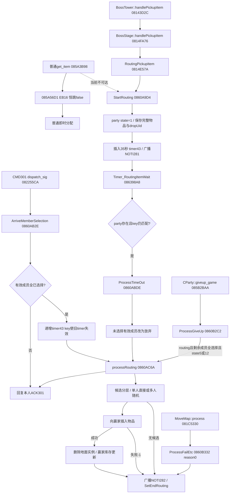
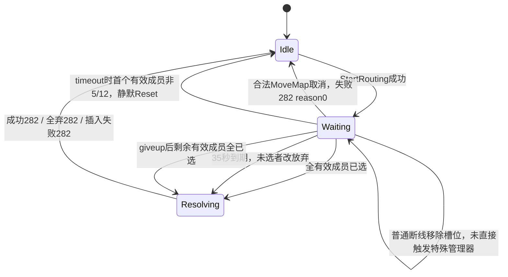

# 官服特殊物品确认分配：完整静态流程

范围：仅调查 `df_game_r.bin`；没有修改产品、样本、补丁、服务或客户端。所有行为均指本样本，不等同于未修改的原版。二进制 SHA256：`8859C99D8290DC5FB58151444138CF2697B2BFFF12D47D6159596A03F20B5261`。

本报告结合父级批量反编译 `../official_full.txt`、`../official_helpers.txt`，并以本目录 `special_disasm.txt` / `special_tables_context.txt` 原字节复核。`special_callers.json` 是按 E8 相对调用扫描得到的辅助交叉引用，虚调用另按 vtable 核实；不把无直接调用当作不可达。

## 1. 先分清两个入口与补丁边界

### 普通副本 CParty::get_item：当前样本入口被绕过

```asm
085A56C9 call CItem::get_rarity
085A56CE 83 F8 04    cmp eax,4
085A56D1 EB 16       jmp 085A56E9
085A56D3            ; 下方 IsRoutingItem 分支当前不可达
085A56D9 call CItem::IsRoutingItem
085A56DE test al,al
085A56E0 je 085A56E9
085A56E2 mov eax,1
085A56E7 jmp 085A56EE
085A56E9 mov eax,0
085A56EE test al,al
085A56F0 je 085A57C9 ; 转普通即时分配
...
085A572E call CSpecialItemRoutingManager::StartRouting
```

该段当前恒走 false，不会由普通 `get_item` 启动确认。`StartRouting` 后续调用块仍完整，但不能把“函数存在”当作该入口可达。只凭本样本无法准确恢复 `085A56D1` 修改前的两个字节、跳转目的或完整条件。BossStage 下述 OR 条件可作对照，不能标为普通副本修改前已证实的条件。本调查没有提出或执行任何补丁。

如果该普通入口能够到达，现存调用参数是 `(manager, 拾取者user, 本次map_item+0x10的Inven_Item引用, 掉落实例UID)`。StartRouting 非0时向拾取者回 CMD46 body=`00 error:u8`，然后本次get_item返回失败；0时返回成功，提前结束get_item，物品仍在地上，等待特殊结算。

### BossStage：另有完整入口，不能说系统整体失效

链为 `CBossTower::handlePickupItem@08143D2C -> CBossStage::handlePickupItem@0814FA76 -> RoutingPickupItem@0814E57A -> StartRouting@0860A9D4`。

`0814FD17..0814FD92` 可见真实条件：party有效成员数>1、BossPlay活成员数>1、`map_item+0`非0，并且 `(item.rarity==4 || item.IsRoutingItem())`。满足才调用RoutingPickupItem。BossTower上层先检查party存在且不处于routing；否则CMD46 error216。

`RoutingPickupItem` 参数 `(user, dropUid, map_item&)`，传 `map_item+0x10` 的完整物品及dropUid给StartRouting。错误回CMD46 `00 error`；成功提前返回，不走即时拾取。没有发现该BossStage入口被与普通入口相同的无条件跳转替换。这里证明的是静态调用链和门槛存在；没有运行Boss模式来证明场景数据在当前环境可达。

## 2. 调用图



## 3. 数据与状态机

`CParty` 本身继承/包含于起始处的 `CItemRoutingData`；这些方法直接把party地址当RoutingData使用。

| 偏移（相对CParty起始） | 内容 | 证据 |
|---|---|---|
| `+0x00` | routing state，存储为DWORD，访问者常按低字节判断；0空闲，1启动 | GetRoutingState 0814575A、SetRoutingState 0860B55E |
| `+0x04` | 完整Inven_Item副本 | SetRoutingItemIndex 0860B576 -> Inven_Item::setCopy |
| `+0x06` | 副本内部 itemId（Inven_Item+2） | GetRoutingItemIndex 0860B53A |
| `+0x44` | dropUid，地面物品实例标识 | GetRoutingItemUniqueID 0860B552 |
| `+0x48..+0x4B` | 4个party槽位的选择状态，0未选、1参加、2放弃 | 085BF694、085BF6B8 |

`Reset@082A52FA`：state=0，Inven_Item::reset，dropUid=0，4个成员状态归0。`SetEndRouting@085BF82A`就是Reset。



资格、已全选、超时转换均重新扫描当时的4个槽位，没有冻结发起时成员快照。`_checkValidUser@085B4D12` 的有效性核心是指针非空、对象UID与槽位记录UID一致、当前角色存在。这里没有额外检查存活标志、进图完成标志、等级或背包可插入性。Boss发起前的活人数门槛与结算候选条件不是同一个概念。

## 4. 开始、选择、超时、退出、取消

### StartRouting@0860A9D4

依次验证拾取者状态为5或12、GetParty非空、物品模板存在；任一失败返回1。若party已经routing返回18。成功时：SetStartRouting把state置1；SetRoutingItem保存完整物品和dropUid；insertTimer；向party广播NOTI281，仅含itemId；返回0。此方法自身不检查人数、rarity、IsRoutingItem、职业、库存容量，也不重置4个选择状态；正常流程依赖上一轮Reset。

### CMD301 -> ArriveMemberSelection@0860AB2E

Dispatcher验证user状态5/12、party存在、成功读到一个choice字节；否则CMD301 error19。GetMemberRoutingState只在有效槽位按user指针匹配；非成员返回-1。仅先前state0可以提交：choice0转state1，choice1转state2。重复选择或非成员返回0，引发error19。

然后HasAllMemberSelection扫描当前有效成员：有state0就false，否则true。全选时cancelTimer、processRouting；最终本次请求回复本人CMD301 ACK=`01`。最后一人提交会先完成库存更新/party NOTI282，再收到自己的ACK301。

实际怪异边界：ArriveMemberSelection不显式检查party正处于routing；choice不为0或1时不改选择状态，但仍可返回1并ACK成功。Dispatcher不校验请求额外字节，也不读取物品ID/dropUid/路由轮次。这些是样本实际代码，不能改写为理想验证规则。

### 35秒定时器

`insertTimer@0860B45C`：`key=party.gen_timer_key(43)`，`TimerQueue::InsertTimer(objType=1, partyIndex, message=43, seconds=35, key, arg=0)`。`InsertTimer@08630E16`对35显式调用 `SECOND_TO_MILISECOND` 再入队，因此不是35毫秒或客户端自带倒计时。NOTI281没有传计时长度。

`cancelTimer@0860B4C2`只再次gen_timer_key(43)，通过递增key使旧事件失效，不物理删除队列。`Timer_RoutingItemWait::dispatch_sig@086398A8`按partyIndex查party，再check_timer_key(43,key)；失败返回0，不调用管理器。

`ProcessTimeOut@0860ABDE`：不处routing就Reset返回1；首个有效成员state不为5或12也Reset返回1，不发送282。否则SetRoutingTimerOver把当前有效成员中state0全部置2（放弃）；HasAll后processRouting。超时默认放弃，绝非默认参加。

### 主动退出 / 断线 / 全员离开

`ProcessGiveUp@0860B2C2`没有给某个成员设置state2的动作，仅在party非空、routing、当前有效成员全已选择、首有效成员state5/12时processRouting。它的唯一直接调用是giveup_game末段085B34E8。

ProcessGiveUp这条成功结算路径没有显式cancelTimer；processRouting结束会Reset。旧事件即便key仍匹配，也会在ProcessTimeOut的非routing分支Reset；若已启动下一轮，下一轮insertTimer已递增key，旧事件不再匹配。

giveup_game@085B2BAA里：普通分支先移除退出者或全员返城，再调ProcessGiveUp；全员返城先battle_data_reset，因此routing已Reset。party+0x13C特殊分支先leave_user并提前跳过末段ProcessGiveUp。故不能笼统说“giveup总会马上结算”。

普通断线链：user_disconnect@08298B48 -> CheckOutParty@08297C76 -> leave_user@0859C114。CheckOutParty及leave_user均不直接调用ProcessGiveUp/ProcessFailEtc。leave_user将离开者槽位指针/UID清零（队长走change_manager）；其后选择/计时结算扫描自然排除无效槽位。剩余有人提交时可能随之完成全选；无人提交则等35秒事件。不是任一断线立即取消或立即广播失败。

Boss断线另外有checkOutBossTower@082981A4通过虚调用进入BossTower::handleLeaveUser@08143AE2 -> BossPlay::handleLeaveUser -> party.leave_user；已读BossTower函数中也没有直接调用特殊管理器。全员离开最终销毁/初始化party；没有仍在线接收者的失败282广播承诺。

### MoveMap / 清理

DisPatcher_MoveMap::process@081C5330在普通转图路径中发现routing时，于081C54A8调用ProcessFailEtc(reason0)，之后继续MoveMap。Boss专属MoveMap可能先在081C5450由Global::CBossTowerFunc::MoveMap处理并提前返回，不能把普通取消钩子泛化到每个模式。

ProcessFailEtc仅当party存在、routing且首有效成员状态5或12时：广播NOTI282失败、cancelTimer、SetEndRouting。条件不满足时什么也不做，不是无条件Reset。

SetEndRouting的其它直接调用包括party.battle_data_reset@0859B0F6、dungeon_start@085A1F8E；这些仅Reset，没有特殊失败广播。

## 5. 候选职业优先与随机选人

`GetRoutingDiceMemberList@085BA294`输出 `(partySlot, characNo)` 的vector。扫描槽位顺序0..3。只接受有效成员且选择state1；分三层，某一层非空就停止回退：

1. 仅当item.IsRoutingItem非0时，收集IsPriorityJob(job,growType)的参加者。
2. 上层为空，收集check_job_type(job)的参加者。
3. 仍为空，收集所有参加者。

职业不匹配不是绝对禁止获取；它决定层级。全员主动放弃/超时放弃得到空vector，不随机给放弃者。

物品字段与方法：IsRoutingItem@08150F18读取item+0xBD；isEpicRoutingItem@0846996A读取item+0x79；rarity在item+0x38。这三个概念不能混为一谈。IsPriorityJob@085BEEC8读取item+0xC0的`vector<pair<int,int>>`，按job完全匹配且grow规范值匹配。grow 1/17→1，2/18→2，3/19→3，4/20→4，其它→0；不是任意`grow&0xF`。check_job_type@0850D728对job>10返回0，否则读取item+0x3C+signed(job)的职业位；没有单独负数防护。

processRouting的winner选择：候选1人则直接get_user(slot)，不掷点；多人max初始-1，对每个候选get_rand_int(100)，大于max则更新winner；小于max就前进；等于max时不前进，给当前这个候选重掷，直到不是当前max。并非所有人平手重来，也不是按characNo选择。候选中characNo只被拷到局部，后续winner仍按partySlot取user。

随机点数不写入NOTI282；包中没有每人骰点、优先层或职业列表。

## 6. 物品预留、插入与失败回退

StartRouting只保存完整Inven_Item副本与dropUid，没有调用pickup_item删除地面物品，也没有在此处检查赢家库存。`DisPatcher_GetItem::process@081C35C0`在081C3888检查party.IsRoutingState；routing时返回error216，故正常拾取入口通过整个party的pending状态阻止再次拾取，不是单独地面条目的预留标志。

processRouting先检查副本itemId非0且模板存在；失败走ProcessFailEtc(reason0)。然后选winner并插入：

| 物品分类 | 赢家库存类型字段 | 插入路径 |
|---|---:|---|
| stackable且GetItemType()==9 | 7 | 普通insertItemIntoInventory |
| 非stackable且IsCreatureItem() | 7 | 普通insertItemIntoInventory |
| 非stackable且IsAvatarItem() | 1 | addAvatarItem |
| 其它 | 0 | 普通insertItemIntoInventory |

虚表已核：CStackableItem vtable+0x18=IsAvatarItem、+0x1C=IsCreatureItem；对象vptr从vtable+8开始，调用vptr+0x10/+0x14分别为这两个方法。IsRandomOption是vptr+0x4C，成功时仅增加日志统计`log_random_option/pick_cnt`，不会改变分配层或再次抽奖。

Avatar路径：genIPGNo(5,赢家characNo)，addAvatarItem(itemId,0,(char)物品+11处word低字节,生成号,15)。普通路径按值传递完整Inven_Item，额外参数 `(4,1,1)`；没有先对候选逐一tryInsert。

返回值**恰等于-1**才是该函数的插入失败分支：广播282 `(0,1,dropUid)`，地面实例保留，结束routing；不改给另一候选，不降优先层，不自动邮件、不销毁地面物品。全弃则广播 `(0,0,dropUid)`，同样保留地面实例并结束。Reset后可以重新拾取/重新进入候选流程（由入口是否可达决定）。

插入成功后才删除地面实例：赢家state5时 `CParty::DeleteDungeonDropItem@0860B62A -> CBattle_Field::pickup_item@0830DAEE`；state12时从赢家的BossTower+0xA18 map中erase(dropUid)。注意Hex-Rays把栈上dropUid误显示为char数组后有`v13[0]`，原指令0860B176读取完整DWORD，不是只删除UID低8位。

普通删除返回>0只记`[EPIC ROUTING] DELETE DUNGEON ITEM FAIL`，仍发送成功282；没有对已插入库存做补偿回滚。此顺序和缺少回滚是样本已证实的边界，不能描述为原子事务。Boss erase结果没有校验。赢家的SendUpdateItem(user,1,inventoryType,inventorySlot)在结果282广播前调用；随后广播282，SetEndRouting清空副本和选择。

## 7. 协议字段表（仅本官服样本，不可直接套ACT1编号）

下列offset从包体0开始，不含传输长度/加密/序号等头。`put_header(0,id)`为通知，`put_header(1,id)`为命令应答。多字节字段按PacketBuf通常little-endian模式；底层实现同时支持另一个endian模式，不能把整包头简单写为此表。表的宽度/顺序由具体put调用已证实。

| 消息 | 方向 | body offset | 宽度 | 字段/值 | 写/读证据 |
|---|---|---:|---:|---|---|
| NOTI281 (0x119) | S→party | 0 | 4 | itemId | 0860AACE put_int |
| CMD301 (0x12D) | C→S | 0 | 1 | choice：0参加、1放弃 | 0822565A get_byte |
| ACK301 success | S→本人 | 0 | 1 | 1 | 0822571F put_byte |
| ACK301 error | S→本人 | 0 | 1 | 0 | SendCmdErrorPacket 0867BFAE |
| ACK301 error | S→本人 | 1 | 1 | 19 (0x13) | 同上，状态/party/短包/重复/非成员 |
| NOTI282 success | S→party | 0 | 1 | 1 | 0860B1CE |
| NOTI282 success | S→party | 1 | 1 | winner partySlot，0..3 | 0860B1E0 |
| NOTI282 success | S→party | 2 | 4 | dropUid | 0860B1F2 |
| NOTI282 success | S→party | 6 | 1 | inventoryType，0/1/7 | 0860B207 |
| NOTI282 success | S→party | 7 | 2 | inventorySlot | 0860B219 |
| NOTI282 failure | S→party | 0 | 1 | 0 | 0860AE91 / 0860B085 / 0860B3B9 |
| NOTI282 failure | S→party | 1 | 1 | reason=0无候选/无数据/取消；1插入失败 | 0860AEA4 / 0860B098 / 0860B3CB |
| NOTI282 failure | S→party | 2 | 4 | dropUid | 0860AEBE / 0860B0B2 / 0860B3E5 |

成功282包体9字节；失败6字节；开始4字节；选择请求1字节；ACK成功1字节/失败2字节。没有计时时长、全员选择状态或逐人骰点广播。NOTI281发起时不含dropUid；选择请求也不回传UID，所以本样本协议依赖party唯一pending item。

例如仅用于静态字段核对：itemId=0x12345678开始body `78 56 34 12`；dropUid=0x11223344、赢家slot2、inventoryType0、inventorySlot0x15时成功body `01 02 44 33 22 11 00 15 00`；插入失败body `00 01 44 33 22 11`。这些字节没有发送给任何客户端。

## 8. 与普通骰子、货币/特殊奖励的区别

确认分配是独立状态机：party唯一pending、先弹窗、每人choice、35秒默认放弃、职业分层、赢家库存插入后删除地面物品。它没有普通骰子中的每人tryInsert筛选、轮转40分、可用职业30分、活/进图标志筛选、指定赢家高点等分数运算。普通自动分配不等CMD301；即使当前样本普通入口跳过确认，普通即时骰子仍是另一条流程，不能把确认当成普通骰子的UI外壳。

该管理器不调用货币均分、复活币保存或特殊奖励发放；它处理的是真实Inven_Item。giveup_game里的SaveCoin发生在退出清理，不能据此宣称特殊确认要消耗或分发币。type9/creature被写inventoryType7也不能直接解释为金币。随机选人、随机属性统计日志、普通自动骰子、特殊奖励/货币分支应分别对齐。

## 9. read/process十字节stub与真实分发

`Dispatcher_BiddingRoutingItem::read@08234186`和`process@08234190`原字节均为 `55 89 E5 B8 00 00 00 00 5D C3`（正常建栈、return0）。附近08234136起有一串相同十字节stub。仅凭大小不能说该handler被patch禁用。

constructor@08597110明确将vptr设为08BD68C8。vtable起始08BD68C0的+0x14指向**完整435字节的dispatch_sig@082255CA**，+0x1C/+0x20才分别是read/process。真正选择读包与应答发生在dispatch_sig，并调用ArriveMemberSelection。全套原字节见special_tables_context.txt。

## 10. ACT1对齐边界与尚未证明的事项

本样本已完整给出服务端状态/选择语义/字段宽度及结果顺序，可以作为ACT1映射时的语义基准；281/282/301只是本官服版本编号。ACT1原生确认窗口RTTI或代码的存在，仍须追到原生通知分发表、发包选择命令和包体消费顺序，才能决定旧号与结构映射。不能从窗口名直接认定字段兼容，也不能继续沿用“必须扩展客户端”的旧判断。本子任务没有客户端静态证据，不替客户端调查下结论。

尚未静态证明/无法由单一样本证明：普通入口被修改前确切字节与条件、改动作者/时间；当前运行环境BossStage实际场景可进入；本管理器接收到的item+0xBD/priority vector在所有PVF模板上的实际值分布；客户端倒计时UI时长及ACT1旧编号；线程调度/断线竞态的动态复现。不得把这些未知覆盖为已确认原版行为。

报告不授权实现高品质确认弹窗，也未发送本官服281/282/301或修改现有ACT1接口。
