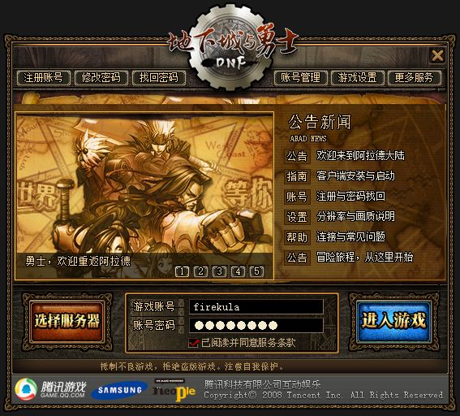
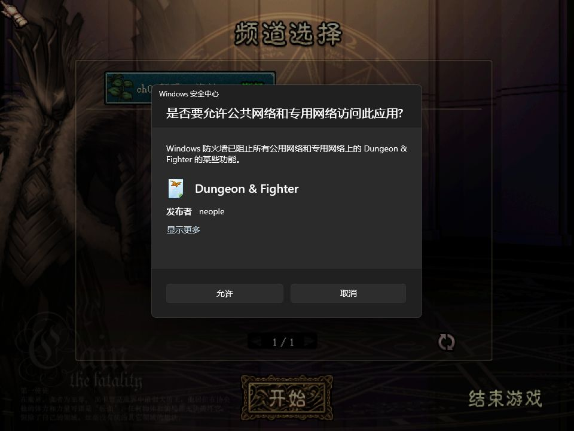

# 固定入口自动修复与天空之城改动验收

日期：2026-11-08。代码与资源仅在隔离工作区、测试副本和 Gitea 测试渠道使用。正式 GitHub 更新、GHCR 镜像及线上服务器未变更。

**更新机制已完成真实双架构验收；玩法代码及模拟测试已完成，游戏内验收仍被 Windows 防火墙授权窗口阻挡。不能据此宣称原始闪退已实机修复。**

## 本轮改动

| 项目 | 实现与边界 |
| --- | --- |
| 原图标启动修复 | `DFLegacy.Launcher.exe` 保持快捷方式目标，作为小型原生入口。完整界面为 `DFLegacy.Launcher.App.exe`，修复程序为 `DFLegacy.Updater.exe`。x86/x64 分别构建。 |
| 修复程序自恢复 | 主程序损坏时使用验证过的缓存副本；修复程序在临时目录运行，可替换客户端目录内的文件。恢复记录只在成功后更新。 |
| 中断恢复 | 先恢复真实安装事务，再校验全部受管理文件、下载差异并复核，最后打开登录界面。保留账号、服务器地址和自定义配置。 |
| 天空之城通关换房 | 最后一个 Boss 已报告死亡、奖励处理中、清场中或已进入结算时拒绝换房，返回错误 19；保留原房间、死亡代次和结算。尚有 Boss 存活、普通房和地狱遭遇的原规则保留。 |
| “牛来” | 精确普通地图聊天命令；仅当前存活的单人副本角色生效。把已出现且未在领取中的地面物品移动到脚下，可重复执行；不自动拾取，不新增物品，不动未开启容器掉落。 |

## Gitea 实际更新结果

测试发布：[v0.1.8-giteatest.3](http://firekula.site:3000/firekula/DFLegacy/releases/tag/v0.1.8-giteatest.3) → [v0.1.8-giteatest.4](http://firekula.site:3000/firekula/DFLegacy/releases/tag/v0.1.8-giteatest.4)。两版各提供 x86/x64 × normal/test 四变体；发布后重新匿名下载验证摘要及 HTTP Range。`.4` 的客户端源码提交为 `51935167e3cd43e7fa377340173b43c3ec08b69c`。

| 实际故障/操作 | x86 | x64 |
| --- | --- | --- |
| 旧 `.2` 从原快捷方式迁移到三程序布局 `.3` | 通过 | 通过 |
| 删除 `DFLegacy.Launcher.App.exe`，再开原图标 | 自动修复通过 | 自动修复通过 |
| 同长度篡改 `DFLegacy.Launcher.App.exe` | 自动修复通过 | 自动修复通过 |
| 删除或同长度篡改主 `DFLegacy.Updater.exe` | 两项均通过，使用恢复副本 | 两项均通过，使用恢复副本 |
| 网络不可达，本地完整 | 校验后允许启动 | 校验后允许启动 |
| 网络不可达，本地损坏 | 拒绝启动；恢复联网后修复通过 | 拒绝启动；恢复联网后修复通过 |
| 真实 `.3`→`.4` 安装中断 | 写入 App 后终止事务进程；原图标恢复通过 | 写入 Updater 后终止事务进程；原图标恢复通过 |
| 测试版从 Gitea 更新新游戏 DLL | `.4`、8 个文件校验通过 | `.4`、8 个文件校验通过 |

中断实验使用生产 `InstallTransaction.Apply`，在真实持久化日志已落盘后暂停并终止测试工作进程，没有伪造恢复日志。最终两端均无 pending 事务、完整文件校验通过且登录窗口已创建；快捷方式摘要和原账号配置保持。x86 中断恢复首次观察器的 180 秒截止先到，原进程稍后自行完成，未再次启动；报告保留此慢启动事实，不将初次超时隐藏为全程无异常。x64 对应恢复耗时 41.9 秒。

以下为 `.2`→`.3` 后实际登录界面，原图标继续使用：

主更新程序和 App 使用相同构建字节，下载缓存按摘要复用；磁盘上仍是独立文件。`.3` 与 `.4` 的小型原生入口字节不变。如果原生入口本身被删除，或所有修复副本一起损坏，仍需恢复完整 starter ZIP；当前不是对所有文件破坏的无条件恢复承诺。

双架构程序均在本机 64 位 Windows 上测试，x86 使用系统兼容层；没有据此宣称已在真正的 32 位 Windows 或 Windows 7 实机通过。

## 玩法验证结果

| 验证 | 结果 |
| --- | --- |
| 最终服务端完整协议/玩法 smoke suite | 全部通过 |
| Boss 房与组队换房专项 | 先复现结算后 7 项失败、提前死亡窗口 14 项失败，修复后均通过 |
| 单人“牛来”权限与通知 | 正常账号通过；组队、死亡、城镇、PvP、外来角色、停止实例及非精确命令被拒绝 |
| 原生游戏补丁 | Release 构建、49/49 CTest 通过；包含真实裸钩子 ABI、受保护坐标、角色/房间身份和物品元数据保留测试 |
| 真实 PVF 天空之城模拟 | 副本 11–17，各 20 固定种子，单人/双人队伍、四死亡阶段，共 1,120/1,120 场景、63,432 项检查通过 |
| 正常流程反向检查 | 280 次普通相邻返回、40 次双 Boss 首只死亡后返回通过；五秒清场补偿和最终结算继续有效 |
| 实际游戏内移动物品、拾取、立即过门与闲置 | 待授权窗口处理后继续；尚未获得运行现场通过证据 |

PVF 模拟读取实际 `Script.pvf`，没有改动资源。17 号副本采样到的本来就是同一竖直布局，其余副本覆盖 4～6 种布局。模拟数据不是客户端战斗、动画或崩溃复现；详见 [真实 PVF 结果](results/skycastle-real-pvf-simulation.json)。此前一次完整测试的 OS 文件租约断言失败，单独重跑通过；最终源码完整复跑已全部通过，原失败原因未作未经证明的归因。

登录器完整测试 2,120 项断言、UpdateCore 702 项断言通过；固定原生入口各架构 24 组过程测试通过；发布打包测试 179 项及 83 个子测试通过。

## 实机阻挡与待继续项目

隔离 `.4` 游戏已通过启动进入频道选择；进程中实际加载了新 `DFLegacy.Client.dll`，日志确认 `installed-849280`，即“牛来”原生钩子的实际客户端签名匹配并安装。系统弹出防火墙权限提示，按电脑控制技能不能代替用户点击安全权限确认。没有修改系统防火墙规则，也没有关闭安全防护。

授权后仍需验证：最终 Boss 死亡立即尝试过门、原房间静置、结算回城；“牛来”重复归拢、新掉落、手动拾取和组队拒绝。特别是用户报告的自动死亡与闲置闪退，当前只能确认并修复导致结算状态丢失的服务端路径，不能把模拟通过等同于原始崩溃已消失。

## 产物、身份与保护范围

- Gitea `.4` 新 `DFLegacy.Client.dll`：`38a7dad0e3b997ef6c5125092cf8e63e90450c12a5576155ed9c96502cf5081f`；两端通过热更安装的摘要一致。
- 本地最终服务端 DLL：`482ea92b0648ab357bdeb4fc18133372c61e7b755fdc6583e9d75bf1b4ca33d0`。
- 实际 PVF：`09e5eefdee0777378a967704eb14c175383eef89ca0f4e27e00dd3409af728cb`。
- 原客户端 `G:/dnf_local/DNF_2008` 的 **855 个文件逐个复核，全部保持，未新增文件**。见[保护校验](results/original-client-preserved.json)。
- 隔离服务器及新测试副本：`G:/dnf_local/DFLegacy_Bootstrap_Test_20261108/`。其中 `x86/x64` 用于自动修复，`game-x86/game-x64` 是已更新到 `.4` 的玩法测试版。
- 原有 Gitea 测试副本 `G:/dnf_local/DNF_2008_Gitea_V4_x64_20261108` 曾在完整备份后临时用于本地启动，现已恢复，883 个文件与备份逐个核对一致，未遗留新增文件。见[恢复结果](results/prior-gitea-copy-restored.json)。当前待继续的客户端使用新根目录中的 `game-x64`。
- starter ZIP：`C:/Users/Firekula/Downloads/DFLegacy-Bootstrap-Gitea-Test-20261108/starters/v0.1.8-giteatest.4/`。它们是测试启动修复包，游戏本体和真实 PVF 不包含在这次公开测试资源里。
- Gitea 标签仅用于测试附件；构建源提交记录在清单内。没有推送正式分支、正式 GitHub Release 或 Docker 镜像。

原始测试结果见本目录 `results/`。测试配置、账号密码和进程内存转储没有放入公共 Release。

报告收尾时本地测试服务器（`127.0.0.4`，PID 48052）和新版测试游戏（PID 44068）保持运行，供处理系统授权后继续验证。没有停止其他工作区或 VS Code 的 SSH 转发。
