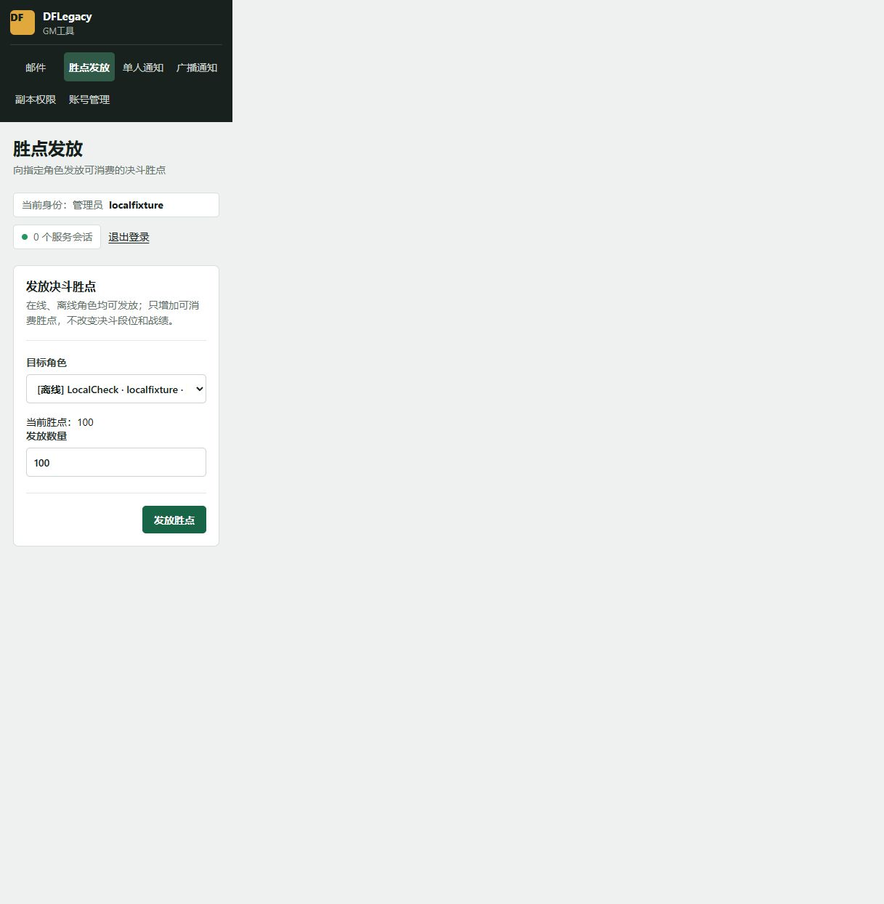
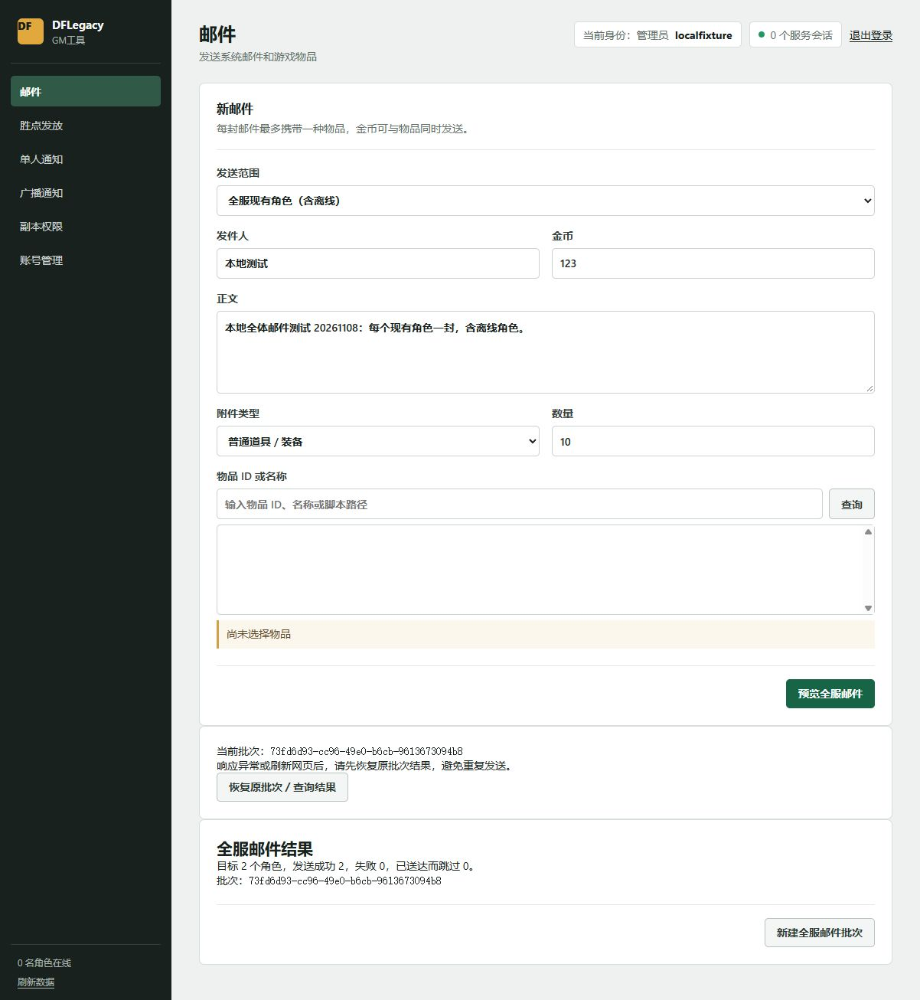

# 本地 GM 邮件与胜点验收

2026-11-08，地址 `http://127.0.0.4:18081/`。全部操作仅针对 `G:/dnf_local/DFLegacy_Bootstrap_Test_20261108` 的隔离测试存档，没有向线上角色发奖励。

## 发现并修复

1. 先前本地进程的工作目录为 `server/`，静态文件实际位于 `server/bin/wwwroot/`，日志记录 WebRootPath 不存在，首页返回 404。以 `server/bin/` 为工作目录重新启动后正常，不修改持久化配置或存档。
2. `WebPanelHosting` 的 GM 端口路由只允许 `admin.js`，遗漏页面引用的 `admin-rewards.js`。补充精确路径白名单，玩家端口仍拒绝该资源。新增真实 HTTP 回归先出现 1 项失败，修复后 0 失败。未扩大为任意目录放行。

网页验收时本地进程为 PID 4160，服务端 DLL SHA256 `dc30eabd6c70d3d12b5403d1c2c32fed9950ca0fadc95f76306139a04f8e0fa8`。服务重启后已重新启动隔离测试客户端，用户完成在线胜点实测。没有重启或更改线上服务。

## 真实后台操作

| 本地角色 | 发放前胜点 | 发放后胜点 | 全体邮件 |
| --- | ---: | ---: | --- |
| LocalCheck | 0 | 100 | 1 封：123 金币＋10 个碎布片（3030） |
| SummonCheck | 0 | 200 | 1 封：123 金币＋10 个碎布片（3030） |

上表记录两名角色离线时的网页验收快照，不代表后续在线测试后的余额。已通过实际网页提交，随后读取实际存档核对胜点与邮件附件；未改变决斗经验。该快照采集时邮件尚未在游戏内领取，本轮没有另行确认游戏内领取结果。

随后重新启动本地测试客户端，用户自行进行在线胜点发放，并于 2026-11-08 明确反馈“在线发放胜点测试通过了”。该项作为用户实机确认记录；未另行采集这次发放的数量或截图。

全服邮件先预览 2 个接收角色，核对预览时存档仍为零封邮件，再取消并重新预览、确认发送。结果为成功 2、失败 0。随后刷新页面并点击“恢复原批次／查询结果”，仍显示同一批次；最终逐角色核对，均只有 1 封匹配邮件。

批次：`73fd6d93-cc96-49e0-b6cb-9613673094b8`。正文为“本地全体邮件测试 20261108：每个现有角色一封，含离线角色。”

后台已经登录并保留打开，用户可以切到“胜点发放”继续操作。测试账号与凭据未放入本报告。

## 自动验证与范围

- Release 构建：0 警告、0 错误。
- WebPanelsSmokeTests：RED 1 失败，GREEN 0 失败；覆盖 GM 实际页面的所有本地脚本与玩家端口隔离。
- AdminRewardStoreSmokeTests：0 失败。
- 真实 HTTP 奖励验收：29 项检查通过，包括操作去重、不同内容复用 ID 拒绝、预览名单冻结、新角色不补发、非管理员拒绝、服务重启后回执和奖励保持。
- 完整 SmokeTests：退出码 0，输出 `All DFLegacy protocol smoke tests passed.`。先前从外置构建目录运行时，因向上搜索不到源码树中的 MentorGold 夹具而中断；将同一份已构建测试程序复制到本工作树 `.tmp/gm-rewards-verification-20261108/bin/Release/net10.0/` 后重新执行通过，没有修改夹具或放宽断言。执行日志保存在该临时目录上级的 `full-smoke.log`。

本轮完成两个离线角色的网页发放、预览取消和刷新恢复，在线胜点生效由用户实机确认。满邮箱部分失败等边界没有重新进行游戏内验收。结构化核对见 [verified-results.json](verified-results.json)。本次源码和文档仅推送 Gitea 开发分支，不创建新的发布标签、镜像或客户端更新，线上版本保持不变。
