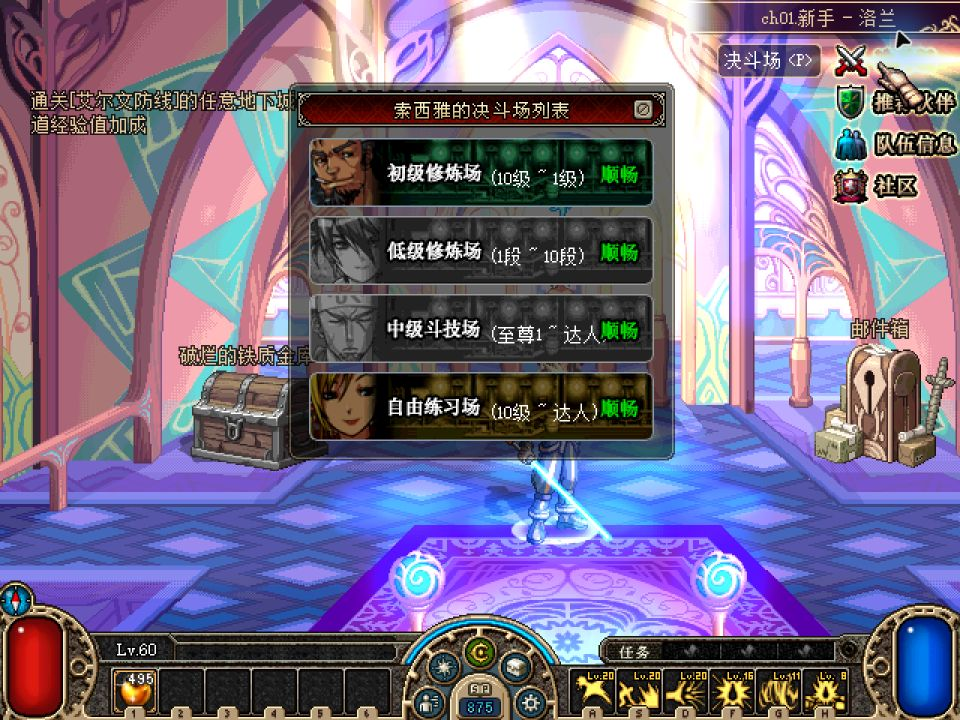
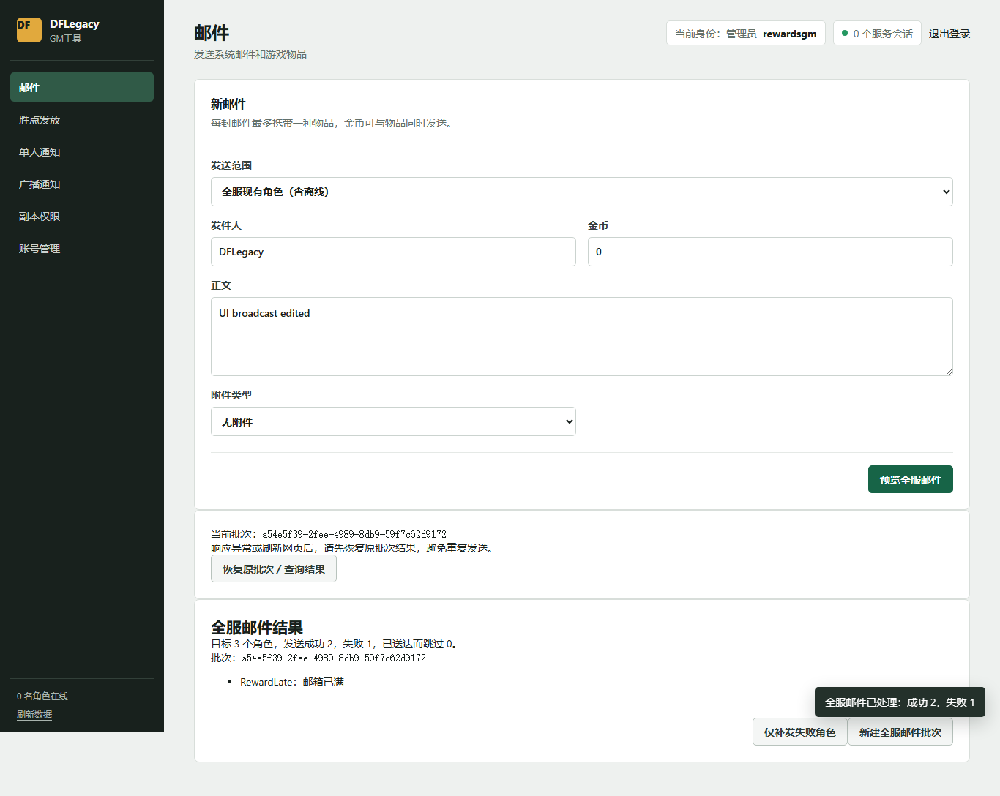

# 第一章决斗频道与 GM 奖励验收（2026-11-07）

本轮在 `codex/pvp-gm-rewards` 隔离分支实现并本地验证。验收阶段未推送或发布，未操作线上存档或奖励。后续组队战和擂台赛已在其上补齐，用户现要求同步全部源码与文档并停止本地测试服务器；后续发布范围为v0.1.7服务端镜像和GitHub源码快照，客户端附件暂不发布，参见[后续验收](2026-11-07-pvp-team-relay.md)。第二章工作区保持不动；此前暂停的 LaunchFlow 启动顺序改动仍在原 stash，旧的 `ACT1_LOCAL_ACCEPTANCE.md` 未并入本轮。

## 实现结果

| 功能 | 结果 |
| --- | --- |
| 初级决斗频道 51 / TCP7004 | 段位索引 0–9 |
| 中级决斗频道 52 / TCP7110 | 段位索引 10–19 |
| 高级决斗频道 53 / TCP7111 | 段位索引 20–PVF 最高段位，本轮为 30 |
| 自由决斗频道 55 / TCP7112 | 不限段位，覆盖 0–30 |
| 房间隔离 | 列表、人物模型、座位、删除广播限定本频道；拒绝跨频道房间 ID |
| GM 胜点 | 在线、离线均可增加可消费胜点；在线刷新，不改经验、段位或战绩 |
| 全服邮件 | 固定预览时的现有角色名单，含离线；每角色一封，显示失败并可仅补发失败对象 |
| 防重复 | 操作与回执同一存档提交；重启、并发重试不重复发放；浏览器刷新保留待核对 ID |
| 客户端 | 双架构配置包含新端口；旧标准 PvP Relay 配置在内存补齐，保留服务器、账号、自定义端口 |

原版入口列表的档位名称仍使用原版内置文字；进入后频道标题分别显示初级、中级、高级、自由。

## 实机与网页证据

复制 `G:/dnf_local/ACT1-local-validation-20261106/client` 到独立 `G:/dnf_local/Pvp-gm-validation-20261107/client`，使用本轮 x86 登录器及配套 PVF。服务器仅绑定 `127.0.0.4`，使用复制的测试存档。建立段位索引 0、10、20 的三个测试角色，实机依次进入 51、52、53、55，完成普通频道与决斗频道之间的切换，未发生连接失败或崩溃。测试进程已停止。

本次 x86 程序运行在当前 64 位 Windows 主机，未进行旧 Windows 7 或真正 32 位系统的兼容性验收。



GM 页面使用真实隔离 HTTP 服务与 Chromium 自动测试：发胜点、预览取消、修改内容后重新预览、成功两角色／满邮箱一角色、仅补发失败角色、普通单角色邮件均通过。额外在服务端成功提交后中断响应，刷新网页，再用原操作恢复；胜点和邮件都未重复发放。



## 自动验证

| 检查 | 实际结果 |
| --- | --- |
| 完整服务端协议 SmokeTests（含新增用例） | 通过，`All DFLegacy protocol smoke tests passed` |
| GM 存储及在线加密会话 | 通过；写入故障、隔离、重启回执、并发发放／结算、实例 ID、补发族、满邮箱 |
| 四频道加密协议 | 通过；段位 0/9/10/19/20/30，各档入场、最高段位、自由频道及普通频道 |
| 抢占会话时结算降段 | 先复现失败两条，再通过；段位 20 弃权到 19 后拒绝高级入场并释放新租约 |
| HTTP / GM 浏览器 | 38 项检查通过，含匿名401、玩家403、重复/未知 ID、编码、部分失败及响应丢失恢复 |
| 完整登录器套件 | 1,995 条断言通过；使用真实旧版补丁 ZIP 和原生夹具 |
| 新 Relay 配置测试 | 5 条断言通过；旧列表补齐、定制保留、UDP不变、关闭 Relay 不解析／绑定 |
| Manager 套件 | 97 检查通过，含 x86/x64 实际导出配置和端口冲突 |
| Relay 核心 | 10/10 通过 |
| 原生频道切换测试 | 退出码0 |
| 离线打包器及最终 Server 构建 | 通过，0 警告、0 错误 |
| 双架构 client-assets 与四个 V3 更新包 | 清单、摘要、架构验证通过；四包均含相同新 PVF |

主要复测命令：

```powershell
dotnet run --project tests/DFLegacy.SmokeTests -c Release -- --admin-rewards
dotnet run --project tests/DFLegacy.SmokeTests -c Release -- --pvp-multichannel
dotnet run --project tests/DFLegacy.SmokeTests -c Release -- --pvp-admission-race
dotnet run --project tests/DFLegacy.Manager.Tests -c Release
python -m tools.debug.verify_pvp_channels G:/dnf_local/PVF-exports/Script-act1-20261107-pvp-channels.pvf
```

HTTP/网页复测入口为 `tests/acceptance/test_admin_rewards_http.py --ui --server <Server.dll> --pvf <PVF> --workdir <测试目录>`，自动创建测试账号和存档，不使用线上地址。

**已知基线限制：**额外设置 `DF2008_REAL_PVF_PATH` 后运行通用全套测试，有 8 条旧断言失败，涉及旧归档条目数、sptable、Cera 价格／商品和宠物进化任务。对已发布输入 PVF 与本轮导出 PVF 各完整运行一次，失败列表完全一致。本轮未改这些表或放宽旧断言，不能称这组额外检查全部通过；需单独整理匹配当前 PVF 的旧夹具。

## PVF 与本地产物

- 输入：`G:/dnf_local/PVF-exports/Script.pvf`，SHA256 `09e5eefdee0777378a967704eb14c175383eef89ca0f4e27e00dd3409af728cb`。
- 输出：`G:/dnf_local/PVF-exports/Script-act1-20261107-pvp-channels.pvf`，SHA256 `c2321f05953ae4484dc6d0b10db50f83c3251c4967cdd0859376d4f8acdf27f4`。
- 导出工具：`tools/pvf/ExportPvpChannels.java`，使用 PVFStudio pvf-core。拒绝源摘要不符、覆盖源文件或已存在输出；导出后检查全部 48,327 条内容，只有 `etc/channel_info.etc` 和 `etc/pvpchannellist.etc` 改动。原文件未变；其他任务、掉落、偷学技能等条目逐字节一致。
- 双架构离线打包素材：`artifacts/pvp-gm-20261107/client-assets-final.zip`。
- 素材身份：`dev-20261107T095915Z-3524a3e74dc5` / `3524a3e74dc5e85c62c437fb5ed153bd001dda5b`。解压后在离线打包器选择包含 `client-assets` 子目录的那一级目录。
- 本地更新验证包：`artifacts/pvp-gm-20261107/final-updates/`，四个 V3 普通／测试版 x86/x64 ZIP，均未上传。素材版本与提交以其 `manifest.json` 为准。
- 详细执行日志和其余实机截图保存在 `artifacts/pvp-gm-20261107/evidence/`，为本地文件，不随源码发布。

Windows 本地素材构建遇到暂存目录原子重命名拒绝访问，验收脚本改用复制到新目录，再运行相同正式白名单／摘要／架构验证；未改正式发布工具。此处验证了本地产物内容，未验证 CI 或线上发布路径。

## 复核与处理取舍

一次独立完整分支复核发现两项重要问题：租约抢占后的段位复查，以及浏览器刷新丢失待核对奖励 ID。均新增先失败后通过的回归测试，再重跑完整服务端套件；无遗留重要项或单列的小问题。

执行决定及影响：

- 已确认的方案直接分解实现，未再增加批准步骤；不扩大本次授权范围。
- 名单冻结于持久化预览，使预览人数和实际发送相符；预览后新建角色不会接收，需要另建批次。
- 补齐 Manager 测试项目已依赖的 `UpdateSafety/UpdateModels` 源码引用，使原有校验能编译；仅增加测试对生产源文件的依赖。
- ACT1 PvP 明确限制服务器组1、共享存档单进程；其他组部署需先迁移配置或另做适配。
- 8 条相同真实 PVF 旧夹具失败单独报告；未扩大本轮为商城／宠物修复，相关额外套件仍未全绿。
- 独立复核未认证的四频道原生验收已由本轮实机补齐；真实线上防火墙、部署及发布仍留待单独授权和验收。
- 暂停的 LaunchFlow 修复和旧验收文件保持原状态；本轮未包含该独立改动。

部署时仍需将服务端和客户端 PVF 同步更新，并在原 Compose 中新增 `"7110-7112:7110-7112/tcp"`，放行相同 TCP 防火墙规则。18081 GM 面板继续使用游戏管理员身份。
