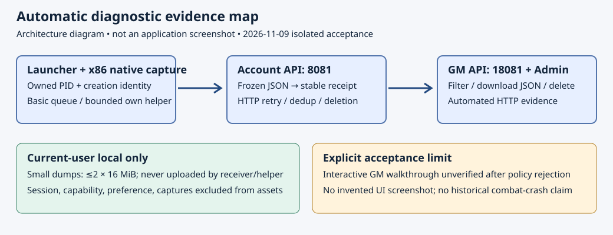

# 2026-11-09 自动基本故障报告：隔离打包与验收

当前处于源码与集成审阅阶段。`.5` 是构建自 `b4fa376` 的不可变中间快照，**不包含之后本地补充的助手执行前完整性校验**。最终全分支审阅及代码修订后，仍须一次新的不可变测试标签构建／发布／四变体真实修复，以及匹配优化 Release 原生符号的私有保存；这一步尚未完成，不能由 `.5` 的结果替代。

本轮完成客户端助手接线、自身文件占用的更新交接、两架构打包、真实 Gitea 四变体更新／修复以及自动 HTTP／原生回归。正式版本号不变；不合并 main，不推送源码，不发布 GitHub／GHCR。

**交互式 GM 页面走查和完整打包 CLI 会话端到端仍未验证，具体边界见文末。** 下图是明确标注的结构／证据示意图，不是应用截图。

## 实际发布及来源

- 隔离预发布：[v0.1.8-giteatest.5](http://firekula.site:3000/firekula/DFLegacy/releases/tag/v0.1.8-giteatest.5)，Gitea release ID **3720**；全部资源先以 draft 上传校验后才公开，四清单匿名整文件 hash／长度及 Range 校验通过。
- 实际构建源码提交：`b4fa376e781f3d157e56d206eb6241774a8bd8e4`；标签使用已有公开提交 `aca790d0070da5c6e0d354c649c3355e9b79afc3`，两者明确分开记录，不声称远端标签对应本轮未推送源码。
- 四个固定入口与 `.4` 对应架构字节一致。普通版管理 9 个公共文件、测试版 10 个，均包含对应架构的自包含 `DFLegacy.Diagnostics.exe`、x86 `DFLegacy.CrashCapture.exe`；测试版另外包含 `debug.dll`。
- 构建输出位于 `C:/codex-build/client-diagnostics-20261109`；大文件交付位于 `G:/dnf_local/DFLegacy_Diagnostics_Artifacts_20261109`。其 `handoff.json` 保存实际构建提交、文件／清单／安装包 SHA256 和私有符号来源；会话、队列、偏好、报告、转储及凭据不进入 Gitea 资源。

## 四变体真实更新和修复

使用对应 x86／x64 自包含测试宿主，调用生产 `RepairClient.RunAsync` 控制路径，接收真实 Gitea metadata／资源；只在新分配的 G 盘隔离目录内安装 `.4` 基线并升级 `.5`，不启动游戏。测试宿主将用户诊断存储注入自己的目录，不接触真实 LocalAppData。

| 变体 | 管理文件数 | 上传助手原始字节 | 缺失助手后实际重取字节 | 最终完整校验 |
| --- | ---: | ---: | ---: | --- |
| x86-normal | 9 | 69,183,411 | 69,183,411 | 通过 |
| x86-test | 10 | 69,183,411 | 69,183,411 | 通过 |
| x64-normal | 9 | 73,652,147 | 73,652,147 | 通过 |
| x64-test | 10 | 73,652,147 | 73,652,147 | 通过 |

每个变体均验证：升级后仍保留当前用户“关闭基本上报”的选择，即使复制的 JSON 默认 enabled=true；删除助手并清除其完整文件／分片缓存后，真实远端重新下载恰好对应字节；停用联网时再次删除助手会阻止放行；恢复联网后完整校验且无未决事务。每架构 **10 项断言、0 失败**。x86 第一次运行遇到 QQPCMgr RTP Service 文件占用，真实预检拒绝提交；后续新夹具完成。测试只等待并重试原预检，没有终止该进程或绕过锁。

受管理助手缺失／损坏时，离线启动仍遵守可信清单的完整性要求；有效安装进入运行阶段后，助手缺失／失败保持游戏容错。两种边界不混淆。

## 默认启动时的自身占用

实际 `UpdateController` 回归在默认开启的启动顺序中保留一个拥有的 helper 子进程，运行实际 `DiagnosticHelper`，同时持有待更新助手文件的真实 Windows 文件锁。检查／下载期间它仍存活；安装前向自身 capability 会话写关闭标记，等待其保留句柄退出后才预检；故意让交接失败后，重新启动助手，安装错误及后续事故均进入新队列。

该生命周期测试最终 **12 项断言、0 失败**，包含四个并发关闭调用下有效且被读取的关闭标记复用、错误 capability 和损坏标记修复。旧重复关闭会替换同一文件而触发真实 UnauthorizedAccessException；本轮改为只复用同一有效 capability 标记。最长等待 12 秒，助手收尾预算最多 10 秒；不按名称／PID 搜索并杀进程。活游戏及原生现场助手继续受到既有更新占用排除保护。

这是注入当前用户根的实际控制器／核心助手进程测试；没有将它冒称为生产打包 helper CLI 的完整会话端到端。

## 本地补充：助手执行前完整性校验

默认 Configure 发生在更新检查之前，原 `.5` 实现只检查助手存在及无链接，可能先执行哈希不匹配的有效 EXE。本地修订在 Process.Start 之前读取安装记录中的助手大小／SHA256：V4 记录优先，损坏记录或未受管理的助手不能通过旧清单回退；旧 schema-2 只接受有效且包含该助手的记录。没有可信身份、哈希／大小错误时保持本地记录并等待更新修复，不执行该程序。校验文件句柄不共享写入／删除，并保持到创建进程返回，避免校验后替换。

回归先使用真实有效 EXE 配合错误哈希、截获创建调用，RED 为 11 项／9 失败，未实际执行任何不匹配程序；修复后扩展到 **13 项／0 失败**。匹配的 V4／旧清单正例还实际启动自己的无害子进程，验证校验句柄保持期间 Windows 可正常创建进程。完整最新本地源码 Launcher **2110 项断言通过**，日志见完整任务报告；这些本地修订须进入后续最终新标签，未改写 `.5`。

## 打包接线与成本

现有登录器是自包含单文件，没有可供第二个程序共享的松散 .NET 运行时。本轮按集成裁定采用独立自包含助手，维持固定入口和单文件修复合同，无需全局安装 .NET；V4 继续只下载变化文件。

x86 上传助手 **69,183,411 字节（约 65.98 MiB）**，x64 **73,652,147 字节（约 70.24 MiB）**；两者均另带同一 x86 本地捕获器 **212,480 字节**。这是明确增加的运行时下载成本。下表为完整 starter ZIP，不等同单次差分更新流量。

| starter 变体 | ZIP 字节 | SHA256 |
| --- | ---: | --- |
| x86-normal | 243,956,168 | `e01b9c47e90d9042b722b8fc841889cfede793382d7e5f9f1c823e7333be112a` |
| x86-test | 244,119,112 | `cad9e7ba6c5901d96ed7fefedf0266b9c51db1f77983f49e6375d70d873fcd82` |
| x64-normal | 259,157,268 | `8662ae72a5ac6eb12c5ec39809a33ca191c69b37264392095896b6421ac6d316` |
| x64-test | 259,320,218 | `38adddb1f89b7986b15edc519006249c072533b65bc9bedbc8d803e471899d4b` |

`legacy-utc/client-assets` 及六个 `legacy-utc/packages` ZIP 使用 UTC 开发标识 `dev-20261109T035128Z-b4fa376e781f`，由同批实际二进制构建并验证。旧 schema-2 包仍可读取，新生成的包要求完整助手对。实际 Manager 四变体导出逐个核对对应上传助手及捕获器的 SHA256、私人数据排除和 8081／18081 配置；离线打包器使用同一已验证资源构建入口。早期未发布的本地时区开发标识输出保留，不作为交付版本。

## 最新测试证据

| 范围 | 结果 |
| --- | --- |
| 最新本地源码完整 Launcher | 2110 项断言通过（`.5` 构建源码当时为 2097 项） |
| Diagnostics Core | 87 项断言、0 失败；文件符号链接权限测试按既有条件跳过 |
| Update Core | 702 项断言通过 |
| Manager，含真实 HTTP | 174 项、0 失败 |
| release Python 整套 | 150 项通过 |
| 原生捕获完整夹具 | 24 种模式通过，含并发、恢复、错误身份、原始上下文及转储限额 |
| 服务器诊断实际 Kestrel | 0 失败：监听端口／角色、重试去重、丢响应／重启、筛选、下载、状态、删除、限额 |
| 完整协议 smoke | 最终通过；首次完整运行出现一次 skill-slot rename UnauthorizedAccessException，独立重跑通过，保留原记录；增加异常堆栈可观测性后的完整重跑通过，未推断其根因，未改游戏逻辑 |
| 实际打包 x86／x64 CLI | 只执行无会话命令：精确完整 third-party-notices、无配置／日志写入；Diagnostics 无效参数返回 2 |

CPU／内存及首个枚举显示适配器的有限查询可用；本机只读投影实际取得 GPU 驱动 `32.0.21030.2001` 和适配器报告容量 `17,163,091,968` 字节。游戏实际 renderer／分辨率／窗口／适配器／DPI 未被观察，保持 unknown。`system.processArchitecture` 是收集器架构，`uptimeSeconds` 是 OS uptime，顶层 architecture 才是事故生产者架构。本轮没有自动上传 PVF hash 的验收声明。

新接收器／上传助手不提供原始转储上传能力。已知 ACT1 BugTrap 历史外传抑制只适用于[明确验证的原版哈希](../../knowledge/decisions/2026-11-09-native-diagnostic-capture.md)，不向未知第三方模块推广该保证；历史战斗故障／旧 CrashSender 复现仍未验证。

## 保护与未验证范围

7 个原客户端关键文件 hash 与基线一致；Gitea main 仍为 `aca790d0070da5c6e0d354c649c3355e9b79afc3`，GitHub main 仍为 `e85dd6aba5d29da63360f1e621568249ec0f4d31`。第二章、线上配置／存档和 GHCR 没有操作；未测量线上存档 hash 或 registry digest，不宣称已测量。Windows 主机为 build 26300 x64；未完成物理 Windows 10 或 32 位 OS 验收。

原 `.5` 原生 Release 构建没有对应独立生产 PDB；已有托管符号按 CI 设置内嵌，来源及二进制 hash 保留在私有 handoff。保留的两个独立 PDB 属于原生 presenter 测试，不冒称为发布补丁的匹配符号。最终纠正构建仍必须生成并私有保存与自有 DLL 精确匹配的优化 Release PDB、GUID／Age、hash、构建 SHA；不进入清单或 Gitea。原始 DNF 无符号是另一范围，不能替代此要求。

真实用户 LocalAppData 已有历史数据，因此没有运行会创建真实用户会话的打包 `--repair-client`／`--self-test`；完整打包 CLI 会话端到端仍未验证。上述真实远端修复通过注入根的测试宿主调用生产路径完成，不能替代该范围的声明。

交互式 GM 走查仍未验证：父任务启动隐藏本地服务并 POST 夹具的操作被自动审批检查以 generic blocked-by-policy 拒绝。没有用其他工具或脚本改道重试，没有伪造 UI 截图。上面的示意图和自动 HTTP 证据分别标明用途。
