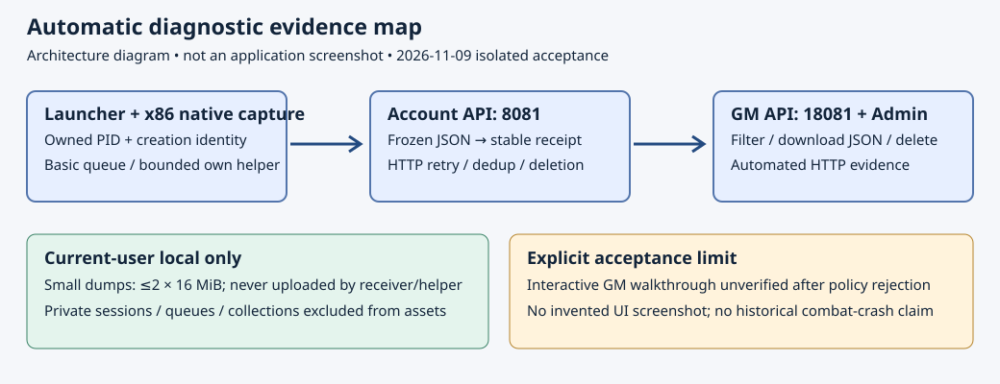

# 2026-11-09 自动基本故障报告：最终隔离验收

最终不可变测试版本 **[v0.1.8-giteatest.6](http://firekula.site:3000/firekula/DFLegacy/releases/tag/v0.1.8-giteatest.6)** 已发布并完成四变体真实修复、公开资源隐私检查、匿名完整 hash／长度／Range 验证及匹配生产符号私有保存。正式版本号不变，不合并 main，不推送源码，不发布 GitHub／GHCR，不改线上服务或原客户端。

**实际构建源码为 `64f5ab5e2b8cf1f7681c43d7b19f14644f427ecc`**；远端标签使用已有公开提交 `aca790d0070da5c6e0d354c649c3355e9b79afc3`。两者分别记录，不声称未推送的本轮源码存在于远端标签。本文之后的报告提交仅改变文档，不改变本次构建来源。

交互式 GM 走查、真实用户配置下完整打包 CLI 会话，以及历史战斗故障复现仍未验证。下图是明确标注的结构／证据示意图，**不是应用截图**。

## 构建、公开与来源

- Gitea release ID **3721**，prerelease。先以 draft 上传并核对完整四清单及资源，全部通过后才公开；公开后再匿名下载验证完整长度／SHA256 和 Range。没有宣称 draft 不支持时也能“公开前匿名验证”。
- 新构建目录 `C:/codex-build/client-diagnostics-final-20261109-v6`；交付目录 `G:/dnf_local/DFLegacy_Diagnostics_Final_20261109_v6`；真实修复夹具位于 `G:/dnf_local/DFLegacy_Diagnostics_Release_Test_20261109/final-v6-run01`。
- `handoff.json` 保存构建 SHA、标签目标、四清单／starter／同批旧格式包身份；`remote-verification/v0.1.8-giteatest.6.json` 保存最终发布验证结果。初建记录中的 draft=true 只表示当时的草稿状态。
- 固定原生入口保持 `.5` 对应架构的原始字节。普通版管理 9 个公共文件、测试版 10 个，均有对应架构自包含 `DFLegacy.Diagnostics.exe` 及 x86 `DFLegacy.CrashCapture.exe`；测试版另含同次构建 `debug.dll`。

## 四变体真实更新与修复

分别以 x86／x64 自包含测试宿主，**调用生产 `RepairClient.RunAsync` 控制路径**并访问真实 Gitea，在新建隔离目录从精确 `.4` 基线上升到 `.6`。测试输入明确指定 expectedVersion，不把 `.5` 常量当最终目标；所有账号／诊断地址和可选服务器配置均为隔离 loopback，用户诊断存储注入自己的目录，没有进入真实 LocalAppData。

| 变体 | 管理文件 | 上传助手原始字节 | 删除助手及其缓存后实际重取字节 | 最终完整校验 |
| --- | ---: | ---: | ---: | --- |
| x86-normal | 9 | 69,190,579 | 69,190,579 | 通过 |
| x86-test | 10 | 69,190,579 | 69,190,579 | 通过 |
| x64-normal | 9 | 73,659,315 | 73,659,315 | 通过 |
| x64-test | 10 | 73,659,315 | 73,659,315 | 通过 |

每个变体还验证：当前用户“关闭基本上报”的选择在复制 enabled=true 默认值及配置迁移后保持；停用联网并删除受管理助手时拒绝放行；恢复联网后再次完整校验且没有 pending 事务。每架构 **10 项断言、0 失败**，四变体全部通过。结果 JSON 为夹具根的 `x86-results.json`／`x64-results.json`，保留实际清单／助手 hash 和目标源码 SHA。

已校验安装进入运行阶段后，诊断功能故障保持容错；可信清单管理的助手缺失／损坏仍需修复，离线时不能偷偷降低完整性要求。

## 自身占用与执行前校验

实际默认 Configure 早于普通更新检查。最终源码只在已安装 V4 记录（优先）或有效旧 schema-2 清单提供大小／SHA256 身份时创建助手进程；V4 损坏或未管理该助手不会回退借用旧清单。校验后的读取句柄不共享写入／删除，并保持到 Process.Start 返回。错误 hash／大小、无可信记录、损坏记录均不会先执行。

有效 EXE 配错误 hash 的回归在创建拦截下完成 RED，未执行任何不匹配程序；匹配的正例实际启动无害自有子进程，证明 Windows 可在校验句柄保持时启动。最新完整 Launcher **2125 项断言通过**，包含该信任路径、两个不同 prerelease 的实际自动正文身份、已知 PVF 投影，以及原有生命周期测试。

更新前仅关闭本次拥有的 capability 会话，并用保留的 Process 句柄等待最多 12 秒（助手最终收尾最多 10 秒），随后执行既有文件锁检查；不按进程名称／PID 杀程序。更新失败／取消时恢复上报，安装失败本身也进入恢复后的队列。活游戏及原生捕获助手继续受占用排除保护。重复关闭只复用同一有效 capability 标记；错误／损坏标记不能冒充完成。

## 最终代码修订与数据边界

整体审阅的 9 项问题已在一次源码修订中处理：实际已安装版本／源码身份、可用 PVF hash、原生已知模块 SHA256、已发送队列回收／过期丢失计数／持久去重、失效会话回收、经过签名验证的原生网络通知交接、优化 Release 符号、合并事故计数措辞和独立运行时说明。

`clientPvfSha256` 使用既有资源获取时已知的 hash；未知／不可用时不编造，不为此额外读取大 PVF。原生主映像及已知自有 DLL 的 hash 有固定数量／大小／时间预算，故障线程不等待扫描；迟到、未缓存或不可用模块仍为 unknown。客户端正文冻结后不随后续 PVF 或计数变化而改写。

GM 标记的是“合并后的事故／份报告”；一分钟内同类通知可共用一个事件 ID，自动正文 occurrences=1，本地详细日志仍可另记重复次数。后台数字不等于每次底层通知的原始总数。

新的 `collections/<sessionId>.json` 持久收据包含本地身份，已从 Python 宽泛资源选择及 managed path 验证同时排除，覆盖裸目录和嵌套复制。该最后整合差异由父任务核对精确 diff 和 RED/GREEN 后裁定通过，未启动第二轮独立审阅；完整成本记录见附录。

公开清单、starter、六个旧格式包及实际 Manager 导出均没有 PDB、会话、collections、偏好、队列、报告、转储或凭据。Manager 四变体逐个核对相应助手 hash、私人数据排除；账号 API 默认仍为 8081，GM 默认仍为 18081。离线打包器使用同批 `client-assets` 和相同的已验证打包入口。旧格式开发身份是 `dev-20261109T045944Z-64f5ab5e2b8c`。

## 优化 Release 生产符号

实际重建 **ijl15、client_patch、df_debug、client_bootstrap、crash_capture** 五个生产目标，未用 fault/presenter fixture DLL 代替。生成配置及实际编译保留 `/O2`、`/DEBUG:FULL`、`/OPT:REF`、`/OPT:ICF`、`/INCREMENTAL:NO`，公开 PE 仅引用叶名称 PDB。

`retain_native_symbols.py` 对每对生产 PE/PDB 验证 GUID／Age、文件名和 SHA256，私有复制后再次核对，记录精确构建源码 `64f5ab5e2b8cf1f7681c43d7b19f14644f427ecc`。符号和 provenance 保存在 **`G:\dnf_local\DFLegacy_Diagnostics_Private_20261109_v6`**，没有上传 Gitea，也不在公开清单／客户端附件中。下列匹配标识便于核验，不是符号附件；原始 DNF 无符号是独立限制，不能拿测试 PDB 替代生产 DLL。

| 自有生产映像 | GUID / Age | PE SHA256 | PDB SHA256 |
| --- | --- | --- | --- |
| `ijl15.dll` | `8d273925-5c26-92a8-cf42-a2af1ed9845f` / 1 | `43a2d8c6fe81b7c96c4d56bb0a7f027acc6d75241f7d880b59e7025bca37a4b1` | `906525488879b39de43face84e14ad309502982d569055c950252a854d13adad` |
| `DFLegacy.Client.dll` | `2eef2e5d-4010-dc83-d19e-47d8b19d2e70` / 1 | `63905c77f5c80b6b4bdd3ca7d156ae25264715acaf13f2edba895ad3ade4b6b5` | `c19e6dec21c2a3c706428d6bbcfd037b536a7e975976368a728ddc995cac753e` |
| `debug.dll` | `119bbbad-543d-f373-3990-31ff27bf492e` / 1 | `ffb36ca605c4f9709dbbda0e01ead4fe4f881f393da3b4273989848251ab04bc` | `55cbf6c3023c2565ff4e077221407939a4559f5358ca240564c0bffcea244ef1` |
| `DFLegacy.Bootstrap32.exe` | `2615d638-dd8e-e2ec-e203-39b9ba47a22e` / 1 | `179252a304bfffa5c9ee861dc66f9029d02bbbf68f8b00ad434f6b91379498d1` | `9fbcafcf29f4a7b45c0f96711005777d379ed07e882b74f1a997ac5df4fac9a6` |
| `DFLegacy.CrashCapture.exe` | `92e4cf02-3f68-6b90-19dc-b6637b213fe5` / 1 | `79d0f37dd229866a35e1fee72183dcd152102c90b40de2060f48962be3945127` | `0611f95c70e057ab5aec02ba0e052f3ab64e39933bccd90933be75faa8566052` |

父任务另独立重算 10 份私有 PE/PDB 文件，并核对四个公开 V4 source 中 10 处原生文件与私有生产 PE hash 一致；记录在 C 构建根的 `parent-public-native-symbol-matches.json`。

## 包体成本

继续采用每架构独立自包含单文件助手，无需全局安装 .NET；既有单文件登录器没有可共享的松散运行时。V4 仍只下载变化文件。上表为助手实际原始字节，完整 starter ZIP 包含恢复副本，不能当作每次差分流量。

| starter 变体 | ZIP 字节 | SHA256 |
| --- | ---: | --- |
| x86-normal | 243,993,126 | `397db757e27748046619e8d54c8ba645b41d878b937c18500d02c868bfffa048` |
| x86-test | 244,156,138 | `4a7c6cc6c27c586bce6e8fef13ad29a1b2048de37882c76ac386c783df3ae042` |
| x64-normal | 259,177,812 | `d9b7e6659180e3957c82d3b98eb669d800b80e5dc8b9730d3d9c1abd944c625d` |
| x64-test | 259,340,808 | `1565015b0648bcd9989fb45129dc6244226dadb8def37df68ce9ebd56ab349d7` |

## 最终验证

| 范围 | 最终来源 / 结果 |
| --- | --- |
| Launcher 全套 | 2125 项断言通过 |
| Diagnostics Core | 全套 87/0；最终修订回归 20/0；真实 native→managed→HTTP 21/0 |
| Update Core | 702 项断言通过 |
| Manager，含真实 HTTP | 174 项、0 失败；实际二进制四变体导出另通过 |
| release Python 全套 | 151 项通过（88.156 秒），含符号来源工具和 collections 排除 |
| 原生捕获完整夹具 | 27 种模式通过，包括自有 DLL SHA、真实网络 thunk、正常负例和并发 |
| 完整协议 smoke | `All DFLegacy protocol smoke tests passed` |
| 实际打包入口 / 库存 | x86/x64 精确 notice CLI 无配置／日志写入；Diagnostics 无效参数返回 2；六个实际旧格式包完整校验 |
| 发布流程 | draft 完整后公开；公开后匿名完整 hash／长度／Range，四清单及依赖资源通过 |
| 实际四变体修复 | x86、x64 各 10/0；真实新标签、缓存清除重取、off 选择保留、离线完整性阻止、完整 hash／无 pending |
| 生产符号 / 公私隔离 | 5 对生产 PE/PDB 精确匹配；所有公开变体及旧包私人条目为 0 |

完整命令／日志集中在 C 构建根；源码、审阅与最终完整任务报告的长期副本在私有符号根的 `acceptance-archive`。[历史阶段完整记录](2026-11-09-client-diagnostic-reporting-history.md) 保留 `.5`、原 RED/GREEN 和失败／更正，不能冒充当前结果。

## 较早快照与实际失败记录

`.5`（source `b4fa376`）保持原有字节和 release ID3720，早于执行前助手校验及整体源码修订；它不代表当前 `.6`。原来的缺生产 PDB、元数据等 pending 已由本次最终阶段关闭。没有覆盖 `.5` 或连续发布更多中间标签。

最终 client-assets 首次 staged-directory rename 遇到 Windows WinError5，原 trace 保留。按同一完整阶段有界等待／重试两次后完成，没有关闭或绕过安全程序，没有改写已完成 V4 包。较早 `.5` 真实修复遇到 QQPCMgr 锁时也由真实预检拒绝提交并重试。此前一次完整 smoke 的 skill-slot 权限错误无法复现；只补充异常堆栈，未推断根因或修改游戏逻辑。历史与最终日志均保留。

## 保护及仍未验证的范围

父任务在 `.6` 公开后确认原客户端 7 个关键文件 hash 与基线一致，Gitea main 仍为 `aca790d0070da5c6e0d354c649c3355e9b79afc3`，GitHub main 仍为 `e85dd6aba5d29da63360f1e621568249ec0f4d31`（C 构建根 `parent-original-protection.json`）。第二章／线上配置／存档／GHCR 没有操作；未测量线上存档 hash 或 registry digest，不宣称已测量。

真实用户 LocalAppData 已有历史数据，本轮没有运行会进入该数据的完整打包会话 CLI；真实 Gitea 控制路径由注入独立根的测试宿主完成。现有文件符号链接测试因 Windows 权限跳过，实际 junction 回归通过；测试宿主其他未用 selector 存在既有 IL3000 警告。物理 Win10／32 位 OS、历史战斗故障、任意未知原版处理器、断电／真实磁盘满未被本轮证明。

新接收器和上传助手不上传原始转储；已知 ACT1 历史外传抑制只适用于[明确验证的原版哈希](../../knowledge/decisions/2026-11-09-native-diagnostic-capture.md)，不扩展为任意第三方模块保证。硬件缺失仍为 unknown；首个枚举显示适配器的型号／驱动／容量不等同游戏实际 renderer。`system.processArchitecture` 为收集器架构、`uptimeSeconds` 为 OS uptime，顶层 architecture 才是事故生产者架构。

交互式 GM 走查仍未验证：原本地服务／POST UI 夹具启动被自动审批以 generic blocked-by-policy 拒绝，没有改道重试，没有 CUA 会话或伪造截图。自动 HTTP 测试和上图分别标明用途。

## 附录：执行裁定、范围与成本原文

### 实施取舍记录

按实施记录的时间顺序整理；用于说明实施期间的取舍；验证结果与未验证范围以正文为准。

| 取舍 | 影响与代价 |
| --- | --- |
| 按用户修订继续实现默认自动基本上报，不再增加首次同意弹窗。 | 玩家无需额外操作；设置必须明确说明并保留关闭入口。 |
| 自动通道只接收结构化白名单字段，原始内存转储只留本机。 | 远程基本报告可能不足以还原复杂故障，深入分析仍需玩家主动提供转储。 |
| 分项实现与审阅顺序执行，最后统一检查跨模块问题。 | 降低同一源码并发修改风险，整体完成时间更长。 |
| 有界本地小型转储默认开启，独立于基本上报开关。 | 会使用有限本地空间；玩家可单独关闭，关闭基本上报不等于关闭本地采集。 |
| 关闭自动上报的选择按当前 Windows 用户全局保存，队列仍按安装、接收站点与启用代次隔离。 | 一处关闭影响该 Windows 用户的全部安装，复制整合包不能重新打开该选择。 |
| 原生进程交接使用明确继承列表中的未命名句柄，并校验会话能力及 PID/创建时间。 | 依赖严格的创建与身份检查；无法建立可信交接时只能降级记录，不能猜测目标进程。 |
| 原生捕获拆为独立文件与外部小程序；基本交接最多 2 秒、含转储最多 5 秒，转储最多两份且每份 16 MiB。 | 超时或超限现场会缺失；只允许终止本次捕获子进程，不终止游戏。 |
| 对已验证哈希/ABI 的原版 BugTrap 抑制历史报告外传，保留原处理链和游戏网络。 | 未验证的第三方版本不盲目修改，不能把已知 ACT1 的保证扩大到所有版本。 |
| x86/x64 上报助手分别使用自包含单文件，原生捕获器均为 x86。 | 避免额外安装运行时，但分别增加约 66/70 MiB 原始助手下载；最终大小以最终构建为准。 |
| 可信更新清单中的助手损坏或缺失，仍须通过完整性修复后才能放行。 | 离线时不能忽略损坏文件启动；已校验安装中的运行时上报失败仍不阻止游戏。 |
| 一次完整 smoke 中未能重现的技能栏文件权限错误，仅补充测试异常堆栈并复跑。 | 不宣称找到了根因，不为该偶发测试错误修改游戏逻辑。 |
| 使用注入独立用户根的测试宿主调用生产修复路径，保护真实 LocalAppData 中的已有诊断。 | 真实网络四变体修复有证据；普通打包 CLI 在真实用户配置下的完整会话端到端仍未验收。 |
| 整体审阅及修正后再构建一个新的不可变 Gitea 测试版本。 | 已公开的 `.5` 保留为较早快照；正式 GitHub/GHCR 与主线保持不变。 |
| 保留一分钟内的事故合并及不可变上传正文，GM 按“合并后的事故”计数。 | 后台数字不是每次底层通知的总次数，本地详细日志的重复计数可能更高。 |

交互式 GM 走查另受工具审批限制：本地测试服务/UI 启动操作被自动审批检查以通用 blocked-by-policy 原因拒绝，未改道重试；自动 HTTP 测试与示意图不冒充交互截图。

### 最终 collections 整合裁定（补充）

最终 scoped re-review 的原 9 项已处理，但发现新的裸／嵌套 `collections/<sessionId>.json` 私人库存遗漏。父任务裁定在已经必需的最终 Task4 隐私门中做最小两处 path-set 修订和针对性回归，不另开第二个整体修订／独立审阅循环；另只把真实修复测试的 expectedVersion 改为明确输入。提交 `64f5ab5` 精确 5 文件。RED：Python 宽泛选择泄漏两路径；managed 46 项／2 失败。GREEN：Python 1 项通过，managed 46/0；父任务阅读精确 diff／日志后裁定 PASS。最终完整 Python151、Launcher2125 及公开资源隐私门也通过。

成本：这项最小整合修订采用针对性行为验证和父任务裁定，而非第二轮独立 re-review；在裁定之前只允许构建，不允许发布。最终 `.6` 来源已包含该修订，生产符号、匿名下载和四变体真实修复门没有被豁免。

## 收尾归档

完整 48 份临时审阅材料已复制到 `G:/dnf_local/DFLegacy_Diagnostics_Private_20261109_v6/acceptance-archive/sdd-final`，逐文件 SHA256 校验一致，复制证明为同目录上级的 `sdd-final-copy-proof.json`。随后清理当前计划临时目录的命令在创建进程前被自动审批检查以通用 `blocked by policy` 拒绝，因此原临时目录保留，未改道重试。这只影响临时材料清理，不影响已完成的构建、发布和验收。

隔离分支 `codex/client-diagnostic-reporting` 和工作区保留；没有合并或推送源码。最终检查未发现遗留的游戏、服务、诊断助手或测试宿主进程，仅保留可能由其他工作共用的构建宿主。
