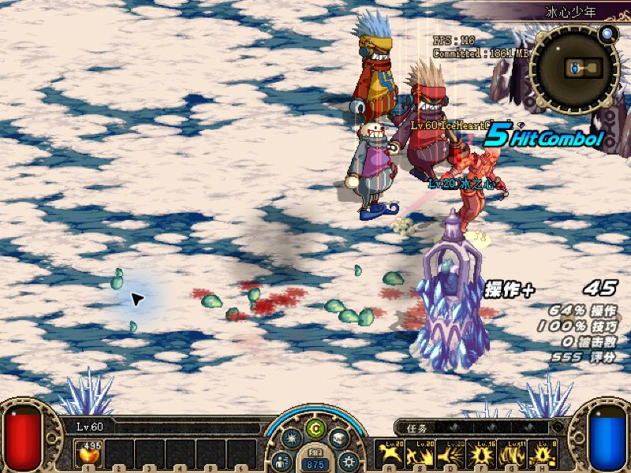
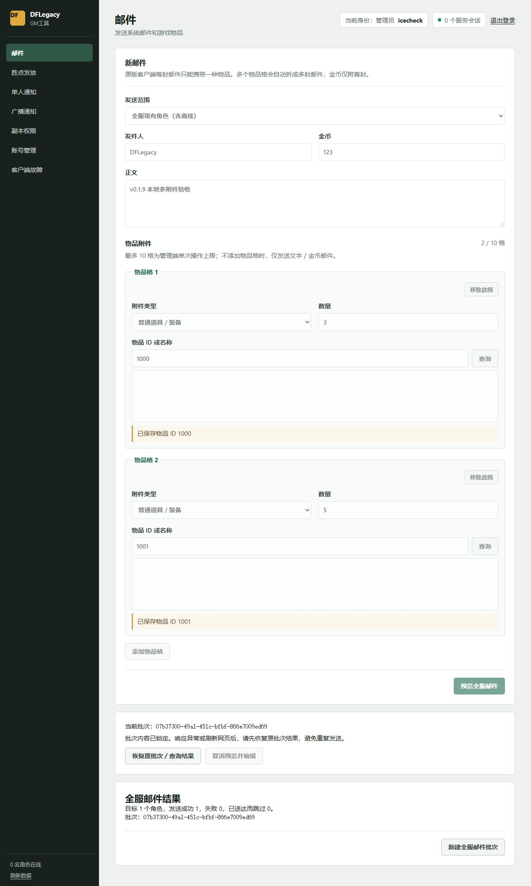

# v0.1.10 冰心少年、跨副本排查与多附件邮件报告

本轮在独立工作区和本地测试服务完成；未修改第二章工作区或在线容器。冰心修复先固定为 `9c23733`，其余代码经独立审阅未发现新增 P1/P2。发布版本为 v0.1.10，具体部署步骤见[升级说明](../releases/v0.1.10.md)。

## 冰心少年与其他副本

旧版在 5803 第二房间实机复现玩家相同的 `DNF.exe+0x4D5745` 访问异常。原因为共用绘制代码把栈内文字状态留在渲染器中。修复结束自己开启的绘制批次，保留调用方已有批次。用户多次重进 5802／5803 均未再崩溃。

服务端另外读取 PVF 怪物阵营，通关清场只处理敌对目标。用户确认 Boss 死后冰之心和角色存活，翻牌正常。

| 检查项 | 实际范围 | 结果 |
| --- | --- | --- |
| 地图资源及四难度 | 1,025 张有效地图，4,100 例 | 无缺失怪物／物件引用、重复 UID、数量溢出或生成异常 |
| 副本布局 | 43 副本，748 组合，11,760 次房间生成 | 无生成错误 |
| 深渊 | 19 副本 × 四难度，76 例 | 生成通过；原版流程保持 |
| 非敌对单位 | 全部地图的 monster team | 仅 5802／5803 冰之心，保护目标不参与清场 |
| 共用文字生命周期 | 256 连续隐藏 FPS 帧、后续原版文字、借用批次 | 原生回归通过 |

map 50000 是 PVF 明确标记未使用的 RANDOM 占位。第一脊椎 3802 是无 Boss 标记的既有 Boss 类型地图，保留全敌对怪物清完后结算。完整扫描说明见[排查记录](../../knowledge/decisions/2026-11-10-dungeon-safety-audit.md)。

此处没有把所有地图逐一开进游戏，也没有覆盖所有技能、召唤物和网络时序。开启 FPS 的完整显示路径没有新增自动验收；生产清理覆盖该返回路径。另两类 `+0x4B2526`、`+0x38C9F6` 崩溃仍待独立证据，不能归为已修复。

## 邮件

已直接核对原版 NOTI 97 读取逻辑和 Mail 对象：每封只有一个物品字段，无多附件数组。后台一次最多十个格是本次操作上限，不是原版客户端容量；按格拆成原生邮件，金币只在第一封。收件箱原上限 255 封保持。

每位角色的全部附件先校验并核对邮箱剩余容量，再一次保存；无效物品或邮箱不足不会部分发送。全服批次逐角色记录结果，只补发失败角色，旧单附件请求和已保存预览／回执继续兼容。

独立服务 `127.0.0.6:18081` 使用本地角色 IceHeartCheck。网页添加两格：野草莓 ID 1000 ×3、黑面包 ID 1001 ×5，金币 123。单发成功为两封；全服预览后刷新恢复，两个物品和数量保持，确认成功。持久化共四封、四个不同 ID，两次操作金币合计 246，第二封均为零。没有向线上角色发送测试邮件。

## 验证汇总

| 验证 | 结果 |
| --- | --- |
| 邮件后端专项 | 0 失败；覆盖十格、空列表、无效附件、容量原子性、旧指纹／回执、并发重试、落盘故障、在线通知与逐封领取 |
| 后台 Node 浏览器行为测试 | 35/35 通过，其中新增邮件 12 项 |
| 原生 CTest | 51/51 通过 |
| Launcher x64 | 最终联合代码 2290 断言通过 |
| Launcher x86（当前 x64 Windows/WOW64） | 最终联合代码 2290 断言通过 |
| 普通启动和后台安装交接 | 两架构各 110 项窗口／交接断言通过；覆盖无需更新、正常安装、重复调用、取消、占用拒绝、恢复确认和重启异常 |
| UpdateCore | 717 断言通过 |
| v0.1.8 实际旧更新程序和固定入口 | 两架构升级记录迁移、资源独占锁定下复用记录均通过；不是 Win7 认证 |
| 完整服务端 smoke + 正式 PVF | 8 项既有失败，与未修改 c58a362 基线失败集合完全一致，新增差异 0 |

八项既有失败涉及旧基线 PVF 条目数、SP 表、现金商品定义和法拉斯宠物进化断言；没有删改断言掩盖差异。邮件和保护目标的针对性测试为零失败。x86 测试最初两处夹具写死 x64 ZIP，修正为匹配架构后保留原断言重跑通过。

启动普通路径复用 validated 记录；旧入口仍会校验并复制更新程序，不能称为完全零读盘。独立修复及实际进入游戏仍完整验证。保留来源、架构、清单、未完成事务和关键文件异常的阻断；不宣称普通登录启动检测所有属性不变的内容篡改。

可重跑测试、原始结果及发布回执保存在本地 `artifacts/gm-mail-v019/`、`artifacts/startup-v0110-*` 和 `G:/dnf_local/DFLegacy-v0.1.10-release/`。私有转储、账号存档和生产 PDB 不发布到客户端。v0.1.9 候选完成先前检查后，复核发现普通 GUI 仍会打开验证窗口并等待网络，故其 GitHub 客户端草稿没有公开；v0.1.10 追加真正的托管快速路径，以及后台更新转交独立程序的修复。两架构最终联合测试各 2290 项通过，独立代码审阅未发现 P1/P2。GitHub/GHCR 公开核验和最终包实测在发布步骤完成后另记回执；本文的本地测试不冒充线上实测。
