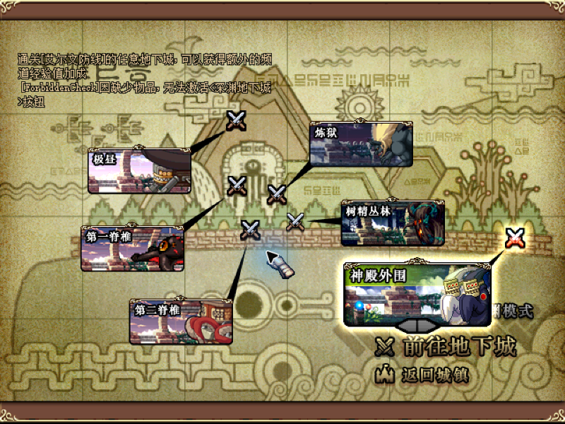
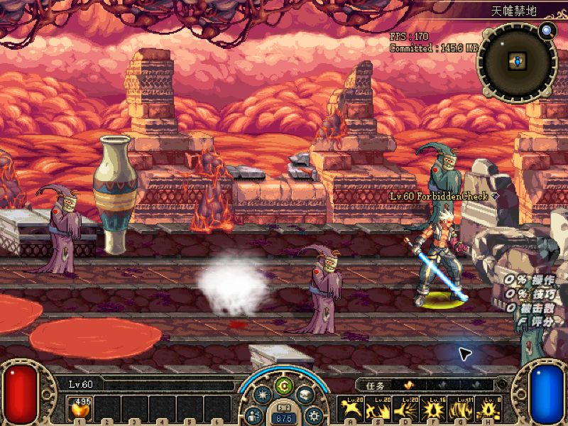

# v0.1.11 天帷禁地与更新窗口验收

2026-11-10，本地测试确认原 PVF 缺少天帷禁地入口；修正版显示入口并成功进入普通级首房间。线上服务未操作。

## 原因和修正

`worldmap/behemoth.wdm` 的地下城条目 `//27 452` 被注释。地下城 27、任务 452「我在大陆的肚子里」及前置 451「疑问的信息」均存在，也未被先前的停用任务清单隐藏。原配置要求接取或完成任务 452 后显示入口。

导出器仅把该行两个斜杠改为空格，保留条目 486 字节长度。Java 与独立 Python 均逐条比较全部 48,327 个条目：唯一变化为该条目的字节 220、221，其余 48,326 条的明文、密文、长度及偏移一致。原 PVF 保持原样。

| 文件 | SHA256 |
| --- | --- |
| 原发行 PVF | `69aa1a0338408fbcc3eff381924311ba42119a2cd2db4e8ffd2fab369bb9b34b` |
| 修正版 PVF | `b66ee59253013fcae78bed9750d731399e567450104dd8d0c3c83a5ef0f7ab8f` |

## 本地游戏验证

角色 `ForbiddenCheck` 为独立测试存档，已接任务 452，任务 451 已完成。客户端位于 `G:/dnf_local/DFLegacy-IceHeart-Hotfix-20261109/client`，本地服务只监听 `127.0.0.5`。

旧 PVF 选图画面由用户确认，只有原六个入口：

修正版通过正常安装事务放入隔离客户端，服务端读取同一文件。由于旧游戏不响应工具的方向键，私有服务端夹具把该角色出生位置设到西海岸入口区域，并在城镇角色就绪后发送现有的选图报文序列。夹具只省略走路，任务判定、PVF 解析和进图处理仍执行原逻辑；夹具没有加入产品源码。

修正版确认显示“天帷禁地”图标，选择后成功进入副本。服务器记录：地下城 27、普通级、迷宫 0、起点 (4,1)、首地图 6002、8 个怪物。客户端实际画面如下：

仅验收入口和首房间加载，未宣称整图通关或所有任务完成。原客户端 `G:/dnf_local/DNF_2008` 未修改，未连接或变更线上服务。

## 更新窗口与自动化回归

阶段前缀覆盖完整校验、下载、等待重试、准备安装、安装、恢复和保存更新记录。内部阶段标识保持原样；小窗口使用左对齐的单行省略，悬停保留完整文字。

- x86/x64 显示回归各 23 项通过；左对齐最终布局在 x64 再跑 23 项通过。
- 小更新窗口流程 133 项、V4 更新 51 项、独立修复 22 项通过。
- 实际 PVF 目录回归：原 PVF 的两个入口检查失败，修正版无失败；任务 452、前置、最低等级和旧存档解锁推导保持有效。
- GM 网页 36 项及独立端口 HTTP 回归通过；防旧缓存改动只同步源码，本次不发布服务端镜像。

发行构建、四路正式升级和公开下载验证均已完成，结果如下。原始导出及游戏证据位于工作区 `artifacts/forbidden-unlock-20261110`，构建与发布文件独立保存。

## 正式包与公开发布

[GitHub v0.1.11](https://github.com/firekula/DFLegacy/releases/tag/v0.1.11) 已公开。运行时源码为 `0e72cff78871686eb80a9d67d115d074e71fef8f`，脱敏公开源码快照为 `75a8cfcb44a2f49518549bdaa80ff61f933b66dd`。后续文档收尾提交不改变二进制和清单的运行时归属。

- 原生发行构建和 51 项 CTest 通过；x86/x64 登录器与诊断助手四项自包含构建均为零警告、零错误。
- 原生套件中的原始模块目录夹具、控制器真实 PVF Start／Tick 可选分支因未提供对应夹具而跳过；本轮 PVF 另由全条目比较、服务端真实目录回归和游戏首房间实测验证。账号保留证据检查复制配置的字段，未操作真实玩家账号或声明 GUI 列表逐条验收。
- 正式验收完成 24 项安装／修复内核场景、44 项真实 CLI 场景，以及 76 个账号保留检查点。测试夹具为每路 3 条账号、选中索引 2，同时检查密码和记住密码标志；不公布账号内容。
- 四路均从 v0.1.8 与 v0.1.10 升级至 v0.1.11，验证原固定入口、重新绑定校验记录、替换 PVF、资源与关键文件损坏后的处理，以及未完成事务和来源不符时阻止启动。此部分使用本地资源提供器和实际生产 CLI，不代替网络下载或游戏实测。
- 第一轮验收工具以系统默认编码读取中文账号显示名失败；保留失败目录，改为明确 UTF-8 后在全新 r2 目录完整重跑通过。发行源码和包未因此修改。

| 客户端 | 正式升级与修复 | 账号保留 | 公开生产更新源 |
| --- | --- | --- | --- |
| x86-normal | 通过 | 3 条、选中索引 2 均保留 | v0.1.11／sequence 3 |
| x86-test | 通过 | 3 条、选中索引 2 均保留 | v0.1.11／sequence 3 |
| x64-normal | 通过 | 3 条、选中索引 2 均保留 | v0.1.11／sequence 3 |
| x64-test | 通过 | 3 条、选中索引 2 均保留 | v0.1.11／sequence 3 |

发布包含 28 个附件，共 2,000,101,477 字节：14 个新增 V4 数据分块、4 个清单、4 个 V3 兼容包、4 个固定入口修复包、配套 PVF 和公开组件来源记录。公开包不含玩家配置、日志、转储或原始 PDB；私有 PE/PDB 配对单独校验保存。

草稿阶段对全部 28 个附件完整下载并校验 SHA256；公开后非 ZIP 附件再次匿名完整校验，ZIP 检查平台摘要和公开范围／前缀字节。部分 CDN 忽略 Range 时，以 HTTP 200 前缀访问、草稿完整摘要及平台摘要共同验证，未宣称公开 ZIP 又完整下载了一遍。沿用的旧版本数据分块亦经匿名验证。生产 ReleaseProvider 另外匿名发现四路清单，结果与已验收清单摘要完全一致；该发现测试不重复下载所有资源。

| 本地证据 | SHA256 |
| --- | --- |
| 四路正式验收 report.json | `99f93d51f57ee1bfcdefaffb7cab6dc688aa3bfb442b08602c69c2bc382a76f6` |
| GitHub 发布回执 | `1e2492b3c12df5ca07dfac8d8586c63b2533113ad9f45f8090320969879187af` |
| 生产匿名发现 report.json | `871b3a90b0a96b2b0916cc87be34ffdb023cd81b22b0b7516afb9dcbd7b562e1` |

发布清单摘要为 `0b207bb547ece01f42c7f06aeefa74c312977a5a392269394ddb262851c65c3b`。线上服务器未操作；管理员仍需在 18080 上传并选中新 PVF、保存后重启游戏服务。Compose、端口和镜像沿用现有配置。
