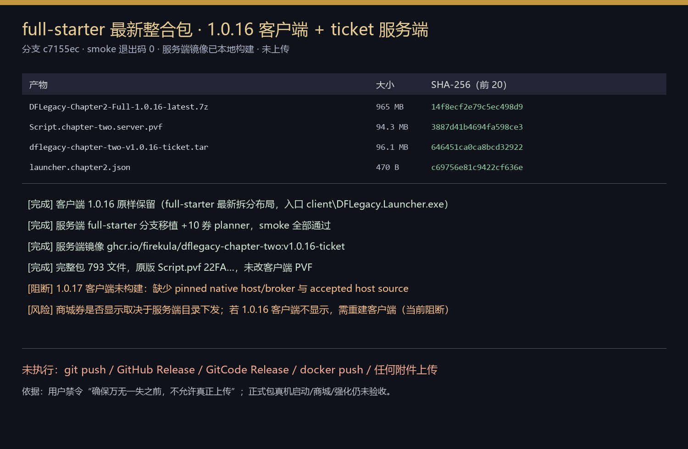

# full-starter 最新整合包（1.0.16 客户端 + ticket 服务端）

- 日期：2026-11-19 08:20（Asia/Shanghai）
- 分支：`codex/chapter-two-full-starter-upgrade`，本地提交 `c7155ec`（未 push）
- 结论：**1.0.16 最新客户端完整包已生成；服务端 +10 券已移植并通过 smoke；1.0.17 客户端因缺少 pinned 原生输入未构建。没有上传任何东西。**

## 1. 这次交付的是什么

| 产物 | 说明 |
| --- | --- |
| `DFLegacy-Chapter2-Full-1.0.16-latest.7z` | full-starter 拆分布局完整替换包：游戏文件在根目录，启动器/更新器在 `client\`；入口 `client\DFLegacy.Launcher.exe` |
| `Script.chapter-two.server.pvf` | 配套服务端 PVF，含商城 `[item]` 行 `100001 7274 1 0 0 100` |
| `dflegacy-chapter-two-v1.0.16-ticket.tar` | full-starter 服务端镜像（含 +10 券 planner），本地 `docker save` |
| `launcher.chapter2.json` | 正式连接 `games.firekula.site`，调试关闭 |

客户端保持 **1.0.16** 原样：`client\` 固定入口、App、Updater 都是现有 1.0.16；`Script.pvf` 是原版
`22FA7529…`，没有改客户端 PVF，因此固定入口的校验哈希不变。

## 2. 服务端移植

- 在 full-starter 分支 `src/DFLegacy.Server/EquipmentReinforcementPlanner.cs` 加入券路径：
  `7273/7274/7275` → +7/+10/+12；消耗 1 张；不扣 PVF 材料/金币；不掷失败；`ResultCode=0`；
  目标已有更高等级也会被直接覆盖。
- 新增 smoke：+12 覆盖、+10 叠券保留、材料/金币不扣、结果码。
- 分支服务端构建：0 警告 0 错误。
- 分支 smoke：退出码 **0**，输出 `All DFLegacy protocol smoke tests passed.`
- 镜像：`ghcr.io/firekula/dflegacy-chapter-two:v1.0.16-ticket`，manifest `sha256:7f55821a5958f34c361cd7f5ae16543bd537b66c5e438e533a9314d0c69d3766`，revision `c7155ec…`。

## 3. 产物与校验

| 产物 | 大小 | SHA-256 |
| --- | --- | --- |
| `DFLegacy-Chapter2-Full-1.0.16-latest.7z` | 965 MB | `14f8ecf2e79c5ec498d9ff90b5cc1f0e5fb74befb3103873a150aa13f7f9a2f8` |
| `Script.chapter-two.server.pvf` | 94.3 MB | `3887d41b4694fa598ce39dda25b279e958966cdb16487c8b914cdaf95c017447` |
| `dflegacy-chapter-two-v1.0.16-ticket.tar` | 96.1 MB | `646451ca0ca8bcd3292200ef34cfae4b7efcd81cc9b48888d30a28f3db6b3ce9` |
| `launcher.chapter2.json` | 470 B | `c69756e81c9422cf636eaa9e3304e77992196c0d265097147bfe2b4a4405a424` |

产物目录：`G:\Game\DNF_ACT1\DFLegacy\.tmp\release-fullstarter-1.0.16\`，含 `SHA256SUMS.txt`。

## 4. 1.0.17 客户端为什么没做

`tools/release/Build-LauncherRoles.ps1` 对输入做了硬 pin：

- `PresentationHost` 必须是 `7FC0080F8E03E532CDB911800C24D45BF0818E715966BAD7315BD30DA2770D83`；
- `StartupBroker` 必须是 `0AA08275D9FD539B2E96DE6C2958343489ABF8C2B325405D4A334B1554725849`；
- 重新构建 host 又要求 accepted source 的 `fixed-loader/main.cpp` 为
  `06C783122C05D04E9AF989D387CC18F72123FE05219D928BD3A266235709AEE2`。

工作区里只有：

- 已集成的 `main.cpp`（`16B21CAB…`），不是 accepted source；
- `v1015-signed` 等归档中的**构建成品**（1.0.15 角色 EXE），不是上述 pinned 原生输入；
- 用户当前 `client\` 的 1.0.16 App/Updater/入口是成品，无法从这里反推出可重建的 host/broker。

因此 1.0.17 的固定入口/App/Updater **不能安全重建**，我也没有伪造版本号或拿 1.0.16 冒充 1.0.17。
要继续做 1.0.17 客户端，需要以下任一条件：

1. 提供 full-starter 的 `chapter_two_presentation_host.exe`（`7FC008…`）和 `dnf_startup_trace.exe`（`0AA082…`）；
2. 或提供 accepted host source（`06C7…` 的 `fixed-loader/main.cpp` 及其两个头文件）+ full-starter 原生构建环境；
3. 或提供 1.0.16 角色构建时的完整工作区和输入清单。

## 5. 仍存在的风险

- 客户端的商城是否显示服务端下发的 `100001/7274`，本轮**没有真机验证**。如果 1.0.16 客户端仍从自己的 PVF 渲染商品列表，券不会出现；那时必须改客户端 PVF 并重建 1.0.17 启动器，而后者正是上面的阻断。
- 完整包只做了文件身份核对（793 文件、原版 PVF、1.0.16 角色、正式配置），**没有启动游戏/登录/购买/强化/充值**。
- 服务端镜像只做了构建和 `docker save`，没有启动 `/ready`、没有连真实 PVF 跑商城请求。

## 6. 没有做

- `git push`（main 和 full-starter 分支都只本地提交）。
- GitHub Release、GitCode Release、任何附件上传。
- `docker push`。
- 1.0.17 客户端、固定入口更新包、自动更新 manifest。
- 正式包真机验收。

## 7. 下一步

1. 你在 1.0.16 完整包上测试商城「道具」页是否出现 +10 券：
   - 出现：服务端目录下发路径成立，可直接用这个包 + `v1.0.16-ticket` 镜像；
   - 不出现：需要补 full-starter 原生输入，重建 1.0.17 客户端并改 PVF。
2. 若接受 1.0.16 客户端 + ticket 服务端，完成真机冒烟后我再准备上传（仍等你明确批准）。
3. 若必须 1.0.17：把第 4 节的 pinned 输入或完整构建工作区给我。
