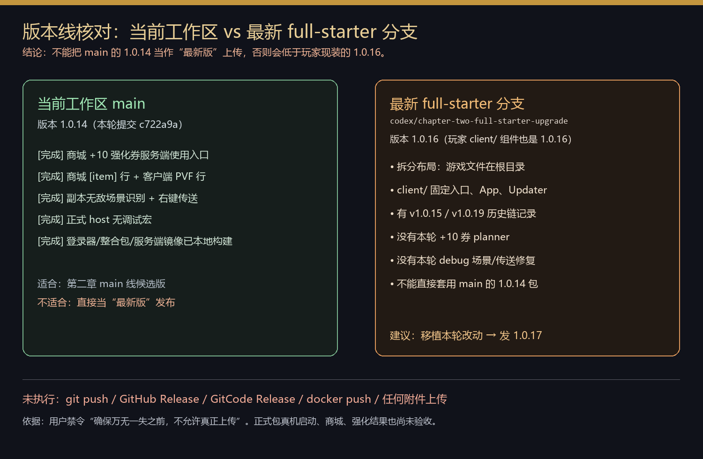
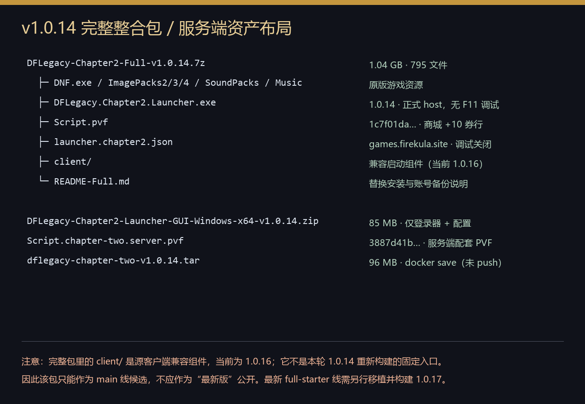
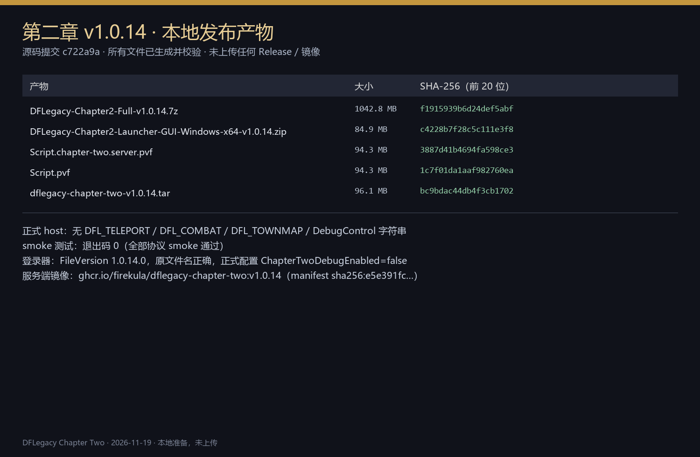

# 第二章 v1.0.14 发布准备 · 图文报告

- 日期：2026-11-19 07:40（Asia/Shanghai）
- 源码提交：`c722a9ac55d4de322b328a5c6efbd0296fda9dfb`（本地提交，**未 push**）
- 结论：**修复、文档、正式 host、登录器、完整整合包、服务端镜像均已本地完成；但没有上传任何 Release、镜像或源码。**
- 关键阻断：工作区 `main` 是 **1.0.14**，最新 full-starter 分支是 **1.0.16**，玩家现装 `client/` 组件也是 **1.0.16**。把 1.0.14 当“最新版”发布会让玩家觉得是降级，不能直接上传。

## 1. 你这轮实机确认通过的内容

以下均在调试/本地测试构建上由你实机确认：

- F11 调试面板：右键小地图传送（同城镇）通过。
- 商城购买页点“充值”能正常弹出充值面板。
- 副本无敌通过：只在本生效，城镇不生效；伤害与受伤/速度符合约定。
- 商城「道具」页出现 +10 强化券，并完成购买流程。

本轮没有把这些结论外推到正式发布包；正式包的启动、商城、强化结果仍需真机冒烟。

## 2. 本轮代码与文档

- **+10 强化券服务端入口**：`EquipmentReinforcementPlanner` 识别 `7273/7274/7275`，消耗 1 张券，直接把目标装备强化等级设为 +7/+10/+12；不扣材料/金币，不做失败判定，返回 `resultCode=0`。
- **商城目录**：客户端和服务端 `etc/newcashshop.etc` 的 `[item]` 段第一行写入 `100001 7274 1 0 0 100` `+10 Ticket` `0 0`。之前误插到文件头注释 `// [item] : ...` 后面，服务端/客户端都会忽略；本轮改为真实段头之后。
- **客户端 PVF**：新 `Script.pvf` SHA-256 `1c7f01da1aaf982760ea3908fa403aefd088e6b7116c0ca5ddce7f33e77ea84d`；登录器哈希白名单加入该值，同时保留旧值。
- **调试控制**：副本场景识别（`game+0x10`，1 城镇/3 副本/10 塔）、副本 HP 损失拦截、右键自动寻路目标每帧传送、城镇 authority 放行。正式 host 不定义 `DFL_CHAPTER_TWO_DEBUG_CONTROL`。
- **文档**：`docs/releases/v1.0.14.md`、`knowledge/decisions/2026-11-19-cash-shop-ticket-debug-controls.md`、`knowledge/handbook/current-state.md` 已更新并提交。
- 提交：`c722a9a Release Chapter Two v1.0.14: cash-shop +10 ticket and production build`。

## 3. 本地产物与校验

| 产物 | 大小 | SHA-256 |
| --- | --- | --- |
| `DFLegacy-Chapter2-Full-v1.0.14.7z` | 1042.8 MB | `f1915939b6d24def5abfcd9c79273473455f2b6efaba3848a2f1b4c103513653` |
| `DFLegacy-Chapter2-Launcher-GUI-Windows-x64-v1.0.14.zip` | 84.9 MB | `c4228b7f28c5c111e3f86f9ffb84ef8a9b42276c2f285335d29b639f4605f8f9` |
| `Script.pvf`（客户端） | 94.3 MB | `1c7f01da1aaf982760ea3908fa403aefd088e6b7116c0ca5ddce7f33e77ea84d` |
| `Script.chapter-two.server.pvf` | 94.3 MB | `3887d41b4694fa598ce39dda25b279e958966cdb16487c8b914cdaf95c017447` |
| `dflegacy-chapter-two-v1.0.14.tar` | 96.1 MB | `bc9bdac44db4f3cb17029814b7283cd0038b955a1c9254942bc228f29107f4b6` |

- 完整包：795 个文件，1.53 GiB 原始内容，含游戏资源、`DFLegacy.Chapter2.Launcher.exe`、配套 `Script.pvf`、正式配置、`client/` 兼容组件和说明。
- 登录器：`FileVersion 1.0.14.0`，`OriginalFilename=DFLegacy.Chapter2.Launcher.exe`，产品名/说明/版权正确；正式 host 二进制中 **不存在** `DFL_TELEPORT` / `DFL_COMBAT` / `DFL_TOWNMAP` / `DebugControl` 字符串（调试 host 中存在，作为对照）。
- 服务端镜像：`ghcr.io/firekula/dflegacy-chapter-two:v1.0.14`，manifest `sha256:da8a516f7f92a2dfab939f1398811cd8f069ba993118ef9b7f0bf4e7ca49093e`，构建标签 `revision=c722a9a…`。
- 自动化：`dotnet run --project tests/DFLegacy.SmokeTests -c Release` 退出码 **0**，输出 `All DFLegacy protocol smoke tests passed.`；正式 host CMake Release 构建退出码 **0**；登录器发布构建退出码 **0**。

产物目录：`G:\Game\DNF_ACT1\DFLegacy\.tmp\release-v1.0.14\`，校验清单 `SHA256SUMS.txt` 同目录。

## 4. 关键阻断：版本线不一致

- 当前 `main`：`LauncherVersion.txt=1.0.14`，包含本轮四项修复。
- 最新 `codex/chapter-two-full-starter-upgrade`：`LauncherVersion.txt=1.0.16`，拆分布局（游戏文件在根目录、启动器/`client` 在子目录），有 v1.0.15/v1.0.19 历史链记录，但**没有**本轮 +10 券 planner 和 debug 场景/传送修复。
- 你的客户端 `client/DFLegacy.Launcher.App.exe`、`DFLegacy.Updater.exe`、`DFLegacy.Launcher.exe` 都是 **1.0.16**。
- 因此：`main` 的 1.0.14 只能作为 **main 线候选**；不能作为“最新版”整合包公开。最新 full-starter 线需要把本轮改动移植过去，并把版本升到 **1.0.17**（或你指定的版本）后重新构建。

## 5. 完整包布局

注意：完整包里的 `client/` 是源客户端的兼容启动组件，当前为 1.0.16；它不是本轮 1.0.14 重新构建的固定入口。正式 latest 包应由 full-starter 分支的制包流程生成，不应手工混用两条线的组件。

## 6. 产物总览

## 7. 没有做/没有验证

- **没有上传**：`git push`、GitHub Release、GitCode Release、`docker push`、任何附件上传都未执行（按你的禁令）。
- **正式包没有真机验收**：本会话无交互桌面，登录器窗口/游戏启动截图未能取得；没有进入游戏验证正式包的商城、强化、充值和退出。
- **latest full-starter 包没有构建**：需要先移植 +10 券、PVF 商城行、登录器哈希；debug 修复在该分支是另一套 F11 实现，需要单独核对。
- **固定入口/更新器没有按 1.0.14 重建**：完整包中的 `client/` 是 1.0.16；若坚持 1.0.14 版本号，必须先解决这个版本混用，否则不能叫“统一版本”。
- **自动更新清单**：本轮只做完整替换包和登录器包，没有生成 V4 自动更新 manifest；latest 线需要其既有制包链。

## 8. 建议的下一步（等你确认）

1. **选线**：如果 latest 指 full-starter 1.0.16 线，我把本轮四项改动移植到 `codex/chapter-two-full-starter-upgrade`，版本升 **1.0.17**，用该分支的拆分/固定入口制包流程重建，再出完整包和服务端镜像。
2. 如果 1.0.14 是你要的独立测试线，则把已构建的 main 1.0.14 候选包先做正式包真机冒烟，确认后再上传。
3. 无论哪条线，上传前先完成：正式包真机启动/商城/强化、服务端 `/ready`、匿名回读资产 SHA-256。
4. 上传命令已备好（未执行）：[v1.0.14-upload-commands.md](v1.0.14-upload-commands.md)。

## 9. 现场清理

- 测试服务器和调试客户端已关闭；未启动正式包游戏。
- `.tmp/release-v1.0.14/` 保留全部产物和校验；`.tmp/full-starter-upgrade` 与 `night-qa` 已归档到 `Y:\DFLegacy-archive\2026-11-19\`（移动，未删除），用于腾出构建空间。
