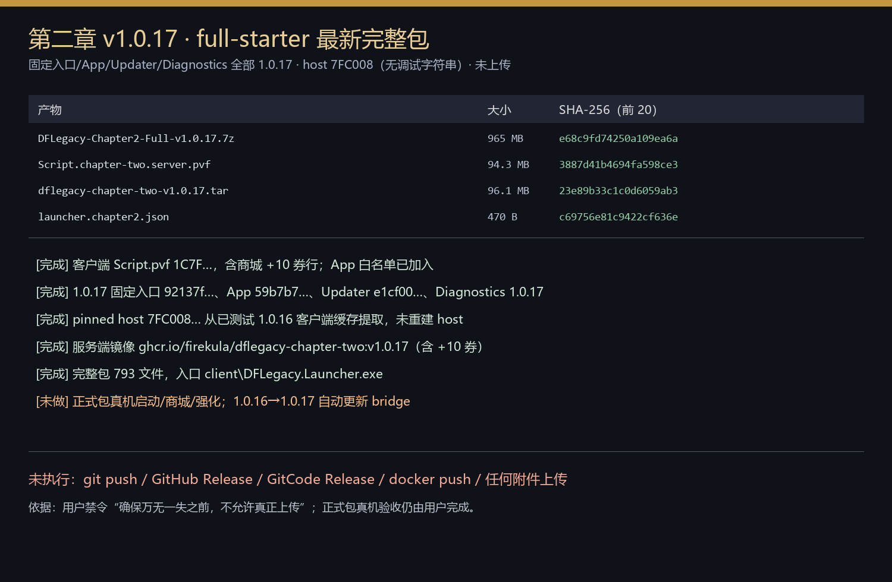

# 第二章 v1.0.17 full-starter 最新完整包

- 日期：2026-11-19 10:30（Asia/Shanghai）
- 源码：full-starter 分支 `codex/chapter-two-full-starter-upgrade` 本地提交 `ff81308`
- 结论：**1.0.17 固定入口、App、Updater、Diagnostics 全部构建完成；完整包和服务端镜像已生成；未上传。正式包真机验收仍由你完成。**

> 2026-11-20 更新：本文记录的 7z 首次启动会失败（缺少 V4 安装记录），已由
> `DFLegacy-Chapter2-Full-v1.0.17-r2.7z` 取代。原因与验收见
> [整合包首启修复](../../knowledge/decisions/2026-11-20-v1.0.17-full-package-startup-fix.md)。

## 1. A 方案输入已找到

上次说的 pinned 输入，在本机找到了：

| 输入 | 位置 | 处理 |
| --- | --- | --- |
| host `7FC0080F…` | `G:\tmp\dfo-v1016-panel\.dflegacy\chapter-two\69B59DBAB71585A7\ChapterTwoPresentation.exe`（及 `7E976A64…`） | 直接使用，**不重建**；这是 1.0.16 已测试客户端提取出的同一颗 host |
| broker `0AA08275…` | `.tmp\night-root\production-broker-r3\build\Release\dnf_startup_trace.exe` | 直接使用 |
| 原生输入 `9BC32EFA…` / `B72C2C7D…` / `751AA409…` / `d3d8 25A0CEEB…` | `.tmp\chapter-two-local-qa\inputs\native-inputs` 等 | 直接使用 |

因此 **不需要 accepted source `06C7…`，也不需要重建 host**。`Build-LauncherRoles.ps1` 的 pinned host/broker 校验全部通过。

## 2. 构建结果

- `Build-LauncherRoles.ps1` 退出码 **0**，revision `ff81308`：
  - App `DFLegacy.Launcher.App.exe` 1.0.17，SHA-256 `59b7b7a4c5e1d290da64c3aadcbc4c848de92bcb830b5d59671473dede652787`
  - Updater `DFLegacy.Updater.exe` 1.0.17，SHA-256 `e1cf004e6413e01267542b0c7dcb71bc44182e64ed4a38bb3bcde23b235ef593`
  - 固定入口 `DFLegacy.Launcher.exe` 1.0.17，SHA-256 `92137f3f0c3fe692cacd68d9e574bc6ac19ec6c5c7e40f52c2d8a1125130f83f`
- `Build-Diagnostics.ps1` 退出码 **0**：`DFLegacy.Diagnostics.exe` 1.0.17，SHA-256 `f66f9136f56b8407faec113445c80c4ac63d99b594bea3255a33825ad5816ec7`。
- 固定入口 `DFLegacy.Bootstrap.ini` 已按新入口/Updater 哈希生成；`DFLegacy.Chapter.json` 的 requiredFiles 全部存在。
- host `7FC008` 二进制中没有 `DFL_TELEPORT` / `DFL_COMBAT` / `DFL_TOWNMAP` / `DebugControl` 字符串，正式包不启用调试控制。

## 3. 客户端 PVF 与商城券

- 客户端 `Script.pvf` 使用原版 `22FA7529…` + 商城 `[item]` 行，SHA-256
  `1c7f01da1aaf982760ea3908fa403aefd088e6b7116c0ca5ddce7f33e77ea84d`。
- 1.0.17 App 的 `ChapterTwoClient.VerifyFile` 白名单已加入该哈希；1.0.16 的旧哈希仍保留。
- 服务端 PVF SHA-256 `3887d41b…`，含同一行 `100001 7274 1 0 0 100`。
- 服务端 `EquipmentReinforcementPlanner` 已移植 +10 券：消耗 1 张、直接设置等级、不扣材料/金币/不失败；分支 smoke 退出码 **0**。

## 4. 产物

| 产物 | 大小 | SHA-256 |
| --- | --- | --- |
| `DFLegacy-Chapter2-Full-v1.0.17.7z` | 965 MB | `e68c9fd74250a109ea6addb9c8bf2d88886b224f9de466fc7b568193f44e19d1` |
| `Script.chapter-two.server.pvf` | 94.3 MB | `3887d41b4694fa598ce39dda25b279e958966cdb16487c8b914cdaf95c017447` |
| `dflegacy-chapter-two-v1.0.17.tar` | 96.1 MB | `23e89b33c1c0d6059ab3b3b05f9b3c18808a660b42053ec33e282fa02c44cc47` |
| `launcher.chapter2.json` | 470 B | `c69756e81c9422cf636eaa9e3304e77992196c0d265097147bfe2b4a4405a424` |

- 完整包 793 文件，入口 `client\DFLegacy.Launcher.exe`；游戏文件在根目录，`client\` 为 1.0.17 固定布局。
- 服务端镜像 `ghcr.io/firekula/dflegacy-chapter-two:v1.0.17`，manifest `sha256:229653eaf97e0e121c2f3c2784a13ce75e3359377ff3bc7ffaabfbf5b9959e72`，revision `ff81308…`。
- 产物目录：`.tmp\release-1.0.17\`，含 `SHA256SUMS.txt`。

## 5. 验证范围

已完成：

- full-starter 服务端构建：0 警告 0 错误；smoke：退出码 0。
- 1.0.17 roles/entry/app/updater/diagnostics 构建：退出码 0；PE 文件版本/产品版本 1.0.17。
- 固定入口 + Bootstrap ini 哈希自洽；host 无调试字符串。
- 完整包 793 文件、客户端 PVF/服务端 PVF 哈希、服务端镜像标签/标签元数据已核对。

**未完成**：

- 正式包真机启动、登录、商城 +10 券可见/购买/使用、装备 +10、充值、退出。
- 服务端 `/ready`、管理页、真实 PVF 下的商城请求。
- 1.0.16 → 1.0.17 的**自动更新 bridge/新启动包**：固定入口哈希已从 1.0.16 变为 1.0.17，现有 1.0.16 固定入口不能原地升级；本包是**整目录替换**方案。如需增量自动更新，要另做 bridge/manifest 并验证。
- `DFLegacy.CrashCapture.exe` 仍为上一版原生 x86 辅助程序（无版本资源）；不影响入口/App/Updater/Diagnostics 的 1.0.17 身份。

## 6. 没有上传

`git push`、GitHub Release、GitCode Release、`docker push`、附件上传全部未执行。源码只在本地：

- main 文档/报告提交（本地）；
- full-starter 分支 `c7155ec` + `ff81308`（本地，未 push）。

上传命令（未执行）：[v1.0.17-upload-commands.md](v1.0.17-upload-commands.md)。

## 7. 下一步

1. 用完整包做一次正式真机冒烟：`client\DFLegacy.Launcher.exe` → 登录 → 商城道具页 +10 券 → 右键使用 → 装备 +10。
2. 服务端用 `v1.0.17` 镜像 + `Script.chapter-two.server.pvf`，检查 `/ready` 和商城目录。
3. 通过后我再按你的批准执行上传；如果要 1.0.16→1.0.17 原地自动更新，先做 bridge 并验证，不要直接切更新源。
