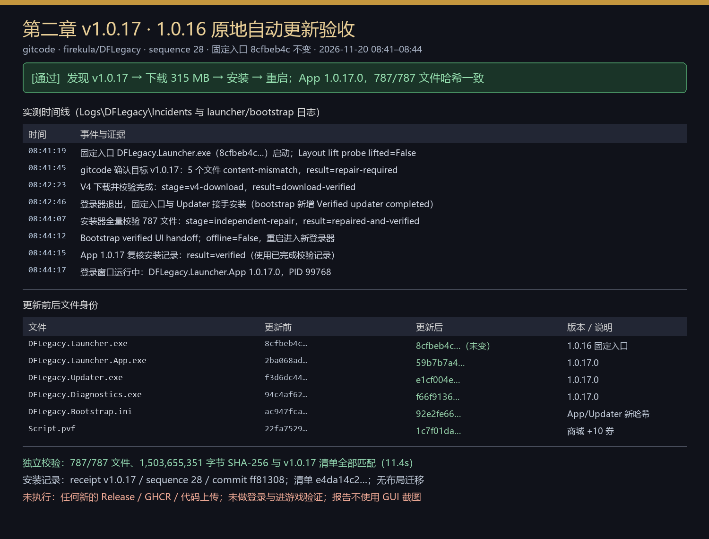

# 第二章 v1.0.17 原地自动更新验收（1.0.16 → 1.0.17）

- 日期：2026-11-20 08:41–08:44（Asia/Shanghai）
- 测试副本：`G:\tmp\update-test-1017`（1.0.16 客户端；`launcher.chapter2.json` 指向 `games.firekula.site`，`UpdateProvider=gitcode`）
- 发布源：`codex/chapter-two-full-starter-upgrade` 提交 `ff81308`，tag `v1.0.17`，sequence 28
- 清单：`DFLegacy-client-update-v4-chapter-two-startup-v2-normal-win-x64.json`，SHA-256 `e4da14c27a0ad67049a3829fba841e64d38c0555f32da523b3b81a63fbcc8512`
- 结论：**通过。** 1.0.16 发现 v1.0.17 → 下载 → 安装 → 重启；App/Updater/Diagnostics 均为 1.0.17，固定入口 `8cfbeb4c…` 保持不变，787/787 文件哈希与清单一致。



## 1. 测试前置

| 项目 | 测试前状态 |
| --- | --- |
| `DFLegacy.Launcher.exe`（固定入口） | 1.0.16.0，SHA-256 `8cfbeb4c381bf780931f123b1490a7508ccee1771a7aba659b9a8524ae54d5cd`，435,048 B |
| `DFLegacy.Launcher.App.exe` | 1.0.16.0，SHA-256 `2ba068ad…` |
| `DFLegacy.Updater.exe` | 1.0.16.0，SHA-256 `f3d6dc44…` |
| `DFLegacy.Diagnostics.exe` | 1.0.16.0，SHA-256 `94c4af62…` |
| `DFLegacy.Bootstrap.ini` | SHA-256 `ac947fca…`（App `2ba068ad…` / Updater `f3d6dc44…`） |
| `Script.pvf`（客户端） | SHA-256 `22fa7529…`，98,576,088 B |
| 安装记录 | `receipt v1.0.16`，sequence 27，787 文件 |

启动方式：直接运行 `client\DFLegacy.Launcher.exe`，未附加参数，未手工点按更新按钮（V4 自动检查）。

## 2. 实测过程

| 时间 | 事件 | 证据 |
| --- | --- | --- |
| 08:41:19 | 固定入口启动，`Layout lift probe … lifted=False`（游戏文件已在根目录，无迁移） | `launcher.log` |
| 08:41:23 | App 1.0.16 进入登录窗口；`Bootstrap verified UI handoff; offline=True` | `launcher.log` |
| 08:41:45 | gitcode 确认目标 v1.0.17：5 个文件 `content-mismatch`，`result=repair-required` | `Incidents\update-…084145…log` |
| 08:42:23 | 下载并校验完成：`stage=v4-download`，`result=download-verified`，`target=v1.0.17` | `Incidents\update-…084223…log` |
| 08:42:46 | 登录器退出，固定入口 + Updater 接手安装 | 进程与 `bootstrap.log` |
| 08:44:07 | 安装器全量校验 787 文件：`stage=independent-repair`，`result=repaired-and-verified` | `Incidents\update-…084407…log`（pid 4712） |
| 08:44:12 | `Bootstrap verified UI handoff; offline=False`，重启进入新登录器 | `launcher.log` / `bootstrap.log` |
| 08:44:15 | App 1.0.17 复核：`result=verified`，使用已完成校验的安装记录 | `Incidents\update-…084415…log`（pid 99768） |
| 08:44:17 | 登录窗口运行中：`DFLegacy.Launcher.App` 1.0.17.0，窗口标题「地下城与勇士 · 第二章」 | 进程 99768，Responding=True |

变更集为 5 个文件、合计 314,978,221 字节，对应发行版中的 7 个 `dflegacy-v4-*.bin` 分片（含 48 MB/50 MB 分片）。`bootstrap.log` 新增两条 `Verified updater completed.`，没有新增 `Primary failed`。

## 3. 结果核对

| 文件 | 更新前 | 更新后 | 版本 |
| --- | --- | --- | --- |
| `DFLegacy.Launcher.exe` | `8cfbeb4c…` | `8cfbeb4c…`（**未变**） | 1.0.16 固定入口 |
| `DFLegacy.Launcher.App.exe` | `2ba068ad…` | `59b7b7a4c5e1d290da64c3aadcbc4c848de92bcb830b5d59671473dede652787` | 1.0.17.0 |
| `DFLegacy.Updater.exe` | `f3d6dc44…` | `e1cf004e6413e01267542b0c7dcb71bc44182e64ed4a38bb3bcde23b235ef593` | 1.0.17.0 |
| `DFLegacy.Diagnostics.exe` | `94c4af62…` | `f66f9136f56b8407faec113445c80c4ac63d99b594bea3255a33825ad5816ec7` | 1.0.17.0 |
| `DFLegacy.Bootstrap.ini` | `ac947fca…` | `92e2fe66…`（App `59b7b7a4…` / Updater `e1cf004e…`） | 1.0.17 哈希 |
| `Script.pvf` | `22fa7529…` | `1c7f01da1aaf982760ea3908fa403aefd088e6b7116c0ca5ddce7f33e77ea84d` | 商城 +10 券 |

安装记录与独立校验：

- `installed.json`：`tag=v1.0.17`，`manifestSha256=e4da14c2…`（与发布清单一致），内置清单 `version=v1.0.17`、`sequence=28`、`commit=ff81308…`、787 文件。
- 更新后独立重算 787 个受管文件：`verified=787 missing=0 mismatch=0`，合计 1,503,655,351 字节，耗时 11.4 s。
- `last-result.json`：`success=true`、`restarted=true`（"全部受管文件已校验，登录器已重启。"）。

## 4. 说明与边界

- 本次只验收更新链路，未做账号登录、进入游戏、商城购买或服务端联动验证。
- 按要求不使用 GUI 截图；证据为日志、文件哈希、安装记录、进程信息与窗口标题。
- 08:41 之前（00:50）的 Error 记录属于修改前的旧本地配置（第二章远程地址校验失败），与本次运行无关；本次运行使用修正后的 `games.firekula.site` 配置，08:41 之后没有 Error 级记录。
- 本次未执行任何 Release、GHCR、代码上传或 push；只新增本报告与验收卡片。
- 测试结束后登录窗口保持运行（PID 99768），以便人工确认；未关闭进程、未改动测试副本配置。

## 5. 证据路径

```text
G:\tmp\update-test-1017\client\Logs\DFLegacy\launcher.log
G:\tmp\update-test-1017\client\.dflegacy\bootstrap\bootstrap.log
G:\tmp\update-test-1017\client\Logs\DFLegacy\Incidents\update-20261120-084145-511-64416-84bd8c8cc78e4f3b8017d26a406f8a69.log
G:\tmp\update-test-1017\client\Logs\DFLegacy\Incidents\update-20261120-084223-165-64416-9a82b0ca336f4653b623ef56e908f898.log
G:\tmp\update-test-1017\client\Logs\DFLegacy\Incidents\update-20261120-084407-204-4712-1b1ffa7d66f34507b4e3284b2af767fe.log
G:\tmp\update-test-1017\client\Logs\DFLegacy\Incidents\update-20261120-084415-731-99768-830cfc3848804f689e49989d4eef2630.log
G:\tmp\update-test-1017\client\.dflegacy\v4\installed.json
G:\tmp\update-test-1017\client\.dflegacy\last-result.json
```

## 6. 后续：整合包首启修复（r2）

- 旧 `DFLegacy-Chapter2-Full-v1.0.17.7z` 在干净目录首次启动失败，原因是缺少
  `.dflegacy\v4\installed.json` 安装记录（另有 `.tmp\full-client-1.0.17\` 多余嵌套）。
  根因、复现与修复见
  [v1.0.17 整合包首次启动失败与 r2 修复](../../knowledge/decisions/2026-11-20-v1.0.17-full-package-startup-fix.md)。
- 已发布 `v1.0.17-r2` 完整包（GitHub / GitCode），SHA-256
  `16a18636…`；客户端程序、V4 清单与服务端镜像仍是 v1.0.17 的同一份字节。
- 本文验收的 1.0.16 → 1.0.17 自动更新路径不受影响；1.0.15 及更旧或新装请改用 r2 包。
