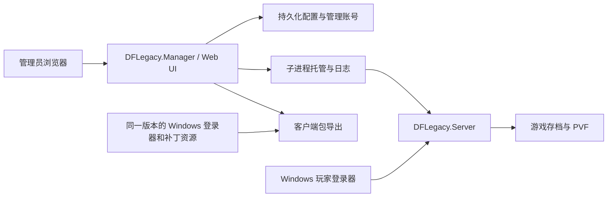

# 跨平台一键部署、Web 管理与 Gitea 自动发布设计

日期：2026-10-30

状态：用户已于 2026-10-30 确认，代码、发行脚本及 Windows/Docker Linux Runner 已实施；[真实 Gitea CI/CD 验收](../reports/2026-10-30-gitea-runner-deployment-validation.md)已完成。macOS/ARM 原生运行及真实游戏客户端联机仍需对应环境验收。

代码基线：`8259048`，Gitea 实例版本经 `/api/v1/version` 确认为 `1.26.0`。

## 1. 目标与已确认选择

在已完成的服务端、客户端兼容补丁和 Windows 登录器之上，提供可交给使用者直接部署的发行包。管理员可以配置服务器、启停服务、查看日志，并导出连接该服务器的客户端补丁及登录器包。提交后自动测试、构建并发布，减少每次手工组装产物。

用户已确认：

- Windows、Linux、macOS 共用 Web 管理界面；本机双击启动管理程序后自动打开浏览器，Docker 通过浏览器远程管理。
- 当前尚未部署 CI Runner，先按 Windows + Linux 两类机器规划。
- 支持 Gitea CI/CD，以及不同平台的 Release 发布。

以下默认行为已随本文确认：

- 本机包为自包含发布，不要求使用者安装 .NET SDK 或运行时；操作系统仍须满足 .NET 的系统依赖。
- 每次推送执行 CI；`main` 成功后自动发布开发预发布版，`v*` 版本标签成功后发布正式版；其他分支和 PR 只产生测试结果与 CI 产物。
- 首批目标为 `win-x64`、`linux-x64`、`linux-arm64`、`osx-x64`、`osx-arm64`；容器为 `linux/amd64` 和 `linux/arm64`。
- macOS 与非本机架构先交叉构建；没有对应运行环境的项目明确记录为未运行验证，不把交叉构建成功描述成实机通过。
- 发布新版本不会自动更新正在运行的游戏服务器；首版升级由管理员停服、备份并替换程序目录完成。

## 2. 当前实现与直接约束

- `DFLegacy.Server` 是 .NET 10 ASP.NET Core 应用，包含业务服务、账号及角色 JSON 存档、账号 API 和 `/admin` GM 后台；默认运行单体拓扑。
- `DFLegacy.Channel` 和 `DFLegacy.InterProcess` 已提供可选的入口拆分拓扑。首版部署管理器以单体模式为验收基线，继续分发 Channel 程序供既有高级部署使用；管理器暂不托管拆分拓扑，检测到启用时给出明确提示并拒绝启动，避免只启动一半服务。
- `DFLegacy.Launcher` 是 Windows WPF 客户端登录器，已有注册、登录、账号管理、IJL15 安装和进程内 Relay。它继续承担玩家端入口。
- `ijl15.dll`、`debug.dll` 和可选的 `DFLegacy.RandomNative.dll` 是 Windows 原生模块，不能通过普通 Linux 任务得到完整产物。
- 现有 `/admin` 页面随游戏服务运行：将启停按钮直接塞进这个进程，会在停服后失去管理入口。
- `server.json` 目前从程序目录读取，包含开发机 PVF 绝对路径；`launcher.json` 包含 `test/test` 和 `StartServer=true`，不能直接作为远程玩家发行配置。
- `Dockerfile` 的 restore 层只复制了 Server 与 Protocol 项目，漏了 Server 的 InterProcess 引用；`compose.yaml` 默认 host 网络并把 `test` 配为引导管理员，需要提供新的通用发行模板。
- `DFLegacy.SmokeTests` 是控制台测试程序，应使用 `dotnet run --project ...` 并检查退出码，不能仅靠 `dotnet test` 声称测试已执行。
- 默认冒烟入口使用临时 fixture；另有真实 PVF 检查及 `--s2-ipc` 等专项入口。部分专项检查硬依赖未入库的 `DNF2008/Script.pvf`，不能直接放进无资源 Runner 的必过任务。
- CMake 与 vcxproj 的原生源文件清单需要核对，尤其 debug.dll 新增的窗口实现与原生测试注册；CI 必须在干净检出上构建，不能复用开发机旧 DLL 掩盖缺项。
- 当前调试浮窗通过本机共享目录读取服务端快照；远程 Linux/macOS/Docker 部署无法天然共享这一目录。首版不扩展该调试传输协议，玩家包默认关闭调试浮窗。
- 存档仍为单个 JSON 文件，不支持多个写入进程共享。管理器不能绕过服务端业务层在线修改它。

## 3. 方案比较与选择

| 方案 | 优点 | 代价与适用性 |
| --- | --- | --- |
| 独立 .NET 管理程序 + 一套 Web UI | 三平台与 Docker 复用；停服后仍能操作；沿用仓库现有技术栈 | 新增轻量管理进程，需要定义与游戏服务的生命周期和权限边界 |
| Windows WPF 服务端控制台 + Linux/macOS/Docker Web | Windows 可获得原生桌面体验 | 两套界面和交互需同步，跨平台维护量更高 |
| Avalonia 等跨平台桌面程序 + Docker Web | 三平台都有桌面窗口 | 引入额外 UI 框架及打包工作，仍需维护容器 Web 入口 |

用户选择第一种。实现建议为新增 `DFLegacy.Manager`，采用 .NET 10 ASP.NET Core，Web 前端沿用仓库现有静态 HTML/CSS/JavaScript 方式，不额外引入桌面或前端构建框架。

## 4. 模块与生命周期



- 管理器独立运行，默认管理端口 `18080`，本机绑定 `127.0.0.1`；游戏账号和现有 GM/API 端口继续为 `8081`，职责与端口分开。
- 本机启动时打开浏览器；Linux 无桌面或 `--no-browser`、Docker 场景只输出访问地址。关闭浏览器不停止管理器或游戏服务。
- 提供 Windows 启动入口、Linux `start.sh`、macOS `Start.command`；Unix 包保留可执行位，文档说明文件管理器和系统首次运行限制。macOS 首版提供未签名包，并明确标注，签名及公证需以后配置证书。
- 管理器状态机至少包含未配置、已停止、启动中、运行中、停止中、启动失败、异常退出。只有健康探测确认后才显示运行中，不能把取得 PID 当成启动成功。
- 串行处理启停和配置应用，重复点击具有幂等性。检查端口冲突、PVF 可读性、目录权限和拓扑设置，失败显示可处理的原因。
- 游戏服务可通过 UI 软停止、重启。新增仅本机管理通道可调用的停服入口，调用 `IHostApplicationLifetime.StopApplication()`；管理器通过私有随机凭据请求，不复用玩家 token。超时后记录原因并强制终止自己托管的子进程树，不终止外部未知进程。
- 管理器退出、容器 SIGTERM 和系统正常终止时先等待游戏服务优雅停止，再退出。子进程崩溃保留退出码和日志；首版不做无限自动拉起。可配置随管理器启动游戏服务，默认首次配置完成后由用户点击启动。
- 通过持久化目录锁防止两个管理器管理同一数据目录；服务端及新增初始化命令同时提供存档路径进程锁，防止手工启动的第二个实例绕过管理器写入同一存档。锁实现由实施者选择跨平台 OS 锁，不能只用会残留的 PID 文本文件。
- 日志同时按进程来源输出到管理页面和滚动文件；设置容量和保留上限，显示退出前最后日志，隐藏密码与管理通道凭据。

## 5. 文件布局、配置与初始化

建议发行目录：

```text
DFLegacy/
  DFLegacy.Manager[.exe]        管理程序与随附运行时
  runtime/server/              游戏服务程序与随附运行时、wwwroot
  runtime/channel/             高级手动部署的 Channel 程序
  client-assets/               同版 Windows 登录器模板、DLL、客户端配置模板
  templates/                  server/manager 的默认模板
  release-manifest.json        版本、提交、文件摘要、验证范围
  data/
    config/server.json         用户服务配置
    config/manager.json        管理器设置
    management/                管理账号哈希、权限受限的管理凭据
    game/state.json            游戏存档
    logs/                      轮转日志
    exports/                   已生成客户端包
    backups/                   配置备份
  resources/Script.pvf         用户放入或指定的 PVF，不随发行包提供
```

路径以发行根目录或显式数据目录为基准，不依赖启动命令的当前工作目录。程序文件、默认模板与用户数据分离；首次运行才初始化缺失文件，升级启动不得覆盖现有配置。

给服务端增加显式配置文件路径入口，保持原有未指定时的读取行为。管理器启动子进程时传入绝对配置路径，同时将 PVF 和 DataPath 解析为明确路径；不再要求把用户配置写入程序安装目录。

基础配置覆盖 PVF 路径、本机/局域网/公网连接地址、监听地址与端口、频道名、最大人数、经验及掉落倍率、游戏 API 地址与 Relay 设置。使用结构化编辑保留未在页面展示的已有字段；修改监听、PVF 或倍率后统一提示需重启应用，不虚称现有 `reloadOnChange` 已实现全部设置热生效。

保存前验证范围和地址，生成临时文件并原子替换，保留前一份配置。环境变量覆盖文件时，页面区分文件值与有效值，对被环境变量固定的项说明需要调整部署环境，避免 UI 保存后看似成功但实际无效。

首次向导完成两套独立身份的初始化：

1. 创建部署管理账号，使用加盐的密码哈希保存；其权限用于文件、进程和客户端包管理，不等同于游戏 GM 身份。
2. 选择 PVF、数据目录、连接模式并检查配置。PVF 必须由用户自行提供，首版通过指定路径或容器挂载使用，不从公网任意下载。
3. 创建初始游戏管理员。新增一次性初始化命令在游戏服务未运行时经既有存档业务层创建账号并配置引导管理员，密码通过 stdin 传入，禁止写入命令行、发行配置或日志。已有存档不重置、不重新播种；冲突账号需要用户明确处理。
4. 新发行模板关闭默认 `test/test` 的播种（增加可配置选项，保留旧运行方式的兼容行为和测试 fixture）；正常玩家无需继承测试账号。管理器不把存档当作普通 JSON 表单修改。

## 6. 管理入口的鉴权与网络边界

- 管理账号与游戏账号分离，游戏服务停止时管理器仍可登录。登录限流；认证会话使用 HttpOnly cookie，写操作验证 CSRF/Origin，拒绝不受信任 Host。管理接口不提供任意 shell 执行或任意可执行文件启动。
- 本机首次设置生成一次性随机设置凭据并自动打开携带凭据的页面；使用后失效。Docker/无头模式从权限受限的初始化文件或预置 secret 取得凭据，启动控制台提供取得方式；不能让任意远程访客抢先创建管理员。
- 管理通道凭据和服务停止入口只供管理器使用，服务端检查来源与凭据；初始化凭据、管理凭据和游戏密码不进入任何下载包。
- 远程管理通过 HTTPS 反向代理或本机端口隧道访问。Docker 默认仅将管理端口发布在宿主 `127.0.0.1`；显式改变映射后可远程访问，有对应部署说明。
- 玩家注册等已有公开 API 继续使用游戏端口和既有权限规则，管理器的启停、配置和文件能力不通过玩家 API 暴露。

## 7. 客户端补丁与登录器导出

“生成”是把本版本已构建好的 Windows 登录器和补丁，加上当前服务器的发行配置，组合为 ZIP；最终用户和 Linux/macOS/Docker 宿主不需要 Visual Studio、CMake 或 Windows 来导出。

- CI Windows 任务生成不可变 `client-assets`，完整包含登录器自包含输出及其依赖、`ijl15.dll`、`Config.ini`，可选包含但默认关闭 `debug.dll`。由后续打包任务放入所有平台发行包和容器镜像。
- UI 提供补丁包（DLL 与配置模板）和登录器完整包两类导出；两者使用同一版本、同一份服务器连接配置。保留现有客户端兼容性补丁，不重新实现游戏登录。
- 导出设置包含对玩家公布的服务器地址、入口端口、账号 API 基址、必要时的 Relay 端口与地址族偏好。区分绑定地址和客户端连接地址，拒绝把 `0.0.0.0`、`::` 当作玩家连接目标。
- 登录器包使用相对 `ClientPath`、空账号和空密码、空账号列表，远程配置默认 `StartServer=false`。沿用现有 IPv6 Relay，直接 IPv4 和 IPv6 经本地 Relay 两种模式分别验证。
- 现有 IJL15 安装行为和客户端本地 `Config.ini` 优先策略需要保留；补丁说明要求先备份、游戏退出后替换，不在启动时强行覆盖玩家自定义配置。
- 包含版本、提交和 SHA-256 清单、安装说明；禁止打入游戏客户端、PVF、游戏存档、本机路径、账号密码、管理凭据及 CI secrets。
- `debug.dll` 的本机共享目录调试仅作为明确选用的测试资源；远程包不会声称具备远程调试浮窗能力。游戏便利补丁和调试功能开关分别表达，普通包调试默认关闭。
- 导出从固定白名单文件和模板构造，服务端路径不能由下载参数任意指定；大包流式下载，有大小与并发限制，过期导出定期清理。

## 8. Docker 部署形态

- 新镜像入口运行 Manager，由其启动和停止容器内的 Server；管理器和游戏服务在同一个容器中使用相同发行版本。无需挂载 Docker socket，也不让 Web UI 控制宿主任意容器。
- 提供通用 bridge 网络 `compose.yaml`、`.env.example`、PVF 只读挂载和持久化数据卷；保留独立 Linux host 网络示例满足已有 IPv6 部署。
- 明确映射业务 TCP/UDP 端口、玩家账号 API 端口和管理端口；可公布地址、API URL、端口与挂载路径可配置，不能保留 `change-me` 后仍显示已就绪。
- 容器使用非 root 用户；默认命名数据卷开箱可写，绑定目录方式给出 UID/权限说明。已有 `data/state.json` 通过显式迁移步骤导入，绝不自动覆盖。
- 容器健康检查检查 Manager 存活与响应；游戏停服是可管理的正常状态，不能让容器因此反复重启。另提供游戏 readiness 状态用于监控，界面显示两者。
- 修复 Dockerfile 项目引用缓存层并验证干净构建。多阶段构建使用事先生成且版本校验通过的 Windows client-assets，镜像构建本身不尝试编译 WPF/Windows C++。
- 发布多架构 OCI manifest；Linux x64 先做容器运行验收，arm64 在缺少原生机器时注明模拟运行或仅构建的真实状态。
- 默认发布镜像到 Gitea Container Registry，仓库地址由变量指定。实例当前 Git 地址使用 HTTP，Registry 是否提供 HTTPS/允许 push 尚未确认；若只提供 HTTP，文档说明 Docker 客户端所需配置，由部署者明确启用，不修改用户机器的 Docker 全局设置。

## 9. Gitea CI/CD

所有脚本既可被工作流调用，也可在本地执行。工作流放在 `.gitea/workflows/`，不将 GitHub 托管的 `windows-latest`/`ubuntu-latest` 标签误认为已经存在的机器。

### Runner 与工具链

| Runner | 建议标签 | 用途 | 必备工具 |
| --- | --- | --- | --- |
| Windows x64 | `dflegacy-windows-x64:host` | 托管测试、Windows 原生构建与测试、WPF 登录器和 Windows 管理器包 | Git、Node（使用 JS actions 时）、.NET 10 SDK、VS C++、CMake、PowerShell 7、Python 3.12+ |
| Linux x64 | `dflegacy-linux-x64:host`，或具备等价工具的隔离容器标签 | 跨平台测试、跨 RID 打包、Linux 运行验证、Docker buildx 与发布汇总 | Git、Node（使用 JS actions 时）、.NET 10 SDK、Python 3.12+、Docker/Buildx，按需 QEMU |
| macOS / arm64（以后增加） | 独立可选标签 | 对应平台实际运行验证 | 对应 SDK 与执行环境 |

仓库需要启用 Actions 并注册两类 Runner；具体注册 token 和机器凭据通过部署操作配置，不写入仓库。默认工作流不等待不存在的 Mac Runner。固定 SDK 系列、工具版本与 action 提交，锁定 Python 测试依赖；实施时核对 1.26 与实际 Runner 对 artifact actions 的兼容性。

### 流水线顺序

1. **检出与测试**：Windows/Linux 独立运行默认托管冒烟；Python 工具的无客户端单元测试；Windows 执行 IJL15、Debug、RandomNative 原生测试。专项入口按真实资源要求分开，未执行项明确列出。
2. **构建 Windows 客户端资源**：在干净环境构建 WPF、32 位客户端 DLL 及可选 x64 随机桥，生成带摘要与版本的 client-assets。
3. **平台打包**：在同一提交上自包含发布 Manager、Server、Channel、必要工具；汇入同一 client-assets，生成 Windows ZIP、Unix tar.gz、启动脚本和默认模板。
4. **发行验证**：验证清单、目标 RID、可执行位、必需依赖、无开发机路径/凭据/存档；Windows/Linux x64 对最终解压包运行首次配置、启停、异常恢复和导出检查，而非只运行源码构建目录。
5. **容器**：从相同提交与 client-assets 构建，验证持久化、PVF 挂载、管理器健康、游戏停服后页面仍可用和 SIGTERM；生成多架构镜像。
6. **发布汇总**：只有全部必需任务通过才创建草稿 Release、上传全套平台包、Compose 示例、SHA256SUMS 和验证报告，再将草稿发布；正式镜像版本别名在验证完成后更新。任一构建失败不发布半套 Release。

### 触发与版本

| 事件 | 测试与构建 | 对外发布 |
| --- | --- | --- |
| PR / 非 main 分支 push | 测试并保留 CI 诊断或构建产物 | 不创建公开 Release，不使用发布凭据 |
| main push | 全套必需任务 | `dev-<UTC时间>-<短SHA>` 预发布，精确指向该提交 |
| `vX.Y.Z` tag push | 对该标签提交重新验证并构建全套产物 | 正式 Release `vX.Y.Z`，版本化镜像；`latest` 仅跟随正式版 |
| 手工触发 | 指定 ref 重跑同一套流程 | 按明确选定的开发/正式策略发布，不能借此跳过测试 |

任务跨机器的文件传递使用经实际 Runner 验证的 Gitea artifact 能力或临时构建存储。汇总前逐项检查源 SHA、版本和 SHA-256，不能取不同提交的“最新 Windows DLL”凑包。

Gitea 1.26 的 job token 支持独立 `code`、`releases` 等权限。测试任务只读，发布任务申请必要 Release/Package 写权限并受仓库上限限制；Registry 无法使用 job token 时只为发布任务配置最小权限专用 secret。对 fork PR 不提供 secrets，不使用特权发布任务执行 PR 提交的脚本。

开发预发布默认保留最近 20 个，只清理由本流程创建且符合固定前缀的开发 Release 和对应开发标签，不删除正式版本；具体清理作为可独立关闭的维护任务，首次启用前提供 dry-run 结果。Release 重跑不覆盖已发布正式附件；中断的草稿可核对提交与摘要后恢复，禁止把不同提交产物上传到同一个版本。

## 10. 验收标准与范围

- **Windows**：从干净解压包双击进入向导，不需安装 .NET；配置真实 PVF 后启动、软停止、重启成功；停服和启动失败时管理页仍可用；导出的登录器在 Windows 上完成注册、登录并进入游戏。
- **Linux x64**：干净包用路径含空格及非安装目录 cwd 启动；初始配置、权限、优雅退出和端口冲突提示有效；用 Windows 客户端连到该服务器完成基础游戏连接验收。
- **macOS / Linux arm64**：首版检验交叉发布产物、资源完整性及文件模式，报告尚无原生运行验收。后续接入 Runner 后补齐，不能虚报平台已实机验证。
- **Docker**：`docker compose up -d` 后可设置管理员、指定 PVF 并启动；页面停服后仍可访问；重建容器保留配置和存档；游戏进程退出有日志，正常停服不导致容器不健康；不挂 Docker socket。
- **配置与存档**：不生成 `test/test` 发行凭据；已有存档导入后不重置；重复点击不启动第二写入实例；升级替换程序后配置和存档保持，导出包不含私人数据。
- **客户端资源**：所有平台可离线导出相同版本的补丁及完整登录器包；IPv4 直连与 IPv6 Relay 设置正确；调试浮窗默认关闭且远程限制明确。
- **CI**：引入可检测失败会阻止发布，修复后 main 自动产生开发预发布；打正式标签后全套文件与镜像版本一致。缺 Runner、私有 PVF、真实图形客户端或 Registry 凭据时，报告具体未执行范围，不用空跑绿灯替代。

普通 CI 使用公开可生成的 fixture。真实 PVF、双客户端桌面和真实跨机进图属于独立受控的集成/手工验收，不随公开发行包或公共 Runner 分发游戏资源；首次正式发布前至少进行 Windows 客户端到 Windows/Linux/Docker 的基本连接手工验收。

## 11. 实施顺序与留给实施者的选择

这是一个部署与发行项目，建议在同一设计下分阶段交付，每阶段可单独验证：

1. **可复现构建与包约定**：修复干净构建问题、配置模板和原生打包，定义 manifest、client-assets 和自包含发行脚本，先获得可审查产物。
2. **管理器及本机闭环**：独立管理身份、首次配置、存档排他锁、服务托管、日志和客户端导出；先 Windows/Linux 完成运行验收。
3. **Docker 与跨平台包**：镜像内管理器、跨 RID 打包、持久化及两套网络示例，迁移与升级说明。
4. **Gitea 自动发布**：复用前述已跑通脚本，接入 Runner、测试门禁、开发预发布和正式 Release/Registry。

实施者可选择模块内部类名、CSS 布局、日志容量的合理数值、跨平台锁与子进程通信细节、测试进程端口分配、发行脚本语言，以及兼容的具体 artifact action；这些选择须保持本文行为与验收要求，不需要用户逐项选型。

首版不包含游戏玩法扩展、数据库/多实例架构改造、远程调试协议、宿主 Docker 管理平台、三套原生桌面 UI、全自动在线升级与回滚、macOS 签名公证、玩家补丁自动更新服务。已有本机玩法验证工具保留，开发调试默认配置不会被直接复制进发行包。

需要环境接入时再提供的外部信息：Runner 所在机器、Gitea 仓库 Actions 权限、Runner 注册 token、Registry 地址及写权限，以及真实 PVF/客户端手工验收环境。准备这些信息之前可以完成本地实现和可复现发行脚本；尚未接入的外部发布不能声称已经成功。

## 12. 核对依据

- 仓库：`README.md`、`BUILDING.md`、`DEPLOYING.md`、`Dockerfile`、`compose.yaml`、`server.json`、`launcher.json`，以及 Server/Channel/Launcher 项目、默认冒烟和原生构建入口。
- [Gitea 1.26 Actions 与 GitHub Actions 差异](https://docs.gitea.com/1.26/usage/actions/comparison/)：使用本实例版本的能力，避免直接照搬全部 GitHub 工作流行为。
- [Gitea 1.26 Runner 注册与标签](https://docs.gitea.com/1.26/usage/actions/act-runner/)：自托管机器、标签及运行模式。
- [Gitea 1.26 job token 权限](https://docs.gitea.com/1.26/usage/actions/token-permissions/)：发布任务权限与仓库配置的关系。
- [Gitea Container Registry](https://docs.gitea.com/1.26/usage/packages/container/)：镜像发布目标。
- [.NET 发布方式](https://learn.microsoft.com/en-us/dotnet/core/deploying/)：自包含发布包含对应平台运行时，目标平台由 RID 指定。
