# 2026-10-27：ACT1 商城限时时装验收

本组恢复普通时装的7天、30天和永久选择、对应计价、持久期限及到期回收。服务端使用绝对截止，ACT1收包使用当前剩余秒；穿脱、领取和重启不能重新开始计时。最终源码为 `0e31e62`，包括领域和存储 `7b92bc3`、商城及会话接线 `a8c7f43`、到期刷新竞态修复 `3a3d157` 和原生期限选择恢复。

完整.NET冒烟、Win32原生兼容测试及Release发布已通过；原生商城六档购买、期限提示、在线穿戴/包内到期、B端外观刷新及离线重启清理已完成。同一实测托管与原生产物已部署，5份原配置和原存档路径已恢复，原档哈希不变；两端重新正常启动并停在频道选择画面。

## 官服依据和ACT1适配

官服样本SHA256为 `8859C99D8290DC5FB58151444138CF2697B2BFFF12D47D6159596A03F20B5261`。依据包括 `CAvatarItemMgr::RegistNotAssignedAvatarItem@082F94BC`、`Avatar_Item::GetRemainDate@082FA1F4`、`CInventory::isAnyExpiredAvatarItem@0850937E` / `ExpiredAvatarItem@08509466`、`TimerAvatarExpire::CheckExpiredAvatar@08632A82`、商城邮件入库/领取，以及 `CCompoundAvatar::_CheckCondition@0833260C` / `_ProcCompoundCore@08332EE8`。本地原始取证位于 `.recon/avatar-term-20261027/agent-official/` 和 `agent-native/`。

| 项目 | 本组规则与版本边界 |
|---|---|
| 三档期限 | ACT1资源 `FILE/115/1042` 的3550/3551/3552为“7天 / 30天 / 无限制”，CMD67 attribute为1/2/3。3按永久处理；PVF旧注释“3=365天”与执行不符。 |
| 价格 | ACT1 `00867AD0`：7天为base，30天为 `trunc(base × 2.2f)`，永久为已截断的30天价格×3。base107的机码结果为107/235/705，直接base×6.6会算错。 |
| 到期 | 官服使用 `deadline < now`；恰好相等仍投影1秒，避免有限期误变永久0。服务端保存绝对截止，ACT1 add_info发送remaining秒。 |
| 邮件 | 系统发放入库时起计，领取保留原截止；到期只清附件，文字与金币保留。玩家邮寄有限期时装返回0x11。 |
| 合成 | 两永久仍永久；两有限期继承当前剩余秒之和。永久/有限混合返回0x13，任一有限期剩余≤5秒返回0x18，失败不消耗。ACT1 `00801080` 支持这两个错误码。 |
| 刷新 | 时装包用NOTI13/listType1全量重建；穿戴用NOTI2本人装备/属性和同区对端外观刷新。官服内部事件51不是ACT1 NOTI51，不能照搬。 |

官服样本 `TimerAvatarExpire::dispatch_sig@08632A78` 为返回1的空体，未闭合活跃调度调用链。本工程将最早截止纳入会话等待、无业务输入时唤醒，是明确的工程适配，不能表述成照搬已运行的官服timer；ACT1九穿戴槽也不照抄后期十槽编码。

旧JSON键 `AvatarExpireAt` 继续兼容剩余秒，新字段 `AvatarExpiresAtUnixSeconds` 保存服务器截止。缺少历史时刻的旧有限期记录只能在首次迁移时锚定一次，无法补算迁移前的离线流逝。实例UUID及截止在重建路径保留；规范记录阻止清空或延长期限，持久到期UUID阻止陈旧快照复活。原子提交成功后才刷新，写入结果不明时隔离。

## 自动化和构建

日志位于 `.superpowers/sdd/2026-10-27-avatar-periods/`。新行为均先记录RED再修复，未用计划代替通过结果。

| 实际验证 | 结果与日志 |
|---|---|
| `dotnet run --project tests/DFLegacy.SmokeTests -- --avatar-lifetime` | `task1-focused-final.log`、`task2-focused.log`、`review-final-focused.log` 均为0 failures。 |
| `dotnet run --project tests/DFLegacy.SmokeTests` | `task1-full.log`、`task2-full.log`、`review-final-full.log`、最终 `native-choice-full.log` 均为“All DFLegacy protocol smoke tests passed.” |
| 独立整分支审查 | 发现普通保存跨截止后可能先采用已删装备、却未刷新客户端的竞态；`review-publication-red.log` 先失败，连接级待发布UUID修复后 `review-publication-green.log` 通过，并重跑focused/full。 |
| Win32 Release原生工程 | `native-build.log`：0警告、0错误；`native-tests.log`：“ijl15 compatibility tests passed”。 |
| win-x64 Release发布 | `native-choice-publish.log` 成功，发布到隔离目录 `final-build/`；真机使用该同一产物。 |

覆盖价格和非法选项、秒边界、永久值、旧记录一次锚定、离线重启、邮件附件、合成和5秒阈值、元数据保留、陈旧快照、写入故障隔离、会话无输入唤醒及普通保存跨截止后只发布一次。邮件、合成错误提示、仓库/邮寄入口及副本内到期，本轮尚未逐项完成原生界面验证，不把领域测试算作这些画面已验收。

## 原生商城与双客户端

隔离目录为 `G:/Game/DNF_ACT1/DFLegacy/.tmp/avatar-periods-20261027/`。A使用 `DF/DNF.exe`，账号shizuku、角色mageco（45级魔法师）；B使用 `Client_test2/DNF.exe`，账号test、角色heal1024（6级）。`shop-native` 阶段服务端PID20132，A/B PID56092/58216；启动时间和身份由deployment阶段快照记录。

首次使用复制到隔离目录的启动器，两端出现“Direct input初始化失败”，尚无经济变动。保留用户截图和失败阶段后，改回前组成功使用的两处原启动器路径，DirectInput创建返回hr0，原生输入回执正常，两端均选角成功。没有改EXE/PVF或系统设置；复制启动器路径引起的具体初始化差异尚未闭合，不冒称找到更深根因。

商城实测又发现旧IJL15强制只显示永久档。关闭该临时限制的三条补丁，重建并通过原生兼容测试后，同一商品原生菜单恢复三档：

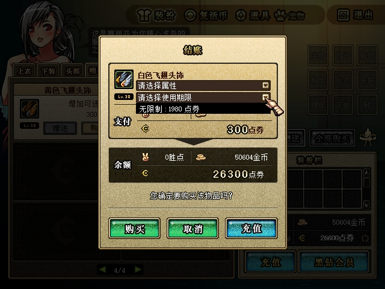

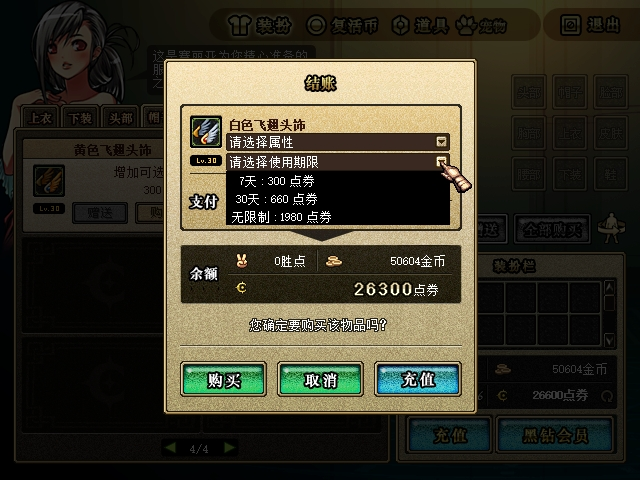

六次购买均使用原生菜单、购买及确认，没有构造业务包。初始点券26600，累计扣7350，最终19250；金币50604和B点券997790保持不变。

| 商品 | 商品号 / attribute | 期限 | 点券 | 购买后点券 | 持久观察 |
|---|---|---|---:|---:|---|
| 51020 白色飞翅头饰，智力+30 | 270000 / 1 | 7天 | 300 | 26300 | `after-cap-7d-purchased.json` |
| 同上 | 270001 / 2 | 30天 | 660 | 25640 | `after-cap-30d-purchased.json` |
| 同上 | 270002 / 3 | 永久 | 1980 | 23660 | `after-cap-permanent-purchased.json` |
| 52641 红宝石饰扣小背心，魔法记忆Lv+1 | 290000 / 1 | 7天 | 450 | 23210 | `after-coat-7d-purchased.json` |
| 同上 | 290001 / 2 | 30天 | 990 | 22220 | `after-coat-30d-purchased.json` |
| 同上 | 290002 / 3 | 永久 | 2970 | 19250 | `after-all-six-purchases.json` |

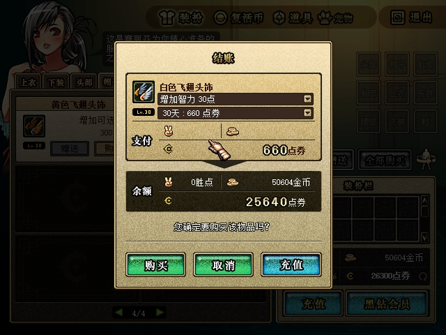

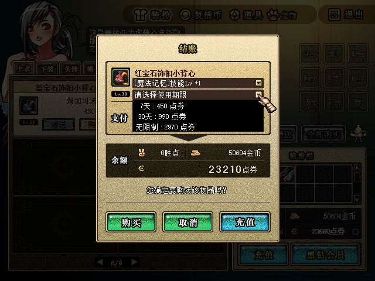

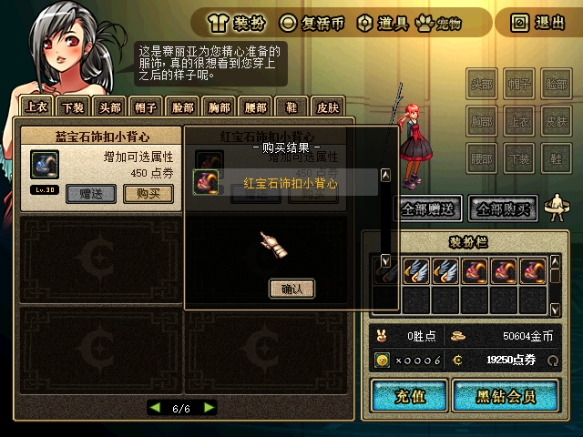

三件头饰的原生提示分别显示7天、30天、无限制，选择属性保留：

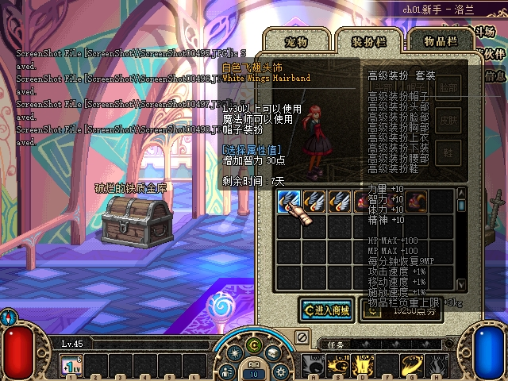

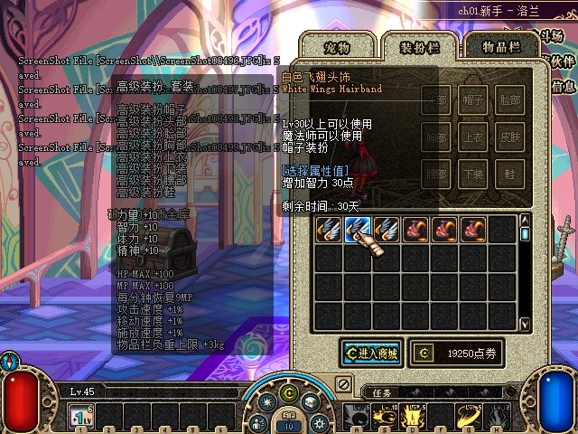

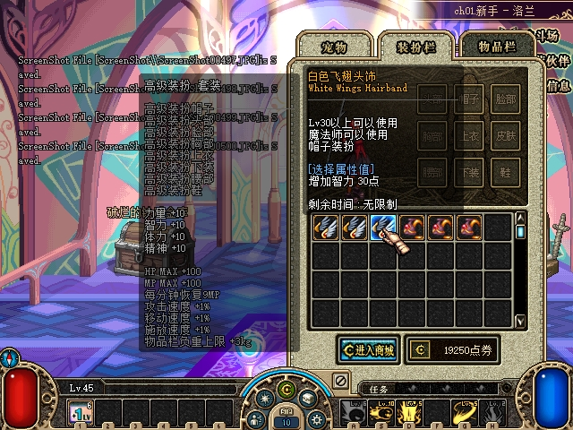

A原生右键穿戴7天头饰和上衣后，B在同一公共城镇可见实际外观：

本记录图片均为查看过的原始640×480截图，复制未裁剪、未重绘；逐文件SHA256及与隔离原件一致的校验见[sha256.json](assets/2026-10-27-avatar-periods/sha256.json)。截图证明可见结果；UUID、截止和精确扣款另由协议和持久快照核验。

### 到期、重启和汇总断言

购买验证使用真实7/30天商品；短期限测试只在隔离存档另建明确记录的fixture，保留六件真实购买实例，不改系统时间，不宣称实际等待7/30天。

- 首轮 `expiry-online` 的180/300秒fixture已在规范存档移除；`expiry-first-before-bag.json`（22:41:00）时装包6件，`expiry-first-after-bag.json`（22:41:55）为5件，短时限上衣槽位清空。到期前双端穿戴画面未收齐，另建 `expiry-pair` 补跑穿戴外观。
- `expiry-pair` 于Unix1793112133锚定：穿戴头饰300秒（截止22:47:13），包内上衣420秒（截止22:49:13），严格小于判定在下一秒生效。穿戴头饰已在无业务输入等待后移除，A装备槽清空，B看到A蓝色飞翅头饰消失。
- `expiry-pair` 在22:48:56暂停，早于包内上衣截止；该实例随离线测试清理，不能将此阶段暂停前截图当作在线包内到期通过。
- 离线阶段22:48:56全部停止，新增两件15秒fixture的截止为22:49:10，原pair包内上衣截止22:49:13。22:49:30发起 `offline-check` 重启（服务端PID30700），22:49:35尚未登录时已清理三件到期实例，22:50:26两端登录选角后仍不复活。
- 最终持久状态报告422/422、准备与文件保护39/39通过；协议、持久状态、18张原图及部署核验共527/527通过，见可随仓库查看的[汇总断言](assets/2026-10-27-avatar-periods/assertions.json)。

`expiry-pair-before-clean.json`（22:44:04）中A装备4件、时装包6件；`expiry-pair-after-worn.json`（22:47:26）为装备3件、时装包6件，点券19250、金币50604不变。穿戴到期的前后画面如下：

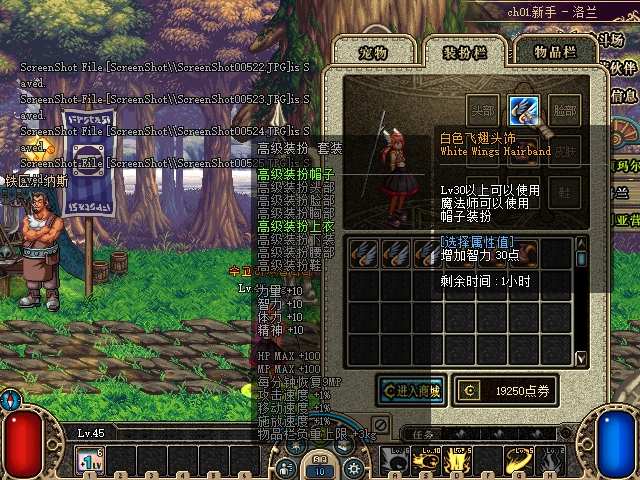

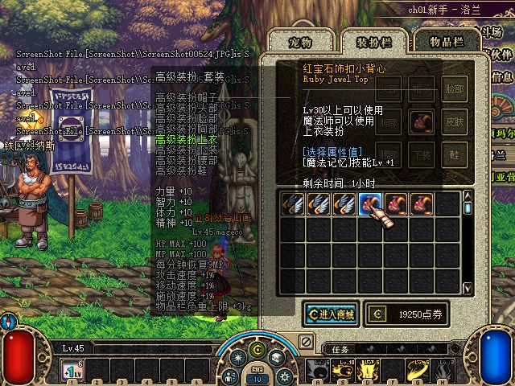

这些画面和装备快照证明穿戴及对端外观刷新；没有打开并记录CLIENTFINAL的数值属性前后差，不能宣称实测智力下降30。NOTI2 mode1的属性输入重建由自动化和协议路径另行核验。

首轮包内回收画面如下。到期前图受客户端自身的头饰期限提示遮挡，槽位存在由同时刻规范存档核对；到期后图可清楚看到前三件头饰之后的上衣槽位已空，右侧两件真实购买上衣仍在。

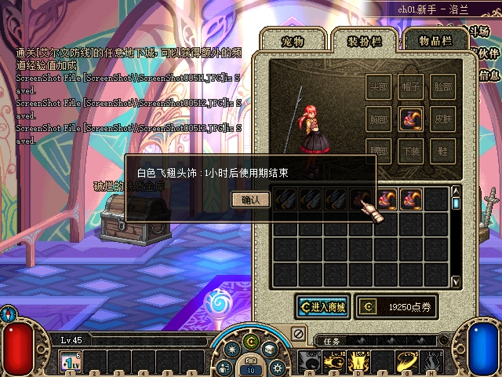

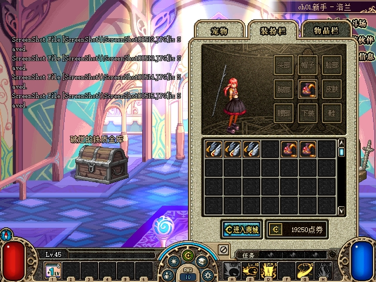

离线前 `offline-before.json`（22:48:56）装备4件、时装包7件；`offline-after-startup.json`（22:49:35）和 `offline-after-login.json`（22:50:26）均为装备3件、时装包5件。六件实际购买实例的UUID和绝对截止保留；A点券19250/金币50604、B点券997790不变。下面是重启登录后的原生界面：7天购买上衣仍穿戴，三件头饰和两件上衣保留在包内，三件离线到期fixture不再出现。

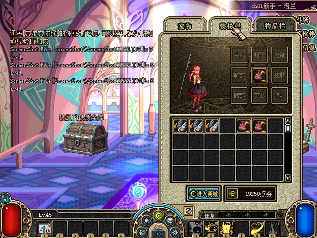

最终 `rx-report-all-final.json` 覆盖 `shop-native`、`expiry-online`、`expiry-pair`、`offline-check` 四阶段、8个来源、92个选中事件，布局/CRC/重组错误0。商城六档单次请求和成功回包5/5，穿戴到期收包6/6；`state-report-final.json` 持久状态422/422、准备与文件保护39/39通过。协议、存档和截图分别证明收到的刷新、持久结果与可见效果，不相互替代。

## 产物与环境恢复

| 产物 / 保护对象 | SHA256 |
|---|---|
| 实测 `DFLegacy.Server.dll` | `8846E30B1F9BAEEB8EE557C7D9DCA399833B21E1608EAACF9996FE3D6DAE4DBE` |
| 实测 `DFLegacy.Protocol.dll` | `DC5C8E3E045908E0EA23829EBB8CDB4018E6D1CDC63126E1912D84A244D20FF1` |
| 新 `ijl15.dll` | `9D6D9C72D5C3288CA6EE81072D2117D5F4B2E3E7874178A61395B6F9260C782C` |
| 两端原EXE（不变） | `6B4850BEAF67EC61ADB04AE17F119F16278DD05E97B8FFCA871A9BDB547DE0D5` |
| 两端原PVF（不变） | `288D58AACE8ED4724A0A94AAA4CD0957B1D52C633771132EDE2F96363C1B506F` |
| 原存档（测试前及当前保护核验） | `FB20572589A5CFB31D89E16EC6936DE96071630E432EDE787CCB0887930ABE52` |

原存档路径为 `G:/Game/DNF_ACT1/DFLegacy/.tmp/lorien-loot-20261027/state.json`。两客户端及各自启动器旁4份旧IJL15均独立备份，旧哈希为 `6A2074E619487D013EE029F9CC88B767BEA9C299A78F061D7F54366B846EBA0C`；本组有意升级至上表新模块，`approved-native-update.json` 精确列出4目标及备份。新产物三条期限限制补丁均禁用。

22:52:41执行 `restore.ps1 -DeployFinal` 完成：测试进程停止，5份原配置逐字节恢复，切回原档路径，实测托管产物和4份新IJL15部署到原运行位置。正常服务端PID67772，目录 `G:/Game/DNF_ACT1/DF/town-test/`；`normal-restored.json` 记录原档哈希保持一致。

`normal-postcheck.json` 为26/26通过：5份配置、4份原生模块、9份托管文件、4个端口7001/27001/8080/8081、原档和两个客户端均核对。随后使用两处原启动器重新打开客户端A PID15004、B PID57156，并实际查看两端均正常到达频道选择，没有DirectInput失败弹窗；未选角色，原档保持不变。用户可直接从当前频道选择界面继续。

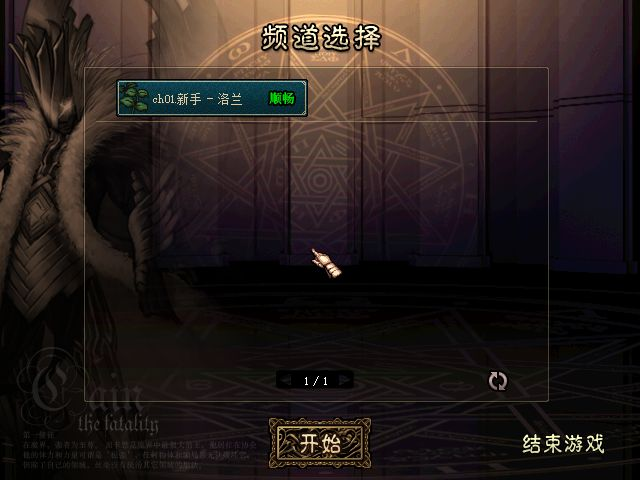

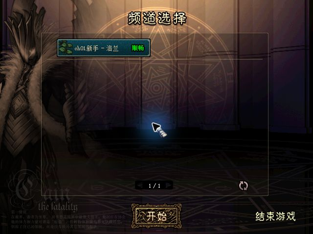

本组未开放直接交易或普通摆摊的时装来源，未恢复CMD22/23租用延期；普通仓库仍拒绝时装。官服允许满足附加规则的未过期时装交易，不能把本工程尚未支持解释成官服禁止。副本内实时到期、原生邮件领取和合成各分支画面仍待另列验证，未验不冒充通过。
