# 2026-10-27：ACT1 普通商城实物赠送验收

本组恢复收礼角色查询、普通商城实物赠送、目标礼物邮件和原生附件领取。服务端源码为 `5fe7e3c`，原生商城入口兼容修复为 `1d915dc`；实测 IJL15 同时包含频道重入修复 `e6959ca`。当前已完成在线 A→B 的原生查询、扣费、收信、领取及月额度提示。

在线与离线赠送领取、领取前后重启持久性、最终合并构建下双端频道重入及组队进副本/换房已完成。赠送协议/存档报告102/102、根任务最终断言228/228、正常部署后检查26/26通过；同一实测构建已部署，5份原配置逐字节恢复、生产原档hash不变，两端正常启动并停在频道选择。文件名沿用10月27日任务开始日期，跨午夜事件实际发生于10月28日（Asia/Shanghai）。下文将界面可见结果、持久状态观察与自动化测试分开记录。

## 官服依据和本组边界

依据本地原服 ELF SHA256 `8859C99D8290DC5FB58151444138CF2697B2BFFF12D47D6159596A03F20B5261`，包括 `Dispatcher_QueryCharacInfo`、`DB_ReqQueryCharacInfo`、`DB_MailBox_Req_CheckReceiver`、`ItemVendingMachine::BuyItem/ProcessBuyRequestEx/_CheckEnableGiftCondition/ProcessIPG_ResultOutput`、`Arad_IPGProcess::CashShopModeItem`、`CCeraShop::_processItemGift`、`ReqDBSendNewMailCashShop` 和 `DB_UpdateGiftCount`。完整函数、ACT1 reader/sender 和 PVF 证据位于 `.recon/next-group-after-avatar-20261027/`，其中 `assessment.md` 的原生 UI 门控更正必须与早期评估一起阅读。

| 项目 | 实现规则与明确边界 |
|---|---|
| 商品 | 本轮只含普通主包实物。正例为商品100018、item15×1、150点券；100021在实际 PVF 禁赠表中。时装、宠物、复活币、契约、仓库、货币券、礼包/立即开启容器/抽奖及直接效果不在本轮范围，不能据此称官服全部禁赠。 |
| 查询 | ACT1 CMD146，名字使用 CP936 编码字节长度；未知/删除目标21、本人7、失败2。成功返回规范名字、等级、职业、成长/觉醒、性别投影和账号收礼次数。当前模型缺少持久性别字段，保留 sex byte 并投影0。 |
| 目标 | 真正 CMD67 gift1 提交时重新查规范角色和目标账号黑名单。允许离线、低等级、同账号不同角色；不借用师徒等级/在线条件，也不把本地 IsAdmin 当官服 GM 表。当前角色自送67拒7是防绕过适配。 |
| 月次数 | 收礼账号共享，每成功商品+1，与附件数量无关。ACT1当前 PVF 无 `[max gift count]`，默认1；服务端在事务内重验，防陈旧查询/并发绕过。使用上海时区完整 YearMonth，明确修正样本只比 `tm_mon`、同月跨年不归零的缺陷。 |
| 扣费与邮件 | 本地 store gate 下规划双方账号，单次原子快照同时扣发送账号点券、投递指定角色邮件、增加目标账号次数。成功才发送结果/现金失效/邮箱 alarm。官服样本没有跨外部 IPG 与邮件 DB 单事务的证明，本工程原子快照属于工程适配。 |
| 会话与领取 | 发送者只更新现金，不获得附件；账号内在线会话消费失效通知时重读规范余额，旧充值通知不能覆盖新扣款。邮件保留 sender、物品和数量，领取复用既有规范一次入包。 |
| 兼容限制 | 本工程物理删角无 tombstone，提交未知和已删名字均3，不能复现官服可区分的24；邮箱满/超额度使用本地 generic4。没有可靠幂等键，合法重复包可成为另一订单；未知写入结果隔离且不自动重试。 |

ACT1 CMD67失败布局修正为 `0,unused:u8,error:u8,category:i32,commodity:u32,progress:u32,last:u32,reserved:u16`，总长21字节。成功 gift1 回显赠送标记，买家奖励列表为空；本人 gift0 购买布局保留。不能用后期16位错误布局替代 ACT1 的实际 reader。

## 原生商城入口修复

早期静态评估确认保留了 UI112 收礼窗和 gift 构包代码，但真机50/51表明当前 EXE 的赠送入口被硬禁用；仅有保留代码不足以证明原生点击可达。原图50中商品已入篮，“全部赠送”仍灰：

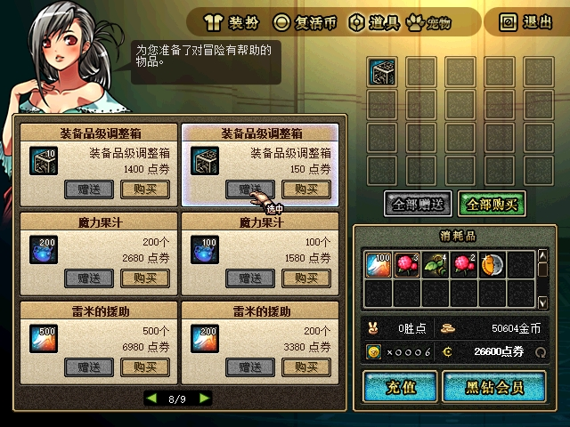

`1d915dc` 只在 IJL15 内存兼容补丁中恢复 `0x85E02F` 已计算的非空标志 BL。该出口只在原有禁赠扫描没有命中时抵达；`0x85E03C` 禁赠出口继续写0，空篮仍禁用，商品行按钮门控未放开。补丁逐字节核对原值，没有修改磁盘 EXE/PVF。修复后，通过“全部赠送”打开原生 UI112：

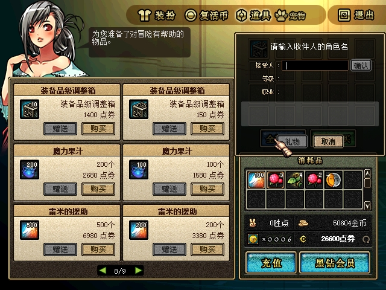

修复后的空篮中，“全部赠送”和“全部购买”均为灰色；加入明确禁赠的100021（50个装备品级调整箱、6000点券）后，“全部购买”启用，“全部赠送”仍灰，点击未打开收礼查询窗。此处是原生门控验证；伪造gift1提交的禁赠拒绝与经济守恒另由确定性测试覆盖。

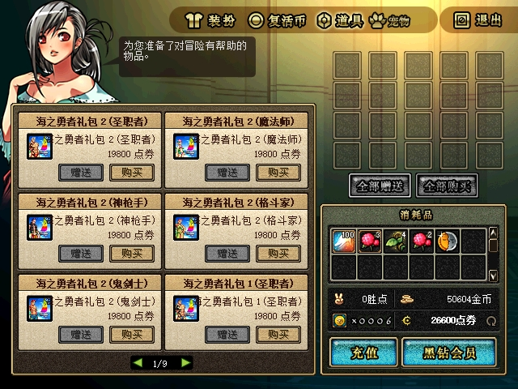

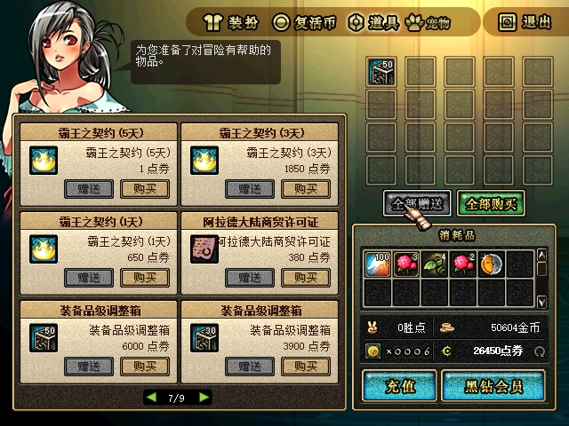

该阶段及最终部署 IJL15 SHA256 为 `82EE8D8E5B7F50DBD663D3DA91925C57BE25B595A38DF7B1F6A7CB28BC74E121`。不能将“未改磁盘 EXE”误写为“无需原生兼容修复”。

## 双客户端在线实测

隔离目录为 `G:/Game/DNF_ACT1/DFLegacy/.tmp/channel-return-20261027/`，阶段 `gift-online`。A为shizuku/mageco（45级魔法师），B为test/heal1024（6级圣职者）；服务端PID58624、B PID56476，合法查询和赠送时A PID55720。A之前的27704/65956是同阶段早期查询进程，不跨进程拼成一条连接。所有下列赠送均由原生界面点击发起。

未知名 `zzGiftNoOne` 显示红字“该ID不存在”；重新启动A后正确输入本人 `mageco`，原生显示“无法对自身赠送礼物”。标签62原计划验证本人，但输入失败，实际仍为第二次未知名查询，不能将62计为本人错误7证据；正确证据是72。

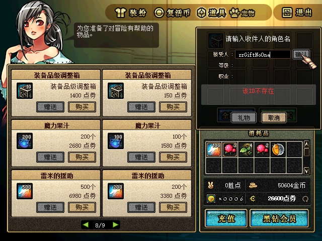

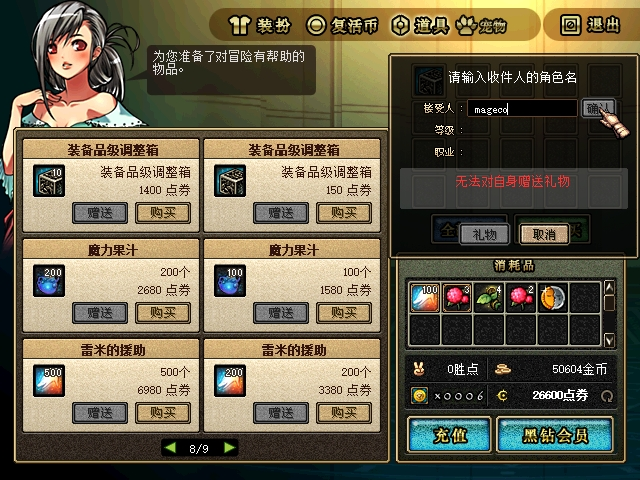

合法查询 `heal1024` 显示6级、圣职者，并显示每月最多1个的原生提示。单张截图证明这些可见字段和提示；最终抓包报告另核对CMD146未知错误21、本人错误7，合法结果为level6/job4/growth0/gender0，成功前received_count0、成功后1。

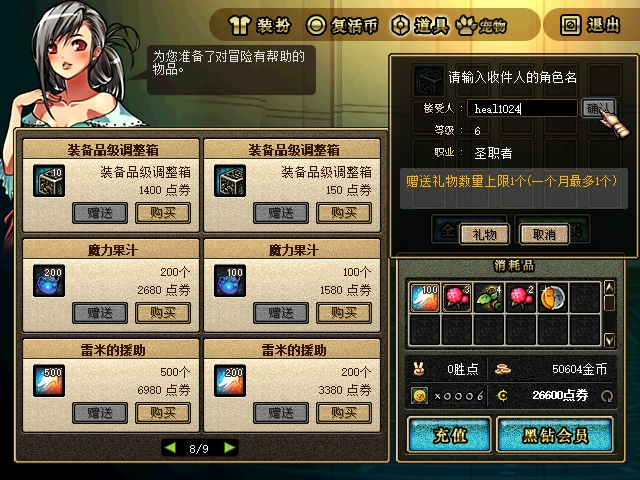

原生结算页列出一件装备品级调整箱、支付150点券、预期余额26450；这里的26450是结算预览。实际确认后出现“赠送结果”，商城现金也为26450，持久观察同时证明扣款已经提交。

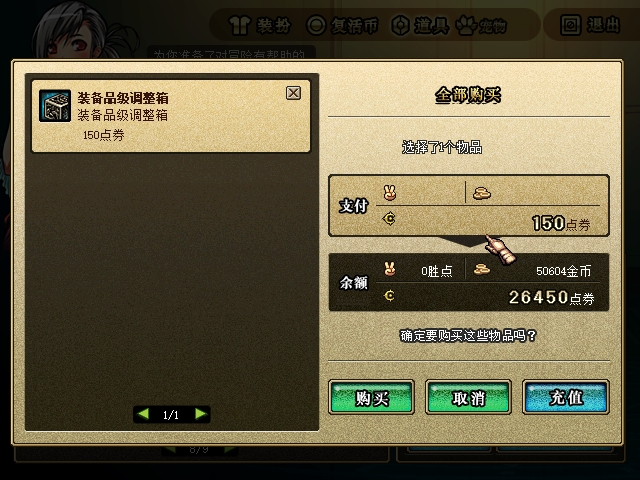

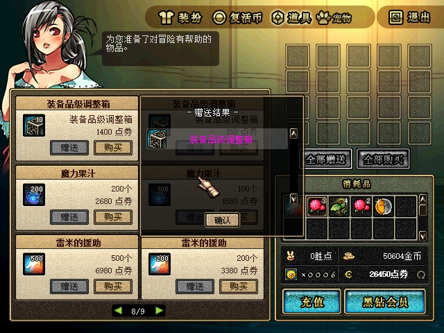

B原生邮箱出现发件人mageco、主题“mageco赠送的商城礼物”；读信可见相同发件人和装备品级调整箱附件。点击附件后附件栏清空，背包出现该物，原生提示为“装备品级调整箱 / Kaleido Box”。图片证明界面所见，item15编号和精确数量以规范存档观察交叉核对。

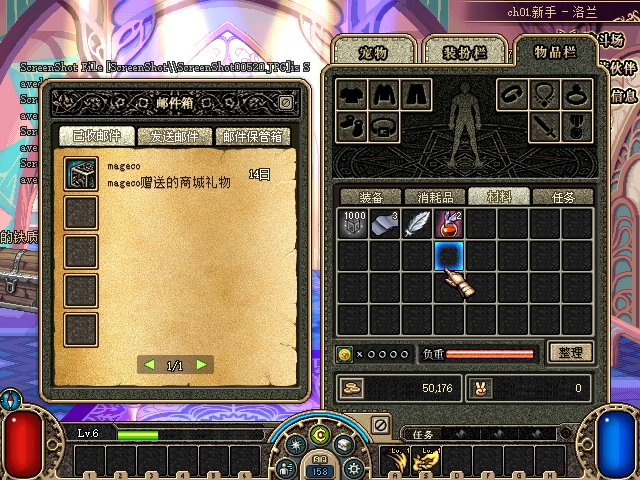

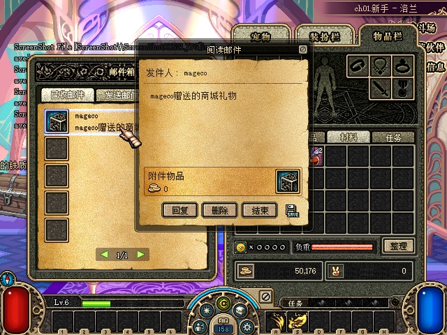

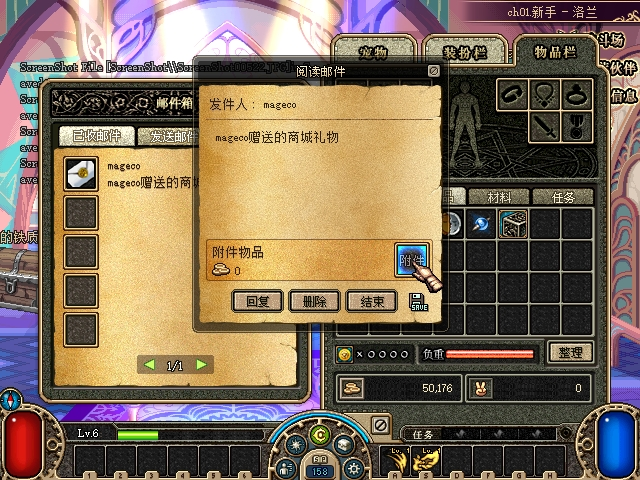

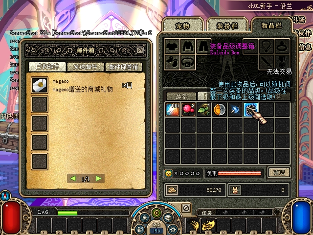

同一在线流程再查询heal1024，原生显示“已超出对方接受上限(1个) / 下月初开始可赠送礼物”，“礼物”按钮禁用。没有清除计数后把第二次当作同一未重置流程。

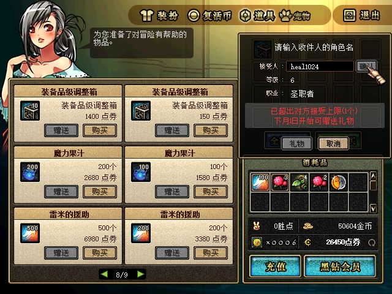

本记录共18张图片，均逐张查看原件后原样复制，未裁剪、重绘或生成替代画面。原路径、原件和复制件SHA256及相等校验见[图片清单](assets/2026-10-27-cera-gift/sha256.json)。

## 规范状态观察

下表来自隔离规范存档的只读观察，原观察文件SHA256、完整存档SHA256、采样时刻和本表字段见[状态摘要](assets/2026-10-27-cera-gift/state-summary.json)。最终协议/存档报告另将这些规范状态与实际收发包交叉核验。

| 观察点 | A点券 | B点券 | A背包item15 | B邮件item15 | B背包item15 | B收礼年月/次数 |
|---|---:|---:|---:|---:|---:|---|
| 在线基线 | 26600 | 997790 | 0 | 0 | 0 | 未写入（逻辑0） |
| 赠送提交后 | 26450 | 997790 | 0 | 1 | 0 | 202610 / 1 |
| 原生领取后 | 26450 | 997790 | 0 | 0 | 1 | 202610 / 1 |
| 再次查询额度 | 26450 | 997790 | 0 | 0 | 1 | 202610 / 1 |
| 禁赠商品入篮/点击后 | 26450 | 997790 | 0 | 0 | 1 | 202610 / 1 |
| A/B菜单重入后 | 26450 | 997790 | 0 | 0 | 1 | 202610 / 1 |
| 服务端重启后、登录前 | 26450 | 997790 | 0 | 0 | 1 | 202610 / 1 |
| 重启登录及组队副本/换房后 | 26450 | 997790 | 0 | 0 | 1 | 202610 / 1 |

A金币50604、B金币50176在这些观察点均不变。领取、额度查询与禁赠入篮后的完整存档SHA256相同，为 `C721D09BAEE1E0639E12F0812F4DBB1C55F02AF00D3E93CAF9D27A00AA50F4D0`；查询及灰色禁赠按钮没有产生第二笔扣款或附件。

A/B在最终合并构建下通过105–112的原生菜单再次返回频道并重入。2026-10-28 00:04:20暂停在线阶段，完整存档SHA256为 `740F84631FB02E95C486FEC2B40A6E5515939C5762ED26223F2A903B94EB6C19`；00:04:24使用同构建启动 `gift-online-restart`，服务端PID57496、A/B PID31440/74408。登录前观察的完整存档SHA256与暂停前相同，已领取物仍恰为B背包item15×1、邮件附件0，点券和月次数保留。重启后的原生登录/选角113–116已完成，119中B再次可见装备品级调整箱提示：

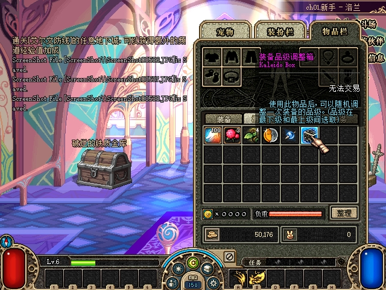

相同最终合并构建下，00:17:09形成party1、成员2；00:25:28副本1的房间(0,0)两人均完成加载并收到NOTI30；正常战斗后00:34:35两人进入下一房间(1,0)、map9，均完成加载并收到NOTI30。169/171原生双端下一房间画面由[频道/组队回归记录](2026-10-27-channel-return-verification.md)统一归档。此回归后的 `gift-online-after-party` 观察仍为A26450、B已领取item15×1、邮件附件0、账号月次数1。00:37暂停后的完整存档SHA256为 `562CAF1CF686C9E7E9EFCE79977CC3DA791B81B6A472E9DC6186A9655BCE10E2`。

## 离线收礼独立用例

在线用例已耗尽B账号本月额度1，因此离线测试明确使用另一份干净基线，不把重置前后的订单宣称为同一未重置流程。全部客户端和服务端停止后，保留上述在线完整冻结存档，将隔离测试 `state.json` 逐字节恢复为最初模板；[重置记录](assets/2026-10-27-cera-gift/offline-case-reset.json)列出前后hash、保留的在线快照路径，明确无改系统时间、无充值。模板、恢复后的隔离存档与生产原档SHA256均为 `FB20572589A5CFB31D89E16EC6936DE96071630E432EDE787CCB0887930ABE52`。

`gift-offline` 阶段服务端PID46104，只启动A PID36284，B进程在该阶段未启动；离线基线为A26600、B997790，双方item15背包/邮件均0，B未写入收礼年月/次数（逻辑0）。A原生查询离线B，显示其6级圣职者档案；原生结算并最终确认后出现“赠送结果”，实际余额26450：

`gift-offline-delivered` 规范观察为A26450、A背包item15为0，B邮件item15×1、背包0、账号收礼次数1；[送达时进程记录](assets/2026-10-27-cera-gift/offline-delivery-processes.json)仅有A PID36284，明确收件客户端不存在。暂停后的完整存档SHA256为 `B942E0FFF08894B4BFA5421A6EF43EC873989BE9151760802D0411622E43E640`。

随后停止A和服务端，以无客户端方式启动 `gift-offline-receipt`（服务端PID69684），登录前的 `gift-offline-after-delivery-restart` 观察仍为B邮件附件1、背包0、次数1，A26450。仅启动B PID75224进行原生登录/选角；187读信中可见发件人mageco及附件，188原生点击附件后，190可见背包中的装备品级调整箱：

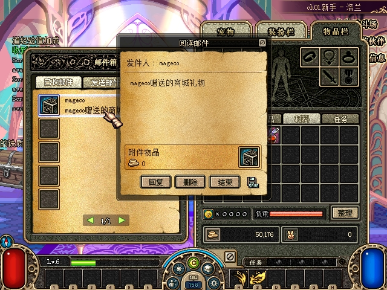

`gift-offline-claimed` 规范观察为A26450、B997790，A背包item15仍0，B背包item15×1、邮件附件0、账号次数1。暂停后完整存档SHA256为 `9C7CB83F1EADB2DCA3F21EE98513583827EBDD37AA8C7F6D9919123642BA4EA9`。最后以无客户端方式再次重启服务端，阶段 `gift-offline-final`、PID45560，`gift-offline-after-final-restart` 的完整存档SHA256仍相同，现金、计数、背包与附件均保持。这次最终重启验证服务端持久性，没有宣称该阶段又启动原生客户端。

| 离线独立用例观察点 | A点券 | B点券 | A背包item15 | B邮件item15 | B背包item15 | B账号次数 |
|---|---:|---:|---:|---:|---:|---:|
| 干净基线 | 26600 | 997790 | 0 | 0 | 0 | 0 |
| B不在线时送达 | 26450 | 997790 | 0 | 1 | 0 | 1 |
| 未领取邮件经服务端重启 | 26450 | 997790 | 0 | 1 | 0 | 1 |
| B登录原生领取 | 26450 | 997790 | 0 | 0 | 1 | 1 |
| 领取后再次服务端重启 | 26450 | 997790 | 0 | 0 | 1 | 1 |

## 自动化与审查

日志在 `.superpowers/sdd/2026-10-27-cera-gift/`。协议精确字节、规范事务和会话竞态先有RED后GREEN；没有以生产builder生成自身预期。定向测试包含同账号不同角色、离线低等级、账号共享额度、上海月界/跨年、禁赠/sticker99、目标/余额/邮箱失败守恒、并发争现金/额度、多商品整单回滚、陈旧保存、原账本保留、写入前/替换后故障隔离、重启领取与旧绝对现金通知晚到等。

| 实际验证 | 结果与证据 |
|---|---|
| Release定向 gift smoke | 0 failures：[task-1-green.log](assets/2026-10-27-cera-gift/task-1-green.log)。 |
| 完整 .NET smoke | 全部通过：[task-1-full-smoke.log](assets/2026-10-27-cera-gift/task-1-full-smoke.log)。 |
| Server/SmokeTests Release | 均0警告、0错误：[Server日志](assets/2026-10-27-cera-gift/task-1-server-release.log)、[Smoke日志](assets/2026-10-27-cera-gift/task-1-smoke-release.log)。 |
| dotnet整体solution | 失败并保留：[原日志](assets/2026-10-27-cera-gift/task-1-release-build.log)。dotnet CLI无法导入C++ `VCTargetsPath/Microsoft.Cpp.Default.props`，Launcher原生hook也失败；不能写成整体solution成功。 |
| 单独Win32 MSBuild原生构建/兼容测试 | 0警告、0错误；`ijl15 compatibility tests passed`：[构建](assets/2026-10-27-cera-gift/gift-ui-native-build.log)、[测试](assets/2026-10-27-cera-gift/gift-ui-native-tests.log)。 |
| 独立整分支审查 | 主任务已报告 `12bb186..5fe7e3c` 审查无遗留发现；`1d915dc` 的原生门控增量也已独立复核。审查不替代前述真机证据。 |

## 最终赠送协议核验与部署恢复

[最终赠送协议/存档报告](assets/2026-10-27-cera-gift/gift-proof.json)在2026-10-28 00:52:57生成，102/102检查通过，pending为空。它按阶段、PID及精确TCP连接归属实际数据，保留原捕获路径/行号、观测与部署hash；公开副本只含选定146/67、现金53、邮件与领取、item15相关字段，不含认证正文或原始hex。报告与恢复记录的原件/复制件SHA256见[报告来源清单](assets/2026-10-27-cera-gift/report-provenance.json)。

在线23:57:12.217与离线00:43:24.960各有一次原生TX CMD67 gift1，收件人heal1024、商品100018、attribute0；各自之后均有成功RX CMD67 gift1，奖励列表为空，并收到现金NOTI53=26450。在线与离线各自从26600扣150，未向买家发item15。报告同时核对规范送达/领取/重启链、B进程启动晚于离线查询和投递、最终无客户端重启状态与冻结hash一致。选定捕获的CRC、结构、布局、未完成字节与禁用流错误均为0。102项是赠送专项报告计数，不与根任务全局检查混为一个总数。

2026-10-28 00:59:12执行最终部署恢复，见[恢复记录](assets/2026-10-27-cera-gift/normal-restored.json)：正常服务端PID72668，工作目录 `G:/Game/DNF_ACT1/DF/town-test/`；托管 `DFLegacy.Server.dll` SHA256为 `711356C0921FEFD026C668C51661B9DB2636C1E68ACA4FFA7CDDF69A8E014F8D`，原生IJL15为上述82EE产物，与实测构建相同。5份原配置逐字节恢复，服务端恢复使用原存档路径，生产存档SHA256保持下列原值。部署前根任务非空断言196/196通过。

正常路径重新启动A PID48880、B PID39764，双方均停在频道选择、没有错误弹窗，身份见[正常客户端记录](assets/2026-10-27-cera-gift/normal-clients-reopened.json)，已查看的原生画面统一保留于[频道记录的正常环境部署与恢复](2026-10-27-channel-return-verification.md#正常环境部署与恢复)。01:00:50的[部署后检查](assets/2026-10-27-cera-gift/normal-postcheck.json)26/26通过，核对原配置、原档、托管/原生产物和正常进程身份。最终 `acceptance.py --post-deploy` 的[根任务断言](assets/2026-10-27-cera-gift/assertions.json)228/228通过，包括部署前196项、后补原生资产及正常环境核验；赠送专项102项单列，不与228重复相加。

生产原档SHA256为 `FB20572589A5CFB31D89E16EC6936DE96071630E432EDE787CCB0887930ABE52`，与验收准备前一致。测试邮件与经济变动仅发生于隔离副本，原档没有导入测试赠送结果。
