# 2026-10-27：返回频道后重入假死验收

用户确认的现象是返回频道、再次点击进入后约11秒无响应，随后可继续进入。用户原图显示 Windows“Dungeon & Fighter 未响应”；本轮没有证明发生访问冲突或进程崩溃。基线3次重入的登录应答到CMD2间隔为10.814–10.974秒；原生修复后的3次重入为1–2毫秒，最终合并构建另有双端2次重入为0–1毫秒。首次连接不计入重入样本，0毫秒表示同一毫秒内先后完成。

**已完成本记录所述修复、回归与正常环境恢复，更新至2026-10-28。** 原生修复已完成RED/GREEN、重复菜单重入、最终合并构建下双端重入，以及同一最终构建下两人组队进副本和换房。最终正常环境部署、5份原配置、原存档路径和双端客户端恢复完成，部署后26/26检查通过。

## 原因与修复边界

ACT1客户端在登录应答路径和普通帧路径同步执行原生ICMP MTU探测。每次回到频道后，NOTI1重建NAT host列表并把MTU重置为-1；重新探测的二分循环使用1000毫秒单次超时，能造成约11秒主线程等待。包头证据显示入口握手、游戏连接、NOTI1和登录应答已完成，等待集中在接下来CMD2之前。修复后相同端点复用原生结果，CMD2立即继续，原生窗口也重新进入城镇。

另有静态指针生命周期缺陷：host列表释放后，manager仍保留指向旧字符串的selected host指针；MTU探测会使用它。本轮未采集到该指针的运行时访问冲突，不把静态缺陷冒称为已复现崩溃，也未证明基线探测实际使用的目的地址。

源码 `e6959ca` 在两个完整CALL边界 `0x78CA43` 和 `0x78CCAB` 安装wrapper，原生入口和两处原字节先校验。wrapper从当前owned host vector读取键，再通过原生selector刷新当前host绑定；同一manager、单host文本、localIPv4和两端口完全相同时，复用本进程中原生探测实际返回的MTU。没有结果时仍调用原生探测，不猜测MTU、不伪造NAT应答，不修改EXE或PVF文件。

端点、localIPv4或manager变化、多host时继续原生选择和探测；无法可信读取metadata时保留原调用。此方案保留首次及新端点可能同步等待的边界，未实现通用异步NAT。相同IP/端点身份背后的网络路径仍可能变化，进程内缓存不能自动感知这类变化。740/750若由原生返回属于原生fallback，不能表述为ICMP测量成功；当前真机实际值为1472。

## 可复核延迟

原始包捕获仅在本地隔离目录保留；发布资产仅包含时间、方向、包头、连接端点与行号，不含认证payload、凭证、原始报文或hex。按每个PID内精确TCP `(local, remote)` 分组，取同一连接的首个TX CMD2及它之前最后一个RX CMD1。每个PID首次游戏连接单列并排除；每个重入连接均核对同PID之前的CMD3成功应答。没有跨session配对。

| 构建 / 角色 | PID / 本地TCP端口 | RX CMD1 | TX CMD2 | 间隔 |
|---|---|---|---|---:|
| 基线 A，第1次重入 | 26236 / 5668 | 23:08:34.839 | 23:08:45.813 | 10974 ms |
| 基线 A，第2次重入 | 26236 / 4659 | 23:12:01.408 | 23:12:12.304 | 10896 ms |
| 基线 B，第1次重入 | 59236 / 14185 | 23:10:35.496 | 23:10:46.310 | 10814 ms |
| 修复 A，第1次重入 | 74232 / 4930 | 23:30:23.730 | 23:30:23.732 | 2 ms |
| 修复 B，第1次重入 | 64892 / 5018 | 23:30:31.522 | 23:30:31.523 | 1 ms |
| 修复 A，第2次重入（公共城镇返回） | 74232 / 10333 | 23:32:26.605 | 23:32:26.606 | 1 ms |
| 最终合并 A，10/28重入 | 55720 / 2885 | 00:02:07.151 | 00:02:07.151 | 0 ms |
| 最终合并 B，10/28重入 | 56476 / 2414 | 00:02:14.524 | 00:02:14.525 | 1 ms |

以上均为本地时间（Asia/Shanghai）；前6行日期为2026-10-27，最后2行为2026-10-28，JSON保留完整日期，游戏对端均为 `192.168.3.177:7001`。6份capture解析错误数均为0。基线两端首次连接86/103毫秒，修复首次79/90毫秒，仅作为排除项保留，未用于夸大修复前后比较；最终合并亦逐PID排除首次。具体连接、原捕获/包头报告SHA256、行号及首次连接见[最终合并延迟分析JSON](assets/2026-10-27-channel-return/latency-final-20261028-0015.json)，并保留[前轮报告](assets/2026-10-27-channel-return/latency-20261027-2342.json)和[首轮报告](assets/2026-10-27-channel-return/latency-20261027-2335.json)。该指标覆盖登录应答后的阻塞区间，不等同于从鼠标点击到完整场景显示的总耗时，也不能单靠毫秒包间隔证明整个UI期间无卡顿。

原生 `channel-reentry-74232.log` / `channel-reentry-64892.log` 均有首次 `reused=0`；A两次重入、B一次重入为 `reused=1`，MTU均1472，wrapper计时均为0ms。最终合并 `channel-reentry-55720.log` / `channel-reentry-56476.log` 也均为首次不复用、重入复用，原生值1472、wrapper计时0ms。0ms表示计时器精度内完成，不是宣称没有执行任何工作。

原修复实测阶段 `native-mtu` 服务端PID69260，对应 `e6959ca`，原生DLL SHA256为 `42C7A008C72F1D53CB864AF9AAE71FCBD91BB7CC8C392A2936CF109FCB1D0C81`。最终合并源码 `1d915dc` 另包含商城赠送结算资格的6字节原生补丁，保留同一MTU修复；最终原生DLL SHA256为 `82EE8D8E5B7F50DBD663D3DA91925C57BE25B595A38DF7B1F6A7CB28BC74E121`。最终双端重入发生于 `gift-online`（服务端PID58624），历史部署快照确认A先后更换为27704/65956/55720、B为56476；本表只使用最后A55720和B56476各自的初始/重入连接，未跨PID配对。四处原生DLL目标的部署记录见[最终原生产物记录](assets/2026-10-27-channel-return/native-update-final.json)，不能再把旧42C7产物标为最终版本。

## 原生画面

用户提供的未响应原图：

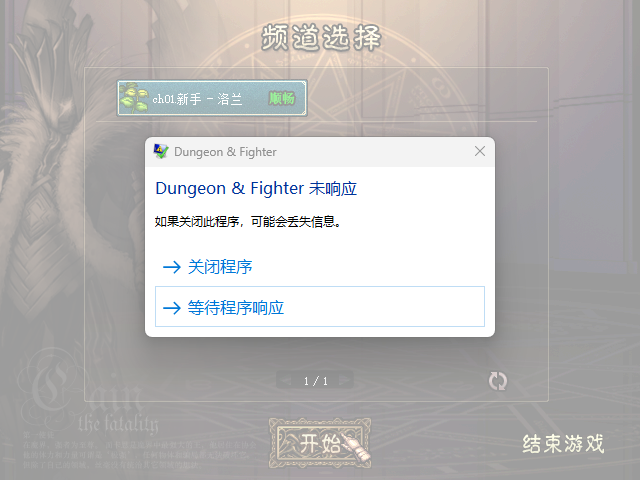

基线通过原生菜单选择频道，点击开始时显示连接提示，约11秒后同一PID恢复进入城镇：

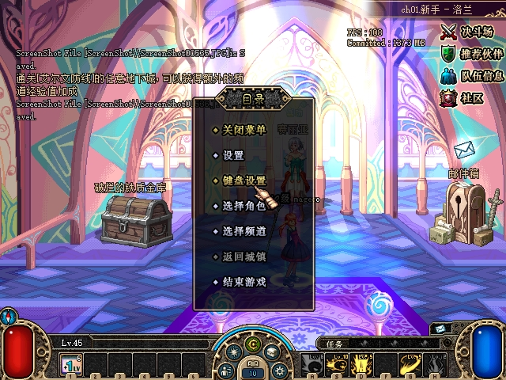

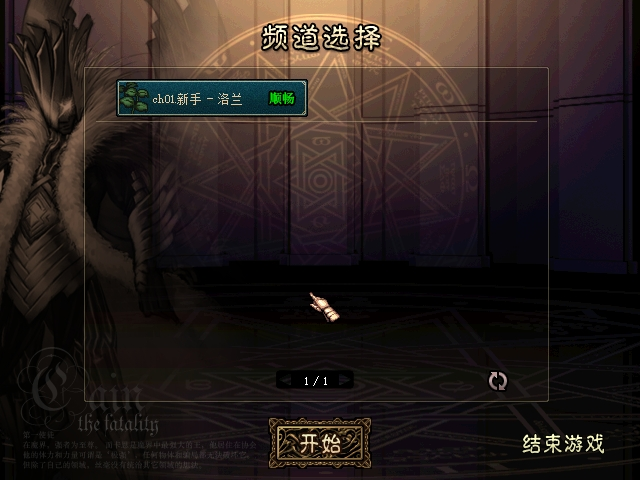

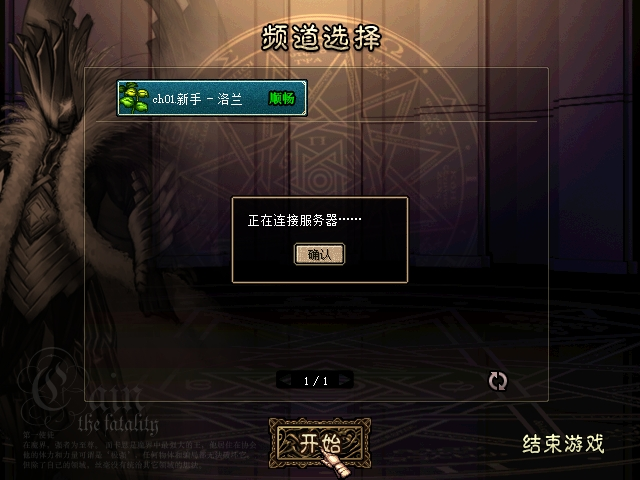

修复后A、B均完成第一次菜单重入并返回原生城镇：

上述图片均逐张查看后原样复制，未裁剪、重绘或添加结果文字。源文件与复制件SHA256一致，见[初始资产清单](assets/2026-10-27-channel-return/sha256-initial.json)。静态截图证明可见画面，精确时延另由同连接包头计算；29/33点击瞬间截图仍显示连接提示，因此没有把它们当作已经进城的证明。

最终合并后的两端于 `gift-online-restart` 再次启动并正常选角进入城镇（服务端PID57496，A31440、B74408），以下图片属于重启验证，不能冒充上表0–1ms重入发生的同一PID。105–112的最终菜单重入由包头闭合；108/112点击瞬间仍有连接提示，未当作完成画面。

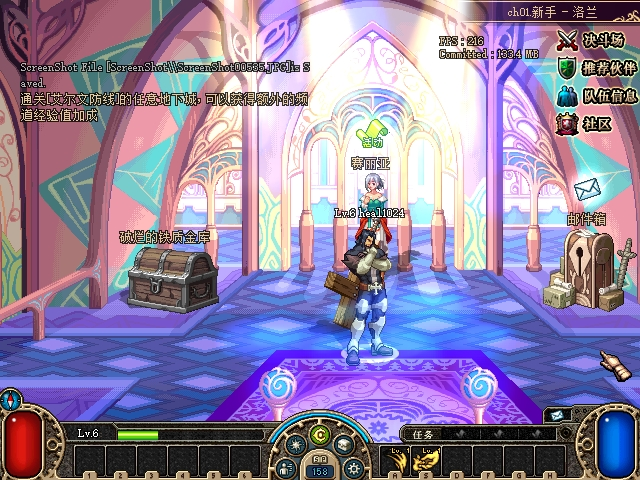

最终分析及两张重启原图同样原样复制，见[最终补充资产SHA清单](assets/2026-10-27-channel-return/sha256-final-0015.json)。

## 最终构建组队、副本与换房回归

回归沿用最终源码 `1d915dc`、原生DLL `82EE…E121`，阶段 `gift-online-restart`，服务端PID57496，A31440、B74408。两端重启后通过原生菜单邀请和接受组队，正常进副本、普通战斗清除首房，再通过方向键走到门区换房；未用DebugDrop生成战利品或构造业务协议。画面、服务端状态和双向UDP中继共同验证了实际流程。

| 2026-10-28本地时间 | 实际结果 |
|---|---|
| 00:17:09 | B接受A邀请；party1发布2人roster。 |
| 00:25:27 | 两人在dungeon1 / instance1 / room(0,0)，起始map1；两用户各消耗1疲劳。 |
| 00:25:28 | instance1全部2人完成加载，向全队广播NOTI30。 |
| 00:34:35 | B再A进入room(1,0)，两用户各消耗1疲劳；同一instance1全部2人完成加载，再次向全队广播NOTI30。 |

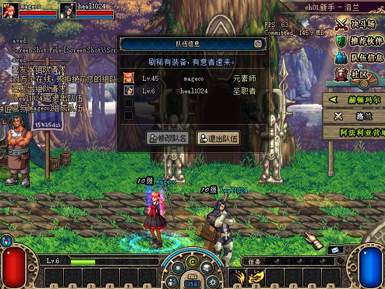

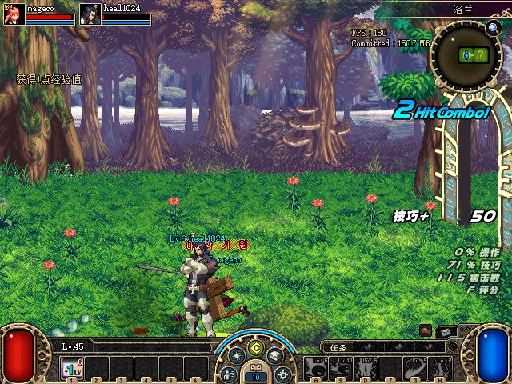

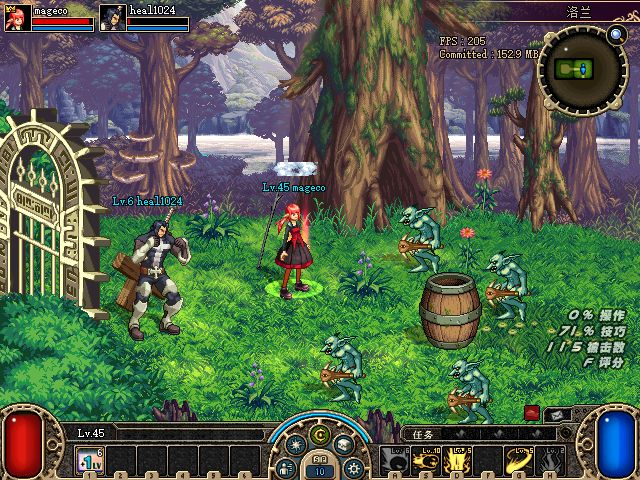

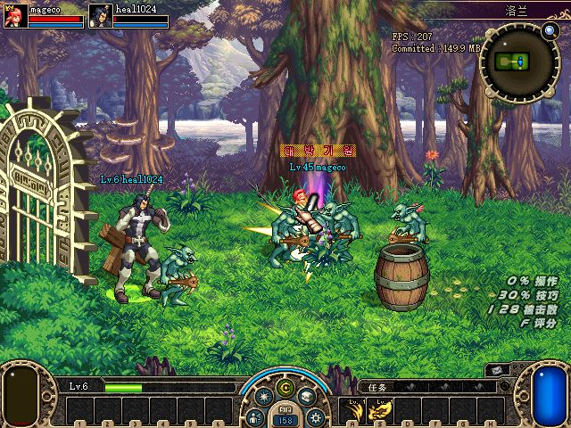

00:25:27–00:36:59，A端点 `192.168.3.177:50284` 向1/1队友端点成功转发10269条、305683字节；B端点 `192.168.3.177:5063` 反向成功转发9635条、259300字节。入口context切换瞬间两端各另有1条0/0记录，未算入成功转发数。应用层审计仍打印CRC/cipher警告，窗口内A6940条、B6282条；当前中继按不透明UDP报文转发，审计不能解释部分原生应用帧不会阻止该转发。因此这里证明双向中继与可见组队游戏继续运行，不宣称全部UDP通过CRC、全部应用帧已被服务端支持，亦不将这些警告混为TCP包头解析错误。

暂停后冻结状态SHA256为 `562CAF1CF686C9E7E9EFCE79977CC3DA791B81B6A472E9DC6186A9655BCE10E2`；赠送相关A点券26450、B领取item15数量1、当月接收计数1仍保留。普通战斗产生的金币和经验变化属于真实回归结果。[只读回归检查](assets/2026-10-27-channel-return/party-regression-proof-20261028-0045.json)17/17通过，包含确切部署身份、冻结状态哈希、组队/进房/双人加载、两端下一房疲劳和双向中继，未以截图替代这些状态断言。

原生截图接口在125/126控制步骤等待超时，另有10秒邀请过期，后续重试后闭合流程；这些是控制与截取限制，未发现它们对应游戏崩溃。上述4张图改用窗口截图保存，逐张查看后原样复制，未重绘或拼接；B的调试显示通过原生F10关闭后再截图。副本原图及回归JSON的源/复制件SHA一致，见[副本回归资产清单](assets/2026-10-27-channel-return/sha256-party-0045.json)。

## 自动化与验证边界

Win32原生兼容测试先RED：同端点没有复用、读取fresh owned string测试失败（[native-red.log](assets/2026-10-27-channel-return/native-red.log)）；实现后完整兼容测试输出 `ijl15 compatibility tests passed`（[native-green.log](assets/2026-10-27-channel-return/native-green.log)），Release原生工程构建0警告、0错误。自动化覆盖同端点复用时仍刷新host、manager/localIP/两端口/host变化需重探、多host不cache、无效MTU不cache，以及旧selected pointer被毒化时仍读取新owned字符串。

最终合并产物下双端菜单重入及组队进副本/换房均已补充。不提前宣称网络路径变化、多host或全部游戏流程均完成真机验收。

## 正常环境部署与恢复

2026-10-28 00:59:12+08执行 `restore.ps1 -DeployFinal` 成功，测试客户端关闭，正常服务端从 `G:/Game/DNF_ACT1/DF/town-test/DFLegacy.Server.exe` 启动，PID72668。5份原配置按原哈希恢复，原存档路径恢复，原存档SHA256仍为 `FB20572589A5CFB31D89E16EC6936DE96071630E432EDE787CCB0887930ABE52`。测试角色、经济和战斗变化均留在隔离副本。

同一最终托管产物已部署，服务端DLL SHA256为 `711356C0921FEFD026C668C51661B9DB2636C1E68ACA4FFA7CDDF69A8E014F8D`；原生DLL仍为 `82EE8D8E5B7F50DBD663D3DA91925C57BE25B595A38DF7B1F6A7CB28BC74E121`。恢复执行结果见[正常环境恢复记录](assets/2026-10-27-channel-return/normal-restored-20261028-005912.json)，原样复制与[SHA校验](assets/2026-10-27-channel-return/sha256-restored-005912.json)通过。该记录中的 `ClientsClosed=true` 指恢复时测试客户端均已关闭，不代表之后的正常客户端启动检查已执行。

恢复后通过原路径重新启动A `G:/Game/DNF_ACT1/DF/DNF.exe`（PID48880，00:59:46本地时间启动）和B `G:/Game/DNF_ACT1/Client_test2/DNF.exe`（PID39764，00:59:48启动）；两端均停在正常频道选择，没有错误弹窗。[客户端身份记录](assets/2026-10-27-channel-return/normal-clients-reopened.json)保留PID、路径和启动时刻，区别于隔离回归时的进程。

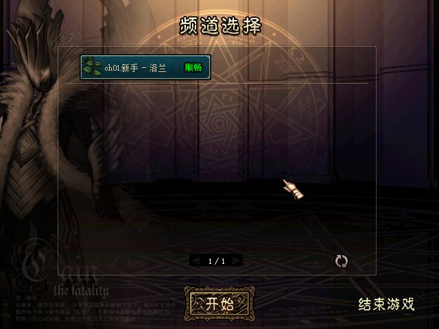

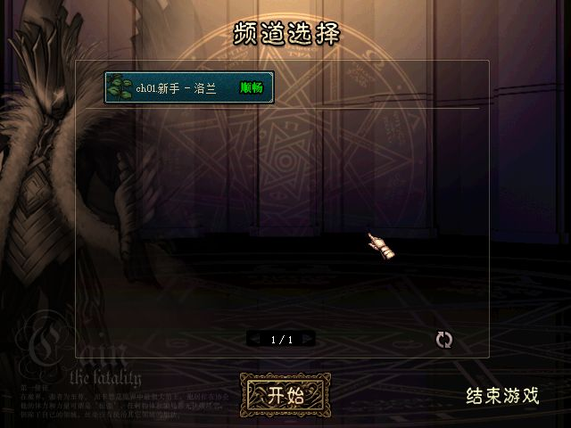

01:00:50执行的[部署后核验](assets/2026-10-27-channel-return/normal-postcheck.json)26/26通过，包含原配置、原档保护、最终托管/原生产物、正常服务端及客户端身份；两张正常频道原图已实际查看并原样复制，见[最终正常环境资产SHA清单](assets/2026-10-27-channel-return/sha256-normal-postcheck-010050.json)。本记录的修复与约定回归闭合，前述新端点探测、相同身份下网络路径变化和UDP应用审计边界仍然适用。

最终根任务[汇总断言](assets/2026-10-27-cera-gift/assertions.json)228/228通过，包含频道时延、组队副本、在线/离线赠送、原件哈希和正常环境恢复检查；它复用各专项证据，不是228种独立游戏场景。
