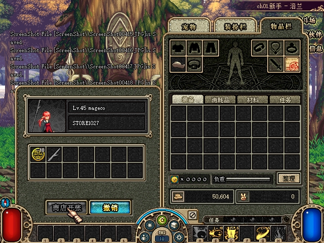
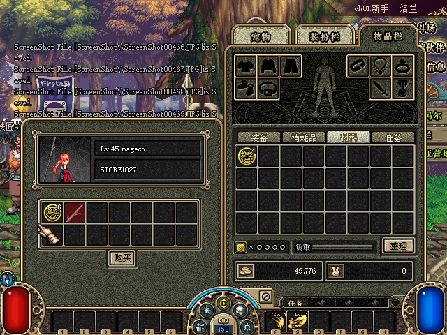
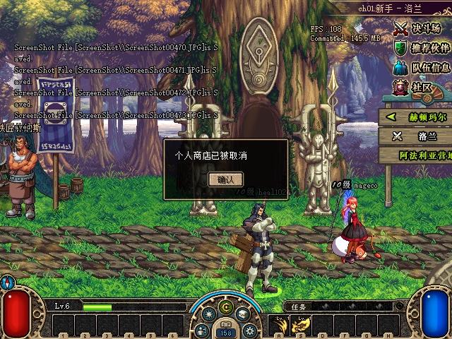
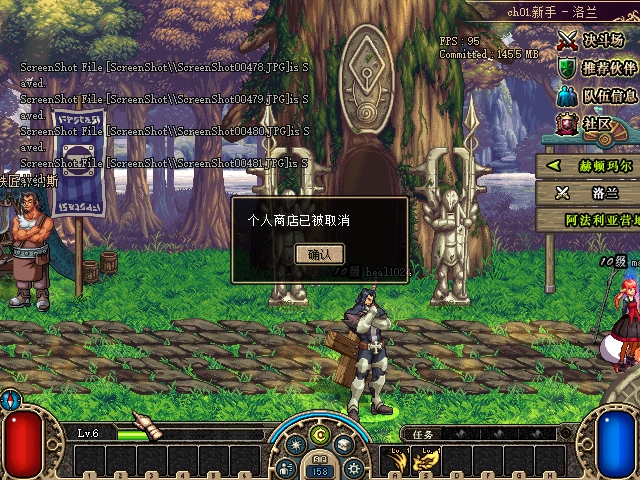
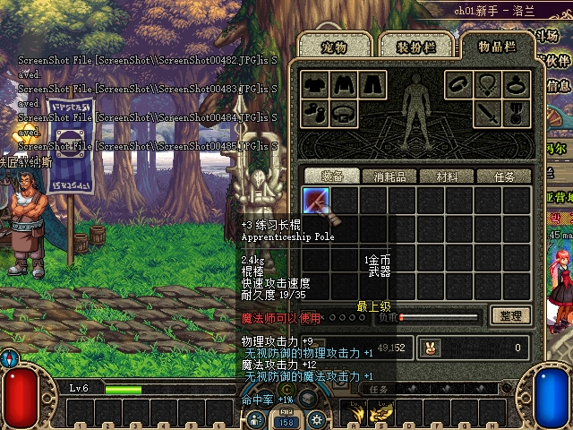

# 2026-10-27：ACT1 普通摆摊

本组恢复 CMD85–90 的购买、进摊、退出、建摊、收摊和完成陈列，以及 NOTI78–85 的原生接口。源代码版本为 `e494483`，已通过完整协议冒烟、Release发布和真实双客户端成交验收；测试全程使用独立存档。

## 官服依据与适配

业务依据为 `CPrivateStore::CreatePrivateStore@085C53EA`、`CompleteDisplay@085C7800`、`BuyPrivateStoreItem@085C7E74`、`BuyItem@085C924C`、`EnterPrivateStore@085C8DD6`、`ExitPrivateStore@085C8FD4` 和 `RemovePrivateStore@085C5FD0`。官服游戏样本 SHA256 为 `8859c99d8290dc5fb58151444138cf2697b2bfff12d47d6159596a03f20b5261`。ACT1 收发处理器和键盘路径另行逐指令核对，本地原始证据位于 `.recon/private-store-20261027/`。

- 普通店需要账户活跃服务8；建摊成功退出当前队伍。准备时不扣物，完成陈列后才原子移入持久托管。普通店允许货格0–6，ACT1界面物理14格不等于官服许可14格。
- 普通来源为主背包的可交易装备、材料与消耗品；拒绝绑定、未知、时装、宠物、穿戴及仓库来源。装备请求值是品质字段，不能当成堆叠数量；强化、耐久、封装和实例标识随物品保留。
- 毛额和总陈列值须在正有符号整数范围。普通频道收取 `floor(毛额×4/100)` 手续费，卖家收入为毛额减手续费。服务端售罄只清空货格，仍接受正常关店请求；ACT1客户端会在售罄时自动发出该请求，见下文版本差异。
- 买家必须已进入当前店，双方在同一公共区域；买家不能同时开店或直接交易。交易使用服务端摊位代际，不能通过UID复用地址旧商品。
- 买家金币、格子、堆叠上限和负重均校验；卖家先按毛额检查等级金币上限，包含未安装信用。限额来自ACT1 `etc/goldlimitbylevel.etc`，例如1级100000、60级300000000；数据缺失或非法时拒绝成交。

`TownAreaScript::clear@086D1D46` 证明缺少 `[use private store]` 时默认启用，不能把“普通地图类型”等同于商业许可。地图NPC由 `Area::set_area@086C1D14` 无条件构建限制中心：横向距离小于80且纵向小于150时不能摆摊，严格边界。摊位160×100矩形接触也算相交，即横向距离≤160且纵向≤100时拒绝。区域与坐标从配置PVF读取，拒绝入口/副本入口和私密实例，限制在可行走矩形内。后期入口邻近判断的部分指令损坏，未虚构额外入口半径，不宣称这部分完全对齐。

## ACT1 包体

建摊请求为公共序号后 `town:u8,area:u8,x:u16,y:u16`；陈列请求为标题、条数和完整商品条目。两者均没有后期人偶u16字段。进摊请求的UID为u32，回包UID为u16。

陈列商品与进摊名单包含货格、单价、模板、数量/品质、状态及耐久。购买成功回包包含金币、胜点、点券和本次获得物品；合堆时发送的是本次增量，之后刷新权威库存。访客先收到货格扣减，卖家收到毛额、手续费、买家和实收余额，买家再收到购买结果；每个连接按提交顺序串行。不同连接的网络完成时间不作为全局时钟。

区域后来者在角色外观建立后收到含标题、状态与坐标的摊位列表。收摊必须发送明确移除通知；空列表不会清除ACT1已有摊位。原生入口为城镇按W后点击地面。

真机发现此前MODE0角色外观包把商人许可字节固定为0，导致许可有效时W仍没有反应。ACT1 `419F17 → 47B9B0` 根据该字节创建角色的摆摊组件，已改为按服务8有效期发送，并贯通自己、同屏玩家、换区及服务刷新。许可到期先收摊，再撤销入口；空NOTI85无法替代该外观字段。

商城商品 `100022`、物品 `16` 的ACT1脚本为380点券/30天，现已映射为服务8，管理Premium接口也支持服务8和正整数天数。商城扣款/许可发放有自动化验证；本轮双客户端使用隔离副本中的测试许可，没有手动购买该商城商品。

两项已确认的版本差异：

- ACT1旧商品说明写14种商品、普通频道1%手续费，界面也有14格；本轮依照所参考官服执行7格、4%，额外格子不接受陈列。未修改原客户端文案。
- ACT1 `NOTI82 → 7B2EF0` 先扣库存，再遍历14格；全部为空时经 `7B303F → vfunc+54 → 7B28C0` 自动发送CMD89。双客户端实收包确认售罄后该请求由卖家客户端发出，服务端照令关店。不能把ACT1实机表现描述成售罄后持续营业。

## 持久化与会话安全

商品从规范背包移出后保存在角色的 `PrivateStoreStock`；每次购买一次原子保存买家金币/物品、剩余托管和卖家售款信用，保留既有奖励账本及组队金币收据。卖家通过自己的会话消费信用，只更新金币，不跨会话覆盖整份背包。连续成交、断线和重启不会重复安装售款。

共享商业占位让直接交易和开摊原子互斥。店主的其他经济写入被守门，防止陈旧库存复活商品；返回选角、换角色、换区、进入副本、被动选图及断线均清理。通道绑定会话，退休后等待在途发送完成，再允许替换，旧会话不能关闭新店或向新角色交付旧包。

整档恢复和全量角色替换会撤销营业资格，即使保存的摊位标识相同也不能继续成交；旧会话保持经济冻结直至退出，按实际恢复的托管返还。启动时先归还余货并消费售款，再做已有迁移。原格冲突时强制回收使用持久邮件；未知写入结果隔离存储，不发布成功或盲重试。

## 自动化验证

`dotnet run --project tests/DFLegacy.SmokeTests -- --private-store` 覆盖精确CP936字节、严格长度和旧包体、装备品质及堆叠增量、区域/开关/NPC/摊位边界、金币表、许可和交易互斥、部分陈列/购买/返还、元数据和实例、价格溢出、买家不足/满格/超重、卖家毛额上限、连续售款、售罄保持营业、最后一件并发、旧会话、阻塞发送、整档/角色替换撤销、冲突邮件及四类事务替换前后的写入故障恢复。

独立整分支审查发现阻塞访客拖住调用者、店主CMD18可误入、社交命令被误拦、首个满堆遮蔽后续容量，均先复现失败再修正。另补退休会话清理、商城许可发放和MODE0入口的回归覆盖。最终 `private-store-live-flag-green.log` 为0 failures，`private-store-live-flag-full.log` 为 `All DFLegacy protocol smoke tests passed.`，`private-store-live-final-publish.log` 发布成功。

## 双客户端与部署

隔离目录为 `G:/Game/DNF_ACT1/DFLegacy/.tmp/private-store-20261027/`。最终构建的卖家客户端PID61504、买家PID67532，测试服务器PID73796；卖家mageco Lv45，买家heal1024 Lv6。操作使用原生W、地面建摊、添加商品、价格/数量窗口和购买确认，没有注入业务包或写客户端内存。

| 实机步骤 | 卖家金币 | 买家金币 | 库存/手续费 |
|---|---:|---:|---|
| 初始，陈列材料3176×10和装备33300 | 50604 | 50176 | 单价100和24，完成陈列才移出背包 |
| 购买4个材料 | 50988 | 49776 | 毛额400，手续费16，余货6 |
| 购买装备 | 51012 | 49752 | 毛额24，手续费0；原InstanceId、强化+3、品质37、耐久19/35保持 |
| 卖家手动撤摊 | 51012 | 49752 | 只返还6个材料到原格73，原材料InstanceId保持；买方被关闭并提示摊位取消 |
| 重新陈列并购买余下6个 | 51588 | 49152 | 毛额600，手续费24；买家材料合堆为10，卖家无余货 |
| 原生售罄关店 | 51588 | 49152 | 卖家自动CMD89，买家收到80/79并发87；托管和待消费售款均为空 |

### 实机截图

以下为本轮实际验收的原始640×480截图，未经裁剪、标注或重画。A为卖家mageco，B为买家heal1024。余额与阶段对应上表；说明中明确区分画面可见金额与存档断言金额。手续费、品质37、InstanceId、托管及待消费售款等不可见字段，仍以正文、协议记录及存档断言为依据，截图不单独证明这些字段。

图1（A，首次开摊）：标题STORE1027及两种陈列商品可见，卖家金币栏为50,604；本阶段买家50,176来自存档断言。

图2（B，进入摊位前）：对端可见A的摊位外观、角色名和标题STORE1027。此图没有金币栏；本阶段A为50,604、B为50,176，均取自存档断言。

图3（B，首批材料成交）：买家背包中材料数量4、摊位余量6可见，买家金币栏为49,776；卖家50,988及本笔手续费16由存档断言确认。

图4（B，装备成交后A手动撤摊）：购买窗口已关闭，原生提示为“个人商店已被取消”。此图没有金币栏；本阶段A为51,012、B为49,752。余下6个材料返还原格及实例保持由存档断言确认。

图5（B，重开后第二批材料成交并售罄）：原生关店提示再次出现。此图没有金币栏，也不单独证明购买数量或关店请求来源；本阶段A为51,588、B为49,152，材料合堆为10、手续费24及卖家客户端自动CMD89分别由存档断言和协议记录确认。

图6（B，最终背包复核）：已购装备的提示可见强化+3、耐久19/35，买家金币栏为49,152；卖家51,588、装备品质37和原InstanceId保持由存档断言确认。

图片原件来自隔离目录的 `evidence/`，以下副本与原件逐文件SHA256一致：

| 图片文件 | SHA256（原件与副本相同） |
|---|---|
| `33-A-open-store.jpg` | `1C7178658BAF991EEE7854631A87B5FB5325AFC937820B95F2FACF7200FD6958` |
| `34-B-store-visible.jpg` | `4FE0CFDC622F8AC49CC7F6C2297FFA836EE9A4BD7554C73A3F6EC70D5E411D39` |
| `41-B-purchase-four.jpg` | `75BD70A0251109E12A331E513D638A057DD3B1CEC441242079D5105E1E8E9E0F` |
| `49-B-forced-close.jpg` | `6D0B716C31AB158F392215C044D4E569B51BCE8FDABE8B8D58432E9FBB9AA575` |
| `67-B-purchase-six.jpg` | `8825353556D594F7A4897C21D5A17DAD5B1AD0E45E5E1EC3EF887A60BA5FE061` |
| `72-B-final-gear-tooltip.jpg` | `37AE2B8EC88F0894E27DDAF2220E1437B04996A4B00A75E318022C11CD4026B6` |

两端实际TCP收发重组并校验CRC/解密：40条商店相关帧、8份MODE0，包长/布局和捕获错误均为0；六种CMD均出现原生请求及成功回包。20项协议业务断言与141项持久快照/保存完整性断言通过，共161/161。材料总量10、装备唯一性、三笔总手续费40和既有地城账本均一致。原生截图、七阶段快照、`rx-report.json`、`rx-assertions.json`、`state-assertions.json` 和 `assertions.json` 留存于隔离目录。阶段名 `after-four.json` 是购买确认前的观察，最终断言使用实际成交后的 `after-four-purchased.json`。

双客户端覆盖正常建摊/陈列/进摊、部分购买、装备购买、剩余返还、重开及售罄；本轮没有逐一实机触发后来者列表、掉线回收、满包、超重、并发抢最后一件和许可过期，这些路径由自动化测试覆盖。特殊频道3%费率、店铺人偶、拍卖代理、时装/宠物来源和后期风控不在范围。

最终Server DLL SHA256为 `5EFFF532202CAA175355BD505E402B302A08C7782A6349F1A6217D0AE5E5095B`，两个客户端EXE均为 `6B4850BEAF67EC61ADB04AE17F119F16278DD05E97B8FFCA871A9BDB547DE0D5`，实际PVF为 `288D58AACE8ED4724A0A94AAA4CD0957B1D52C633771132EDE2F96363C1B506F`。

20:16收尾时关闭两个测试客户端和测试服务端，冻结测试存档，恢复两个客户端Config、两个启动器配置及server.json。将实测的同一最终构建部署至 `G:/Game/DNF_ACT1/DF/town-test/`，正常服务端PID24220，8081/27001/8080/7001均由其监听。10个发布文件与实测构建一致，部署后25/25核对通过，见 `normal-restored.json` 和 `post-deploy-checks.json`。

常用服务端已恢复原存档路径 `G:/Game/DNF_ACT1/DFLegacy/.tmp/lorien-loot-20261027/state.json`；SHA256仍为 `FB20572589A5CFB31D89E16EC6936DE96071630E432EDE787CCB0887930ABE52`，与测试前及备份相同。本轮测试许可、金币和物品变动均保留在隔离副本，未写入原档。
