# 2026-10-28：ACT1 普通时装赠送与已选属性

> 最终交付补记：本组件有界验收已完成，最终30AD商城既有入口交集、源码/产物身份和原环境核验见[本轮交付索引](2026-10-28-overnight-delivery.md)。下文PENDING保留发布时点含义；743原生赠送结果仍属原阶段，30天未重启及120秒派生到期的边界不变。

普通时装赠送和本人购买的已选属性修正已在 `ccad0cc` 实现，组件focused/full Smoke、两个Release构建及独立审查已完成。批准的集成managed源码 `5078da2` 已冻结；使用此构建完成三个独立原档副本的7天/30天/永久原生赠送与B领取、7天未领取停服重启，以及gift0本人购买能力4、原生月上限提示和独立派生120秒到期回收。**本组原生Task4已完成，最终集成交付绑定与原环境恢复仍为 PENDING**；下面区分真实期限购买与明确披露的短时限场景。

## 规则与实现范围

本组复用既有CMD146收礼角色查询、CMD67赠送、目标角色系统邮件和账号月额度，不另建赠送系统。新增普通 `[avatar]` 三档礼物，并修复gift0本人购买没有保留已选能力的问题。普通时装包含本版九部位及skin；合成系统的八部位门槛不用于商城赠送。

CMD67每条严格为 `ability:u8 + term:u16 + commodity:u32`，共7字节。首byte为零基能力索引，**不是商品分类**；旧期限报告中的临时category命名以此更正。请求外层gift1带CP936收礼角色名，gift0不带；回包中的i32 category是另一字段。能力必须不是FF，且小于实际脚本的选项行数，不加1或随机补选。

| 实际目录/脚本 | 合法能力范围 | 7天 / 30天 / 永久商品 | 价格 |
|---|---|---|---|
| 51020 白色飞翅头饰 | 0..4；4为CAST_SPEED +120 | 270000 / 270001 / 270002 | 300 / 660 / 1980 |
| 52641 红宝石饰扣小背心 | 0..43；43为mage skill69 +1 | 290000 / 290001 / 290002 | 450 / 990 / 2970 |
| 42201 skin | 0..1；sticker1保持 | 160000 / 160001 / 160002 | 300 / 660 / 1980 |

上述数量来自真实闭合 `[avatar select ability]` 选项块，技能编号和数值token不单独计数。共享resolver检查普通avatar、quantity1、规范定义、请求期限与目录一致，以及所选能力。赠送另检查禁赠标记与sticker99；保留本人购买既有sticker处理是本组范围裁决，不能宣称官服对本人购买豁免sticker99。

期限1为604800秒，2为2592000秒，3为永久；0/4和错目录期限拒绝。价格继续按base、`trunc(base × 2.2f)`、前项乘3分步处理，base107回归为107/235/705。

有限礼物在成功候选事务规划时只取一次服务端时刻，确定绝对截止、所选能力和非空UUID。发信、离线、重启、领取均保留原截止；严格 `deadline < now` 才过期，相等秒仍保留且wire投影为1，后一秒清理并留墓碑。普通玩家邮件仍拒有限时装，商城礼物沿系统邮件路径。永久对照不因上述期限结算消失。

## 原子提交与会话

赠送在现有store gate内重查目标、黑名单、商品、规范现金、邮箱容量和目标账号月额度。物理/avatar/蛋共用上海完整年月的账号次数，默认cap1，每成功商品+1。整单任何条目无效均不扣费、不投信；同账号另一角色、离线低级或跨职业目标不新增赠送门槛，领取与可穿戴条件分开处理。

一次规范快照提交sender账号现金、指定target角色邮箱、target账号次数，并保留已有金币/奖励/PvP/师徒记录。同账号两角先更新copied target账号，再从同一对象扣现金。Unknown隔离且不自动重试、不发成功。成功gift1回category0、原商品键和空买家reward，不给sender本人时装；target在线仅失效邮箱缓存，其他现金会话重读规范余额。

gift0使用同一resolver与带能力参数的寿命附件工厂，保留时装包/包满系统邮件和expectedCash并发保护。组件测试经过真实resolver、工厂、planner和store；本轮另用原生本人购买能力4闭合Entrance入包，实际结果见下方gift0回归。

## 已完成的组件验证

以下为组件冻结阶段执行记录，已核对日志终态；这些组件结果与下方最终批准构建的实际原生结果分别记录。

| 检查 | 已记录结果 |
|---|---|
| `dotnet run --project tests/DFLegacy.SmokeTests -c Release -- --cera-gift` | `Cera gift smoke: 0 failures` |
| `dotnet run --project tests/DFLegacy.SmokeTests -c Release -- --avatar-lifetime` | `Avatar lifetime smoke: 0 failures` |
| 完整Release Smoke | `All DFLegacy protocol smoke tests passed.` |
| Server与Smoke两个Release构建 | 各0 warnings / 0 errors |
| 独立实现审查 | Tasks1–3批准进入原生验收，无Critical/Important/Minor发现 |
| 三份原始CP936脚本fixture及提交blob | 原PVF字节/fixture/提交后工作区一致，实际选项数5/44/2 |

自动化覆盖三档费用/能力/截止、真实邮件规划与领取、领取前后重启、边界及领取计划跨截止、墓碑与旧actor/mail回写、永久对照、gift0能力4/43与溢出、禁赠/错能力/错期限、同账号与离线目标、满包可投/满邮箱拒绝、混合订单回滚、共享月额度及跨年月、现金/最后额度竞争、替换前后Unknown、现金失效重读和既有经济账本保持。生命周期原有实现满足新增回归，没有为制造RED改坏既有路径。

原始反汇编、完整日志和原档留在私有取证位置，本公开记录不嵌入原始协议字节流、认证数据或完整存档。

## 原生验收：Task4完成，交付绑定待补

三档使用三个独立原档副本，分别命名 `avatar7d`、`avatar30d`、`avatarpermanent`，各自初始月计数逻辑0；不在同一流程中暗改额度。三例实际基线均为同一原档SHA256，A现金26600、B现金997790，三档与gift0现均有原生成交及领取/入包结果。

| 独立case | 原生请求/场景 | 实际A现金 | 实际证明 | 状态 |
|---|---|---:|---|---|
| avatar7d | ability4 / term1 / commodity270000 | 26300（实际） | UI价格300、gift1成功；未领取重启，B原生读信/领取后能力4、同UUID与原deadline | PASS：赠送、重启、领取 |
| avatar30d | ability4 / term2 / commodity270001 | 25940（实际） | UI价格660、gift1成功、B读信/领取同UUID及原deadline | PASS：赠送、领取；本例未执行重启 |
| avatarpermanent | ability4 / term3 / commodity270002 | 24620（实际） | UI价格1980、能力4、seconds0/无截止，B领取同UUID | PASS：赠送、领取 |
| gift0关联回归 | ability4 / term3 / commodity270002，gift0 | 22640（从24620再扣1980） | CMD67 gift0、NOTI13本人入包、能力4，独立UUID | PASS：原生本人购买 |
| 原生月额度提示 | 同一收礼角色再次查询 | 24620保持，未再赠送 | CMD146 count1，界面显示已超上限/下月1日 | PASS：查询及客户端入口限制 |
| 独立短时限派生 | 已领取7天礼物副本，只改绝对截止为创建+120秒 | A26300 / B997790保持 | 同UUID/能力/原始duration，B无业务输入收到清包，墓碑/经济不变 | PASS：派生短时限；不属自然7天到期 |

每例由A原生入篮→全部赠送→UI112查询B→明确选择能力4与期限→最终确认，核对CMD146接收次数、CMD67请求7字节条目和category0/gift1/空买家reward。A没有本人获物；B现金不变、次数+1、指定角色收到邮件。B为跨职业角色时无需穿戴才能证明收礼和领取。

7天有限礼物已在未领取时正常停服、冻结并重启同一case，之后B原生读信/领取；原UUID、能力和deadline不变，remaining减少。自然7/30天到期尚未等待；短截止适配另列明确场景，不能混称自然到期。

### avatar7d 首次赠送：已完成的真实证据

本例隔离证据ID为 `native-cases/avatar7d`，独立原档基线SHA256为 `FB20572589A5CFB31D89E16EC6936DE96071630E432EDE787CCB0887930ABE52`。`initial` 阶段服务端PID48516（UTC 2026-10-27 21:27:11.3252837），A/B为PID28960/66956（分别UTC21:27:14.3518265、21:27:15.3355224）；暂停后冻结日志和规范存档，没有改月次数或重置业务状态。

执行原生流程为：白色飞翅头饰加入购物篮→全部赠送→查询B角色heal1024→确认跨职业提示→选能力4“增加施放速度12.0%”→7天300点券→购买及最终确认。查询实际返回6级圣职者、已收礼计数0，界面显示月上限1。

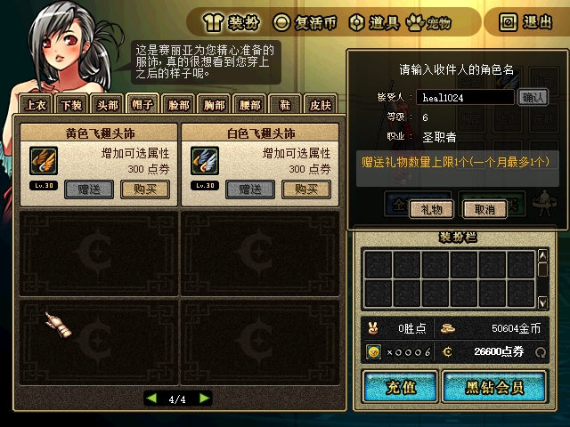

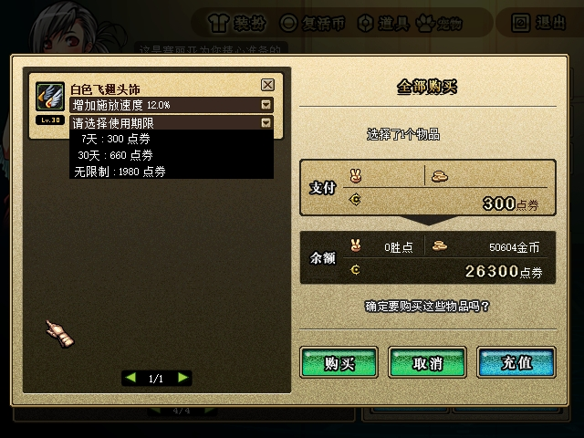

以上4张原图已逐张查看并原样复制；[原件/副本SHA256](assets/2026-10-28-avatar-gift/sha256-initial.json)全部一致，未重绘。`B-mailbox-unclaimed.jpg` 实际仍为世界画面，不能当作打开邮箱或领取的UI证明。`after-gift-unclaimed.json` 和 `capture-initial-unclaimed.json` 实际位于最终YES之前，只保留为确认前对照，不能作为成交成功证据。

成交依据是 `gift-committed-unclaimed.json` 和停止后的 `state-unclaimed-paused.json`。邮件1159876143中的物品51020为能力4、数量1，实例UUID `01a17f4a-3bf8-73ce-9a35-3d0696cf6e14`；发放Unix1793136933、剩余604800秒、绝对截止1793741733，截止减发放恰为7天。A现金26600→26300、金币50604不变，没有本人获物；B现金997790、金币50176不变，账号收礼年月/计数为202610/1，礼物仍在指定角色邮箱，尚未进入其时装包。

私有 `verify-gift-initial.py` 只读 `frozen-native-initial` 的闭合原始捕获与规范存档，重新校验PID/启动时间、逐条游戏TX CRC和所选包布局，结果为[首次赠送脱敏证据](assets/2026-10-28-avatar-gift/initial-frozen-proof.json) **58/58通过，整体状态明确PARTIAL**。A TX19/RX34、B TX16/RX33，35/35游戏TX CRC通过，0布局、截断、partial-line或disabled-flow错误。CMD146为等级6/job4/次数0；CMD67严格为gift1、ability4/term1/商品270000的7字节条目，成功回category0、gift1、空买家reward及相同商品键；B实际收到NOTI97目标邮件，wire剩余604800、durability能力4。此阶段没有CMD98领取请求。

| 闭合取证输入 | SHA256 |
|---|---|
| A原始捕获 `netdump-28960.log` | `013C5D67CB7A5F12D410FD7C1D82823ADB7DDE66227413A208580D87EDBAAB6F` |
| B原始捕获 `netdump-66956.log` | `AF7FFC23102C84C0E319F7A4444A7F74A0BDD33B4B1FC75910C0AB145D68C3F0` |
| `server-initial.log` | `5945E4FF6F687E0777EF47A6971B0838BB0AE370366221FE50ADCBE9290CC252` |
| 停止后的规范存档 | `7B05C243A004B0CFC3D5F8F248A9F495268BA6535A3A1EDEEADA9B0993BF25E1` |

### avatar7d 未领取重启与原生领取：已完成

同一case从上述 `7B05…25E1` 未领取存档重启，未改额度或重置业务状态。`unclaimed-restart` 阶段服务端PID48252（UTC21:36:32.0257899），A/B为56268/69400（UTC21:36:34.7154746、21:36:35.4837078）。A只停在频道选择，没有进入角色，也没有游戏TX/RX；重启后的领取验证由B原生完成，不能将A写为该阶段已进城。

B打开邮箱、读信并点附件领取，界面如下：

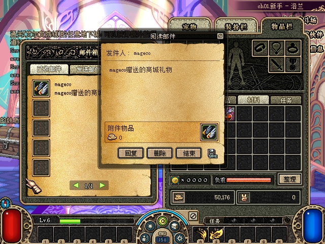

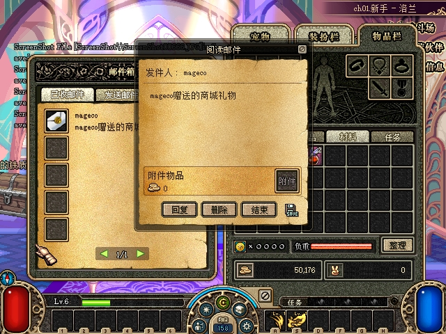

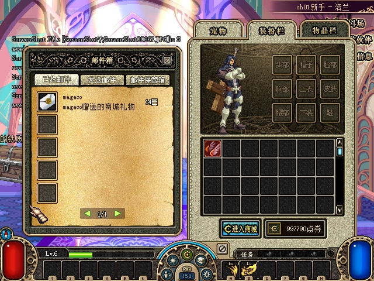

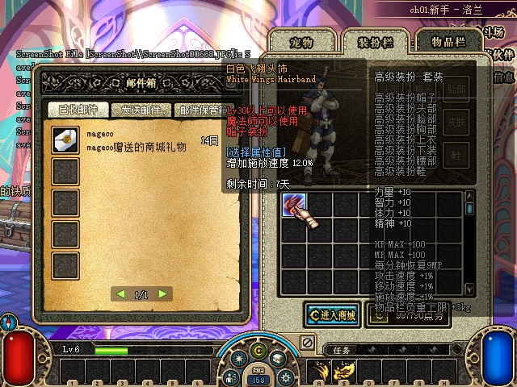

5张原图已逐张查看，原样复制的[SHA256](assets/2026-10-28-avatar-gift/sha256-restart.json)全部一致。跨职业/等级要求标红只限制穿戴，没有阻止查询、赠送和领取。

`after-restart-native-claim.json` 及停止后规范存档SHA256同为 `7C1B190875E2EF9CC7AC1B4F85D0D67B506F24F83D7ED15FA8D113D5BB33414B`：B包slot0的UUID仍为 `01a17f4a-3bf8-73ce-9a35-3d0696cf6e14`，能力4、绝对截止1793741733不变；原邮件1159876143保留、附件为null。A26300/B997790点券、双方金币和B账号202610/1次数均不变。

私有 `verify-gift-restart.py` 从 `frozen-native-unclaimed-restart` 的闭合原始日志重解码，[重启与领取脱敏证据](assets/2026-10-28-avatar-gift/restart-claim-frozen-proof.json)为 **65/65通过**。B实际TX15/RX36，15/15游戏TX CRC、零布局或截断错误；CMD99打开邮箱、CMD144/state2读信、CMD98领取均关联同mailId并成功。登录与打开邮箱时的NOTI97 remaining分别604660、604621，领取后的NOTI13/list1为604579，均等于原截止减对应实际包时刻，未重置7天。JSON旧键 `AvatarExpireAt` 仍存604800，不能把它当作领取时重新计时的证据；绝对截止和递减wire才是本例依据。

| 重启闭合取证输入 | SHA256 |
|---|---|
| A频道选择捕获 `netdump-56268.log` | `6DF7714A66AA71AF90F1FEA3EA6C7686D5F42E94FBCBB697E50B884CE14176D9` |
| B原生领取捕获 `netdump-69400.log` | `0A2D39435174B7D2250C80C9D7F29EEFE17CA64B4F9DFEB37F653CC4D8F73E9F` |
| `server-unclaimed-restart.log` | `7ACFED5C66B11AA3779CFF028B654C9CEAB1F484A07AFF36643003ACDA5A90AC` |

### avatar30d 独立赠送与领取：已完成

`avatar30d` 从相同 `FB205…BE52` 原档另建副本，实际 `baseline.json` 确认A26600/B997790、B收礼字段原先不存在且计数0，没有在7天case内清空次数。`initial` 阶段服务端PID14816（UTC21:41:21.1707473）、A71404/B59396（UTC21:41:24.2348829、21:41:24.9874575），仍使用同一批准构建；本例没有重启，重启证据属于前述7天case。

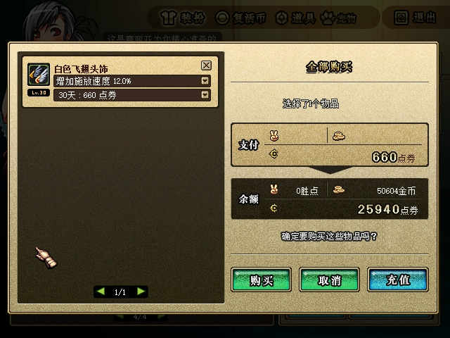

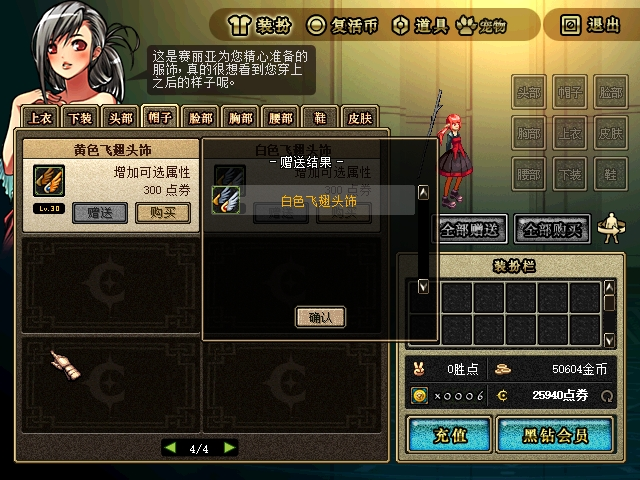

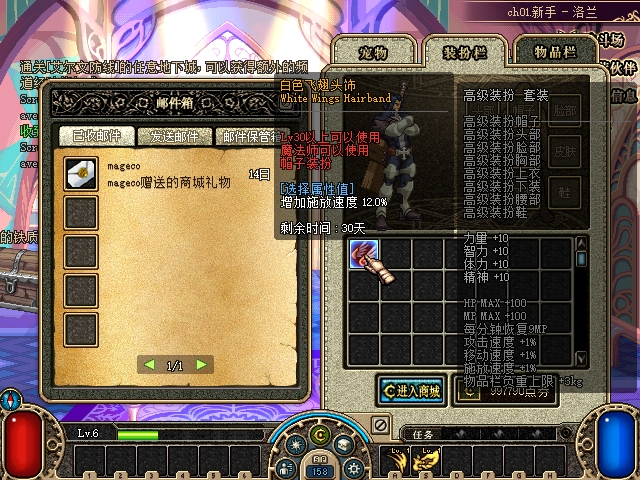

4张原图已逐张查看，[SHA256](assets/2026-10-28-avatar-gift/sha256-thirty-day.json)与原件一致。成交邮件1185057729，UUID `01a17f52-1206-786d-8bbb-56cb96e570f1`，能力4、初始2592000秒，发放1793137447、绝对截止1795729447；B领取slot0后仍为原UUID/能力/截止，原邮件附件清空。A点券26600→25940，A没有本人获物；B997790、双方金币及B202610/1次数保持。

私有 `verify-gift-claimed.py` 从本例冻结原始捕获重解码，[30天赠送领取脱敏证据](assets/2026-10-28-avatar-gift/thirty-day-frozen-proof.json)为 **82/82通过**。A TX14/RX34，B TX14/RX38，28/28游戏TX CRC，零布局、截断或disabled-flow错误。CMD67为gift1、ability4/term2/商品270001，成功category0/空买家reward；B原生打开、读信和领取成功。邮件remaining2592000→2591970，领取入包2591951，均按原截止递减。

领取观察的整档SHA256为 `88486A3305403817E6C1181224E9A486BA8A7B28A74157C3D469AF5F2CF93F0E`；最终暂停存档为 `BD009DFD70B72085D8B81AC8541BFE39618E3782EAE98CD064A512BE439FDDCF`。两次不是相同全档字节，检查器逐项确认现金、额度、邮件和礼物实例等规范字段完全相同，没有把不同hash声称为恒等。

| 30天闭合取证输入 | SHA256 |
|---|---|
| A原始捕获 `netdump-71404.log` | `EDF218A811EAA8908F1E70918FAE01BE6338A1F888F65B5A53452197AA66BBD9` |
| B原始捕获 `netdump-59396.log` | `2E3C42960881C527FFED745629F568FD06D4E5F499E882C87A4A06B44CA1B028` |
| `server-initial.log` | `62B0403E015C8F77620B31DFC111086AEE91B1D06ED7676F0A78B6F3CE112D78` |

### avatarpermanent、gift0与原生月额度：已完成

永久case独立基线仍为 `FB205…BE52`。首次角色名输入失败，两次CMD146返回unknown21，没有CMD67、扣费、投信或次数变化；该负向阶段原始资料单独私有冻结，不当作永久赠送成功。随后从同case暂停存档 `33E89DCED6097F16C7EA4AF07594462DE0A969E6E733120A0435205C24BFC616` 重启重试，未重置业务数据。

实际成功阶段为 `recipient-retry`：服务端PID47064（UTC21:53:18.4656941），A44724/B35912（UTC21:53:21.2293058、21:53:22.0355457）。正确查询后选能力4和无限制1980点券，最终显示“赠送结果”，A现金24620：

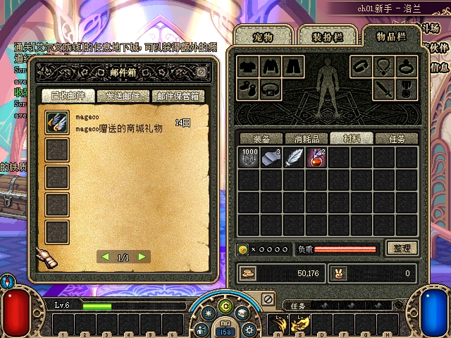

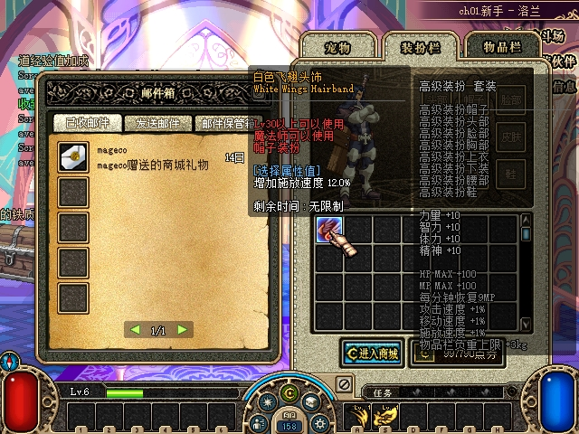

邮件773142773的礼物UUID为 `01a17f5d-4629-75dd-889c-c8be43b9c5bd`，物品51020、能力4、初始秒0、没有绝对截止。领取后B包slot0保留此UUID，邮件附件清空；B现金997790和202610/1计数不变。再次原生查询B返回count1，画面显示“已超出对方接受上限(1个)，下月1日开始可赠送礼物”：

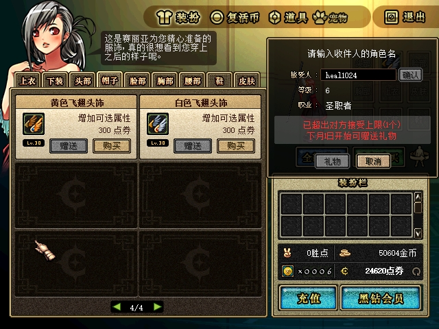

此处证明查询和客户端入口限制，未再发送第二笔gift1订单，不能声称真机执行了额外CMD67的服务端超额拒绝；该事务分支由组件测试覆盖。

同一case保留上述收礼状态，A随后在原生商城用gift0为自己购买同款永久、能力4时装。A现金24620→22640；购买结果与本人原生提示如下：

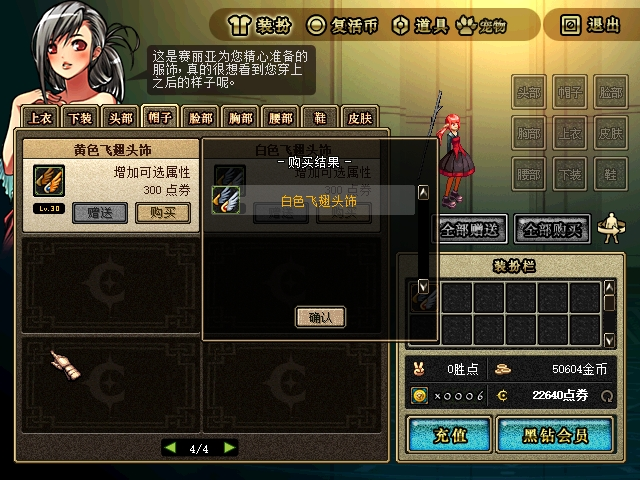

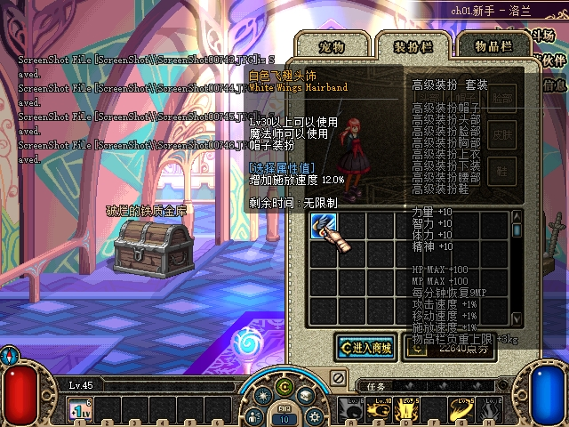

A本人包slot0的UUID为 `01a17f61-1d2a-77f2-8f7d-a13cacfa7093`，与B礼物不同；能力4、永久0且没有截止，B状态完全保持。8张真实原图已逐张查看，原样复制的[SHA256](assets/2026-10-28-avatar-gift/sha256-permanent.json)全部一致。早先误命名的 `A-permanent-preview.jpg` / `A-permanent-gift-result.jpg` 尚处错误收礼人查询，`B-read-permanent-gift.jpg` 实为误点NPC菜单，三者均不作成功或邮件UI证明。

私有 `verify-permanent-selfbuy.py` 从成功阶段闭合原始捕获重解码，[永久赠送、本人购买与额度脱敏证据](assets/2026-10-28-avatar-gift/permanent-selfbuy-frozen-proof.json)为 **76/76通过**。A TX20/RX43、B TX19/RX40，39/39游戏TX CRC、零布局/截断错误。实际CMD67先gift1、后gift0，均ability4/term3/商品270002、category0；两条成功回包的reward_count实际均为0。gift0本人放入由随后NOTI13/list1的item_count1、slot0/物品51020/能力4/remaining0证明，不能把回包reward_count写成1。B原生mail open/read/claim成功，所有规范金钱、次数、实例字段与最终冻结存档一致。

| 永久/gift0闭合取证输入 | SHA256 |
|---|---|
| A原始捕获 `netdump-44724.log` | `2CDBCCA8649B950C68AD0D7805FC327F7EEBCDC2CC74173FCFE0FF2BFACCB223` |
| B原始捕获 `netdump-35912.log` | `737E1A256A76BE6E126D36AFC691A1C22C1A6A86189D800B27195415AAE65FD4` |
| `server-recipient-retry.log` | `F7216D025079B357BE8C78EB9306431BBC4290E1100498B8512CBEA1E0B757FE` |
| 最终规范存档 | `9EE0EF81F0C25F077A35792C79F626C43607B2AA5034C1828FC0DC0F3B10B376` |

### 独立派生120秒到期：已完成

短时限另用隔离证据ID `native-expiry-short`，不修改前三个赠送case或其他原档副本。源为7天礼物已领取快照 `7C1B190875E2EF9CC7AC1B4F85D0D67B506F24F83D7ED15FA8D113D5BB33414B`；[派生记录](assets/2026-10-28-avatar-gift/short-expiry-derivation.json)和实际JSON差分确认只把 `/Accounts/0/Characters/2/AvatarInventory/0/AvatarExpiresAtUnixSeconds` 从1793741733改为1793139690，派生快照SHA256为 `4AE16CAC0EAF952AD822B2105BA0DA8159D7E07A74429812C17F69B8409642E1`。

创建时刻为UTC2026-10-27 22:19:30.054149（上海06:19:30），截止为上海06:21:30。没有改系统时间、插入物品、重置月额度或改源文件；原UUID `01a17f4a-3bf8-73ce-9a35-3d0696cf6e14`、能力4及原始duration604800仍保留。永久对照来自前面的独立永久case，没有向派生副本额外添加永久物品。此项验证服务端同一路径的短截止清理，**不是等待7天自然到期，也不是未改动的原赠送流程**。

`short-expiry` 阶段服务端PID64724（UTC22:19:30.445527），A30652只停频道选择、没有游戏TX/RX；B59352（UTC22:19:35.303465）进入原角色，前后图均为同一进程：

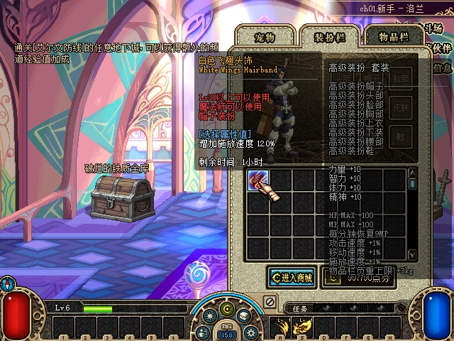

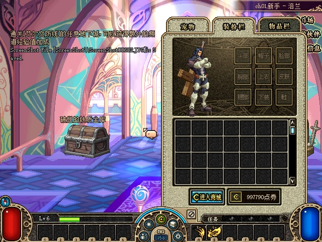

两张真实原图已逐张查看，[SHA256](assets/2026-10-28-avatar-gift/sha256-short-expiry.json)与冻结原件一致。到期前内置输入计划在06:20:21.707完成，早于截止；原生tooltip显示“1小时”，不能说画面显示120秒。到期后计划只按PrintScreen取图。名为 `near-deadline-observation.json` 的观察实际在06:21:45、截止后15秒，包已空且UUID墓碑存在；不把这个名字误写成截止前或原生等号边界测试。

私有 `verify-short-expiry.py` 从闭合原始捕获重解码，[短时限脱敏证据](assets/2026-10-28-avatar-gift/short-expiry-frozen-proof.json)为 **82/82通过**。B TX11/RX35，11/11游戏TX CRC、零布局/截断错误；06:20:09.231登录时NOTI13/list1为slot0物品51020、能力4、remaining81，恰按派生截止计算。06:21:31.124（截止后一秒）收到空NOTI13/list1，符合严格小于回收；清包前20秒内没有新的客户端请求，也没有商城或领取输入触发回收。

最终派生存档SHA256为 `62B0C1BE17AE6E34C75CC1F174E8EC747747BD4DBDCAB174417A66F9B51BBBC2`，目标UUID从包移除并只增加一次墓碑；原邮件附件仍null，A26300/B997790、B收礼202610/1和金币均保持。源→派生只有一字段变化；派生→实际运行后的全档另有正常06:00疲劳日界：`FatigueDayKey` 20261027→20261028、四个角色已有UsedFatigue从2/3/1/3归0。检查器把这些正常启动变动和时装清理分别核对，没有声称运行后的全档只变一个字段。

关闭时PauseExpiry执行原ROOT与四个原业务case的受保护文件哈希校验，列表和校验边界随私有冻结manifest保留。本组检查器绑定这份闭合阶段，不要求之后合法退役/切换的ROOT存档或journal永远不变。

| 短时限闭合取证输入 | SHA256 |
|---|---|
| A频道选择捕获 `netdump-30652.log` | `46DFDF0795125A6B037D517A6D932A1C9F58DC0087C81A3160599CB23258C5BB` |
| B原始捕获 `netdump-59352.log` | `085B4336EB9B49A851732D6A8D4C5479AF9B2601BED0466D7A134BC8132D3B5B` |
| `server-short-expiry.log` | `DB5FB9DD7A6713E8F185A3915BF2446DFA27C97BBA453E28762E12D0A99BA4BC` |

### 冻结构建与后续未验范围

| 本例已绑定产物 | SHA256 / 来源 |
|---|---|
| approved manifest | `3D92263FE0E44BA5F56E3255D61CE1080E31B77D55ECDC17551BB6435B64D266`，managed源码 `5078da27a4807695f002ceea61333c43e1932ce4` |
| Server DLL | `A0EE99650A49011B9527E06BB8E1C19E6A7E5D284CC51D8F9865597C9E133134` |
| Protocol DLL | `5A55089D384EFA9E4ACEC5A211EE5C551668CDDB5C93ED46A698D50250E04A4E` |
| IJL15 | `7431347A19A5D8B0B963B474B9739288BA8755895B260DF04A51D80BFF65B3DC`，native源码3a35188 |

表中为本组实际原生运行使用的历史精确产物。各阶段检查也核对case manifest及保留的三份文件，不能仅凭当前源码哈希推断已加载构建。7天/30天/永久赠送与B领取、7天未领取重启、gift0能力4、原生月额度提示及独立派生短截止回收已通过；不宣称自然等待7/30天或原生精确等号秒验收。

最终集成若更换原生模块，须另记录经过审查的差异与交付产物绑定，不能将新模块冒称与这些743产物逐字节相同。本记录的最终交付与原配置/原档恢复结果仍待补。
