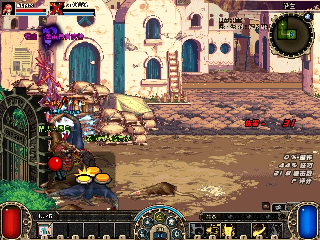
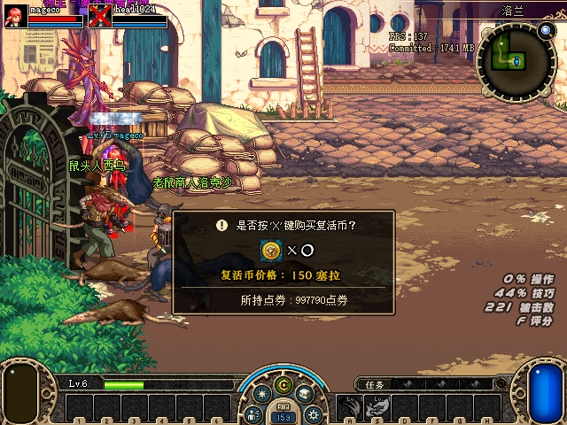
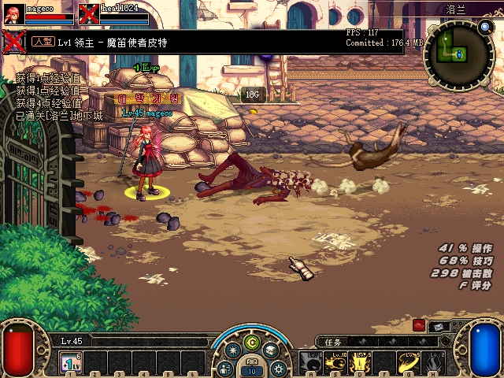
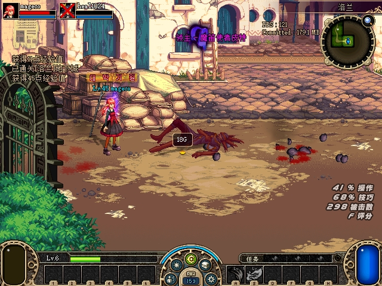
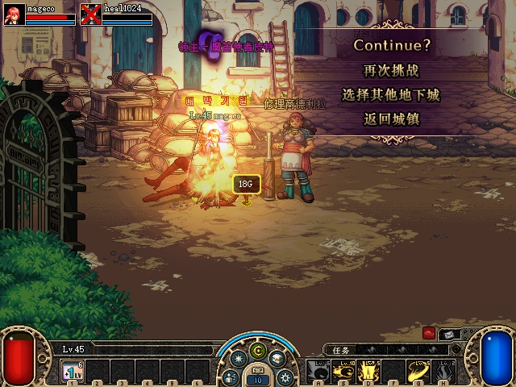
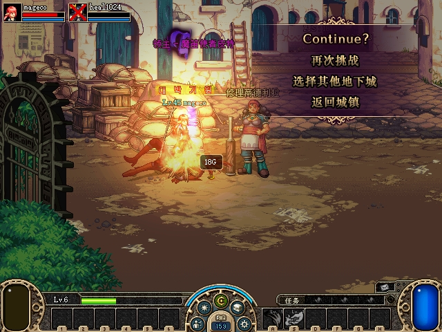
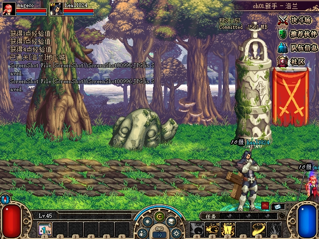
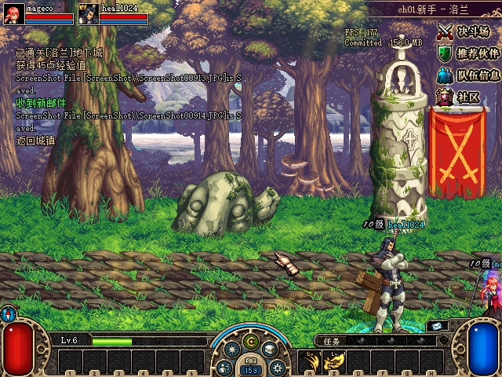

# 洛兰 3×3 Boss 专用选图验收

2026-10-28：已修复每套迷宫的 `[boss map specification]` 漏读。洛兰新增布局的 Boss `(2,2)` 选中 **MAP 6416 / 魔笛使者1077**。双原生客户端已实际进入该地图，完成自然击杀、双方 Continue 结算及队长带队回城；本次实测构建已交付正常运行目录。怪物位置同步继续单独排查。

## 配置与实现

原始客户端 PVF SHA256 为 `288D58AACE8ED4724A0A94AAA4CD0957B1D52C633771132EDE2F96363C1B506F`。`dungeon/Act1/Lorien.dgn` 第三套布局为3×3，起点(0,0)、Boss(2,2)，专用候选为6416。该地图脚本是 `map/VilligeOfTemptation/b6416.map`，明确标记Boss，含Boss怪1077及其他怪物，共9只。

`DungeonCatalog` 现在为每套 maze 独立解析专用列表。已缓存的选图和任务替换先行；所选坐标的角色确认为Boss后，优先选择专用列表中的有效Boss地图，再沿用原有普通配置/池回退。显式6416的归属为地下城51、拓扑为C，这两个差异不会把配置明确指定的Boss排除。起点与Boss重合时仍保留既有Start优先级。

普通房的角色与拓扑规则保持原状；本次实机实际路线为 **MAP1→9→8→10→6416**，坐标依次为(0,0)→(1,0)→(1,1)→(1,2)→(2,2)。当前PVF的一般候选2/3/4属于Start分类，普通房沿原规则另选有效地图；本轮没有把这些普通房改成强制配置选图。

## 验证范围

- 字面配置回归先在旧实现出现6条失败断言，随后通过；其中包含选错地图导致的后续断言失败，并非6个独立缺陷。
- 覆盖旧布局无专用列表、maze隔离、普通/起始房、非法坐标及ID、缺失/Normal/Dummy候选、多候选选择、重进缓存，以及任务Boss替换的优先级。
- 独立复核发现起点/Boss重合边界；新增1×1公开Catalog回归，修复前单条失败，改用实际Boss角色判断后通过。
- 真实PVF回归输出 `maze=2, size=3x3, boss=(2,2), map=6416, bossMonsters=1077`；完整.NET冒烟与严格Release构建通过，0警告/0错误。提交后focused及完整冒烟再次通过，冒烟目录中的Server/Protocol/InterProcess DLL与实际交付包逐项同哈希。
- 双客户端正常组队及共同入场、四次房间切换均由原生输入触发。两端只读观察均记录9只怪物，其中UID2为1077、初始HP625；自然战斗后两端Boss HP均为0。服务端记录 `LastBossDefeated`，给两人发送result13/code0结算。
- **B在Boss房战斗中死亡，A完成清场。** 两端之后都显示Continue菜单，队长B点返回城镇，两人回到城镇且HP为正。没有进行复活币购买修复或验收。
- 清场后25秒共424次窗口响应采样，A/B各212次，均响应；这只证明该采样窗口的窗口响应，不代表全程帧率或位置同步。

## 原始截图

以下均为游戏自身PrintScreen产生的原图，未裁剪、拼接或重绘。私有输入文件中带`score`的标签实际拍到的是Continue菜单，按画面内容归档；没有把它当作短暂的Score评分覆盖层。

| 阶段 | A端 | B端 |
|---|---|---|
| MAP6416现场；B已死亡 |  |  |
| Boss自然死亡、通关提示 |  |  |
| 双方Continue菜单 |  |  |
| 队长带队回城 |  |  |

首次v1邀请未成立、单端3×3尝试，以及v2中的未生效点击、辅助脚本失败、树木碰撞及门边界停止记录均保留在完整私有证据中。纠正后才开始本表的共同3×3路线。全量915文件、76,268,999字节，清单SHA256为 `3EB4A4077AFA975E9DA49548553EEE8DC1D8893F3813FAF4C7D7D443C00FDF03`。

## 构建与正常交付

托管源码为 `59666d9b543abc5119012cd98ad1fe8e57d7858c`，保留native `b4fe25f` / 8AB。50文件构建包清单SHA256为 `1F201242877DDEEE783C338515FBAF8029292462E3039E369487A5643151931D`。同一包已由加载模块收据绑定到实际三进程，并向正常运行目录交付49文件；原server.json等配置未纳入覆盖。

| 组件 | SHA256 |
|---|---|
| Server DLL | `0E576748248436A974093A1CF4491A756B2D4D52B1CB6823577D2B4529000D25` |
| Protocol DLL | `79295A31A0D08DB18E7790886422F6B01A85958087170A2D151AA4E247023263` |
| 保留的native DLL | `8AB0660B416F2240ABFC0E0840E3B93D8F54BFCBB8B15E8C4C5ACBD5CD0142DC` |

Windows PowerShell5.1.26100.9711使用显式克隆存档、独立快照/日志启动正常目录，实际监听27001/7001/7005 TCP及7005 UDP。检查后进程退出。15项原始保护、11份实体备份、69份原运行备份、49份本轮覆盖前映像、5份原配置与8个输入邮箱复算通过；9个历史包438文件/9份历史native、已验TCP的1611文件、怪物诊断的344文件仍保持。测试游戏/服务器/启动器进程均为0。

最终独立只读复核已逐项核对12个公开附件、8张原图与来源收据、完整915文件、初末模块绑定、实际路线和Boss血量、结算回城及正常交付；未发现剩余Critical/Important。

[构建及测试摘要](assets/2026-10-28-boss-map-specification/build-tests-summary.json)、[双端验收摘要](assets/2026-10-28-boss-map-specification/native-summary.json)、[最终交付摘要](assets/2026-10-28-boss-map-specification/delivery-summary.json)及[附件哈希](assets/2026-10-28-boss-map-specification/manifest.json)可逐项核对。原始网络捕获、完整存档、PVF和输入接口档案不公开复制。
