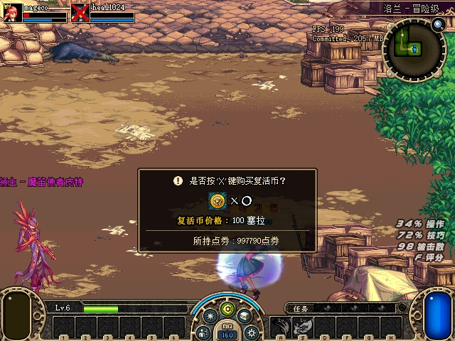
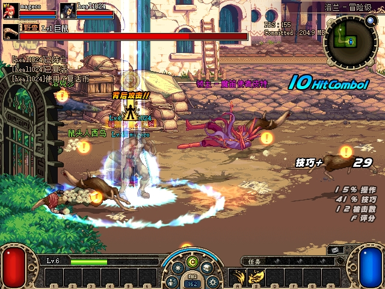
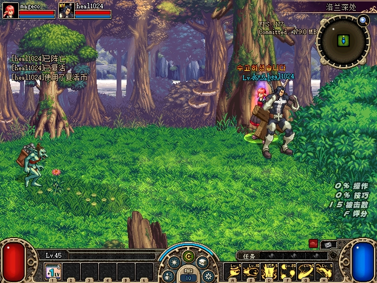
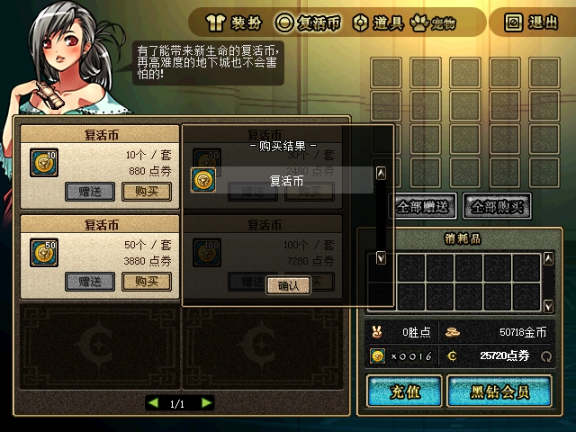

# ACT1 倒计时复活币购买与原生复活验收

2026-10-28：最终native `19C0…` 已确认倒计时价格100无重复标签，并完成A队员使用已有币复活、A队员购买后复活、A转为队长后购买并复活三个有界案例。B另完成普通10币礼包购买，原购买结果窗口正常。双方之后通过菜单返回Town，本轮phase已停止，10条配置/mailbox精确恢复记录为PASS。**本轮有界验收和正常目录交付完成，最终审计PASS_AS_SCOPED。** 怪物位置同步继续单独排查。

## 原生合同与实现

当前PVF SHA256为 `288D58AACE8ED4724A0A94AAA4CD0957B1D52C633771132EDE2F96363C1B506F`，倒计时单币为 `100004 / item1 / quantity1 / cash100`。官方 `8325A88` 负责增加付费复活币并发送数量状态，不直接复活；原生CMD44随后消费币并复活。购买和复活分别核对，回城自动恢复HP不计为使用复活币。

原始ACT1 `863270` 把末尾单币行复制到 `CashShop+0x341C` 并从普通商品向量删除；CMD67成功仍进入普通商城结果展示，`861540` 只查普通向量，隐藏商品因而落到 `error=-1` 的未知错误分支。该行icon为0，把它直接回填普通lookup会被 `7EB230` 解引用，不能采用。原始PE/ELF字节比对及当前PVF提取作为本地合同证据保留。

ijl15仅适配已知ACT1的UI边界：正确UI所持CashShop、pending=1、CountDown state1/2，以及success1/category1/error−1/slotFFFF/gift0的精确隐藏单币收据才消费普通商城展示回调；商品号必须与本机隐藏行一致，并验证item1、quantity1、optionFF、attribute0、无替代货币及合法正cash。其他上下文沿原函数执行，后续 `863800` 仍清pending。服务器扣款、持久发币、币数量刷新和原CMD44均不改，没有注入HP、币数或业务包。

正常价格sprite37只在已知调用点改为原生 `B539D0` 有效价格的数字及Cera后缀，使用CountDown原字体；窗口底图已有的价格标签只保留一次。alternate sprite43、非法或未知绘制上下文沿原绘制。EXE、PVF、资源及字符串文件不属于修改范围。

## 自动验证与历史试验

- 生产收据/绘制策略、实际发出的x86 bridge参数与栈、寄存器/标志位与passthrough、字面签名校验、重复安装、外来hook、部分写入失败与回滚均有RED→GREEN记录，覆盖异常字段、错误UI/状态、无pending、未知商品/错误/礼物及页错误。
- native Release使用 `/W4 /WX`；focused/full测试和保留的managed full smoke分别有通过记录。首次full因错误cwd输出 `Config.ini missing` 的尝试保留，未因exit0而判通过；之后从正确输出目录重跑。重复标签修正另有2条RED→focused/full GREEN。
- 独立代码/ABI/字体/安装回滚复核没有剩余代码Critical/Important。原生实机案例另行按下文证据边界判断，不把代码审查当作实机结果。
- 初版 `5a8d624` / native `C533…` 的normal-coin-v1历史结论保持：B自然HP470→0、原生CMD67扣100得1币且无未知错误、后续CMD44复活及同伴可见，25秒424次窗口采样0不响应；重复价格标签限制保留。155文件、19,600,572字节，清单SHA256 `A78CA1916CDA35423CDD153960E684FC8945E9E4479DA20F14628A4EFE7F8C91`。该trial只作功能证据，未改写为最终外观通过。

## 最终双端实机案例

用户先完成路线准备，并于22:35明确把两端交给root、准备到Boss门口。root接管后于22:38用两端 `native_walk` 进入冒险MAP6416 / Boss1077，本轮Boss实际HP937。**路线准备和此前推进含用户协助；root接管后的双端输入循环不代表root独立完成全程进图。** 全部时间为北京时间。

更早21:56:40，A已原生购买1币，Cash997790→997690；该轮Boss被击杀后EPLP自动带两端回Town，未发生A CMD44。22:01的Town按X和回城HP470不计复活。该枚保留币随后用于下表第一例。

| 案例 | 请求和配对结果 | 真正post采样及结论 |
|---|---|---|
| A队员使用已有币 | A自然死亡后立即原生X；22:38:58边界内唯一A CMD44成功，无CMD67。配对result00双端UID1均HP0→464。 | 真正post双端均HP436、存活；复活光柱及“已复活/使用复活币”聊天共同支持使用已有币复活。 |
| A队员再次死亡，购买后复活 | 22:40:42唯一A CMD67成功，100004/item1×1/100，Cash997590；22:40:43唯一A CMD44成功，配对result00双端UID1均HP0→470。 | 真正post A448、B端所见UID1为443，均存活。按日志秒级时间，约1秒完成购买→原生复活；x1中间帧自身不作最终复活图。 |
| A为队长，购买后复活 | 23:03:59唯一A CMD67成功、100004@100，随后23:04:00唯一A CMD44成功；配对result00双端UID1均HP0→470。 | 真正post双端UID1均HP450、存活；B端原图显示heal1024站立、皇冠及“已复活/使用复活币”聊天，确认本轮队长购买后原生复活。 |

队长身份依据22:53:10 B端有效RX CMD131请求（目标slot1）与实际皇冠像素共同确认。原始日志没有找到TX131，因此不写“131成功应答”；未定位的旧NativeRoster行不作为引用。队员与队长案例分别列明，没有用一个角色状态替代另一个。

两例队员独立审查SHA256为 `2B28FD46053006D2C7E4081B190508B2053E8DAE954B5BB97936B3CF0FCEC581`；队长独立审查为 `242B74B2434CDDDFB119C9A501BD7918795F9D44574B972FCD1EE20A51E7C7EE`。各案例内同UID1的user/actor绑定、Stage与StageMap稳定，原始44/67顺序、双端死亡→存活及原图相互支持。死亡期间同actor.map临时为0，三份原helper的 `UNCONFIRMED_HP_AND_LOG_BOUNDARY_ONLY`、strict predicate=false均原样保留；有界独立结论没有改写通用安全谓词，也不泛化“map0安全”。

result00是成功应答配对后的首次读取，post是稍后的真实快照，不能混称。角色仍在战斗中，随后较低HP和分时读取不能据此判成“不满血复活”缺陷或长期HP同步结论。独立案例只覆盖本次native19C、指定身份、精确日志字节范围和快照，不外推其他账号、免费币、所有购买/复活路径或全局多人同步。

## 普通商城、余额与正常链路

B在native19C普通商城于22:50:42原生购买10币礼包 `100000 / item1×10 / cash880`。Cash26600→25720，paid coin6→16，原购买结果窗口正常。此回归只覆盖该礼包和实际路径。

钱包独立收据在23:05:59稳定截点核对18条44/67/Completed记录，唯一join出4笔购买、3次付费币消费，无歧义、未知SKU或重复包；收据SHA256为 `5AF78A4445154FAFED27372D71DC8DF672E7037AA7607542E0FB96F08DA23E08`。

| 两个指定角色 | 付费币守恒 | Cash守恒 |
|---|---|---|
| A=`heal1024` | `0 + 3 − 3 = 0`，实际0 | `997790 − 300 = 997490`，账号与角色实际均997490 |
| B=`mageco` | `6 + 10 − 0 = 16`，实际16 | `26600 − 880 = 25720`，账号与角色实际均25720 |

A的三笔购买分别为21:56:40、22:40:42、23:03:59；三次消费为22:38:58、22:40:43、23:04:00。997590是较早余额，不能写成钱包最终截点余额。成功44按本轮已确认的付费币消费合同解释；只核对两个目标的付费币item1与Cash，不证明其他币种、其他角色或跨Town/重启持久化。截点后的交易需要另出版本，不能追写冻结收据。

最终normal UDP严格wire匹配A→B 49,894、B→A 68,940，wire_contract为PASS；解码器的native_acceptance保留 `NOT_ASSESSED`，这是其只验证wire的正常边界。其范围是头部身份与精确不透明字节，不据此声明无丢包、时序/应用正确、世界状态、NAT/Internet或所有同步通过。实机业务结论来自上面的独立案例组合证据。

最终25秒窗口响应采样共422次、0次not responding，只证明该采样窗口的窗口响应，不代表全程帧率或位置同步。最终加载模块与hook收据绑定实际三进程和native19C，两端两处hook共4项检查PASS，pending均00、有效价格均100。

菜单回城后的23:12:31状态记录两端均state1；所记录HP为A470、B151。此处只作收尾回城状态，回城恢复HP不作为复活证据。本轮phase已停止，10条配置/mailbox精确恢复记录PASS；最终审计及保护范围见下节。

## 原始截图

以下9张游戏原始PrintScreen图已按来源逐一复算哈希并导出。附件相对目录为 `assets/2026-10-28-countdown-coin-purchase/`。

| 附件文件 | 画面与使用范围 |
|---|---|
| [01-baseline-unknown.jpg](assets/2026-10-28-countdown-coin-purchase/01-baseline-unknown.jpg) | 旧7001原生购币未知错误现场。只取独立购币错误证据；旧transport-v2整体仍失败，不据此改判。 |
| [02-final-price100.jpg](assets/2026-10-28-countdown-coin-purchase/02-final-price100.jpg) | 最终native19C价格100，单一价格标签。 |
| [03-existing-coin-revive-beam.jpg](assets/2026-10-28-countdown-coin-purchase/03-existing-coin-revive-beam.jpg) | 已有币原生复活的光柱及聊天。 |
| [04-purchased-coin-x1.jpg](assets/2026-10-28-countdown-coin-purchase/04-purchased-coin-x1.jpg) | 购买所得x1币的死亡提示中间/延迟帧；不是最终复活画面。 |
| [05-leader-revive.jpg](assets/2026-10-28-countdown-coin-purchase/05-leader-revive.jpg) | B端看到heal1024已复活、站立且有皇冠，聊天含使用复活币；仍是洛兰深处场景。源为B-return图，不是A-X的x1中间帧。 |
| [06-normal-coin-before.jpg](assets/2026-10-28-countdown-coin-purchase/06-normal-coin-before.jpg) | 普通10币/880礼包，购买前6币、Cash26600。 |
| [07-normal-coin-after.jpg](assets/2026-10-28-countdown-coin-purchase/07-normal-coin-after.jpg) | 原购买结果窗口，购买后16币、Cash25720。 |
| [08-final-town-A.jpg](assets/2026-10-28-countdown-coin-purchase/08-final-town-A.jpg) | 菜单返回城镇后的A端场景；画面仍有菜单，保留原状。 |
| [09-final-town-B.jpg](assets/2026-10-28-countdown-coin-purchase/09-final-town-B.jpg) | 菜单返回城镇后的B端场景，采用重试原图；首次截图超时保留。 |

全部附件不裁剪、不拼接、不重绘。最初A回城图实际打开了地图，未用来替代清晰城镇场景；所选A图有菜单也不修图。`coin2-A-buy1.jpg` 是刷新前0币/旧余额画面；队员及队长的A-X图均只能按各自真实帧内容使用；`coin3-A-revived-fresh/B-peer-revived-fresh` 实为奖励牌。失败、延迟和未被公开选用的原始截图继续保留。

## 构建、原始保护与交付

native源码 `09429ccffffecc220d98366e8965495518261d3d`，托管保留Boss构建 `59666d9b543abc5119012cd98ad1fe8e57d7858c`。最终包登记50文件，正常运行目录交付49文件（保留原server.json），两客户端及启动器旁共四处native为同一实测19C。

| 对象 | 身份或收尾状态 |
|---|---|
| native DLL SHA256 | `19C0CC26185D959882F7DEF3BCD15B28248D34553E31E4F66C266798646A62D4` |
| 候选包清单SHA256 | `327B9A0A5E05D3034A3DAA2251E1836AE7879202B1161376CE234B7E27B5045F` |
| 最终loaded收据SHA256 | `361CC346D691DF1AED4643EDB1079E2A3FAA2D33D6EFF7A55E6F748E2CF2B7B8` |
| 最终hook收据SHA256 | `68A4FDC3765083245F31FF1929FB7F2D94BF6B57CC08632F1ABDE6E58628D374` |
| 严格wire摘要SHA256 | `05316A99BDCF2593A39C71A1C8C35F54362E56E63649A95CA3EC549E92DD3F65` |
| 完整最终native证据清单 | 445文件、130,865,744字节；SHA256 `86E1CCCCDCD007804792C0A4635726AB64FCD37243ADAE7E223250DF8C3019E7`。封存closed/evidence/automation及明确helper依赖，未在冻结后追加。 |
| 最终readiness与审计回执 | 正常目录启动PASS，实际PowerShell7.6.5，精确归属TCP27001/7001/7005及UDP7005，finally停服；readiness `70BBC660AB97F9505E44EA1644D1F07ED49A24E3B7E59DAF251CBAF7E317A77E`；最终审计 `1FA510D6EB5FC5938DBF90BAE8E0968F0C0061281CD51E0EF435F408256EE6E9`，PASS_AS_SCOPED。 |
| 恢复与原始保护摘要 | 15项原始保护（含11份物理备份）、额外2份字符串；5份原配置、2份原档、8个输入邮箱原字节/原存在性恢复核对；69运行备份与49份前镜像复算。 |
| 正常运行目录交付 | 50文件最终包和49文件运行交付逐项一致，493份产品源文件绑定；4份native原30AD→8AB→C533→19C的收据/物理前镜像链均核验。游戏、服务端和启动器进程为0。 |
| 9图与安全摘要公开manifest | 11文件（9原图、1安全摘要、manifest）；manifest SHA256 `3312AF6238479CA48780CCA5AFF6E17A03FCCDEABCC7ACBCB2ED7B5220F6FA75`。 |

已导出的 `coin-native-summary.json` 仅含构建身份、三例角色/请求时刻/首次与post HP、原helper verdict、钱包算式、普通礼包、wire方向计数、422/0响应、双端Town state1及官方/ACT1差异和范围限制。完整review含私有来源路径，不复制进公开附件；auth、完整状态、网络捕获、存档、PVF和敏感启动恢复材料不公开复制。

所有失败阶段、未确认helper、截图超时和错误cwd尝试保持原记录，不因后续案例成立而改判。怪物位置同步、其他账号和未列功能不在本次完成范围；本轮仅对上述范围作完成结论。

最终价格、队员复活、队长复活及普通商城的原始画面：

最终审计对历史资料另作精确区分：9个历史包438文件、旧TCP1611文件、怪物诊断344文件、Boss915文件及初版coin155文件均复算；9个历史开发产物中6个原路径未变、2份旧743 DLL在冻结包保有原字节。1份旧开发测试EXE已被合法重建、未保留旧物理字节，未声称9个开发输出全部不变；当前测试EXE及源码/日志另行绑定。旧fence与失败v2审计不改写，新v3审计明确记录此限制。

WindowsPowerShell5.1仅完成语法解析，本机未签名执行策略拒绝启动本脚本，未修改策略；本次真实正常启动验证使用7.6.5。旧Boss组的5.1记录仍属旧组，未冒用为本组结果。
