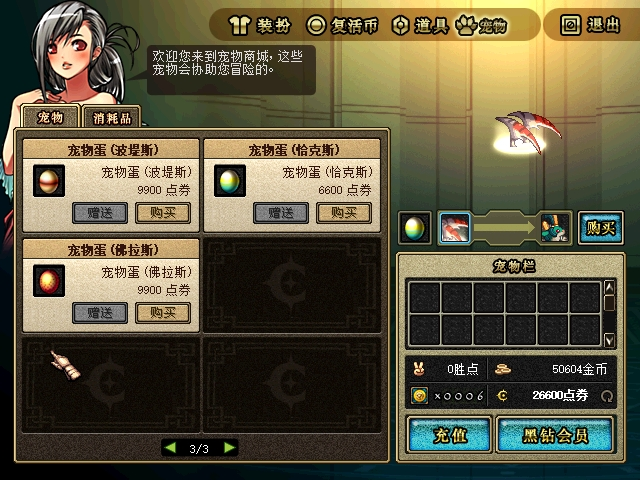
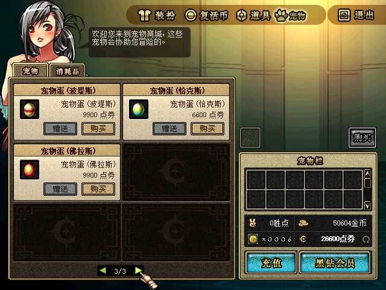
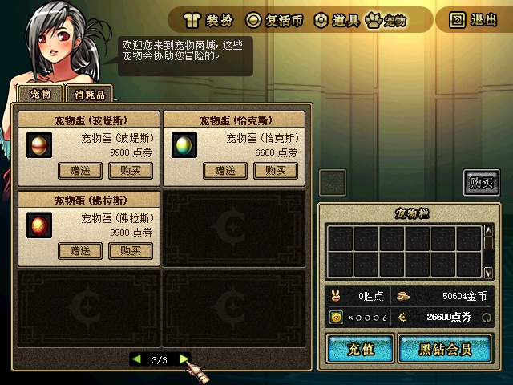
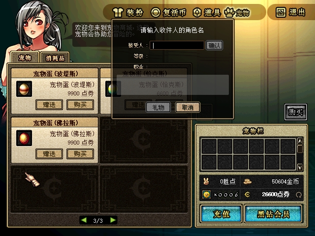
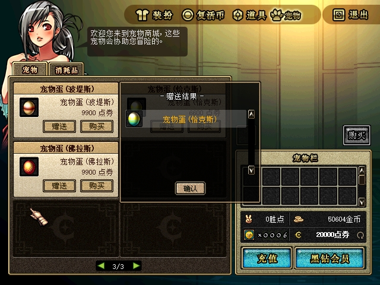
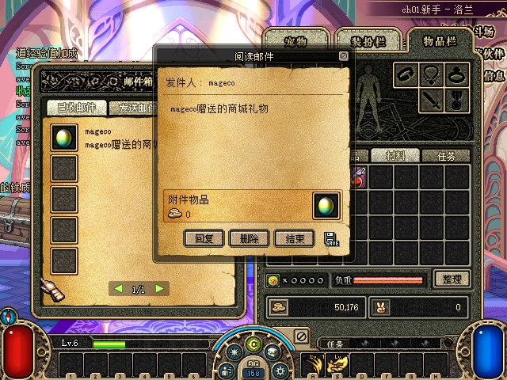

# 2026-10-28：ACT1 普通永久封印宠物蛋赠送（验收草稿）

普通永久封印蛋赠送的服务端组件已在 `feade88` 实现，`cacab2e` 保留原始fixture空白字节。原生行入口经过两次真实RED：743仍有独立界面禁用；C79安装了hook但价格字段偏移错误，实际按钮仍灰。`ab1e6b6` / 30AD修正后，**已关闭的 `gift-entry-final` 阶段通过了原生行Gift→UI112→收礼查询→6600实际赠送→B收信/阅读但未领取**。规范现金、次数、封印附件与协议重算相互一致，脱敏checker为27/27。**未领重启、领取、孵化及重登仍为PENDING**；本页不把入口/订单通过扩写为整个宠物闭环或最终正常runtime交付完成。

## 规则与实现范围

本组仅开放现PVF中的15款普通永久fresh封印蛋，沿CMD146→CMD67 gift1→系统礼物邮件→宠物包→既有孵化路径。官服group3活动链先建立独立creature记录，再以身份投递邮件，领取保留原身份；不能把全部CREATURE分类简单加入普通实物白名单。

| 范围 | 已实现规则 |
|---|---|
| 目录 | 105008..105020、105028、105030，共15款；quantity1、creature section、sticker非99且无禁赠 |
| 实例定义 | 规范Equipment/Creature、subtype1、Sealing、有效且非蛋的Creature孵化输出 |
| 请求 | ability byte为FF、term为0；category来自成功回包，不取请求首byte |
| 排除 | 饲料105001..105004、改名卡105005、容器/抽奖/直接效果/服务、任意可变宠物邮件及限时宠物 |
| 价格 | 取CREATURE目录原价格；105009为6600、105008为9900、105020为13200，不套avatar倍率 |

赠送资格同时读取实际脚本的 `[usable period]`、`[expiration date]`、`[usable period after unsealing]`。可读脚本中缺省为0，显式每次出现都必须是可解析整数0；非零、畸形、缺值、重复后非零或不可读均拒绝。实际注释与反引号内容不会冒充标签；这个保守畸形筛选是本地范围裁决，不宣称复刻官服畸形脚本容错。不能仅因商城term0就认定永久。

候选105009为item63007“宠物蛋 (恰克斯)”，输出63003。CMD67该条7字节语义为FF / u16零 / commodity105009；成功回category3、gift1、原商品/进度键和空买家reward。此前“全部赠送入口跨分类复用、无需新增入口补丁”的推断没有闭合宠物子页的布局门控，已被下述实机RED否定，不能继续作为可达性结论。

## 身份、邮件与孵化适配

赠送附件为数量1、state0、durability0、seal1，avatar剩余秒/能力/截止及质量字段均空，提交前生成新的非空UUID并随同一次快照持久化。每成功商品一只蛋/一封礼物，独立订单UUID不同；sender不入宠物包或提前孵化。

本地UUID与ACT1非零32位宠物wire UID不同。UUID贯穿未领邮件、重启、领取和孵化；wire UID在真正领取进入角色宠物包时按既有策略分配，必须避开已占UID。邮件数量1不冒充官服数据库全局identity，也不在本组更换UID算法。

领取沿既有本地默认状态：stomach100、remainder0、exp0、level1、name为蛋catalog名称、noCharge=false、seal1/durability0。官服新蛋邮件DB name为空，不能把catalog名/level1说成官服逐字段原样。邮件等待不创建成长、饥饿或自动孵化。既有63007→63003孵化保留UUID/UID，转换seal0并安装输出默认状态。

永久蛋与邮件有效期分开：礼物邮件仍为30天，普通邮件仅 `ExpiresAt > now` 可领取，相等即不可领取。宠物包满仍允许投信；领取满包保留原邮件，腾位后再领。邮箱满则整单拒绝不扣费。

## 原子提交与会话

蛋礼物与物理、avatar共享现有store gate、目标黑名单、规范现金、邮箱容量及目标账号上海完整年月次数，默认cap1。每成功商品+1，不按宠物UID另开额度。同账号另一角色和离线低级目标可收；混合订单任一条不合法则整单回滚。

一次规范快照提交sender现金、指定target角色邮件/UUID、target账号次数，保留奖励/金币/PvP/师徒记录。同账号更新从同一copied account继续扣款。Unknown隔离、不发成功、不自动重试；成功sender仅更新现金并收gift1回包，target在线仅邮箱失效。现有claim/planner/UID/孵化实现通过新增回归，本组未为此扩写可变宠物邮件模型或修改selfbuy功能。

## 已完成的组件验证

以下为组件冻结阶段的实际执行记录，已核对日志终态；本草稿没有重跑正在集成的共享分支构建。

| 检查 | 已记录结果 |
|---|---|
| `dotnet run --project tests/DFLegacy.SmokeTests -c Release --no-restore -- --cera-gift` | `Cera gift smoke: 0 failures` |
| `--avatar-lifetime`既有聚焦回归 | `Avatar lifetime smoke: 0 failures` |
| 完整Release Smoke | `All DFLegacy protocol smoke tests passed.` |
| Server与Smoke两个Release构建 | 各0 warnings / 0 errors |
| 原PVF fixture | 30份原始CP936输入/输出与两份派生文本独立核对；提交blob保持 |
| 独立实现审查 | Tasks1–2批准进入原生验收，无Critical/Important/Minor发现 |

自动化实际覆盖15款原目录/价格/输出及独立中文名、永久标签和畸形边界、原生FF/term0与category3 literal布局、6600扣款/无sender物品、同账号和离线目标、混合整单回滚、提交UUID、未领重启、真实邮件planner→store claim→重启→既有孵化、UID1冲突与双蛋唯一UID、140槽满宠物包/255封满邮箱、30天邮件前/相等/后边界、跨种类月额度与最后额度/现金竞争、替换前后Unknown、旧actor保存及既有账本保持。

原始脚本fixture直接取原PVF的CP936字节，原始 `.equ` 与派生目录行分开记录；不是将可读UTF-8反汇编报告回填成运行输入。完整反汇编、原档和原始抓包保留在私有取证位置，本公开文档不嵌入这些原始材料。

## 首轮原生入口：已闭合RED

首轮phase为 `initial`，服务端PID24040，A76984、B59440。A原生打开宠物商城、翻页并选择105009/item63007，原生预览显示6600点券；该页隐藏普通购物篮，行内及所选弹窗的赠送入口仍被独立硬禁用。点击灰色行赠送按钮没有打开UI112。

图1：目标“宠物蛋（恰克斯）”及6600点券可见，右侧已有所选预览；行内赠送按钮仍为灰色，A点券栏为26600。这张图证明选择和界面门控，不能证明任何赠送提交。

图2：原生点击后仍为宠物商城，没有收礼角色窗口。原操作记录、两端协议和规范状态共同闭合本次失败；单凭画面未出现窗口不能替代零请求核对。两张640×480原图均已实际查看，未裁剪、标注或重画。

| 闭合证据 | 实际结果 |
|---|---|
| 冻结完整日志独立重解 | A19条、B17条游戏TX，CRC全部有效，捕获/布局错误0，完整行及TCP尾0 |
| CMD146 / CMD67 | 两端均0，没有收礼查询或赠送订单，更没有category3成功回包 |
| 规范现金/次数/物品/邮件 | A26600、B997790，双方次数0，无63007/63003或新礼物；与启动后筛选基线相同 |
| 原有filtered报告复核 | 按其不可变日志前缀重新解码，A/B事件、计数和哈希一致 |
| 闭合存档SHA256 | `3E5A68F8F8322D1B726D1AF117CCB49433DE8B5F344DF307ADD3A33549B38665` |

[公开筛选证明](assets/2026-10-28-creature-gift/native-entry-red.json)来自私有冻结raw日志/存档的重新解码与筛选重算；[checker结果](assets/2026-10-28-creature-gift/native-entry-red-check.json)只验证本次入口RED和零订单，不代表宠物赠送成功。[原图与证明哈希](assets/2026-10-28-creature-gift/entry-red-sha256.json)记录仓库副本与冻结原件一致。

本轮使用源码 `5078da27a4807695f002ceea61333c43e1932ce4`；managed构建manifest SHA256为 `3D92263FE0E44BA5F56E3255D61CE1080E31B77D55ECDC17551BB6435B64D266`，Server DLL为 `A0EE99650A49011B9527E06BB8E1C19E6A7E5D284CC51D8F9865597C9E133134`，Protocol DLL为 `5A55089D384EFA9E4ACEC5A211EE5C551668CDDB5C93ED46A698D50250E04A4E`，原生IJL15为 `7431347A19A5D8B0B963B474B9739288BA8755895B260DF04A51D80BFF65B3DC`。该组合在此处记录的是RED实测构建。

补充只读机器码核对确认：宠物子页的独立布局不显示普通购物篮；行刷新在 `008636BE` 无条件禁用行赠送，所选弹窗还有独立禁用。根任务批准了仅恢复当前已证15种永久封印蛋行资格的兼容hook，保留寄存器/flags与原有UI112→146→67回调链，检查当前行、禁赠、sticker、限制组、数量/属性、价格及固定目录元组。封印/永久资格仍由已核对PVF事实及服务端实际resolver共同约束，不能把客户端固定名单称为对任意修改PVF的动态认证。

## C79实际RED与30AD字段修复

C79产物 `C79E139201E55DAE86AD6FD6ABE501A98759371269F937046E0C392B1830C912` 的隔离构建、定向/完整兼容测试和第一次审查曾通过，但后续真实 `gift-entry-green` phase仍为 **ENTRY_RED**（phase名字不是验收结论）：server15844、A52752、B71876，Gift灰色、无UI112/146/67。两端各10条游戏TX CRC有效，A26600/B997790、次数0、无新蛋邮件；闭合档仍为3E5。[C79独立历史摘要](assets/2026-10-28-creature-gift/C79-entry-red-summary.json)和原图另存，743原图/证明保持不变。

只读快照确认原hook及21字节stub实际已安装，当前category3/subtab0、六行关联、qty1/FF/属性/禁赠/可读item等均符合；失败来自价格列。C79把cash理解成record+32，而实际三款原始84字节记录为：

| commodity / item | +32 | +36 | +40（原生cash消费者） |
|---|---:|---:|---:|
| 105010 / 63013 | 0 | 0 | 9900 |
| 105009 / 63007 | 0 | 0 | 6600 |
| 105008 / 63006 | 0 | 0 | 9900 |

原parser72E6F0写入这三列，原价格消费者729F30读取+40，checkout869193调用该消费者；85E560刷新也把价格写入+40。旧测试构造器重复了实现的错误假设，因此旧GREEN不能证明字段语义。[实际guard对照](assets/2026-10-28-creature-gift/C79-native-guard-comparison.json)保留这一失败原因。

修复提交 `ab1e6b685021f6cd6f8d125fc04dc0c5c50e931f` 仅改[生产价格字段判断](../../src/DFLegacy.Ijl15/src/creature_gift_row.cpp)与[回归测试](../../src/DFLegacy.Ijl15/tests/creature_gift_row_tests.cpp)：+32/+36必须0，+40匹配固定15款的cash。三个独立原生84字节literal先复制整条记录，仅将+80旧进程item指针重定位到可读测试内存，再调用真实UpdateRow并验证只改变按钮状态。三个原记录启用和“旧错位布局必须拒绝”先产生4项行为RED，再修正产品到GREEN。hook/stub/ABI、回调、当前行关联与其它资格范围未扩展。

| 冻结修复证据 | 已记录结果 |
|---|---|
| [原实现RED](assets/2026-10-28-creature-gift/native-row-fix1-red.txt) | 3个真实记录错误disable，加1个错位布局错误accept，共4项；不是编译失败 |
| [focused](assets/2026-10-28-creature-gift/native-row-fix1-focused.txt) / [full](assets/2026-10-28-creature-gift/native-row-fix1-full.txt) | creature gift row / IJL15 compatibility均passed |
| [测试构建](assets/2026-10-28-creature-gift/native-row-fix1-green-build.txt) / [x86 DLL Release](assets/2026-10-28-creature-gift/native-row-fix1-release-build.txt) | 各0警告/0错误，输出独立fix1目录 |
| [独立审查](assets/2026-10-28-creature-gift/native-row-fix1-review.md) | APPROVE，无Critical/Important/Minor；保留C79实际失败，修正旧审查的字段结论 |
| [源码fixture与冻结哈希重核](assets/2026-10-28-creature-gift/native-row-fix1-source-proof.json) | 3×84字节与只读原生快照逐字节相同；28项冻结源/产物/旧输出/证据哈希一致 |

新DLL为 `30AD9A4A3CD565DE845F74AB3D6C6D60EED1F3429EC7D53929D912F158246584`；C79与743旧产物、旧测试输出没有改写。上述测试/构建是原冻结执行日志，本次文档整理只做哈希与字节复核，不声称重新运行native suite。

## 30AD实际行赠送与未领取邮件：已通过

独立v3 continuation使用相同3E5闭合存档逐字节克隆，未重新seed业务或重置次数。已关闭phase `gift-entry-final`：server74472、A47508、B51716；A启动07:39:21、B07:39:22。原生source为完整ab1提交，managed仍为 `5078da27a4807695f002ceea61333c43e1932ce4`。49文件组合包manifest为 `09EFFBE39AB99B377AAFB540933EA75919E9E04642FCE79F4D6AF0CB1CC05204`，新native approval为 `832A30A725206FE2A789EFAD4EE7A3194E03B49CCF781E3D931D4C3C99BB8CD8`；Server A0EE / Protocol5A55与上文完整哈希一致。

[查询原图](assets/2026-10-28-creature-gift/30AD-A-final-recipient-query.jpg)显示heal1024、Lv6。07:41:49实际CMD146成功回复level6、received_count0；UI“一个月最多1个”是资格提示，不表示已消费这一次额度。

[6600结算确认原图](assets/2026-10-28-creature-gift/30AD-A-final-egg-checkout.jpg)显示预计余额20000，背景仍26600，**该图不证明扣款**。随后真实确认产生07:42:58.005的唯一CMD67 gift1、abilityFF、term0、commodity105009；07:42:58.103成功回category3、三个结果key105009、买家reward_count0。实际提交后的结果图与规范快照才共同证明扣款。

[收件箱原图](assets/2026-10-28-creature-gift/30AD-B-open-egg-inbox.jpg)对应实际开信CMD99；07:44:21的CMD144 state2成功只证明读信。这个已关闭阶段没有CMD98领取，没有蛋进入宠物包，也没有孵化。

| 已关闭证据 | 实际结果 |
|---|---|
| 全部游戏TX独立重解 | A17/B17，CRC全部有效，布局/捕获错误0，完整行与TCP尾0；早期15/15捕获仅作对应前缀一致性复核 |
| 规范现金与月次数 | A26600→20000，B现金997790不变；B `202610=1`，A接收次数仍0 |
| 投递 | B新增mail1675276505，item63007、qty1、state0、durability0、seal1；UUID `01a17fbe-dffc-7f27-9c6e-6ba5711fb38f` |
| 买家与未领目标 | A无新蛋/宠物/avatar；B附件仍在邮件，目标普通包/avatar/宠物包没有该蛋；未提前分配宠物包wire UID |
| 邮件期限 | 规范ExpiresAt−SentAt为30天；客户端画面中的剩余日数不是规范到期时间的替代 |
| 冻结 | 业务提交时档98DF…；读信后闭合未领档 `31B4B586EA244BA8C989A2F8434C3231D6EBC7D1930A244C893BFF71210D4435`；二者分别保留 |

[脱敏authoritative v3](assets/2026-10-28-creature-gift/30AD-authoritative-unclaimed-v3.json) SHA256为 `4D2FA5E1D8A9E6713566CE6E48C00D183EA57D7B378EA8186D4B93A48BDE2C51`。[冻结checker27/27](assets/2026-10-28-creature-gift/30AD-check-unclaimed-v3.json)及[对公开副本的再次检查](assets/2026-10-28-creature-gift/30AD-unclaimed-recheck.json)同为PASS；checker明确保留ROOT_UI_REVIEW_REQUIRED，不以解析器替代原图审阅。根任务已逐张查看原图，本次整理亦查看7张并核对其与冻结原件SHA一致。[原图和修复日志哈希](assets/2026-10-28-creature-gift/30AD-entry-images-and-fix1-sha256.json)记录不裁剪、不重画的副本。公开报告仅含筛选字段，不含完整存档、认证数据或原始报文。

初始原档FB、743启动后基线7E44、743/C79闭合3E5、30AD提交98DF与未领31B4是不同时间点，不混称同一整档。先前跨06:00疲劳日切及序列化默认键的变化不等于业务seed；当前v3明确从3E5续接。

## 未领重启、领取、孵化、重登：PENDING

| 后续步骤 | 必须取得的原生/规范证明 | 当前状态 |
|---|---|---|
| 正常停止后从31B4未领取档重启 | 原mail/UUID/qty/seal与同一冻结构建保持，未重新克隆模板或重置额度 | PENDING |
| B真正领取附件 | CMD98成功、NOTI97/13 list7；同UUID、非零无冲突wire UID、seal1/default状态 | PENDING |
| B执行既有孵化 | 63007→63003，同UUID/UID、seal0和输出默认状态；实际宠物包画面 | PENDING |
| 孵化后持久化重登 | 同一角色/实例/UID和状态，未追加扣费或次数 | PENDING |
| 最终整组与正常runtime交付 | root最终输入、同构建复验、原配置/原档保护恢复及交付回执 | PENDING |

根任务已开始下一阶段，但本页只引用已关闭gift-entry-final证据；没有读取或推断后续active raw。读信不能当领取，组件claim/hatch测试也不能替代这些原生步骤。共享[筛选checker](assets/2026-10-28-creature-gift/verify-native-evidence.py)保留旧entry-red分支并严格增加v3固定source/build/approval分支；本次真实运行仅闭合unclaimed阶段。
