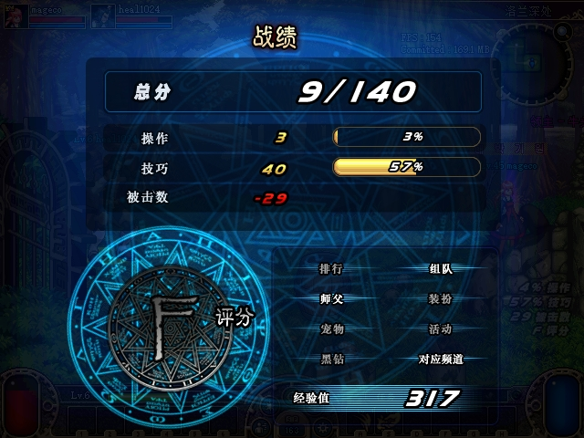
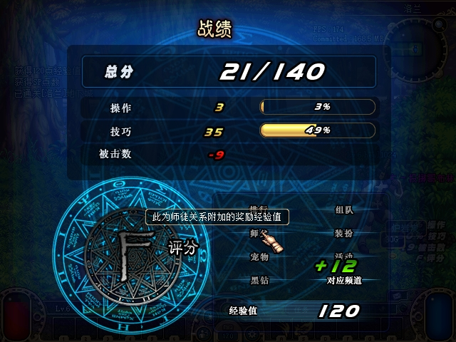

# 2026-10-28：ACT1 师徒在线成长与徒弟经验验收

> 最终交付补记：本组件有界验收已完成，最终构建的源码重叠、关系名单/成长持久化交集及统一运行交付见[本轮索引](2026-10-28-overnight-delivery.md)。下文NOT_READY/待绑定保留各历史取证时点含义；历史695的7/7类行为仍按原构建归属，不改称全部在30AD重跑。

历史隔离构建 `695232c7c6ba7191d79f074c6e7e6dab103a39a7` 的 **7/7 类原生行为已取证**：真实在线成长、在线直接击杀、在线通关、组队经验信用收件人、离线师父时的击杀与通关零加成，以及跨旧计时期限重登且不补时。后续 `cacab2e` 构建上的实际服务端重启持久性也已单独取证。**整体验收仍为 `NOT_READY`**，待补最终托管/原生构建的部署与相关行为重叠回归绑定。

本记录只归属于阶段 `mentor-growth-695232c`。后续分组构建使用各自的源码、运行文件和回归证据；本阶段原生授奖记录保留其历史构建身份。COF、师父金币/疲劳不在本组范围内。

## 恢复规则与自动化范围

本组已核对官服monitor/game的在线成长与经验分项函数、ACT1名单/经验通知及实际PVF阈值，并据此落实以下规则。原始分析与设计保留私有，公开规则、自动化结果和原生证明在本页分别列明：

- 每个活动角色从进入世界起独立计时600秒；到期时与在线师父及在线徒弟的规范边各加1。双方稳定在线时通常每10分钟合计加2，不要求同队、同房或同镇；离线不补时，重登重新计时。
- 累计上限880，阈值为 `0,3,6,11,20,37,70,132,249,468,880`。累计3仍为Lv1、3/3；累计4为Lv2、1/3。在线升级广播、兄弟缓存不降级及重登重新按本边载入保留样本语义。
- 经验率先保存 `float32(level*0.01f)`，再提升精度乘真实基础经验并朝0截断。小额奖励允许为0；Lv2的基础50仍为0，基础100为1。怪物只加一次，NOTI37 `extraExperienceB` 为实际师徒份额；通关按原 `withParty` 基数计算，写入NOTI35师徒槽。
- 规范关系、活动会话、原子持久化和缓存发布保持一致；陈旧角色保存不能覆盖关系进度。实际授予受容量截断时，分项不能超过真实入账。

确定性回归覆盖阈值、599/600秒、错峰双端、旧会话与重登、墙钟变化、父子链与多徒弟缓存、离线/解绑/删角、旧档与孤儿字段、陈旧快照、并发经济账本、原子替换前后故障、float32舍入和封顶分项。最终独立审查的孤儿替换清理问题已复现并修复。

[RED成长](assets/2026-10-28-mentor-growth/red-growth.log)、[RED替换孤儿](assets/2026-10-28-mentor-growth/red-replacement-orphan.log)、[RED容量分项](assets/2026-10-28-mentor-growth/red-clear-budget.log)、[最终定向GREEN](assets/2026-10-28-mentor-growth/green-reviewed-focused.log)、[完整冒烟](assets/2026-10-28-mentor-growth/full-smoke-reviewed.log)保留原日志。Server/SmokeTests Release构建均0警告、0错误；[Server构建](assets/2026-10-28-mentor-growth/build-server-release.log)、[Tests构建](assets/2026-10-28-mentor-growth/build-smoke-release.log)、[Release定向](assets/2026-10-28-mentor-growth/release-focused.log)、[win-x64发布](assets/2026-10-28-mentor-growth/publish.log)见附件。本次证据整理未重新构建或运行游戏。

自然服务端死亡sweep与直接CMD共享真实handler，另一个授奖点处理party-credit收件人。本阶段原生击杀有实际CMD42，**自然死亡sweep仍只计源码/TDD覆盖**。多徒弟、封顶和写入故障也不列作本次原生矩阵。

## 冻结来源与所有权

原生操作、进程控制、规范状态观察和冻结由协调者root执行；证据工作者只读复核、查看原图并原样复制资产。A为 `mageco` Lv45，B为 `heal1024` Lv6，使用隔离存档和原生UI输入。A旧进程53140、B14144、A重登进程58124，均绑定PID、可执行路径与启动UTC；服务端56304。

测试进程于04:28:18暂停，原始副本清单制作于04:30:18。三份私有冻结网流合计验证 **524个TX、1017个RX游戏帧**，CRC、选定布局错误、残留字节和禁用流均为0。所有TX游戏帧均消费密码流；公开内容只含选定语义、EXP前缀和包头。CMD42仅解释23字节布局中的序号、实体ID及末尾被动对象标志，中间字段不扩张解释；NOTI35未解码奖励卡片尾部。

历史运行目录13个文件逐项匹配[原生构建哈希](assets/2026-10-28-mentor-growth/native-runtime-hashes.json)，其中Server DLL SHA256为 `01D664C4465769E3A617D40215C0FF471EFA74E6D707F0ED63D20A31E8E933AF`。该匹配不代表后续最终构建与它字节相同。

[只读检查结果](assets/2026-10-28-mentor-growth/native-review.json)为历史原生范围7/7、后续重启持久性PASS，整体 `NOT_READY`，仅余最终交付绑定。[历史695来源证明](assets/2026-10-28-mentor-growth/native-source-proof.json)、[选定包与独立计算](assets/2026-10-28-mentor-growth/native-packet-proof.json)、[有界服务端事实](assets/2026-10-28-mentor-growth/native-selected-server.log)保留该历史阶段的时间、分项和私有来源哈希；[后续重启证明](assets/2026-10-28-mentor-growth/native-restart-proof.json)使用独立阶段身份。完整网流、认证流量、完整服务端日志和完整存档保持私有。

## 真实600秒成长与异地在线

双方约03:20进入世界，03:22:20通过原生申请/接受建立关系。计时从进世界开始，因此建边后约8分钟出现首个到期，并未从建边重新计时。

| 原生/服务端观察 | 关系累计 | 名单投影 |
| --- | --- | --- |
| 初始建立关系 | 0 | Lv1、0/3 |
| 03:30:28，A端点到期 | 1 | Lv1、1/3 |
| 03:30:39，B端点到期 | 2 | Lv1、2/3 |
| 03:40:28，A重复周期 | 3 | Lv1、3/3 |
| 03:40:40，B重复周期 | 4 | Lv2、1/3 |
| 后续真实周期至04:10:41 | 10 | Lv3、4/5 |

两端名单与13份规范状态观察吻合。B在03:34:03离开赛丽亚房间，A仍留在房间；规范区域分别为1/2，此后两次端点仍增长。冻结日志共有10次真实加1，另有师父离线后的1次空边提交。

[A初始图](assets/2026-10-28-mentor-growth/017-growth-A-open-list.jpg)、[B两次端点后的进度](assets/2026-10-28-mentor-growth/019-growth-two-ticks-list.jpg)、[B的Lv2图](assets/2026-10-28-mentor-growth/028-mentor-B-level2.jpg)均为已查看原图。B的Lv2图保留原生地图提示遮挡；精确1/3由严格名单包和规范状态核对。

## 在线奖励与实际持久化

| 必需用例 | 独立基础经验 | 师徒份额 | 实际该项授予 |
| --- | ---: | ---: | ---: |
| B直接击杀，A在镇内在线 | 240 | 7 | 247 |
| 在线通关，基数已含组队 | 281 | 8 | 317，另含频道28 |
| A击杀，B收到party-credit | 180 | 5 | 185 |
| A实际离线，B直接击杀 | 120 | 0 | 120 |
| A实际离线，B通关 | 120 | 0 | 132，另含频道12 |

第一轮组队：A于04:02:04.847实际发出非被动对象CMD42，B于04:02:04.929收到NOTI37。前值15607、后值15792，差185 = 180 + 5；服务端明确记录B的party-credit。后续22和38两份怪物奖励使其到15852，再加通关317，规范存档为16169。NOTI35的281已经包含party94，求和时不再重复加94。

独立PVF/冻结源码计算：boss等级4基础60，boss类型倍率4，两人队倍率1.5再除2，其余因素1，得到180。关系Lv3费率为 `0.029999999329447746`，截断为5。通关25只怪，D2基础等级2奖励40、B等级惩罚.75、两人分摊，未加组队倍率前187.5；先后得到withoutParty187、withParty281，师徒8。187属于通关分项，不是boss基础。

第二轮直接击杀：A离队回镇且保持在线，[A的实际名单](assets/2026-10-28-mentor-growth/057-mentor-A-town-online-list-retry.jpg)与会话包对应。B于04:15:43.201实际CMD42击杀，NOTI37为16894/师徒7；规范前值16647，247 = 240 + 7。随后22只怪的单人清算基数330、师徒9、频道33，共372，规范存档为17266。A经验前后均38402107。[B原图](assets/2026-10-28-mentor-growth/058-mentor-direct-B-clear.jpg)已进入Continue菜单，未把它标成372的EXP结果图；数字依据为实际包、独立基数和规范存档。

## 实际离线零加成与重登不补时

04:18:18实际进程证明确认A旧身份已不存在、B和服务端仍在；B于04:18:18.031收到NOTI72离线通知。[原生B名单](assets/2026-10-28-mentor-growth/060-mentor-B-master-offline-list.jpg)保留师父关系。在线资格依据进程、会话和通知核验。

B实际进入普通洛兰D1。PVF中boss为随副本等级的monster2、偏移+1，因此等级2；基础40、boss倍率4、B等级6惩罚.75，单人正常难度得120。若师父在线，Lv3应加3，故实际0不是小额舍入造成的无效对照。04:23:35.499实际CMD42之后，NOTI37从17491到17611，差120、师徒0。

实际击杀15只普通怪和1只boss，通关基数 `30*16/2*.5 = 120`，在线反事实也应加3。实际NOTI35为120基础、12频道、0师徒，共132；规范存档17743恰为17611+132。在线D2与离线D1分别核对其真实基数。

该原图拍在计分动画中，显示120及绿色+12；最终132和师徒0由实际包与存档证明。

旧A最后一次端点为04:10:29，其原期限约04:20:29。A离线跨过期限；B于04:20:41实际提交空边，04:21:02规范关系仍累计10。新A进程58124于04:24:35.1800032启动；04:25:22.474发出ACT1选角CMD4，.476收到回应，B于.482收到上线，A于.619收到世界完成NOTI136。04:26:44与04:27:53规范观察仍为累计10、Lv3、4/5，未在新会话首600秒内追补旧期限。

[A重登原图](assets/2026-10-28-mentor-growth/062-mentor-relogin-A-growth-list.jpg)也保留Lv3。上述属于真实客户端重登及过旧期限不补时。

## 后续构建上的实际服务端重启

旧服务端56304停止后，新阶段 `pvp-creature-cacab2e` 服务端48776于UTC20:32:27.1415357启动，客户端A28824/B66396随后通过正常选角进入世界。该阶段源码标记 `cacab2e8e6bf8370f630b5aec52f63ab485fdf5e`，托管Server DLL为 `48244DCEC0EC9AC556D6C14CA3DC3CA6701CA6208A12E4D1FD679A0FB24E2B9A`，与历史695的 `01D664C4…` 分别绑定。

04:33:18规范观察SHA256为 `AB528D5275B7F42EFD395765AD760ECB0FF12E7DE816A42FC107EFA3CE0C5EEB`，与上一阶段暂停快照完全相同。原B `heal1024` 仍为Lv6、EXP17743，规范师父边及累计10保留；两端严格名单均为Lv3、当前4、下级5。两份已关闭网流私有副本验证66个TX、130个RX游戏帧，CRC/布局/残留/禁用流计数均0。

原图065/066已实际查看并逐字节复制。证明窗口截至04:34:41；之后普通选取B的Lv52角色及PvP尝试不计入本组重启结论。该阶段较晚暂停存档SHA256 `B9831C157CB9A6A77DE3BFF7C07B591860E34D8A294BF1B18B0AEE9EBFAAB9FB` 与初始重启观察分别保留。

[重启运行文件哈希](assets/2026-10-28-mentor-growth/restart-runtime-hashes.json)核对发布清单48项中的47项；唯一差异为 `server.json`，运行初始化明确使用原备份配置，其实际SHA256为 `D604F6F0F9F351745B306EAEEEC8DAD028BF0330D4071090BCE80176CCB8F47C`，单独核对且未公开配置正文。所有托管程序集和其他声明文件匹配。历史695的五类授奖不会因此被记作已在新DLL上全部重跑。

## 待完成的统一交付绑定

最终源码、托管/原生构建、运行目录清单、配置与原档恢复，以及相关行为重叠回归仍待分别绑定。后续分组会继续修改源码；历史695授奖、cacab2e重启持久性与最终构建使用独立的证据身份和审查范围。

私有暂停存档SHA256为 `AB528D5275B7F42EFD395765AD760ECB0FF12E7DE816A42FC107EFA3CE0C5EEB`。完整原始内容未放入本目录。原图、公开证明、测试日志及复制件的逐项来源/哈希见[资产清单](assets/2026-10-28-mentor-growth/sha256.json)和[查看记录](assets/2026-10-28-mentor-growth/screenshots-reviewed.json)。失败的早先单人尝试和焦点抓图不计为通过证据，保留在私有阶段目录。
