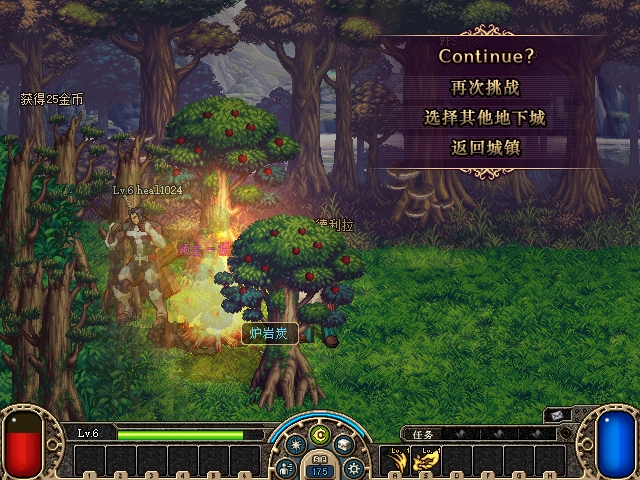

# 2026-10-28：ACT1 师父 MASTER GOLD 验收记录

> 最终交付补记：本组件有界金币矩阵已闭合，统一构建交集、正常运行目录启动和原档/配置核验见[本轮最终索引](2026-10-28-overnight-delivery.md)。下文PENDING_ROOT及附件whole_round字段保留发布时点含义，由后续聚合回执闭合；743/C79/30AD各阶段身份及疲劳/COF阻塞边界不变。

**本组件已完成批准范围内的原生验收：普通PvE来源、正常选角flush、自然金币计时、师父离线正额来源反例，以及两次完整重启的余额/receipt保持与无补发。组件结论为 `PASS_AS_SCOPED`；整轮运行交付、原配置恢复和其它功能集成仍为 `PENDING_ROOT`。** [分阶段总验收](assets/2026-10-28-mentor-master-gold/native-component-acceptance.json)明确区分743、C79与最终30AD，不把旧构建结果改称新构建重测。托管源码为 `5078da27a4807695f002ceea61333c43e1932ce4`，包含R1真实外部金币通知排序修复。疲劳与COF数值仍为BLOCKED。

## 已批准规则与最小架构适配

本组已核对官服game/Monitor的金币来源、费率与结算函数、ACT1的NOTI76消费逻辑，以及原始PVF容量/金币上限表，并据此落实以下规则与本地事务适配。原始分析、设计和实施计划保留私有；本页公开具体规则、可执行验证结果和审查结论：

- 仅普通PvE的服务器生成金币拾取（本组规范RoutingSource=1）和正常free card正金币进入税基。按每位收款人原本请求的正signed32金额、在其钱包裁减之前累计；队伍商/余数保持，徒弟不额外扣税。玩家丢金币source0、付费卡成本、任务/交易/邮件/商店/Cera和师父收到的税金不再计税。
- 来源仅在首次规范持久化成功后、同一store gate内累计；重放、消费信用、登录重装、Rejected和Unknown均不再累计。原先单人直接写Gold的拾取/免费卡收敛到已有幂等提交路径。
- 未结算池绑定徒弟与师父attachment、规范关系边代次，仅存内存。双方在来源和结算时都须在线有效；离线、换角色、重登、解绑重建、删除或强制替换不转移旧池，也不离线赚取/补时。
- L取徒弟自己的规范关系等级，不能取兄弟升级抬高的经验奖励缓存。N为当前在线直接徒弟数，C为师父等级对应原生容量5/8/10；师父至少Lv18。先分别保存 `float32(L * double(0.01))` 与 `float32((N/C) * double(0.05))`，再作float32求和，按该精确值乘税基并截断。小额为0不留小数余额。
- 每个活动角色另有 `600 + GetRandInt(300)` 秒金币计时，保留可能900秒的原生分支，与成长600秒计时独立；迟到只处理当前一次，不补历史周期。当前适配覆盖正常退出/选角/断线和该计时结算，不扩展其它历史UpdateData触发器。
- 师父上限来自原始PVF `etc/goldlimitbylevel.etc`，容量同时扣除已保留的副本、私人商店和师徒信用。零实际收益消耗该批，不发虚假的NOTI76，也不积欠被裁掉的部分。

原生原型在结算时直接更新钱包；本仓库沿已有跨会话金币交付架构，**仅把已决定授予的钱和不可变receipt原子持久化**。未结算税池不落盘。师父自己的actor在安全点消费该信用，只安装Gold及相关receipt字段；旧actor的物品、技能、邮件领取、Cera购买等正常保存仍成功并保留其结果，未新增Gold revision拒绝方案。写入结果不确定即隔离，不报告成功、不自动重试；重启只按原子存档中已经授予的信用安装一次。

真实角色替换使用 `CharacterSessionRegistry.ClaimAsync` 的既有Kick标记：旧finally捕获旧lease和旧mentor token，在store gate内读取WasReplaced后决定普通flush或强替换丢弃，再Release，incoming才完成claim并重读。不能依赖后来Attach发现旧channel来代替这个判断。

## 协议与实际发送者排序

NOTI76完整载荷为 `actualGold:u32LE + fatigue:i16LE(0) + nameByteLength:u32LE + CP936徒弟名`，名称长度1..49字节。ACT1会真实增加客户端Gold，因此顺序必须是**NOTI76增量，然后包含该收益的规范绝对余额**。

首轮独立审查发现，实际ItemTradeService取消的NOTI14和PrivateStoreService卖家NOTI82绕过owner货币gate，延迟的旧绝对值会覆盖新金币。修复将这两种确切Gold包排入本attachment的owner队列；其它城镇包直接发送。owner在同一gate内先冻结该批通知、安装待交付交易/商店信用，再读取规范Gold，替换包中的Gold字节后发送；取消包与销售商品/数量/买家/金额/费用内容保留。发送期间新到的第二笔销售留给下一批重新采样，旧attachment队列退休后不进入新角色。

[首轮审查](assets/2026-10-28-mentor-master-gold/final-review.md)保留R1的拒绝原因；[修复复审](assets/2026-10-28-mentor-master-gold/fix1-review.md)结论为 **APPROVE，R1已关闭，无剩余Critical/Important/Minor问题**。这两个结论属于托管源码范围，不代表原生Task4完成。

实际协议编号以批准源码为准：CMD46是8字节拾取请求，NOTI39的金币形态给出四位实际分配；**CMD74才是SelectCard**。CMD36是FinishQuest，NOTI36是疲劳，均不能记作本组来源。卡牌账本保存实际GoldDelta及指纹，并不保存独立的requested字段；不得从实际差额反推受cap前税基。已提交师徒receipt的Basis/L/N/C/requested/actual与来源包/拾取账本、服务器flush日志共同构成核对依据。

## 自动化证据

政策使用独立Fraction/整数oracle：230组费率位模式、24组乘积截断边界、301组特殊随机分支种子；原始容量表、PVF金币上限文件保留原字节哈希。原始金币上限文件1367字节，SHA256为 `718960fccddac3f6205ca9e0a21686493cde8b3727e1e6d3860caac69e465e1e`，复审独立从实际PVF解出并核对一致。

真实服务/存储测试覆盖：101金币两人51/50分摊与独立截断、徒弟cap前requested、单人/组队同源、免费卡/重放/付费排除、师父离线和旧token、关系重建、实际ClaimAsync及阻塞gate期间强退、普通TCP EOF、成长与金币双计时、原生上限及三类pending信用、合法旧保存、原子替换前后故障与重启、NOTI76和绝对包的实际Gold偏移。

| 证据 | 结果与范围 |
| --- | --- |
| [初始RED](assets/2026-10-28-mentor-master-gold/red-initial.log) | 8项功能缺失失败，另1项为派生oracle换行哈希夹具问题；未将夹具问题算作功能修复 |
| [免费卡RED](assets/2026-10-28-mentor-master-gold/red-card.log)、[信用容量RED](assets/2026-10-28-mentor-master-gold/red-card-reservation.log) | 实际trusted-roll来源与pending容量裁减 |
| [交付RED](assets/2026-10-28-mentor-master-gold/red-delivery.log)、[交易待安装RED](assets/2026-10-28-mentor-master-gold/red-trade-notice.log) | 实际安全安装顺序与被交易阻挡的notice重试 |
| [R1真实发送者RED](assets/2026-10-28-mentor-master-gold/fix1-red-external.log) | 实际取消及实际卖家发送：预采样后延迟、N76发送期间两种交错，共4项失败 |
| [发送中第二笔销售RED](assets/2026-10-28-mentor-master-gold/fix1-red-new-sale.log) | 真实BuyAsync证明新到notice必须另批采样 |
| [最终定向GREEN](assets/2026-10-28-mentor-master-gold/fix1-green-final-focused.log) | 0 failures，包含上述修复及原有成功旧保存回归 |
| [完整Smoke](assets/2026-10-28-mentor-master-gold/fix1-full-smoke.log) | All DFLegacy protocol smoke tests passed |
| [Server Release](assets/2026-10-28-mentor-master-gold/fix1-build-server-release.log)、[Smoke Release](assets/2026-10-28-mentor-master-gold/fix1-build-smoke-release.log) | 均0警告、0错误 |

这些是封存的实施者运行结果，已由独立审查核对；本次文档整理没有重新构建或操作游戏。公开附件为有界测试/审查日志、脱敏原生事实投影和已查看的原图，均从私有准备件原样复制；[资产哈希清单](assets/2026-10-28-mentor-master-gold/sha256.json)逐项核对源与复制件。完整网流、认证、完整服务端日志和完整存档不在公开资产中。

## 批准托管与最初743构建身份

| 项目 | SHA256/身份 |
| --- | --- |
| 批准源码 | `5078da27a4807695f002ceea61333c43e1932ce4` |
| Server DLL | `A0EE99650A49011B9527E06BB8E1C19E6A7E5D284CC51D8F9865597C9E133134` |
| Protocol DLL | `5A55089D384EFA9E4ACEC5A211EE5C551668CDDB5C93ED46A698D50250E04A4E` |
| 原生ijl15.dll | `7431347A19A5D8B0B963B474B9739288BA8755895B260DF04A51D80BFF65B3DC` |
| 批准发布清单 | `3D92263FE0E44BA5F56E3255D61CE1080E31B77D55ECDC17551BB6435B64D266` |

R1前的Server `7D44789C…` 是被审查拒绝的历史候选，不能用其原生结果替代最终候选。批准后root只补充原始member表注释尾空格的文件级属性豁免，468项source/test原字节保持不变。最初两阶段由root绑定到本表A0/743候选执行；后续C79及30AD身份另列。只读整理核对各阶段冻结journal、确切PID/启动UTC、原始收包头及状态连续性，不随后来全局DLL、当前进程或其它部署改写历史。

## 已冻结的两阶段原生事实

[脱敏逐包、规范余额与公式检查结果](assets/2026-10-28-mentor-master-gold/native-public-proof.json)来自停止后的原始TCP、原始状态和服务器日志；读取前固定SHA，复制后逐字节核对。在线阶段 `mentor-gold-final-5078` 为server60360、A25588、B64696；完整重启阶段 `gold-persist-relogin` 为server55284、A12628、B56412。两阶段分别封存，重启初态与在线终态完全同字节。未读取或替代为后来全局live存档。

| 在线来源/结算 | 原始事实 |
| --- | --- |
| 06:58:50 生成金币拾取 | CMD46 ground1 → NOTI39实际20；source1账本requested20/actual20 |
| 07:01:21 生成金币拾取 | CMD46 ground8 → NOTI39实际20；source1账本requested20/actual20 |
| 07:01:59 生成金币拾取 | CMD46 ground9 → NOTI39实际21；source1账本requested21/actual21 |
| 07:03:05/07:03:28 免费卡 | NOTI35四列预览均24，原生短CMD74确定免费第0列；committed账本实际24；没有手动CMD74请求或DFCR扩展 |
| 07:04:05 正常选角 | B的真实CMD7于05.491发送；同秒服务端flush：Basis85、L4、N1、C10、requested3、actual3 |
| 师父客户端收包 | 05.539先NOTI76增量3，紧接同一TCP记录内NOTI13绝对50680；完整CP936源名字节数8、预期名称匹配、signed fatigue0 |

税基为 **20+20+21+24=85**。不能把两笔20之后的剩余45都称为卡金币；另一笔21已由实际拾取包证明。另一次ground10请求未对应金币通知，未计入。B规范金币50351→50436，获得全部85，没有额外扣税。B自身关系EXP10→16，因此结算时L4，不能沿用baseline的L3；服务端flush、持久化receipt和规范关系共同核对。独立计算的费率为binary32 `0.044999998062849045`，85乘该精确值截断为3。A金币50677→50680，新增唯一receipt且Applied=true，三类pending Gold均为0。

上图为已查看的原始截图，显示通过徒弟的师徒关系获得3金币。[标记为free-card的原图](assets/2026-10-28-mentor-master-gold/gold-B-native-free-card.jpg)实际是Continue界面，**不当作已翻开免费卡的截图**；卡24金币由NOTI35、CMD74和committed账本证明。finalboss-live-finish属于评分动画，也不充当选卡图。07:04:27 B通过真实CMD4再次进入世界，[同进程重入原图](assets/2026-10-28-mentor-master-gold/gold-B-native-relogin.jpg)可核对；该阶段A仅收到一次NOTI76。

随后真正停止并重启服务端与双客户端，每端各一次原生登录。A最终绝对及规范钱包均50680，B均50436；原有唯一师徒receipt保持Applied=true，无新增receipt，双方原始流均无NOTI76。拾取与卡账本保持，既有三条PvP receipt保持。两端原图已分别查看，均回到Town1。这证明本次完整重启不补发旧提示、已授予余额保持；没有将它扩写成多个反复登录循环或离线产生收益的实验。

[徒弟重启后Town1原图](assets/2026-10-28-mentor-master-gold/gold-persist-B-login.jpg)与同阶段收包和规范余额一起封存。独立冻结检查器两阶段均为PASS；[自测记录](assets/2026-10-28-mentor-master-gold/frozen-checker-selftest.log)覆盖缺失证据、颠倒N76/绝对值、重复提示、错误公式和重登重放等拒绝分支，另与230组独立oracle核对。工具的原生总判定仍为NOT_ASSESSED；此处具名提示/Town1判断来自原图查看，不来自工具自称截图成功。

## C79自然计时与师父离线来源

[C79脱敏事实与检查](assets/2026-10-28-mentor-master-gold/native-C79-timer-offline-proof.json)来自已全停的 `gold-natural-timer-C79`：server56756、A24580、B68972，托管仍为A0/5A55，native为 `C79E139201E55DAE86AD6FD6ABE501A98759371269F937046E0C392B1830C912`，native源码 `c43b1f89f06bf862f065b75a9da7dc0863aa1694`。历史组合包清单SHA `8C00C67ADB6B35058A992A46D5BD85FD17C8A870D91896002B6436B8E13CDF5A`，独立封存的C79部署receipt为 `58A5D7AA59A3597BA621890ECBD7DD7EC34114C5A5430BB26AF0DEEA1349E3AA`；另已核对该runtime原始哈希记录。没有使用后来全局部署receipt替换C79身份。

实际在线来源为 **拾取20＋自动免费卡14＝34**：07:19:13的CMD46/NOTI39对应source1账本20；07:25:18的NOTI35预览14、07:25:40自动CMD74及committed卡账本14吻合。A50680、B50436的起点来自前次743重启最终状态；实际timer后A50681、B50470，B关系EXP16→18仍为L4。

B首次CMD4为07:15:30.366，首个attach后CMD82为07:15:30.554；07:29:46.749收到A的NOTI76实际1金币，随即NOTI13绝对50681。距CMD4 **856.383秒**；唯一新增receipt与server第586行flush均为Basis34/L4/N1/C10/requested1/actual1/Applied=true。两端在发奖前没有CMD7、重选或对方离线通知；A首次CMD7直到07:30:53.829，B首次CMD7直到07:32:47.847。发奖后A真实CMD82以及B后续同连接CMD46/NOTI39、回城CMD82都提供了原attachment继续存在的证据。

因此本次可按源码仅有的计时与正常退休两条发奖路径，排除正常退出前置，确认自然金币计时场景。**856.383是观察到的墙钟间隔，不是读取出的随机GoldDelay或jitter。** 现有日志不记录GoldDelay、精确deadline或flush reason；成长600秒日志属于另一计时，未被当作Gold到期证据。独立生命周期检查分别使用B真实roster和显式的后续拾取/唯一source1 receipt见证，两种路径均PASS；未为满足检查器而强迫B在地下城打开无效社区窗口。

[A发奖后真实师徒列表原图](assets/2026-10-28-mentor-master-gold/timer-A-post-award-roster.jpg)已查看，徒弟在线、关系Lv04。自动卡14仍由包与账本证明；Continue画面不当作已翻卡截图。

随后A先正常选择角色，B于07:30:53.843收到实际NOTI72师父离线。A已离开world后由既有client-control关闭其进程；B继续留在同一副本/连接，用保留的自然地面金币进行离线反例。07:32:08.509的NOTI39与新source1账本均为25，B50470→50495；A保持50681、receipt总数保持2、pending0。若相同L4/N1/C10下师父在线，该25税基应截断为1，因此不是零收益无区分度的反例。B随后回城，07:32:32.803真实CMD82显示师父channel255离线，再于07:32:47.847正常CMD7提供普通flush机会，仍无新award。

[回城后师父灰色离线原图](assets/2026-10-28-mentor-master-gold/offline-B-return-and-roster.jpg)已查看。进程证据有明确时间限制：来源前原始JSON是无嵌入时间的array；其绑定文件记录的07:31:44.074270文件写入时间只作观察已发生的上界，**没有改称原生采样时刻**。来源后/B正常选角后的第二份原件有明确ObservedAtUtc＝07:33:08.7403437；两份均只见原server/B身份，不见A。实际NOTI72、来源包、离线roster和CMD7补足了事件顺序。整个离线段没有用后来登录状态倒推离线事实。

## 最终30AD重启桥接与不补发

[最终30AD冻结重登检查](assets/2026-10-28-mentor-master-gold/native-final30AD-relogin-proof.json)来自已全停的 `gold-offline-final-relogin-30AD`：server61388、A74644、B57968。其初态与C79离线25后的最终存档逐字节相同；托管仍为5078/A0/Protocol5A55，native固定为 `30AD9A4A3CD565DE845F74AB3D6C6D60EED1F3429EC7D53929D912F158246584`，native源码 `ab1e6b685021f6cd6f8d125fc04dc0c5c50e931f`。组合包清单SHA `09EFFBE39AB99B377AAFB540933EA75919E9E04642FCE79F4D6AF0CB1CC05204`，该阶段新部署receipt SHA `832A30A725206FE2A789EFAD4EE7A3194E03B49CCF781E3D931D4C3C99BB8CD8`均固定复制后核对。

两端各一次真实新登录，全部19个TX帧滚动CRC有效，A规范/绝对钱包50681、B50495；两条原有师徒receipt均Applied、完全保持，三类pending Gold均0，B关系EXP18保持，拾取/卡账本和既有三条PvP receipt保持。两端收包均无NOTI76，因此离线25没有在完整服务重启后补发。最终[A已进城原图](assets/2026-10-28-mentor-master-gold/offline-final-A-world.jpg)与[B已进城原图](assets/2026-10-28-mentor-master-gold/offline-final-B-world.jpg)均已逐张查看。

这完成了C79离线来源到30AD最终身份的持久化桥接；它不表示在30AD重新进行了之前全部战斗或随机计时。743普通flush与第一次完整重启、C79自然timer/离线来源、30AD第二次完整重启分别保留自己的原始包、状态、图和构建身份。旧proof里当时的PENDING状态保持原字节，由[总验收记录](assets/2026-10-28-mentor-master-gold/native-component-acceptance.json)引用后续阶段闭合，不回改历史数据。

## 原生矩阵：组件闭合与剩余边界

| 必需场景 | 当前状态 | 待取证闭环 |
| --- | --- | --- |
| 徒弟自然拾取服务器生成金币，师父异地在线 | PASS_NATIVE | 三笔source1：20、20、21；请求/通知/账本/总税基/实际收益闭环 |
| 徒弟正常挣得free card，师父在线 | PASS_PACKET_LEDGER | NOTI35预览24、自动CMD74、committed账本24；缺少已翻牌原图，不宣称手动选卡 |
| 普通离场具名收益提示 | PASS_NATIVE | 正常Esc→选择角色及CMD7，flush85→3，原生具名提示，完整N76→NOTI13绝对50680 |
| 真实600+rand金币计时到期 | PASS_NATIVE（触发路径推断） | C79首attachment约856.383秒后34→1；发奖前无选角/退休，真实后续同attachment仍存活；未声称读出精确deadline |
| 师父实际离线时的自然来源对照 | PASS_NATIVE | 实际25金币为正额反例；B得25，A50681/2条receipt不变；NOTI72、进程、离线roster及正常CMD7闭环 |
| 全服务重启后已授予金币保持 | PASS_NATIVE | 743首次重启：50680/50436及唯一Applied receipt保持；30AD第二次：50681/50495及两条Applied receipt保持 |
| 离线来源重启后不补发 | PASS_NATIVE | 30AD两端各一次新登录，19TX CRC有效，无新增receipt/NOTI76，pending0 |
| 最终交付恢复及完整重叠回归 | PENDING_ROOT | 后续部署、原配置恢复、运行存档交付和其它功能回归由root另行确认，不用本页代替 |

这些原生窗口使用既有合法关系与正常PvE，没有种金币、强制掉落、业务包注入、存档修改或快进时钟。**钱包cap/零裁减、真实交易/私人商店竞态、强制替换、写入故障、多徒弟和其它容量等级仍仅有自动化覆盖**，不能称作已原生逐项实测。随机计时只验证了本次首周期，不涵盖全部随机值。两次重启各端各一次登录，不扩写成任意次数压力测试。

私有只读观察助手已经过[合成自测](assets/2026-10-28-mentor-master-gold/capture-helper-selftest.log)，要求明确部署journal、phase与服务端/客户端PID，逐帧消费TX滚动密码/CRC；只解释实际CMD46/CMD74、NOTI39、完整NOTI76和Gold绝对包，并记录有界规范receipt投影。名字仅输出CP936字节长度与预期匹配，完整状态哈希也保留在私有报告。未知卡牌结构明确标记unsupported；观察助手始终标记 `NOT_ASSESSED`，不代替原图查看和native验收。

后续生命周期检查器增加实际CMD7/NOTI72/CMD82和显式后续拾取见证；[自测记录](assets/2026-10-28-mentor-master-gold/lifecycle-checker-selftest.log)包含错socket、同socket但已退休/重选、错误钱包和缺失离线证据的拒绝分支。既有743普通退出阶段被故意当timer运行时也被拒绝，未把正常退出误算为自然timer。

**疲劳收益与COF仍为 `BLOCKED`，本组未实现或验证其数值。** 本组件批准范围的金币native矩阵已闭合；它不等同整轮任务完成。最终runtime交付、原配置恢复、运行存档交付和其它功能重叠回归仍由root另行确认。
