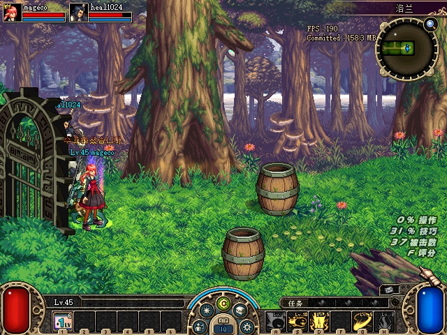
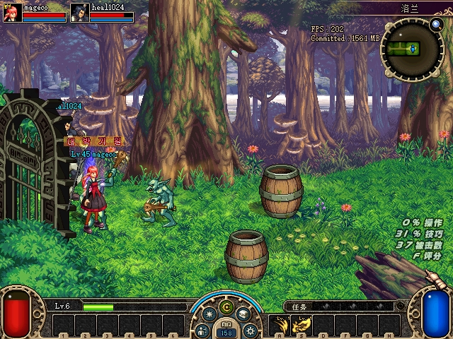
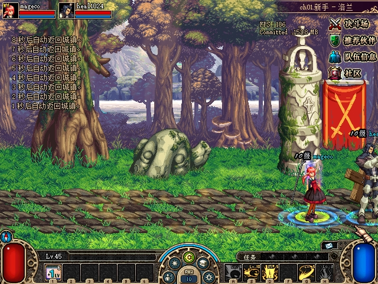
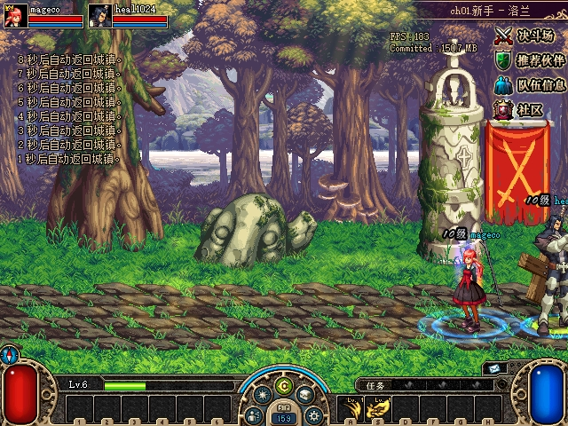

# ACT1 怪物位置同步排查

2026-10-30新增[自然移动窗口](2026-10-30-sync-followup.md)：普通洛兰MAP4的592行合格比较最大30.27px，未复现历史持续大差；不替代本报告首领房／种子，不关闭具体接收应用与GP42未知。夜间按用户授权保留阻断，继续其余列表。

2026-10-28，**进行中，尚未修复位置同步**。已验收的 [TCP 回退](2026-10-28-party-tcp-fallback-verification.md)解决传输入口、寻址与损坏帧；本记录继续区分传输、消息解释、接收门控与运动状态应用。

## S01：原始契约与离线解码

新增 `tools/acceptance/act1_gameplay_evidence.py` 是离线工具，不参与服务器转发或客户端游戏执行。16 项新测试及原有8项 relay 证据测试共24项通过。原生 GP4 字节夹具先在仅支持旧 managed cipher 的实现上出现3个断言失败，加入实际观察到的表示后通过。独立审查发现多字节/多维memoryview能绕过字节上限，新增负例实际出现4个失败，再改为分配前检查nbytes并通过。模块缺失及 GP42 标记缺失的运行单独保留，不冒充业务错误复现。

| 契约 | 原始 ACT1 依据 | 这一步确认的范围 |
|---|---|---|
| GP4 接收 | `78EE00` case4 | 读取对象kind/UID、声明玩家kind/UID、房间两字节及32位运动标志；对象存在且房间一致，并满足“无关联对象，或关联对象kind/UID与声明匹配”后才调用移动应用。收到 socket 数据不代表走过此门槛 |
| GP6 接收 | `78EE00` case6 | 三个u16字段：对象kind、对象UID、选定玩家UID。查找在同一地图中的玩家及怪物，再走怪物虚表+2D8 |
| 实际怪物虚表 | 旧完整观察中该异常怪物两端的虚表均为 `A0BE04`；重新核对原始PE | +138为`47F480`读取`+1864`，+2D8为`4AE790`；+34/+38为kind/UID getter，+40取得运动控制对象。由此对这一已绑定类型闭合关联指针与接收链，不能扩展为所有对象的同一布局 |
| 本地关联判断 | `473620` | 比较虚表+138返回对象与全局本机角色；`4AE790`每次写入计时值`8F3F60(this+8)+2000`，并有本地选择后的运动处理。未将它命名为仅转移时的“两秒保护期” |
| 运动应用 | `4C9270` | 标志0x10直接复制；普通路径按运动状态插值并可采用携带的轴时间值。这里只核对读取布局和分支，不断言本次实际执行哪一分支 |
| 可靠应用边界 | `905810`、`907070`及冻结数据 | 可靠消息有u16长度前缀，可在一个MT块内连续存在多个应用；严格消耗边界，截断不扫描重同步。ACK、非可靠与空块分别保留 |
| 编码/CRC | `776F80`、`717CF0`及原生字节 | 支持原文、已观察ROL1/XOR56及既有managed ROL2/XOR14表示。检查CRC后才标记已知表示；未知保持不透明。真实CRC碰撞夹具验证：不同明文同时匹配时拒绝选一种 |
| GP42 | `78D800`、`78EE00`及`8C7550` | 走外部provider封装/解包接口，不能当成普通GP4/5/6。其外层CRC一致也保留`wrapper_opaque`，不扫描其中的疑似头宣称完整解包或GP6缺失 |

重新导出的15个原始函数完整字节与当前原始EXE一致，EXE SHA为 `6B4850BEAF67EC61ADB04AE17F119F16278DD05E97B8FFCA871A9BDB547DE0D5`。此处没有运行客户端业务函数或写进程内存。[函数与虚表哈希](assets/2026-10-28-monster-sync-diagnosis/s01/native-contract.json)

冻结捕获的外层应用复算如下，统计包含各端自己的TX和RX，以及可靠重发/包装等记录，不等于独立业务消息数或已应用消息数：

| 阶段/端 | 外层应用数 | 未解析外层CRC/表示 | 内层仍不透明的GP42 |
|---|---:|---:|---:|
| fallback-v3 A | 60941 | 0 | 24285 |
| fallback-v3 B | 60941 | 0 | 24283 |
| fallback-v4 A | 8538 | 0 | 1138 |
| fallback-v4 B | 8535 | 0 | 1137 |

[计数附件](assets/2026-10-28-monster-sync-diagnosis/s01/decoded-counts.json)。没有用旧 managed 固定key的CRC警告作为坏包证据，也没有将全部外层CRC可验证升格为所有内层GP5/GP6已解码。

## S02：持续差异窗口的线索

fallback-v3首领房普通怪UID3的274次快速成对观察覆盖约24秒，平面差约653–736。此时A/B的原始关联字段都映射到队员；同房其他怪物的分布不同。该窗口附近，初步离线追踪有B的67条GP4和A收到的67条GP4，声明玩家为kind273/UID2、房间为(1,2)，含明确位置值的记录已经到达A。A观察坐标却仍长期偏离。

这缩小了排查边界，**没有证明原生接收门控通过**。完整GP42/动作链、两端实际Stage房间字段、原生网络消费状态、该怪物当前/目标运动状态与插值参数还需成对记录。`+1864`的类型绑定也不能替代对具体时刻分支的观测。不能据此认定抢控制权、插值错误或直接修改坐标。

新增 `act1_stream_timing.py` 保留一帧首末贡献socket日志记录、行号和字节区间；独立原始wire SHA与规范relay fingerprint分开。仅有完成记录时间的原型在3条分/合包断言实际失败；修正后9项新测试、16项既有应用解码和8项relay测试共33项通过，独立复核复跑同样通过。重复帧保留各次观察与候选发送次数，不按最近时间强配。异常或不完整结束后拒绝继续。源码为 `b7a3b56`，只影响离线证据工具，未生成新游戏构建。

原始netdump在socket调用返回后采样`GetLocalTime`，随后才取得日志写锁。这些时间是日志来源，不是原生消费、接收门控或运动应用时间，也不是物理网络延迟；每条流的时间与行号顺序另作严格校验。三组完整冻结抓包复算后，在采样窗口附近得到：

| 窗口 | 指定GP4接收及完全一致的对端发送 | 日志时间差 | 边界 |
|---|---:|---:|---|
| normal-v3，room(2,2)/UID3 | 83组，双向合计 | 1–16ms | 地图13；不同布局/种子，作为参考 |
| fallback-v3，room(1,2)/UID3 | 67组B→A | 0–16ms | 地图15；原653–736差异窗口 |
| fresh M1，room(2,1)/UID1 | 82组B→A | 1–16ms | 地图13；新增当前/目标运动字段 |

上述选中帧均只有一个完全相同的发送候选。回退两组实际没有跨日志记录分裂的TCP帧，分/合包边界由字面回归覆盖；未把“实际未分裂”当作以后均不会分裂。全流外层表示/CRC没有未解项，GP42内层仍保持不透明。M1外层GP42计数A2177/B2176，不能据此推断其中GP5/GP6缺失或已经应用。[时间与位置摘要](assets/2026-10-28-monster-sync-diagnosis/s02/motion-summary.json)

## S02补采：当前位置与目标位置分开记录

历史 `fallback-monster-v1` 使用托管20d/native8AB，实际走洛兰旧maze0：(0,1)→(1,1)→(2,1)，地图1→7→13。这不是后来新增3×3/MAP6416的验收；后者单独见[魔笛使者记录](2026-10-28-boss-map-specification-verification.md)。同一补采的首房292次观察含573对存活怪物，最大平面差6.299，无读取错误。

| 首领房窗口 | 成对采样数 | 选中普通怪 | 该怪平面差范围 | 大于100的次数 |
|---|---:|---:|---:|---:|
| 正常UDP参考 | 280 | UID3 | 0.010–2.186 | 0 |
| 旧TCP回退差异 | 274 | UID3 | 653.018–735.765 | 274 |
| 新鲜M1回退补采 | 285 | UID1 | 0–121.370 | 121 |

这三组布局、地图和种子不同，不能据表认定传输是差异的原因。M1首领房记录中，两端实际Stage坐标均为(2,1)，每端地图和选中对象指针保持一致、网络消费标志为1，均无读取错误；标志为1本身仍不证明指定消息实际执行。

最大差异出现在17:56:36.327，成对读取跨度3.762ms：

| 端 | 当前X/Y | 目标X/Y | 已绑定类型的关联玩家 |
|---|---|---|---|
| A | 229.840 / 233.226 | 351.000 / 233.017 | kind273 / UID2 |
| B | 351.209 / 233.603 | 351.000 / 233.017 | kind273 / UID2 |

两端当前/目标结构的原始`+28..+48`标量尾同为`[0,0,-1500,52348,43988,-1]`。目标一致不证明上述82条GP4全部执行；这些标量的完整语义/单位及相关动作路径尚未闭合，不能直接将52348解释为已证实的52秒定时器并强行截短。整个285次窗口，该怪A/B当前XY分别有154/193种记录值，不能将其描述为整个窗口完全停止更新。

重新核对的15个原始EXE函数，在两端共30次RAM/PE完整函数字节比较均一致。GP42实际provider函数指针落入两端`TerSafe.dll`，文件SHA均为`AC4AC828C93D4624968EB03AECCCF16D38DB3B3852FC1BE62C451A620D428C81`；这里只读指针/代码指纹，未调用provider或改动其执行。原生接收门控的具体执行、GP42内层动作，以及运动应用后的求解仍是当前缺口。[补采身份与传输摘要](assets/2026-10-28-monster-sync-diagnosis/s02/native-phase-summary.json)

## 补采原图及验收勘误

以下为M1游戏自身PrintScreen原图，保持原始字节。截图依次拍摄，仅展示路线、通关和回城；位置差异的定量依据是成对只读记录，不能用这两张不同时间的画面替代。

| 阶段 | A端 | B端 |
|---|---|---|
| 首领房现场 |  |  |
| 自然清场与通关提示 |  |  |
| 自动回城后 |  |  |

**M1回城勘误：**服务端17:58:04记录自然清除和双方结算，18:00:26/27经`settlement-eplp-timeout`返回两人。标记为A手动回城的输入实际始于18:01:01，已晚于自动回城。因此本轮只能计为自动回城，早先工作摘要中的手动描述作废。`settlement`命名的两张图实际是通关画面，未拍到短暂Score覆盖层。另一个`room0-initial`命名的观察实际仍在城镇，也未计入副本采样。

完整M1原始344文件/35,225,425字节仍保持原清单 `D34BAF0260CCB300E14262BAE3693DC0E9E9D28E2723F3DDA2CCF6C150499C03`；新增21个分析/测试档案另行冻结，原型和两版分析均保留。[测试及源码摘要](assets/2026-10-28-monster-sync-diagnosis/s02/tests-source.json)、[附件哈希](assets/2026-10-28-monster-sync-diagnosis/s02/manifest.json)

最终独立只读复核逐项校验9项公开载荷附件、21份分析档案和344份原始文件，独立复算四组采样统计，核对六张原图/收据、自动回城勘误及30项RAM/PE记录；未发现剩余Critical/Important。该结论仅接受诊断与证据归档。

位置修复仍需具体接收分支执行、GP42内层和运动字段语义的证据；没有强制归属队长、写坐标或把日志到达当作修复验收。当前正常交付仍为Boss修复59666d9/native8AB。保留这个未闭合项，接续已确认的复活币购买价格/未知错误UI契约排查；有产品根因后再增加真正失败回归及修复。实施计划见[排查计划](../../docs/superpowers/plans/2026-10-28-monster-sync-diagnosis.md)。
