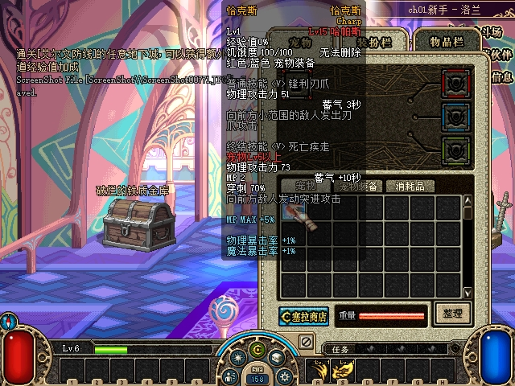
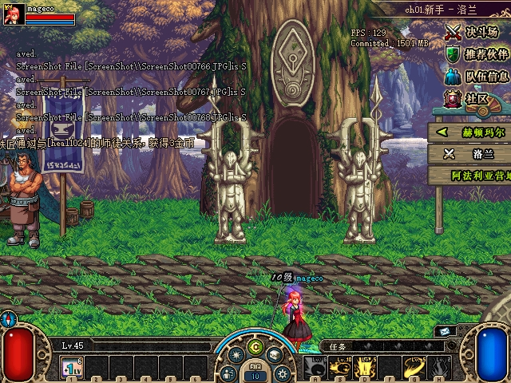

# 2026-10-28：ACT1 本轮恢复与验收索引

本轮六组恢复和批准范围内的验收已完成，结论为 **PASS_AS_SCOPED**；返回频道后的重连问题已修复，并补齐最终构建的双端验证。正常运行目录已发布且隔离启动通过，原存档与配置保持。各组实际覆盖及后续证据阻塞见[恢复覆盖与未验范围](2026-10-28-restoration-coverage.md)。

## 本轮六组

| 组件与详细记录 | 已完成的有界结果 | 保留的覆盖边界 |
| --- | --- | --- |
| [ACT1诊断](2026-10-28-client-diagnostics-verification.md) | 区分125与历史118，确定性解析测试、双端正常选角进城回归 | 未自然触发125，真实错误上报不计原生已验 |
| [师徒成长与徒弟经验](2026-10-28-mentor-growth-verification.md) | 600秒在线成长、实际击杀/通关及在线/离线经验对照、名单和重启保持 | 历史695/cacab结果保留原构建身份；怪物自然死亡sweep仅源码/TDD，最终绑定说明共享生命周期变化和必要交集 |
| [双人个人PvP](2026-10-28-pvp-individual-verification.md) | 历史三局，加最终30AD一局真实击杀、双边原子奖励、普通/决斗往返；第四份账本完整重启保持 | 两席个人mode0、地图3；默认配置关闭，其他模式、公网和完整UDP应用CRC不在已验范围 |
| [普通时装赠送与已选属性](2026-10-28-avatar-gift-verification.md) | 7天/30天/永久赠送与领取、7天未领重启、能力4本人购买、月额度提示及短deadline清理 | 30天案例未重启；120秒派生到期测试明确披露，未等待自然7/30天 |
| [永久封印宠物蛋赠送](2026-10-28-creature-gift-verification.md) | 最终30AD真实Gift→收礼人查询→6600付款→未领重启→领取→原生孵化→再次完整重启保持；57/57、103条TX CRC有效 | 只开放固定15款fresh永久封印蛋；实际闭环使用其中一款。旧743/C79入口失败仍保留 |
| [师父普通PvE金币](2026-10-28-mentor-master-gold-verification.md) | 实际生成拾取/free card税基、正常选角结算、600＋随机自然计时、师父离线正额反例、两次完整重启保持与无补发 | 743/C79/30AD分别保留阶段身份；钱包cap、发送竞态等只计自动化，疲劳和COF仍阻塞 |

各记录含原图、脱敏协议/状态投影、测试与构建日志、独立检查结果及SHA256清单。图像与真实包、规范账本和持久化证据共同用于验收。

## 可以直接看到的原生效果

宠物来自一次真实6600赠送，未领邮件与已孵化实例分别经过完整重启；同一UUID及领取UID保留，没有重复扣款或加月额度。[赠送到孵化的完整图文](2026-10-28-creature-gift-verification.md)。

这一局A的HP实际12742→0，双方结算和第四份原子收据一致；其余经济与存档字段保持。[对局、奖励和频道往返](2026-10-28-pvp-individual-verification.md)。

此图属于税基85、正常选角结算入账3；后续另取自然约856秒到期入账1及离线来源不发奖证据，原阶段分别记录。[金币公式、计时及离线对照](2026-10-28-mentor-master-gold-verification.md)。

## 设置返回频道后的无响应问题

修正ACT1原生频道重连的启动路径，保留原500ms/5s时序和原close。最终30AD两端同进程完成普通→决斗→普通→再次决斗；另用独立阶段完整观察两端“设置→返回频道→ch01→进入→正常世界”。468条Process.Responding样本均为true，双方各234条、约半秒间隔，两个完整转换窗口均被覆盖。原图、实际登录回包及[43/43检查结果](assets/2026-10-28-pvp-individual/reentry30ad-check.json)相互对应。

有限采样仍保留短于采样间隔停顿及其他机器环境的边界；较早390样本仅部分覆盖B流程，原证据没有改写成全程覆盖。

## 最终构建与正常启动

| 交付产物 | SHA256 |
| --- | --- |
| Server（managed源码5078da2） | `A0EE99650A49011B9527E06BB8E1C19E6A7E5D284CC51D8F9865597C9E133134` |
| Protocol | `5A55089D384EFA9E4ACEC5A211EE5C551668CDDB5C93ED46A698D50250E04A4E` |
| IJL15（native源码ab1e6b6） | `30AD9A4A3CD565DE845F74AB3D6C6D60EED1F3429EC7D53929D912F158246584` |

最终托管/原生包保持冻结。启动辅助源码首版为`22f2f0a`，共享日志修复后的交付源码为`adc990941e860e7d199faa2e4acb7d1cdc48c868`。相关Release构建均0警告0错误，完整冒烟及定向RED/GREEN见各组件记录。401份非Ijl15产品/测试源文件与批准5078逐字节一致；早期695/cacab共享文件的实际变化按重叠审查保留，未宣称历史五类经验案例在新DLL全部重跑。

正常启动入口已放在`G:\Game\DNF_ACT1\DF\town-test\Start-NormalServer.cmd`，相邻PS1也已部署；[CMD源码](../../tools/runtime/Start-NormalServer.cmd)、[PS1源码](../../tools/runtime/Start-NormalServer.ps1)。**先运行该CMD，待启动完成后再使用原启动器**，服务就绪后会留在后台。原启动器的StartServer=false及其余配置保持原样。

原配置Entrance2311落在Windows排除端口2280–2379内，而原启动器使用27001。辅助脚本读取原启动器端口，仅给子服务进程覆盖入口，要求7001/27001均由同一PID连续稳定监听至少2秒，且无BackgroundService失败/StopHost。原JSON和系统端口保留不变。脚本还修正了Windows PowerShell5.1活跃重定向日志的共享读取；真实持有writer的旧实现4/32失败，修复后两宿主均32/32通过。

正常目录的最终06隔离启动验收使用系统Windows PowerShell5.1，PID50700实际双端口就绪后停止，独立补充核验通过。正式CMD默认使用server.json原DataPath；本次验收显式使用独立存档副本并锁住原档/配置。启动会自然改写隔离副本，该副本没有替换原档。相关环境项前后均为空且哈希一致，仅据此记录本次实际恢复，不扩写为非空环境全矩阵。

三次较早失败分别保留：03原2311绑定失败；04旧PowerShell验收入口默认编码解析中文JSON失败，尚未启动；05已启动但旧helper读取活跃stdout失败。新06独立记录成功，未覆写或重跑旧失败。双原生玩法使用各自冻结包验证，正常目录通过相同产物的发布核对和独立启动，不冒称恢复配置后又重跑全部玩法。

原PvP默认关闭保持不变。需要体验已验双人模式时，在`server.json`的`DFLegacy`对象中配置`"Pvp": { "Enabled": true, "Port": 7004, "ChannelNumber": 51 }`，使用同进程共享存档。配置操作未在本轮替用户执行，不能据此扩大到组队/观战等模式。

## 原环境与结束状态

原存档SHA256保持`FB20572589A5CFB31D89E16EC6936DE96071630E432EDE787CCB0887930ABE52`；5项原配置已恢复且哈希逐项一致。83份保护备份、两份DNF.exe及两份PVF保持原字节。正常目录发布48/49包成员，唯一排除项为原server.json；4处IJL15均为最终30AD，两份启动脚本作为独立额外文件交付。9份历史包、9项旧/新构建产物及已冻结失败证据保持，私有验收存档、原始网流和备份保留。

结束时游戏、服务端、启动器进程均为0；原先也均未运行。没有用测试副本覆盖原存档，没有提交或推送私有存档、完整配置和认证数据。

最终[聚合交付回执](assets/2026-10-28-overnight-delivery/final-delivery.json)将六组历史原生、最终构建、正常目录发布、配置恢复及06实际启动绑定为PASS_AS_SCOPED。[只读检查器](assets/2026-10-28-overnight-delivery/verify-final-delivery.py)复核结果为[29/29通过](assets/2026-10-28-overnight-delivery/verification-result.json)，[24项语义负例及5项文件/路径负例](assets/2026-10-28-overnight-delivery/checker-tests.json)均拒绝。此检查器重验记录和资产哈希，不会再次启动服务或读取用户当前存档。

独立[保存状态证明](assets/2026-10-28-overnight-delivery/final-preservation-public-proof.json)、[06启动证明](assets/2026-10-28-overnight-delivery/readiness06-public-proof.json)、[历史失败链](assets/2026-10-28-overnight-delivery/startup-history-public-proof.json)和[9份新增文件清单](assets/2026-10-28-overnight-delivery/publication-manifest.json)提供选定事实及来源哈希。历史组件附件中的PENDING/NOT_READY及旧部署receipt的NativeAcceptance占位保持原字节，由这一后续回执关闭交付绑定，不反向改写原阶段成功或失败。

## 沿用范围和停止位置

既有[队伍聊天与金币](2026-10-27-party-chat-gold-verification.md)、[原生骰子](2026-10-26-native-loot-dice.md)、[普通摆摊](2026-10-27-private-store-verification.md)、[基础师徒](2026-10-27-mentor-verification.md)、[时装期限](2026-10-27-avatar-periods-verification.md)、[频道重入](2026-10-27-channel-return-verification.md)、[实物赠送](2026-10-27-cera-gift-verification.md)沿用各自记录，必要交集另按最终构建绑定。

本轮可实施的六组已完成。举报147、受限旧坏名修复145、失败收摊91、公会、师父疲劳、COF及更广PvP等仍缺匹配的ACT1业务/入口/数据契约；[覆盖页逐项列出证据缺口](2026-10-28-restoration-coverage.md#证据阻塞的功能)。当前没有另一个同时满足官方活动业务、ACT1真实入口与wire、完整校验持久化、可执行原生验收路线的新IMPLEMENTATION_READY组。未闭合系统保留边界，完整存档、认证网流与私有分析均不纳入公开附件。
