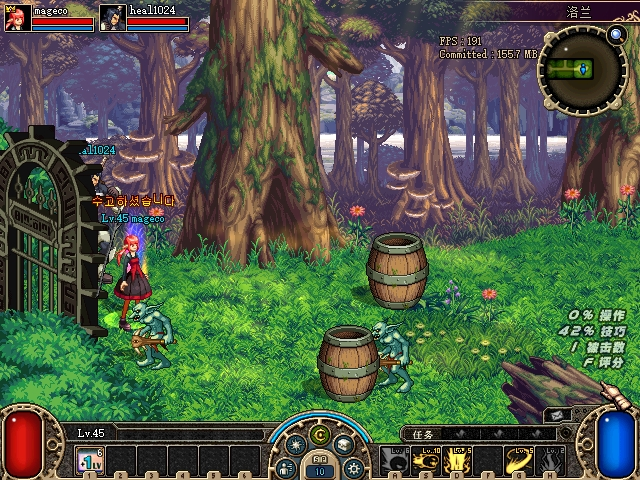
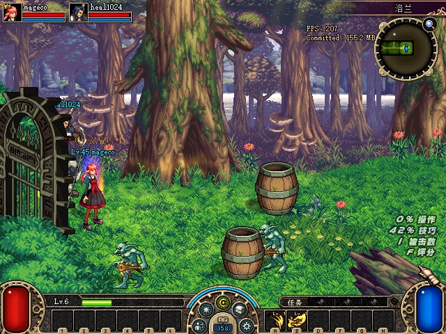
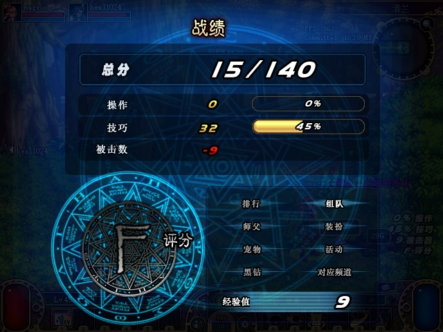
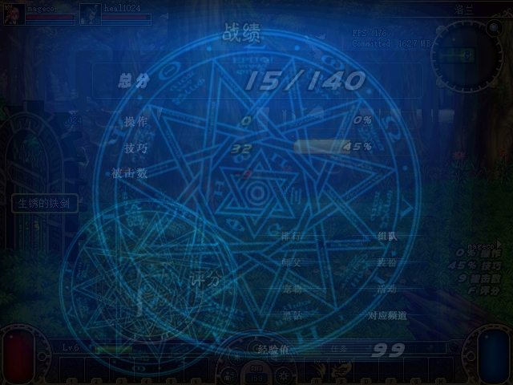

# ACT1 组队 UDP 失败后的 TCP 回退验收

2026-10-28。**PASS_AS_SCOPED**：已恢复原客户端实际使用的回退入口、账号寻址和双向转发，修复持续 TCP 游戏流量暴露的原生发送队列竞争。正常 UDP、受控 UDP 故障后的自然战斗、通关、回城及频道重入已有双客户端证据；实测构建已交付正常运行目录。**怪物位置同步仍在排查**，不随本项通过而宣称修复。

公开附件为 12 张未修改的原生 JPG 和脱敏汇总；原始认证抓包、存档及配置留在私有证据目录。附件完整性见 [manifest](assets/2026-10-28-party-tcp-fallback/manifest.json)、[图片来源](assets/2026-10-28-party-tcp-fallback/screenshots.json)。

## 修复内容与官服对照

| 项目 | 官服样本及 ACT1 依据 | 本项目结果与边界 |
|---|---|---|
| 原生中继帧 | 官服 `TCPHandlerRelay::dispatch` 0x805B958、`relayToTCP` 0x8051B76、UDP dispatch 0x805E4C0；ACT1 0x9060D0、0x906500、0x905F80 | 12 字节小端头：opcode、总长、源账号、目的账号。TCP 注册 0，无 ACK；TCP 数据 1、UDP 数据 0 转交为 3，保留其余字节。最大帧 8192 |
| 登录与 peer 寻址 | ACT1 0x40F290 读取完整登录尾，0x907160/0x907400/0x9077B0 使用账号字段寻址 | 补全 mode0 登录尾，保留 mode4；三处 NOTI11 使用真实绑定账号，消除双方均写账号 1 的旧错误 |
| 接纳及清理 | 样本按目的账号查在线 TCPUser；本地架构已有规范游戏会话 | 密码验证后接纳、校验连接地址；新会话取代旧身份，退出提前撤销。排队消息携带会话和游戏上下文代次，发送前重查 |
| 转发范围 | 原样中继不计算怪物坐标 | 同队、同一副本实例，或同一 PvP 房间/场次；有界队列、反压、部分写入及取消清理。没有改坐标或强制怪物归队长 |
| 进程形态 | 官服样本中继是独立进程，样本版本也非 ACT1 同版 | 这里由同一个 `DFLegacy.Server` 托管 TCP/UDP 7005；与启动器的 IPv4/IPv6 端口代理分属不同用途。可关闭；不据此宣称还原官服分布式部署 |

新托管代码首次能完成游戏，但完整 TCP 复算暴露了原生损坏帧，故没有把“能通关”当最终通过。定位到原客户端 append/flush 与 relay 生命周期的并发访问后，在四处生产/刷新入口的首次 owner/vtable 读取前串行化，并覆盖 binder、stop、config、close、reconnect 五处入口。九处原始机器字节和两张 vtable 全部匹配才安装；全部安装后才激活，部分写入及回滚失败仍保留可执行的原始路径。没有新增业务包、修改 MT 内容或写客户端游戏状态。

原始 ELF/PE 对照及失败阶段在私有 `party-relay-sync-20261028/recon`、`closed-normal`、`closed-fallback-v2` 保留。详细设计见 [TCP 设计](../../docs/superpowers/specs/2026-10-28-party-tcp-fallback-design.md)、[原生发送队列设计](../../docs/superpowers/specs/2026-10-28-party-relay-send-queue.md)。

## 构建与自动化

| 组件 | 实际构建身份 |
|---|---|
| 托管业务及协议 | `20d996f66775ba21f0b52995e00dc2ae40de99f0` |
| 原生发送修复 | `b4fe25f0c82c0cf8ab87813ec7670f1d6b2bf662` |
| 独立证据解码器 | `f86cb548fda9eabd32c13e644cdc228f17c49b8c` |
| Server DLL | `17C9612C34547012A8D44EF1C5152C00F1B385295C67B287843630C6A7EE4BE8` |
| Protocol DLL | `DF52310E3EC91A942277CC9AD4A59C04C89529830178285C537F8477DAF8A66E` |
| ijl15.dll | `8AB0660B416F2240ABFC0E0840E3B93D8F54BFCBB8B15E8C4C5ACBD5CD0142DC` |

冻结包有 50 文件，manifest SHA 为 `28C9B6A1199CEF82AA75D6FF9E558B15FC599E01EF3435589FBF0489E116FFFB`。程序集实际 ProductVersion 为 `1.0.0+20d996f…`，文档和解码器提交不冒充重新编译的程序集。构建冻结时另存 1335 个已跟踪源文件的哈希；后续文档更新保留自己的提交身份。

完整 .NET 冒烟通过，Release 为 0 警告/0 错误。真实 socket 测试覆盖分片/合包/截断、错误注册、身份取代、跨上下文及旧排队数据拒绝、慢接收者反压与停服清理。原生测试先复现 append/flush 数据不守恒、旧 owner 访问、混合补丁残留激活和 secondary vtable 缺口，再通过相应测试、真实 x86 stub ABI 测试及完整 Win32 兼容套件。独立解码器的 8 项测试覆盖严格捕获边界及端到端负例。组件日志哈希与实际末行见 [构建与测试附件](assets/2026-10-28-party-tcp-fallback/build-and-tests.json)。

## 双客户端结果

两端均为原 ACT1 EXE/PVF，A 为 45 级 mageco，B 为 6 级 heal1024。使用独立存档副本，仅在初始副本中调整两人的城镇集合位置；输入走既有原生文件接口，观察为 VM_READ。战斗使用正常方向键及 X，没有写 HP、坐标、控制者或注入业务包。

| 阶段 | 实际网络证据 | 原生流程与范围 |
|---|---|---|
| normal-v3 | A→B 25316、B→A 24557 份匹配 peer UDP；TCP 注册及数据为零 | 自然通关；A 主动回城带回 B；两端设置菜单返回频道并重新进城 |
| fallback-v3 | A→B 31962、B→A 29264 条匹配 TCP 交付；普通 peer UDP 匹配为零 | 自然战斗、双端结算、自动抽卡、EPLP 超时自动回城；两端重新选频道。A 战斗截图超时保留，因此另开 v4 补图 |
| fallback-v4 | A→B 6222、B→A 5574 条匹配 TCP 交付；普通 peer UDP 匹配为零 | 同一构建重新组队，经三房自然通关，双端成绩/结算图；A 点击回城带回 B |

故障条件为**只把 peer 地址指向本地 UDP 丢弃端点**，7002/7003 NAT 探测及 TCP 保持可用；不是防火墙实验或跨机器 NAT 实测。v3 的原生 TCP opcode1 输入分别为 A 31965、B 29270；交付以严格重组后、源/目的/长度及不透明内容的哈希多重集合逐项匹配，不能把数量接近称为无损转发。三个完整捕获均从字节零开始严格解析，拒绝截断和坏头，不搜索下一帧来掩盖异常。v3、v4 均未出现旧阶段的畸形中继头异常。[网络汇总](assets/2026-10-28-party-tcp-fallback/wire-summary.json)

normal-v3 的响应窗口每端分别 498、211 样本，fallback-v3 每端分别 506、210 样本，均为 Windows `Process.Responding=true`。这只证明各采样窗口消息泵响应，不是完整场景载入延迟、屏幕帧率或任意时刻无卡顿证明。

### TCP 阶段首领房

| A | B |
|---|---|
|  |  |

### TCP 阶段双端结算

v4 日志在 16:39:32 记录两端结算；原生观察均为首领 UID4、HP0 且无活怪。B 图拍在评分画面淡出时，成绩仍可见。

| A | B |
|---|---|
|  |  |

### 队长主动回城

16:40:35 A 点击“返回城镇”，B 被同队回城流程带回；不是两端分别点回城。

| A | B |
|---|---|
|  |  |

### 返回频道后再次进入

v3 双端均先拍到频道选择，再拍到重新进入赛丽亚房间；B 首次 ESC 没打开菜单的尝试不计成功。[A 频道图](assets/2026-10-28-party-tcp-fallback/fallback-A-channel.jpg)、[B 频道图](assets/2026-10-28-party-tcp-fallback/fallback-B-channel.jpg)。

| A | B |
|---|---|
|  |  |

正常 UDP 的 [A 成绩图](assets/2026-10-28-party-tcp-fallback/normal-A-settlement.jpg)及 [B 结算动画](assets/2026-10-28-party-tcp-fallback/normal-B-settlement-animation.jpg)单独归属 normal-v3，不替代 TCP 原图。

## 失败保留、交付及后续

- 初次 normal 使用旧 peer 账号字段，修正后另冻包；fallback-v2 的 TCP 完整解析失败，保留为失败，不因它也通关而改判。
- v3 原生 PrintScreen 超时、首次菜单未打开、过期选择界面及输入坐标尝试均保留。v4 用同一构建补齐双端结算图。私有交付检查器首次因函数作用域错误失败，修复检查器后用新命名的存档、日志及快照重跑；产品启动脚本未因此修改。
- 正常目录更新冻结包中 49 个文件，排除已保存的 `server.json`；四处授权原生 DLL 均为 8AB。Windows PowerShell `5.1.26100.9711` 使用明确指定的克隆 DataPath/快照目录，验证入口 27001、游戏 7001、TCP/UDP 中继 7005，结束后停服。
- 15 项原始保护记录中，五份配置、两份存档及两端 EXE/PVF 保持原哈希；四处 native 为授权新版本，原版本在备份中保持。11 份 preflight 实体备份、69 份原 runtime 备份、8 个输入信箱存在性/内容、历史九包 438 文件及九个 native artifact 均复算一致。最终游戏/服务器/启动器进程为零。[交付核验](assets/2026-10-28-party-tcp-fallback/delivery-summary.json)
- 三阶段完整原始证据清单分别为 623、610、378 文件，共有独立哈希；独立复核先指出缺失 TCP 结算图，v4 补齐后确认无剩余 Critical/Important，再允许交付。交付结论以自己的收据追加，不修改冻结构建 manifest 的历史 PENDING 字段。

本项不证明应用层 CRC 全覆盖、互联网/任意 NAT、跨机器、性能压测、完整分布式部署或 PvP 扩展。新鲜的 fallback-v3 快速观察仍记录一只普通怪在 24 秒内持续出现约 653–736 的平面位置差；其他怪的差异分布不同。`actor+0x1864` 的语义和具体接收条件继续用原始客户端闭环核对，不据指针标签直接宣称“抢控制权”。下一组先排查此问题，再推进已闭合契约的剩余功能。
