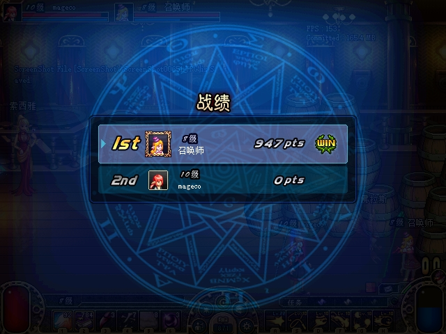

# 2026-10-28：ACT1 双人个人决斗原生验收

> 最终交付补记：本页历史三局、最终30AD独立一局和双端频道补证均已闭合，正常运行目录启动、配置/原档核验及整轮交付由[最终索引](2026-10-28-overnight-delivery.md)统一绑定。下文“另行验收/待闭合”保留对应阶段时点；历史资产与390样本覆盖边界没有改写。

历史隔离运行 `pvp-switch-3a35188` 已完成双端原生闭环：**普通世界→决斗频道→建房/入房→三局对战结算→普通世界→再次进入决斗频道**。前两局通过原生超时结算，第三局真实攻击将A的HP从12742降至0，原生上报死亡并显示B胜利。三份规范双人账本与双方结果一致。历史记录仍绑定托管 `cacab2e`、原生 `3a35188`；文末新增最终托管 `5078da2` / 原生 `30AD` 的独立一局及频道往返验证，组件结论为 **`PASS_AS_SCOPED`**。正常运行目录部署和原配置恢复仍由协调者另行验收，不能据此宣称整体交付完成。

本组为默认关闭、同进程共享规范存档的个人决斗，ACT1 wire mode0，仅席0/1。支持房间、地图、准备/开战、死亡/超时、排名/结果、回房与频道往返；不代表完整PvP、组队/擂台、密码房、远程公网/NAT全矩阵或原生备用relay服务已还原。恢复规则和本次实际覆盖边界以下述公开证据为准。

## 来源、冻结与构建身份

协调者root独占原生操作、只读探针与停止进程；证据工作者复制关闭后的日志，重新解码、核对状态并整理资料。服务端PID57640；A PID73000、B PID75816，从首次普通登录至再次决斗进入保持相同进程及启动UTC。A使用Lv45角色，B使用既有Lv52角色。没有协议/存档注入；攻击由原生内置输入执行，HP/位置通过VM_READ只读观察。

原生DLL SHA256为 `7431347A19A5D8B0B963B474B9739288BA8755895B260DF04A51D80BFF65B3DC`；历史Server DLL为 `48244DCEC0EC9AC556D6C14CA3DC3CA6701CA6208A12E4D1FD679A0FB24E2B9A`。运行目录14项逐项复核见[历史运行哈希](assets/2026-10-28-pvp-individual/native-runtime-hashes.json)。本阶段不能改称后续Gold源码/最终二进制的原生验收。

私有 `frozen-native-pvp` 保存A/B原始网流、完整服务端日志、停止部署记录和前后存档，逐项复制前后哈希一致。旧capture报告未覆盖；新报告从关闭副本重解码，选定事件、TCP统计、UDP统计与旧报告完全一致。[私有原件复核输出](assets/2026-10-28-pvp-individual/native-private-check.json)记录重新解码、真实存档比较及PID/启动时间核对；[四处原生DLL绑定](assets/2026-10-28-pvp-individual/native-four-target-binding.json)保留部署收据与实际文件匹配。公开[选定协议证据](assets/2026-10-28-pvp-individual/native-packets.json)只含白名单字段及来源哈希；完整原始流量、认证、IP和存档不公开。字段、限额、重放检查与隐私范围见[证据schema](assets/2026-10-28-pvp-individual/evidence-schema.md)。

**A的107个、B的242个全部游戏TX帧CRC有效，布局错误/尾部残留/遗漏事件均0。** TCP从字节0重组，未猜测重同步。独立[可执行检查器](assets/2026-10-28-pvp-individual/verify-native-evidence.py)核对三局顺序、双人结果与账本、频道往返、HP与响应采样；结果见[检查输出](assets/2026-10-28-pvp-individual/native-check.json)，资产见[SHA256清单](assets/2026-10-28-pvp-individual/sha256-manifest.json)。

## 频道入口修复与双端准备

先前原生RED保留在私有调查：CMD3成功后场景5保留待选频道，但计时器未启动、无后续TCP。兼容修复在原ACK close调用后检查并启动原生重连，并让既有FD_CLOSE路径共用幂等启动；保留原500ms/5s时序、元数据地址选择与原close。它是本地ACT1兼容修正，不声称原服曾有同一补丁。没有硬编码目标端口、强制登录或伪造peer-ready。

本次A于05:02:01、B于05:02:34收到完整mode4登录并进入原生决斗列表。A建默认房，B正常确认加入；双方出现角色，选择赫顿玛尔酒馆（原生地图序号3），B准备、A房主开战。

| 原始画面 | 证据 |
| --- | --- |
| A普通世界、B既有Lv52世界 | [A](assets/2026-10-28-pvp-individual/pvp-fix-A-normal-world.jpg)、[B](assets/2026-10-28-pvp-individual/pvp-fix-B-level52-world.jpg) |
| 打开频道列表、自动进入决斗 | [列表](assets/2026-10-28-pvp-individual/pvp-fix-A-open-list.jpg)、[A进入](assets/2026-10-28-pvp-individual/pvp-fix-A-auto-enter.jpg)、[B进入](assets/2026-10-28-pvp-individual/pvp-fix-B-auto-enter.jpg) |
| 建房、加入、选择酒馆 | [建房](assets/2026-10-28-pvp-individual/pvp-create-default-room.jpg)、[加入](assets/2026-10-28-pvp-individual/pvp-B-confirm-join.jpg)、[地图](assets/2026-10-28-pvp-individual/pvp-select-HendonPub.jpg) |
| 准备与真实开战 | [B准备](assets/2026-10-28-pvp-individual/pvp-B-ready1.jpg)、[A开战](assets/2026-10-28-pvp-individual/pvp-A-host-start1.jpg) |

## 三局真实原生生命周期

所有时间为2026-10-28 UTC+8。双方每局均收到NOTI45，然后NOTI49、实际CMD61、NOTI48/47并发出CMD60。第二、三局在前局ACK后重新开始，未重启客户端。

| 局 | NOTI45开战（A） | 终止输入 | NOTI47结果（A） | B累计VP / PvPEXP / 胜场 |
| --- | --- | --- | --- | --- |
| 1 | 05:04:07.798 | A CMD59 05:07:14.423，HP减少量9596/228 | 05:07:14.490，B胜 | 4 / 1000 / 1 |
| 2 | 05:08:17.421 | B CMD59 05:11:23.945，HP减少量947/0 | 05:11:23.981，B胜 | 8 / 2000 / 2 |
| 3 | 05:12:11.141 | A CMD58 05:13:16.486，killer UID2 | 05:13:16.497，B胜 | 12 / 3000 / 3 |

第一局没有截到结果窗口，只按双方真实包和规范账本证明结算，不补造画面。第二局原始[结果窗口](assets/2026-10-28-pvp-individual/pvp-match2-result-window.jpg)明确显示B **947pts / WIN**，与CMD61及NOTI47相符。

第三局修正追击方向后，以正常S/X/Z输入追击攻击。只读[HP观察](assets/2026-10-28-pvp-individual/native-combat.json)显示A `12742→0`、B保持15042；随后双方NOTI46为deadSeat0/killerSeat1，再索取排名与结算。B报告12742伤害分项及1800附加分，总分14542，与双方结果一致。原始[B胜利画面](assets/2026-10-28-pvp-individual/pvp-match3-observed-fight-finish-B.jpg)显示VICTORY与A死亡标记；[A结束过渡](assets/2026-10-28-pvp-individual/pvp-match3-observed-fight-finish-A.jpg)保留实际捕获时刻，不冒称第三局完整结果窗口截图。

早期 `native_pvp_fight` V1追击未对准；首次QWERTY尝试意外打开商店。这些是保留的失败操作，不能当作技能成功或击杀证据。前两局仍确实进行了动作/伤害并走原生超时；第三局V2的正确朝向、HP下降、死亡包及胜利画面才闭合真实击杀。

UDP中A→B可靠/不可靠块3053/2821，B→A为3130/6551，接收端逐项一致，ACK形状计数也对应。**不宣称完整UDP应用CRC验过**：通用管理端七字节应用解码器不覆盖本次原生不透明MT应用/分片形状，报告中的CRC失败/未解析计数属于解码限制，不直接说明网络损坏。实际双端角色、攻击、HP、死亡和胜利证据支撑玩法闭环；无需把不透明relay误解释成全部应用协议均已还原。

## 原子结算与经济保持

前档SHA256 `B9831C157CB9A6A77DE3BFF7C07B591860E34D8A294BF1B18B0AEE9EBFAAB9FB`，后档 `EF99CD680A517BEB812758E4BE18E5A23371A196D95A7A2EFF30D6041977DBC6`。独立比较得到三个唯一match/fingerprint收据，每份都同时含A/B奖项。公开[变化报告](assets/2026-10-28-pvp-individual/native-state-delta.json)与协议报告内选定收据相互核对。

| 角色 | VP | PvPEXP | 等级 | 胜/负 | PlayCount / Count |
| --- | --- | --- | --- | --- | --- |
| A | 0→3 | 0→0 | 0→0 | 0/0→0/3 | 0/0→3/3 |
| B | 0→12 | 0→3000 | 0→2 | 0/0→3/0 | 0/0→3/3 |

每局A+1VP、B+4VP；B每局+1000PvPEXP，普通角色EXP奖励为0。除此之外**全部字段相等**：账号现金、角色Gold/Cash、背包/装备/仓库/邮件/时装/宠物、技能任务、师徒字段、其他角色和其他账本，以及镇区/位置。此结论来自这两份规范快照，不要求普遍情况下所有可变位置字段都不变化，也不替代并发写入回归。

## 原进程返回普通世界并再次进入

A在05:14:32.319、B在05:16:10.802重新收到mode0；之后A在05:15:21.170、B在05:17:42.749又收到mode4。两端登录模式序列均为 `[0,4,0,4]`，CMD3成功各3次。B返回普通频道采用手动选择，保留这一实际操作区别。

[A离房](assets/2026-10-28-pvp-individual/pvp-A-leave-room3.jpg)、[A普通世界](assets/2026-10-28-pvp-individual/pvp-A-return-normal-world.jpg)、[B普通世界](assets/2026-10-28-pvp-individual/pvp-B-return-normal-world.jpg)、[A再次决斗](assets/2026-10-28-pvp-individual/pvp-A-second-auto-enter.jpg)、[B再次决斗](assets/2026-10-28-pvp-individual/pvp-B-second-auto-enter.jpg)均为原图。[响应采样](assets/2026-10-28-pvp-individual/native-responsiveness.json)在B手动回返期间对双方各采22次，44条全部响应，PID与启动UTC未换。该有限采样不扩大为长时间稳定性压力测试。

## 源码/自动化覆盖与剩余边界

源码审查先发现并复现跨局序号重放、延迟组队接受重入、角色模型陈旧三个问题；[7项RED](assets/2026-10-28-pvp-individual/fix1-red.log)与[定向GREEN](assets/2026-10-28-pvp-individual/fix1-focused.log)、[完整冒烟](assets/2026-10-28-pvp-individual/fix1-full.log)对应修复。托管[Server](assets/2026-10-28-pvp-individual/fix1-release-server.log)/[Tests](assets/2026-10-28-pvp-individual/fix1-release-tests.log) Release为0警告0错误。原生切换有[RED](assets/2026-10-28-pvp-individual/native-switch-red.log)、[GREEN](assets/2026-10-28-pvp-individual/native-switch-green.log)、[完整兼容测试](assets/2026-10-28-pvp-individual/native-switch-full.log)及[Win32 Release重建](assets/2026-10-28-pvp-individual/native-switch-release.log)0警告0错误。整理证据时未重新构建。

双死draw、外退处罚、零排名/零ACK watchdog、持久化故障、并发经济保存、序号完整循环的限界、双方角色互换以及公网网络条件，仅在各自源码/TDD或尚未覆盖范围；不计成本轮原生已验。上述历史原生覆盖两席、地图3、三局B胜，以及双向频道往返。默认PvP仍关闭，需要显式配置开启；未提供的独立备用relay不作可用承诺。最终构建的独立验证见下节。

## 最终30AD构建：真实死亡、第四份账本及双端重入

关闭阶段 `final-pvp-30AD` 使用服务端PID64868、A52320、B60896；从普通世界至第二次决斗进入均保持同一客户端进程及启动时间。构建绑定为托管源码 `5078da27a4807695f002ceea61333c43e1932ce4`、原生源码 `ab1e6b685021f6cd6f8d125fc04dc0c5c50e931f`，Server `A0EE9965…133134`、Protocol `5A55089D…A4E`、原生 `30AD9A4A…6584`。组合manifest `09EFFBE3…C05204`、原生批准收据 `832A30A7…B8CD8` 与独立运行目录实际DLL哈希一致，完整值见[最终绑定](assets/2026-10-28-pvp-individual/final30ad-binding.json)。这是一局新的30AD证据，不把旧三局743结果改称最终构建实测。

原始关闭文件145份、实际战斗VM_READ快照20份分别保留在私有冻结目录。原始A59/B71个游戏TX全部CRC有效，完整尾部、解析错误、遗漏事件均0；两份原中途capture的精确字节前缀重解后语义一致。[选定收包](assets/2026-10-28-pvp-individual/final30ad-packets.json)、[私有核验摘要](assets/2026-10-28-pvp-individual/final30ad-private-check.json)和新的[独立检查器](assets/2026-10-28-pvp-individual/verify-final30ad-evidence.py)得到[62/62通过](assets/2026-10-28-pvp-individual/final30ad-check.json)。CRC错误、缺死亡、缺重入、错误奖励、旧账本被改、非PvP变化、未归零HP、非响应样本和夸大采样覆盖的负例均被拒绝。原36份历史资产保持原哈希；新增文件单列[最终SHA256清单](assets/2026-10-28-pvp-individual/final30ad-sha256-manifest.json)。

A原生[建房](assets/2026-10-28-pvp-individual/final30ad-A-create-room.jpg)、B[加入](assets/2026-10-28-pvp-individual/final30ad-B-join-room.jpg)，选择[赫顿玛尔酒馆地图3](assets/2026-10-28-pvp-individual/final30ad-select-map3.jpg)，wire mode0、席0/1，于08:16:23.749[开战](assets/2026-10-28-pvp-individual/final30ad-A-start.jpg)。原生输入攻击，VM_READ记录A `12742→0`、B始终15042；没有HP写入或业务注包。[HP证据](assets/2026-10-28-pvp-individual/final30ad-combat.json)与08:17:39.651 A实际CMD58、双方NOTI46 deadSeat0/killerSeat1相符，本局没有以CMD59超时代替死亡。之后双方NOTI49→CMD61→NOTI48/47→CMD60闭合。B实际报告 `12742+2100=14842` 分，与双端排名一致；root查看的[原始VICTORY图](assets/2026-10-28-pvp-individual/final30ad-real-death-finish-B.jpg)佐证原生胜利。

| 角色 | VP | PvPEXP / grade | 胜/负 | PlayCount / Count |
| --- | --- | --- | --- | --- |
| A | 3→4 | 0→0 / 0→0 | 0/3→0/4 | 3/3→4/4 |
| B | 12→16 | 3000→4000 / 2→2 | 3/0→4/0 | 3/3→4/4 |

前档固定 `BDDD24C2…6A7D3`，最终停止后磁盘档 `14D4526D…298B4`。前三份原始match/fingerprint/awards逐项不变，仅新增第四份唯一双人原子receipt；收据、规范角色数值和双方NOTI47/48完全一致。独立[全存档差异](assets/2026-10-28-pvp-individual/final30ad-state-delta.json)仅发现上述两角色PvP字段及一份账本追加，**全部其他字段完全相等**，包括现金、金币、物品、邮件、宠物/时装、普通EXP、疲劳、师徒和其他角色/账本，没有扩大排除整个Accounts子树。停止后的磁盘存档与同进程频道往返证明已落盘且未重复发奖；本阶段没有另做第四份receipt的完整服务端重启，不据此声称该额外情形已原生覆盖。

| 角色 | 首次普通mode0 | 首次决斗mode4 | 返回普通mode0 | 第二次决斗mode4 |
| --- | --- | --- | --- | --- |
| A | 08:10:17.264 | 08:12:59.614 | 08:20:19.065 | 08:21:53.457 |
| B | 08:11:29.905 | 08:13:30.373 | 08:21:17.519 | 08:22:45.677 |

两端各三次CMD3成功，完整登录模式均为 `[0,4,0,4]`；第二次进入后的记录与结算值相同，账本没有增加。root已查看原始[A选频道](assets/2026-10-28-pvp-individual/final30ad-A-return-channel-chooser.jpg)、[A普通世界](assets/2026-10-28-pvp-individual/final30ad-A-return-normal-world.jpg)、[B选频道](assets/2026-10-28-pvp-individual/final30ad-B-return-channel-chooser.jpg)、[B普通世界](assets/2026-10-28-pvp-individual/final30ad-B-return-normal-world.jpg)、[A第二次决斗](assets/2026-10-28-pvp-individual/final30ad-A-second-entry.jpg)、[B第二次决斗](assets/2026-10-28-pvp-individual/final30ad-B-second-entry.jpg)，均为未改动原图。

响应观察的范围单独限定：[390条Process.Responding样本](assets/2026-10-28-pvp-individual/final30ad-responsiveness.json)均为true、Failure=null，时间为08:19:13.783–08:20:53.576。它完整覆盖A返回频道选择及EnterNormal输入窗口，只覆盖B频道选择前2.909秒；**B EnterNormal及两端第二次决斗进入在采样结束之后**。这些后段由原包及原图证明，不能称390样本覆盖全部转换，也不据此宣称长时间无假死。协调者安排的后续独立频道响应阶段不混入本次关闭证据。UDP应用CRC限制与公网/并发等未测矩阵继续保留；正常运行环境部署、恢复及整体最终交付仍待独立闭合。

## 独立补证：双端普通频道重入全窗口采样与第四收据重启

随后关闭的独立阶段 `final-channel-reentry-30AD` 使用新服务端PID24096、A61536、B45620，固定相同的托管A0EE / 原生30AD / 组合09EF / 批准832。原38份文件单独冻结，旧390样本、原PvP冻结包与public manifest均不改写。新增[原包/采样/输入计划选定证据](assets/2026-10-28-pvp-individual/reentry30ad-proof.json)经[独立检查器](assets/2026-10-28-pvp-individual/verify-reentry30ad-evidence.py)重放，得到[43/43 PASS_AS_SCOPED](assets/2026-10-28-pvp-individual/reentry30ad-check.json)；[私有核验摘要](assets/2026-10-28-pvp-individual/reentry30ad-private-check.json)和[独立资产清单](assets/2026-10-28-pvp-individual/reentry30ad-sha256-manifest.json)记录来源与测试。错误CRC、意外mode4、缺少登录、存档变化、额外收据、错误奖励、无响应、窗口超出采样、错误PID/二进制的负例均被拒绝。

本阶段只做普通世界→设置返回频道→ch01普通世界：双端同PID登录模式均为 `[0,0]`，各有一次成功CMD3、两次成功mode0与角色进入回复，A20/B20 TX全部CRC有效；未开新PvP对战，也无新排名/结算。root查看的[A频道选择](assets/2026-10-28-pvp-individual/reentry30ad-A-channel-chooser.jpg)、[A普通世界完成](assets/2026-10-28-pvp-individual/reentry30ad-A-normal-world-complete.jpg)、[B频道选择](assets/2026-10-28-pvp-individual/reentry30ad-B-channel-chooser.jpg)、[B普通世界完成](assets/2026-10-28-pvp-individual/reentry30ad-B-normal-world-complete.jpg)均为未修改原图。

新采样共468条，双方各234条，均Responding=true且Failure=null，覆盖08:28:11.624–08:30:11.576；各端最大相邻采样间隔A0.532206秒、B0.529556秒。检查器从原输入JSON和本PID原生 `plan armed` 日志重算区间，四个chooser/world输入计划完整落在采样范围，双方从chooser开始至world完成的整个连续区间亦被覆盖：

| 角色 | chooser开始 | 计划频道进入点击 | 实际mode0回包 / 角色回复 | world输入完成 |
| --- | --- | --- | --- | --- |
| A | 08:28:33.823 | 08:28:51.213 | 08:28:52.072 / 08:28:52.077 | 08:29:05.052 |
| B | 08:29:14.777 | 08:29:31.244 | 08:29:32.098 / 08:29:32.102 | 08:29:45.053 |

“计划点击”是本PID原生计划启动时间加1100ms偏移，不是假造独立按钮回调时间。计划中的后续保险点击也不冒称实际进入世界的触发点；真实登录和角色回复由收包给出，整段输入窗口和结束截图均在采样内。该有限的约半秒响应采样补齐了双端普通频道重入的观测范围，不排除更短于采样间隔的停顿，也不扩大为所有假死原因或无限时长稳定性证明。

此新服务端重新读取上一阶段的完整 `14D4526D…298B4` 存档；本阶段结束后磁盘文件仍为**同一SHA、逐字节完全相等**。第四份PvP receipt及前三份历史receipt均保留，A VP4/负4、B VP16/PvPEXP4000/grade2/胜4，双端新进程的两次NOTI48均与该账本一致，无新增收据或奖励。由此独立补上前节第四份收据的完整服务端重启持久化，而没有把新事实倒填进旧阶段。正常运行目录发布及原配置恢复仍由协调者的交付阶段单独记录。
