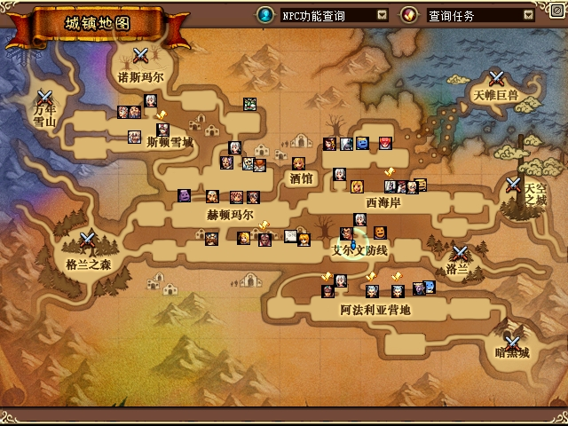
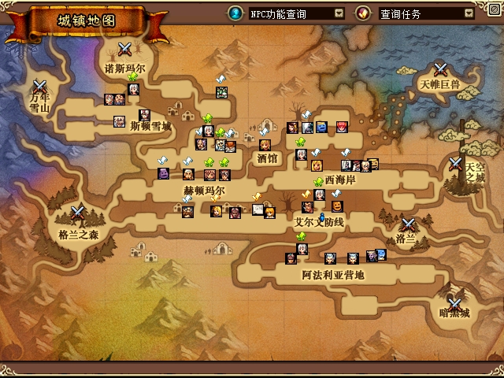
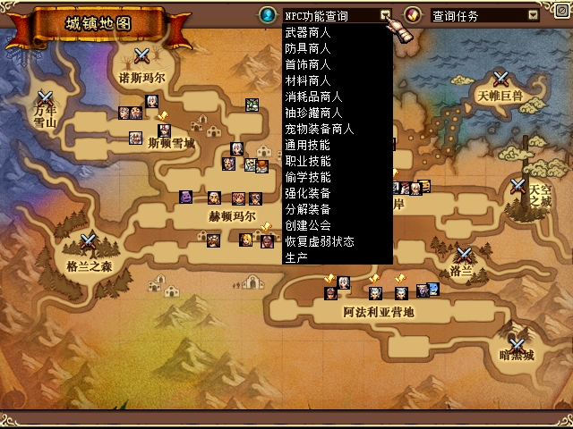

# ACT1 城镇地图点击移动、debug 目的地与状态接口验收

2026-10-29：**U06 已完成当前区域内的双客户端功能验收**。打开原客户端的 **N 键「城镇地图」**，点击当前区域可走的空白位置能够移动；debug 接口也能设置同区目的地，并区分受理、到达、拒绝和中断。两端均有实际到达记录，方向键取消及地图控件保护通过本次指定案例。私有测试进程已停止并归档，8个输入 mailbox 已恢复；两端原配置仅新增两个开关并保留原快照目录。

## 实现与使用范围

普通城镇目的地接口 `478F70` 设置目标后，原地面点击流程还会激活 `B5F0A0`。原 Town 更新函数随后持续按目标计算方向和速度，原方向键与菜单路径可以停止该模式。首个 v3 候选遗漏激活位，实机仅移动约一帧便停止；此失败及 `f51… / debug F9F939…` 冻结包保留。最终 `02de7053 / debug 5449F6…` 在原生 setter 成功并读回目标后，重新核验身份，再**只激活一次**原生模式，交给原 Town 更新推进；观察到停止后不会逐帧强行重启。

城镇地图点击和 debug 命令共用上述处理器。地图点击先执行原有 UI 流程，再核对当前区域、实际捕获控件、释放状态、动态投影矩形和标记命中；NPC、其他标记、关闭和下拉控件不会被当作新增移动目标。映射使用客户端已加载的地图缓存，没有固定某份 PVF 的区域表。

本次支持**当前区域的原生目的地移动**。未证明 A* 绕障或跨区路线规划；地图上其他区域的点击不新增移动，debug 跨区命令明确拒绝。原 EXE、PVF 及角色坐标没有通过外部写入来实现移动，状态采样器仍然只读。

实现入口见 [导航策略](../../src/DFLegacy.Debug/src/client_navigation.cpp)、[原生导航与命令处理](../../src/DFLegacy.Debug/src/client_navigation_runtime.cpp)、[客户端状态采样](../../src/DFLegacy.Debug/src/client_state.cpp)。接口说明和命令示例见 [debug README](../../tools/debug/README.md)。

## 双客户端实际结果

最终 phase4 使用源码 `02de70534576e1cdae6dc38f06f9d5fb36dd3684`、debug `5449F6…`，沿用已验收的 ijl15 `19C0…`。两端输入使用原生 IJL 文件接口；画面取原生 PrintScreen，未使用外部坐标写入、业务包注入或传送。

| 案例 | 观测结果 |
|---|---|
| A、B 设置 debug 目的地 | A 设置 `(530,250)`、B 设置 `(400,260)`，两端均实际移动并满足到达条件；后续同区移动也有独立核对。 |
| A 城镇地图点击 | 500ms 点按 `(399,281)` 到达 `(642,256)`；随后对另一有效空白点进行 80ms 点按 `(408,281)`，原生 `source=minimap` 目标为 `(853,256)`，到达样本为约 `(852.51,256)`。 |
| B 城镇地图点击 | 120ms 点按 `(409,281)`，原生 `source=minimap` 目标为 `(877,256)`，到达样本为约 `(877.16,255.88)`。 |
| 原方向键停止 | A 向远目标 `(1500,250)` 移动时按原方向键，原生移动模式清除，返回 `interrupted/native_auto_move_stopped`；十余秒后的状态仍停在约 `(1012,217)`，距目标超过 400。较早的短目标案例可能已经到达，不计作取消通过。 |
| 地图控件与标记保护 | NPC 图标、其他区域、NPC 分类下拉展开和关闭地图后，都取得晚于输入 ACK 的新鲜状态；目标与位置不变，没有新增地图导航请求。关闭后状态为地图不可见。 |
| 拒绝不适用命令 | 跨区、过期、旧 actor 和重复 request ID 分别得到对应原生拒绝。另取晚于全部应答的静止状态，确认没有随后发生位移。 |

到达依据是原生结果与后续同一 PID、精确进程创建时间、UID、actor/map、generation、Town/Area 的新鲜状态相互对应，XY 各轴误差不超过 3，方向停止值为 `4/4`。`requested` 只表示目标已受理；写文件成功或输入 ACK 均不计到达。

初始 debug 到达和无效点案例的部分终态先由工具读取，原文件随后被新试验覆盖；保留的是明确标注来源的观察值，不能冒称逐例原始字节收据。后续两端地图到达保留了原生响应文件与状态配对。四类拒绝中，三条紧随请求的状态早于对应应答，不作逐例 post 证据；晚于全部应答的独立静止状态是这些案例的共同后续核对。

最初 200ms 地图点按未确认移动，记录保留。500ms 成功案例的历史标签包含 `traced`，但当时 trace 请求超出工具时限，实际没有启动，不能称为已追踪。后来再次点击同一位置时，角色已经移动到那里，该位置受到自身地图标记保护，不能据此判断短按失败。最终换用新的有效空白点完成了 A 的 80ms 案例，并取得有效外部只读采样：1667 条字段样本中有 3 条匹配根控件释放状态；这是字段观测，不是指令级执行轨迹。

NPC 分类下拉的**展开**已由原图确认，后续选项切换的实际过滤效果未确认。此次也不包含所有城镇、全部筛选项或其他叠加窗口的普遍回归。

## 原始画面

以下附件按来源保留游戏原图，不裁剪、拼接或重绘。移动结论同时依赖上面的结构化结果，单张地图画面本身不能证明角色走完路线。

A 端地图移动后的原图，对应先前到达 `(642,256)` 的 500ms 案例；这张图不作为最终 80ms 案例的截图。



B 端地图移动后的原图，对应目标 `(877,256)` 的案例。



NPC 分类下拉正常展开，本次点击没有新增导航；不由这张图推断后续过滤选项已经生效。



A、B 分别关闭地图，返回原城镇视图；两个人物出现在同一画面不作为组队成功或副本同步证据。


## 结构化状态与自动测试

客户端导出 `dfl-client-state/v2`，消费端兼容 v1。采样目标间隔 200ms，文件 IO 在后台进行。Town 可读取当前区、位置、目的地、原生方向和移动模式；还包括已证实的菜单与倒计时等 UI 原值。debug 目的地命令绑定进程与角色上下文、采样序号和时效，拒绝未来、过期、重复或身份不符的请求；等待期间继续核对状态。

最终同一 debug 构建还取得了 A 在 Town、B **单人副本**的实际状态样本：B 的房间、玩家 HP `434/470`、存活状态及 7 条已学技能等级可读；3 个敌人的 UID 为 `0/1/2`、该时刻 HP 均为 50。UID0 是合法敌人，不能按玩家非零 UID 规则剔除。最终DLL的4.83秒、13对新鲜时间夹对照中，260项非位置值匹配；43项端点稳定的位置差≤0.01，8项运动与1项端点相同但中间不同的值按未稳定保留。没有据此宣布怪物位置同步已修复，也不计为同组双客户端副本验收。随后按数据选择近敌、移动并使用原生普攻，同一敌人HP从50降至20；决定这些动作没有使用截图。房间清场／换房和同组完整流程仍待补。

MP、技能冷却和技能可用性仍为未知值；已学技能等级不代表可以立即释放。门的方向 mask 只表示拓扑存在，不表示门已经开放，`map_clear_state` 保留原始整数语义。接口据此减少持续截图的需要，关键 UI 与最终验收仍保留原图。

本轮验证包含：

- Python 消费端与目的地接口共 **71 个测试通过**。
- native Release Win32 使用 `/W4 /WX`；状态、导航策略及导航运行状态机三个 focused 组均为 0 失败，完整 overlay 测试为 0 失败。
- 覆盖身份变化、时效、重放、投影与溢出、未知或命中标记、控件捕获、关闭、旧请求结果覆盖、新请求拒绝、激活顺序、原生停止后不重启，以及 hook 恢复失败时阻止卸载等边界。
- 实际城镇观察约 15 秒，两个窗口合计 **114 次 Responding 采样、0 次无响应**；这只说明该观察窗口的响应状态，不是全程帧率或长时间稳定性测试。

本轮尝试组队邀请未形成已确认的组队验收，因此不计入通过项目。完整副本流程、技能冷却/MP、全城镇筛选、四人掉落及其他恢复列表项目继续分别跟踪。

## 正常启用与交付收尾

两端已在原 `Config.ini` 的 `[DebugOverlay]` 节新增以下两行；原 `EnableDebugOverlay=1`、`SnapshotDirectory` 及其他字节保留：

```ini
ExportState=1
EnableTownNavigation=1
```

各增加39字节，移除新增行即可逐字节还原预先保存的原配置。临时测试目录配置已经清除，正常配置启用记录为 `.tmp/debug-client-state-20261028/final-normal-activation.json`。测试客户端／服务端均已关闭，后续正常启动即可使用。

phase4已按精确PID、路径和创建身份停止，归档在 `closed-normal-town-navigation-v4`；8个输入 mailbox 的原字节或原存在性已恢复，未留下待执行输入计划。四处 debug 为实测 `5449F6…`，四处 ijl15 保持 `19C0…`；原EXE、PVF、两个原存档与launcher/server配置按基线核对。A正常运行目录按50个适用产物核对；B启动器目录是client-only目录，不宣称在那里部署了整套服务端文件。

公开附件为6张原图与1份结构化摘要，清单排除自身；总计8文件。原图与原生Screenshot源逐字节一致。[附件清单](assets/2026-10-29-debug-town-navigation/manifest.json) SHA256为 `8457B5E164819DD3F92AA7C23C476B0CF4FB1BA39B2E2CAC7B2EED26E7CC6DD5`，包含本次各案例的精确证据标签和摘要。

单人副本中的原始画面用于说明实际界面，不代替结构化状态及输入后HP观测：


实现源码 `02de70534576e1cdae6dc38f06f9d5fb36dd3684`；debug SHA256 `5449F6F79024DE6AA2A0C206C40248D0D754C84DB83623A10C3EE8A16FF64492`；保留ijl15 SHA256 `19C0CC26185D959882F7DEF3BCD15B28248D34553E31E4F66C266798646A62D4`。独立审查已核对U06限定范围；私有冻结清单 `final-evidence-manifest-20261029.json` 共1680文件、306023154字节，SHA256为 `C27B67F6F1D8620BD1A0A47D594B17403E80BA7EC3089AB94BD2BF68FA57AC44`；仅表示本组目录在冻结时的证据成员，不表示所有历史尝试都通过。最终交付复核由本组 `final-delivery.json` 引用。文档随后只修正README中的城镇地图快捷键说明，不改变本次二进制实现来源。
