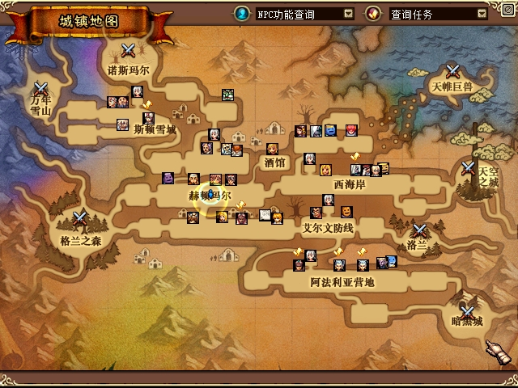

# 城镇大地图：仅右键寻路与黄色双次扩散反馈

按用户最新要求，大地图空白可走点只由右键释放设置目标；左键不再触发新增寻路或黄色效果。有效新目标显示原版玩家位置扩散图的黄色副本，第二次延迟200ms，整体约1.95s结束；快速点击以新目标重新播放，关闭地图立即清除。

代码提交为 `c63ee94`、`c39d282`。正常运行目录四处debug.dll已更新为 `022A81AC3CE59B0BF4662B7712ECC0938FC3AA1665102BABF899C64D78ED6D42`，原生输入DLL仍为0F构建。原版EXE、PVF、NPK以及共享蓝色玩家标记资源没有修改。原图像素通过私有纹理转为黄色，沿用原ANI的缩放与淡出；没有用黄色乘原蓝色而产生绿色。

## 双客户端结果

本轮私有服务端使用正常存档的字节副本。A为UID1、PID8820，B为UID2、PID8568；所有操作绑定路径与启动时间，通过原生文件输入或单目标接口执行。普通操作默认不截图，关键图片由客户端自身PrintScreen生成并原样复制。

| 检查 | 结果与依据 |
|---|---|
| 左键点击地图空白点 | 两端均无新增目标、无黄色效果、无角色位移：[A](assets/2026-10-29-map-right-feedback/evidence-right-pulse-v2/A-left-only-proof.json)、[B](assets/2026-10-29-map-right-feedback/evidence-right-pulse-v2/B-left-only-proof.json) |
| 右键跨区域 | A从2/5经2/2到2/0，8段；B从1/1经1/0、2/1到2/0，9段，最终坐标与目标误差小于1像素：[A](assets/2026-10-29-map-right-feedback/evidence-right-pulse-v2/A-first-right-pulses-proof.json)、[B](assets/2026-10-29-map-right-feedback/evidence-right-pulse-v2/B-right-cross-area.json) |
| 快速重复右键 | 两端均记录两次受理、trigger增加2，第二目标出现两个同时有效的ring；随后有限到期，纹理创建数仍为1：[A](assets/2026-10-29-map-right-feedback/evidence-right-pulse-v2/A-rapid-right-yellow-double-v2.json)、[B](assets/2026-10-29-map-right-feedback/evidence-right-pulse-v2/B-rapid-right-yellow-double-v2.json) |
| 关闭再打开地图 | 两端清除当前效果，重新打开不重播：[A](assets/2026-10-29-map-right-feedback/evidence-right-pulse-v2/A-close-reopen-clears-pulse-v2.json)、[B](assets/2026-10-29-map-right-feedback/evidence-right-pulse-v2/B-close-reopen-clears-pulse-v2.json) |

下面两张为原生JPG，可见黄色反馈与原有蓝色玩家标记。单张图片证明颜色及显示位置；两次播放的时间关系由原生诊断和纯时间线测试共同验证，不能仅凭图片推断GPU时间序列。

原生NPC、玩家标记、查询菜单和控件仍优先处理命中。对这些对象右键不作为空白路线目标，也不产生本功能的目标反馈。本轮两次到达后重按278/280点命中玩家标记，未受理符合保护条件；另一次245点未受理缺少当时完整命中对象记录，不推断根因，不计入快速替换通过。

## 测试与真实失败记录

右键入口回归先得6失败，纯时间线与像素回归24失败，原生渲染缝隙回归22失败；实现后全部通过。独立审查发现的关闭生命周期交错以2失败重现后修复；专用地图绘制入口的回归3失败后通过。当前严格Win32 Release构建零警告/错误，反馈、导航及完整overlay测试零失败；实际PVF的城镇路线、组队、状态相关测试通过，相关Python为176通过、173子测试通过。[本次构建](assets/2026-10-29-map-right-feedback/specific-native-build.log)、[反馈](assets/2026-10-29-map-right-feedback/specific-feedback.log)、[导航](assets/2026-10-29-map-right-feedback/specific-navigation.log)、[完整overlay](assets/2026-10-29-map-right-feedback/specific-full-overlay.log)、[Python](assets/2026-10-29-map-right-feedback/verified-python-related.log)。

首个F5候选实机虽有活动时间线，却没有实际原生绘制，故保留为[live RED](assets/2026-10-29-map-right-feedback/first-live-red/A-first-right-pulses-proof.json)。改用NMap专用绘制调用后022A实际绘制与原图通过。022A首次跨区图片恰逢加载画面，没有拿它证明黄色可见；上方同区原图才是显示依据。一次快速替换脚本第一点未受理的[失败记录](assets/2026-10-29-map-right-feedback/v2-edges.log)保留，避开该点后的[双端重测](assets/2026-10-29-map-right-feedback/v2-edges-retry.log)通过。

## 源码封印、审查与边界

二进制与运行绑定见[构建清单](assets/2026-10-29-map-right-feedback/build-manifest-right-pulse-v2.json)、[运行身份](assets/2026-10-29-map-right-feedback/running-deployment.json)。该构建清单继承的SourceFiles和旧验证日志属于历史基线，不能当作新源码全量封印；追加的[当前源码清单](assets/2026-10-29-map-right-feedback/build-source-seal-v2.json)及[口径说明](assets/2026-10-29-map-right-feedback/build-source-seal-v2-clarification.json)补齐实际Debug源文件、c39提交及当前构建/测试日志。Ijl源码只作为当前检出上下文，未宣称重新构建0F。

独立[增量源码审查](assets/2026-10-29-map-right-feedback/review/source-review-specific-followup.md)与[实机证据审查](assets/2026-10-29-map-right-feedback/review/live-evidence-review.md)均通过限定范围。设备切换/丢失、任意并发FreeLibrary、全部城镇及全域性能尚未验证；两端跨区与同区功能通过不扩展为这些保证。

测试进程已停止并确认频道会话清理为0，2份配置、8个输入接口文件已恢复，正常运行目录50项及旧冻结目录844项复核通过。用户先前正常客户端游玩产生的存档进度保留；私有测试存档没有覆盖原始存档。[恢复记录](assets/2026-10-29-map-right-feedback/closeout-restoration.json)。

随后已接续U07，完成两端原生位置、上报和广播的对照；该排查不属于本地图功能的通过范围，亦不关闭怪物同步、四人掉落矩阵或debug剩余接口。
