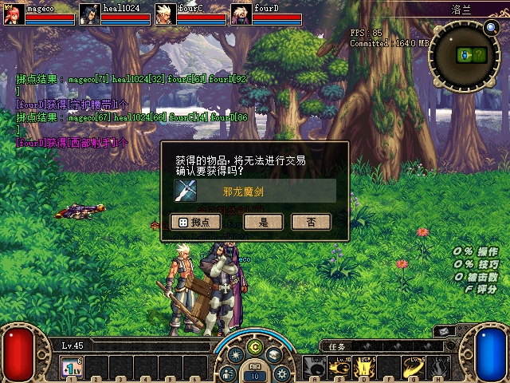

# 仅测试环境的 CLI 与四客户端掉落验收

2026-10-29，本组完成测试 CLI、debug.dll 执行端和服务端权威提交记录，并恢复四人掉落验收。**25 次拾取：24 次持久化提交、1 次符合负重规则的拒绝；另有四端各一次史诗“否”。** 拒绝不是入账成功，未重掷来更换赢家。完整事件和核对结果见 [acceptance.json](assets/2026-10-29-test-control-four-client/acceptance.json)。

## 实现与边界

[CLI](../../tools/debug/test_control.py) 提供 `state`、`player teleport`、`monster kill`、`drop isolate`、`loot result`，用法见 [说明](../../tools/debug/README.md)。服务端 `Debug.TestControl.Enabled` 默认 false，必须同时开启 ClientOverlay；客户端另需 `EnableTestControl=1` 和原始 EXE 校验通过。新鲜租约、服务端 PID/启动时间/nonce、run/房间代次、客户端 PID/启动时间/UID/演员/地图/用户及请求时间共同约束执行，旧请求不能跨房复用。

文件读取及序列化放在工作线程，原生操作留在游戏线程。关闭开关不执行新增采样或修改。Windows 替换快照期间的短暂访问拒绝、枚举缺口及 SDK 第二次读取失败采用有限重试；每次重新取完整集合，不拼接不同重试的队员快照。发布始终重试同一份请求，不生成新的请求 ID。

- 位置设置使用原版整数坐标包装器 `4715F0 → 4C9D50`，四端实际位置一致才算同步。房间外或不可行走点没有可达保证；早先 y=400 的试验仅本机到位、同伴受原版约束，保留为部分同步，没有算通过。
- 指定怪物死亡调用拥有该怪物原生控制权的客户端，再进入原版 `481000`。保留死亡、复活、上报、掉落及奖励业务。原生 `applied` 只是请求执行，另外核对服务端怪物消失与四端死亡。本轮进入下一房后立即清除 5 个怪物，四人保持存活。
- 掉落隔离只移动已有 ground；服务端先完整验证后更新，随后协调四端原生地面对象。原 ID、实例、数量和描述对象保留。实测 15 件、28 件地面集合；客户端缺读的一次返回 `partial_sync`，没有误报成功，修正读取后重新核对通过。
- 提交日志位于实际保存／金币 ledger 提交后，早于网络发布；传输失败另记 `publication_error`。日志保留最近 512 条，包含事件号、房间、拾取者、得主、四槽骰数、目标背包槽和实例 ID。实例销毁后仍可指定 run 查询；进程重启后不沿用旧结果。

这些是测试场景准备能力，**不代表已完成正常战斗伤害、正常位置协议或怪物位置问题的验收**。客户端同步、原生回执、服务端最终提交分别记录。

## 四端与夹具

| 端 | 角色 | PID | UID／队伍槽 |
|---|---|---:|---|
| A | mageco | 76712 | 1／0 |
| B | heal1024 | 54028 | 2／1 |
| C | fourC | 63188 | 3／2 |
| D | fourD | 56488 | 4／3 |

独立存档、相同 ACT1 客户端资源，洛兰普通级。服务端运行本组 Release `549CBE0F…`，debug.dll 为 `4AE4BEF7…`；完整哈希在数据附件。本轮两个非 Boss 房为 MAP1 `(0,1)` 与 MAP7 `(1,1)`。角色升级及负重上限变化按实际状态读取，没有直接修改角色等级、HP、背包或骰数。

服务端使用明确的 MOB 掉落夹具 `3FA1EE62…`：只在 goblin、goblinthrower 两个脚本追加五种物品的必掉条目；独立逐文件比对确认物品模板及其余文件不变。客户端仍使用原始 PVF `288D58AA…`。本轮证明受控怪物掉落后的分配／入账／同步，**不证明原始自然掉率**。

| 样本 | 品质 | 拾取次数 | 最终结果 |
|---|---|---:|---|
| 31901 装备 | 白 | 4 | 四端各发起一次，4 次提交 |
| 3030 材料 | 蓝 | 4 | 4 次提交；这是蓝色材料，不是蓝装 |
| 17242 装备 | 紫 | 4 | 4 次提交 |
| 31046 装备 | 粉 | 4 | 4 次提交 |
| 27546 邪龙魔剑 | 史诗 | 8 | 7 次提交，1 次超重拒绝 |
| 23 金币 | 金币 | 1 | 四人 ledger 及余额持久化 |

蓝、紫、粉由本轮客户端自动发送分配选择，不能写成逐次手点“是”。每次成功均核对事件、持久化库存的精确增量、唯一装备实例及目标槽位、四端地面移除。关闭进程后的存档又独立核对一次，库存及余额仍一致。

## 史诗“否／是／掷点”

ACT1 的选择窗由拾取者操作，不是四人分别投票。A／B／C／D 分别对 ground5／10／15／21 选择“否”，确认窗口关闭、无提交事件、四份库存不变、原 ground 四端可见，再重新打开同一物品进行下一项。

| 发起端 | ground | 选择 | 骰数：槽 0／1／2／3 | 得主与最终结果 |
|---|---:|---|---|---|
| A | 5 | 是 | 0／0／0／0 | A，提交到槽 16 |
| A | 27 | 掷点 | 20／12／64／72 | D，超重拒绝 |
| B | 10 | 掷点 | 94／96／81／13 | B，提交到槽 19 |
| B | 33 | 是 | 0／0／0／0 | B，提交到槽 22 |
| C | 15 | 是 | 0／0／0／0 | C，提交到槽 17 |
| C | 38 | 掷点 | 86／52／47／65 | A，提交到槽 20 |
| D | 21 | 是 | 0／0／0／0 | D，提交到槽 22 |
| D | 43 | 掷点 | 90／93／57／41 | B，提交到槽 23 |

槽位以事件和存档为准。A 的拒绝例中，D 当时重量 36826、上限 38300，新装备重量 4000；服务器没有发给次高分 C，也没有删除物品。ground27 及原装备实例仍在地面，四端可见且非 pending，四份库存完全不变。**这是正确拒绝的负面用例，A 的本次掷点没有入账。** 提示图显示“2526kg”，显示参数的单位另列待核对，不能以业务拒绝正确推断提示数值正确。

金币 ground16 共 23，由 D 拾取：A/B/C 各 +5，D +8，余数归拾取者。保存余额依次为 50609／50181／50024／50031；四端地面移除，D 背包界面显示 50,031。

## 关键原图

七张均为原生 PrintScreen 原图，逐字节复制并记录 SHA256，无裁剪或拼接。普通操作默认不截图。

[D 的史诗选择窗](assets/2026-10-29-test-control-four-client/04-D-epic-confirm.jpg)、[D 掷点后 B 入账](assets/2026-10-29-test-control-four-client/05-D-roll-result.jpg)、[超重后物品仍保留](assets/2026-10-29-test-control-four-client/06-overweight-retained.jpg)、[D 的金币余额](assets/2026-10-29-test-control-four-client/07-D-gold-inventory.jpg)。

[B 的结果原图](assets/2026-10-29-test-control-four-client/02-B-roll-with-arena-notice.jpg) 同时有“决斗场频道未开启，无法进入”的原生提示，保留真实现场；只支持其骰子／入账内容，不能用来证明无多余弹窗。该提示已关闭，C、D 后续结果图另行核对；其出现原因未在本组判定。

## 自动检查及收尾

- CLI 聚焦 33 tests／64 subtests；状态、导航、组队等相关 Python 检查合计 145 tests／237 subtests，通过。
- 完整 Python：504 tests／285 subtests 通过，另有 6 个失败。它们均在未修改 HEAD 复现：3 个 ledger 断言仍预期 12 行而实际 23 行，3 个 orchestration 用例遭 Windows socket 10013。没有把完整套件写成全绿。
- 服务端 Release `--test-control` 0 failures，Release 完整 smoke 通过；原生 `--client-test-control` 契约与实际 IO 测试 0 failures，相关状态／导航／组队聚焦检查通过。
- 原生完整覆盖层 UI 套件有一次通过，也保留了另两轮 acknowledgment／resize 时序断言失败；该套件的桌面时序稳定性没有在本组修复。
- 最后独立只读复核重新运行 CLI 聚焦测试，并逐项核对 25 事件、四次取消、精确库存／金币增量及七张图片内容和哈希，未发现 Important／Critical 或文档数据不一致。
- 首次曾误用较旧的 Release `--no-build` 输出，仅到城镇，未执行测试修改。随后明确重建 Release、核对 DLL 含功能并用 `549C…` 重启；旧试验、登录配置失败、部分同步等记录保留，没有并入通过次数。
- 按用户授权，通过原生确认销毁隔离角色的多余白装及史诗，并逐件核对 DELETE_ITEM 和保存结果。较早两件 A 装备已经原生存仓，未伪称销毁。没有手写保存文件增删背包。
- 四窗按 A/B 在上、C/D 在下排列，保持 640×480。最终核对坐标为 `(0,0)`、`(648,0)`、`(0,488)`、`(648,488)`。启动流程调用 [布局工具](../../tools/acceptance/window_layout.py)，不靠抢焦点或缩放实现排列。
- 本组客户端及服务端已关闭，关闭后的存档与提交重新核对；四份测试 Config.ini 精确恢复，测试开关默认关闭。正常存档哈希仍为 `E0E2FB4B…`，原客户端 EXE／PVF／NPK 与正常启动配置保护检查通过。

私有实机证据保存在 `G:\Game\DNF_ACT1\DFLegacy\.tmp\test-control-20261029`，关闭快照为 `closed-tool-v2s`；原生及服务端离线构建／测试原始日志另在 `D:\codex_worktree\party-chat-gold\DFLegacy\.tmp\test-control-20261029`。公开附件只含有界业务证据及原图，不含账号凭据、完整存档或原始网络转储。技能栏持久化仍按用户要求放在后续列表最后处理。
