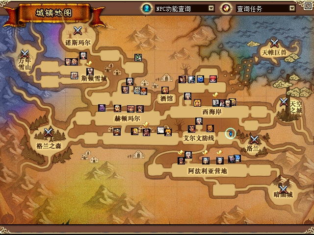
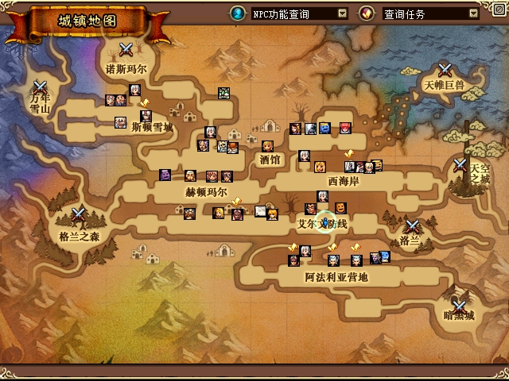
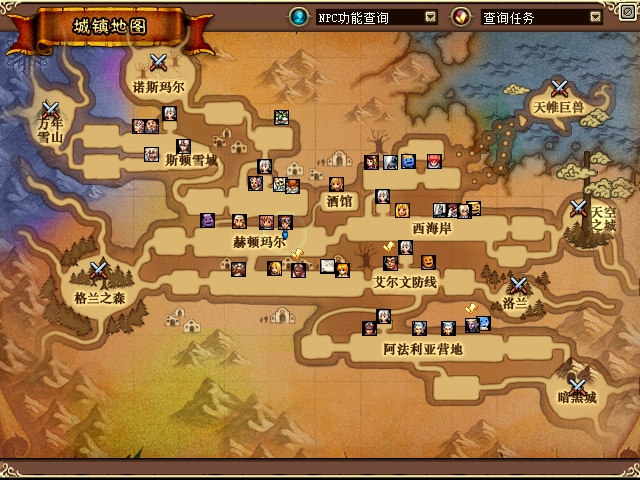

# 回城后大地图点击修复与 debug 开销观察

2026-10-29，源码提交 `5f101c9`。已修复本轮复现的回城后地图点击失效，两端均完成同一进程内进入普通洛兰、从原生菜单返回城镇、打开 N 大地图、左右键设置目标并到达的验证。偶发卡顿尚未复现到足以归因；本轮只关闭已确认的重复结果写盘问题。

## 原因和改动

回城当前位置是格兰之森副本入口 `1/2`，原控制器拒绝从 `dungeon_gate` 开始，原始结果为 `rejected / unsupported_area`。现在仅允许已经校验身份、地图和代际的初始入口作为离开起点；入口仍不能作为一般寻路目标或中途节点。实际 PVF 路径到西海岸为 `1/2→1/0→2/1→2/0`，经过三道门。

左键此前在原生 UI 完成点击处理前检查释放，时机不合适。现在左右键都先让原生点击函数处理，再分别校验自己的释放事件、捕获控件和当前按钮状态，空白地图才提交客户端内部寻路目标。原生函数仍执行一次，NPC、菜单及隐藏地图保护保留。

debug 派生 JSON 取消强制落盘，仍完整写临时文件后原子替换；不变的组队状态最多每 200ms 更新，邀请和结果变化立即更新，相同结果不再反复重写。失败写入保留重试，未产生新的游戏采样时不会伪造新鲜时间。本轮没有改变金币、物品或存档事务的持久化策略。

## 实机结果

A 为 mageco45，PID `64280`；B 为召唤师52，PID `60624`，身份及启动时间见[运行记录](assets/2026-10-29-town-return-perf/running-deployment.json)。服务端为已经通过 U04 人工测试的托管构建 `65e53d4`，原生输入 DLL 为 `0F2CB060…`，debug DLL 为 `C3ED35E1…`，完整来源见[构建清单](assets/2026-10-29-town-return-perf/build-manifest-return-green.json)。

| 实测操作 | 原生结果及随后 SDK 位置 | 用时 |
|---|---|---|
| A 回城后左键 `(420,286)` | 从入口 `1/2` 到 `1/0 (1135,294)`，arrived | 6.14s |
| A 随后右键 `(410,286)` | 同区域到 `(900,294)`，arrived | 2.75s |
| B 回城后右键 `(278,239)` | 经三道门到西海岸 `2/0 (1431,299)`，arrived | 28.09s |
| B 随后左键 `(285,239)` | 同区域到 `(1550,299)`，arrived | 2.06s |
| A 再设跨区域目标后按左方向键 | interrupted，`native_auto_move_stopped`，没有继续过门 | 通过 |
| A 隐藏地图后点击；B 点击 NPC 图标 | 没有产生新的地图寻路结果 | 通过 |

这里的用时包含输入文件处理及观察等待，跨区域时间还包含实际步行，并非 UI 延迟。四项 arrived 均校验最终区域、坐标误差≤3、方向停止和比终态更新的 SDK 采样，未把输入 ACK 当作到达。详见 [A 左键证据](assets/2026-10-29-town-return-perf/evidence-return-green/A-post-return-left.json)、[B 右键证据](assets/2026-10-29-town-return-perf/evidence-return-green/B-post-return-right.json)及同目录其他记录。

以下均为客户端自身 PrintScreen 产生的原始 JPG，逐字节复制，未拼接或绘制标注。

回城后打开地图，当前位置仍在副本入口：

A 左右键验证后停在艾尔文防线：

B 完成三道门跨区域移动及左键再次定位：

A 关闭地图后的实际城镇画面，同时验证隐藏地图不会误触发扩展寻路：

## 卡顿：已确认什么，尚未确认什么

使用相同 20 秒只读观察程序：两端均在入口 `1/2` 打开大地图，有已完成组队命令结果；第 2 秒通过已有原生输入邮箱激活 A，仅统计第 3 秒后且实际前台 PID 相符的单次计数更新区间。文件替换和 SDK 统计覆盖完整 20 秒。基线为旧版 `5E5`，修改后为 `C3ED`。这是两个短样本，并非完整场景或严格帧性能基准。

| 指标（20 秒） | 旧版 A / B | 修改后 A / B |
|---|---|---|
| 相同内容的组队结果文件替换次数 | 81 / 82 | 0 / 0 |
| SDK 数据年龄中位数 | 179.5 / 172ms | 31 / 31.5ms |
| SDK 数据年龄 P95 | 266 / 266ms | 62 / 62ms |
| SDK 文件替换次数 | 79 / 80 | 98 / 99 |
| 组队状态文件替换次数 | 81 / 81 | 72 / 72 |
| 进程总写操作计数增量 | 263 / 245 | 583 / 571 |
| A 前台采集到的单次原生更新区间 | 2744 | 2606 |
| 其中已证明下界超过 50ms 的区间 | 0 | 0 |

数据支持“重复结果重写消失、该样本 SDK 更新更及时”，**不支持总 IO 下降或全部卡顿消失**。总进程写操作反而增加，不能用它替代所选文件的替换次数。SDK 部分捕获耗时 A 中位数均约 4µs，也不能代表整个插件耗时。活动寻路的即时采样、网络转储及场景切换仍需在实际卡顿时关联分析。

原生更新计数用 `B5DD34`，外部轮询仅给出更新时间区间，不是 GPU Present 时间，也没有证明不存在其他卡顿。早先误用 `B5DD20`（FPS 窗口计数）的私有试采，其帧耗时结论已排除；见[更正说明](assets/2026-10-29-town-return-perf/perf/measurement-correction.md)。原始有效样本：[旧版](assets/2026-10-29-town-return-perf/perf/baseline-valid-v2-5E5.json)、[修改后](assets/2026-10-29-town-return-perf/perf/optimized-valid-v2-C3ED.json)。

## 测试、交付及范围

Win32 Release 严格构建、完整 Native 测试，以及导航、实际 PVF 路线、组队和状态聚焦测试均为 0 failures。debug Python 测试 `165 passed, 173 subtests passed`。全仓 Python 为 `463 passed, 221 subtests passed, 6 failed`：三个旧协议台账场景数量断言、三个固定端口 2311 被 Windows 10013 拒绝的启动编排测试，与已记录基线一致，未改成全仓通过。对应[测试日志](assets/2026-10-29-town-return-perf/verification/full-native.log)及[全仓结果](assets/2026-10-29-town-return-perf/verification/python-full.log)。实际鼠标游标系统测试要求 `--interactive-cursor`，本轮未声称执行。

已将新 debug DLL 更新到两端及两个启动目录，并把经 U04 人工验收的托管服务端构建更新到正常 `DF/town-test` 运行目录；保留 `server.json`、原版 EXE/PVF 和原始存档。双端实测使用上一轮关闭后存档的逐字节副本，保留人工测试进度；本轮未将私有测试存档覆盖回原始存档。测试进程已按 PID、路径和启动时间停止，原配置及八个输入接口文件已恢复；旧冻结证据 W 的146文件、X的1221文件哈希复核通过。见[停止后运行记录](assets/2026-10-29-town-return-perf/deployment.json)、[恢复记录](assets/2026-10-29-town-return-perf/closeout-restoration.json)及[最后保护文件检查](assets/2026-10-29-town-return-perf/final-verification.json)。

独立审查覆盖[源码与测试](assets/2026-10-29-town-return-perf/review/final/source-review.md)及[实机记录的离线一致性](assets/2026-10-29-town-return-perf/review/live-evidence-review.md)，后者不是独立实机认证。原图、数据和日志的完整哈希见[发布清单](assets/2026-10-29-town-return-perf/manifest.json)。实机记录属于本轮有限地图路径，未外推到所有城镇、运输、动态障碍或副本小地图。U03 四端史诗与稀有度矩阵、U04 蓝装及边界、U05 其他接口、U07 同步问题继续保留；偶发卡顿仍待捕获。

后续用户确认操作时全画面一起停顿，已进一步捕获隐式原生截屏引起的短停顿并修复操作工具默认值，见[操作期对照](2026-10-29-operation-stutter-verification.md)。本页旧样本的“0个超过50ms的单次更新区间”只适用于其筛选条件；原始计数窗口重置会遗漏截图对应的区间，不能作为全面排除卡顿的证据。旧冻结数据原字节保留。
