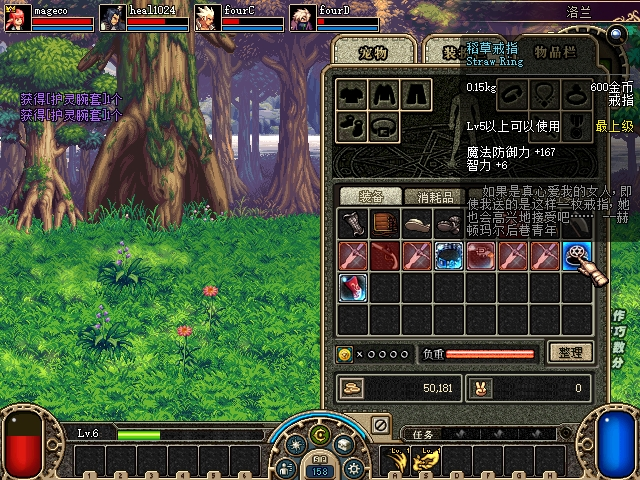
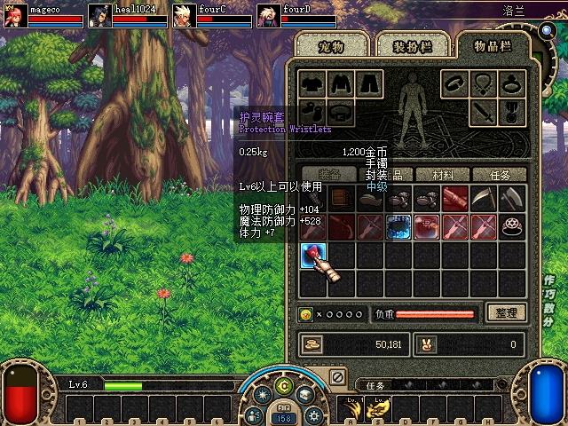
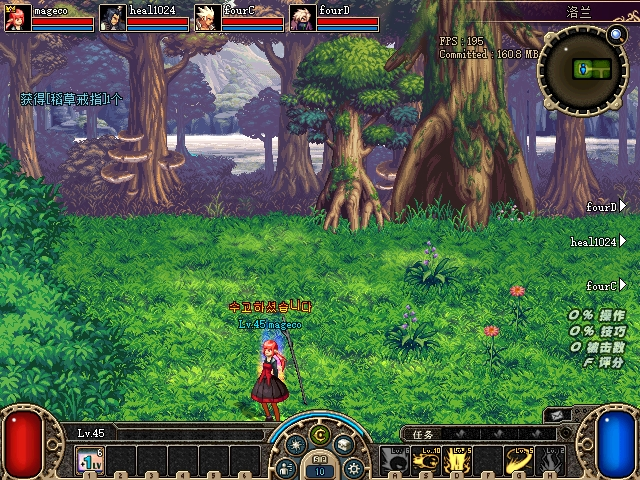
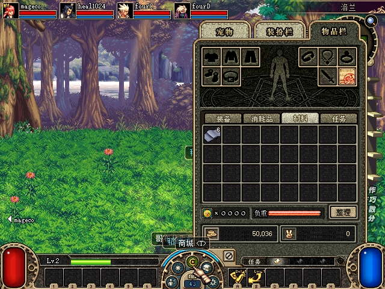

# 2026-10-29～30：四客户端主动丢弃扩展验收

本组补齐 U04 的蓝色装备、未解封紫装、四向交接、材料部分丢弃、金币均分，以及留地后换房返回。以原生背包丢弃入口、服务端库存／真实拾取提交及关闭后的存档为证据，客户端独立核对地面出现与移除。未修改正常存档，未用管理授予替代本次掉落，也未把准备场景的测试定位／秒杀写成正常战斗验收。

前组的白装／金币／消耗品／材料双端人工结果见[人工记录](2026-10-29-active-drop-manual-verification.md)，稀有度及史诗三按钮矩阵见[前组四端记录](2026-10-29-test-control-four-client-loot-verification.md)。本组新增蓝装，不能改写前组“蓝色材料”的历史范围。

## 构建和隔离

- 托管 Release `DFLegacy.Server.dll`：`1ECD5759BEB56A9BFA7EBC5349F2D026AD8B832B66318C446665D6874495ECAF`；测试 `debug.dll`：`12D58F6AA209FCE2AA9DAE6004C547A99104EA97B818C194101414D721838E72`。仅安装于本组隔离服务端及 `Loot4_A/B/C/D`，未声称正常运行目录已经部署。
- A=mageco、B=heal1024、C=fourC、D=fourD，四窗按 A/B、C/D 排列。B 的角色选择槽为2；操作绑定实际进程创建时间与区 UID，不按账号序号猜测。
- 新私有目录 `.tmp/active-drop-four-20261029`；来源为前组关闭后的克隆存档，未手写库存。旧 `.tmp/test-control-20261029` 的两个已封存目录均保持只读。
- 服务端夹具只为两个 MOB 增补 `24002/22050` 必掉项。全量比较48343个PVF条目，仅两份MOB脚本不同；物品模板不改，客户端原PVF不改。这里只验证拾取和主动丢弃，不验证原始自然掉率。

## 新的原生丢弃接口

`inventory drop --uid --slot --item --count` 复用测试租约与 DLTC112，新增 operation=5。调用原版 `0x45F0F0` 背包丢弃发送函数及 `0x45CA20` 物品策略，沿 ACT1 CMD50 正常业务路径处理；没有开放任意地址写入、物品生成或原始发包。支持主背包9～511槽、金币0槽，绑定实际物品对象、数量、身份、房间及前后采样；待处理背包、交易占用、陈旧物品或不支持类型拒绝。

原生回执仅表示入口执行，保留 `server_committed=false/persistence_verified=false`。CLI另外要求源库存减少、对应新地面和四端独立观测。装备还核对实例ID、状态、耐久、封印、品质种子；最终拾取要求真实服务端提交和保存。原生 `partial` 保留回执并继续只读观察，绝不因“非applied”误称安全拒绝或重新发送。动画抛出阶段各端 Z/XY 可不同，身份出现与坐标一致分别报告，不把动画高度误判为物品丢失。

新增独立、有限长度的 `inventory` 观测，包含主背包槽位、物品ID、数量及对象绑定字段；地面状态与库存状态的有效性分别判断。接口仍默认关闭，死亡角色的该测试快照不会继续刷新，此项作为 U05 剩余范围保留。

## 实机结果

装备共12次有效交接提交：第一阶段同房蓝装6次、紫装5次；第二阶段换房返回后蓝装1次。准备拾取、失败轮的回收另记，不混入此12次。每次源库存已保存移除、同房四端出现、指定角色拾取后四端移除，服务端提交得主和存档唯一所有者一致。每次拾取后再次按原生X，库存和提交事件不增加；这不是重复网络包重放验收。

| 样本 | 四向主矩阵 | 补充交接 | 最终关闭存档 |
|---|---|---|---|
| 蓝色24002，稻草戒指 / Straw Ring，150g | A→D、D→A、B→C、C→B | C→A、A→B准备；重启后A留地、换房返回A拾取 | A主背包22，唯一实例 `01a18860-caab-7803-a562-f84ce92c8471` |
| 紫色22050，ACT1界面“护灵腕套 / Protection Wristlets”，250g、封装 | D→A、A→D、B→C、C→B | D→B准备 | B主背包25，唯一实例 `01a18860-caac-7f54-8e06-9fa1a07947ec`，SealState=1 |

物品名按实际客户端画面记录；PVF候选文本与当前本地化显示可能不同，以ID和实例为准。实机两件装备 State=0、Durability=0、品质种子null；非零强化／耐久／品质只由下述托管回归覆盖，未扩大成实机验证。

材料3030从A部分丢1个、D拾取：四人数量 `{A:4,B:0,C:5,D:5}` → `{A:3,B:0,C:5,D:6}`，总数14不变；源减少先保存，实际拾取提交为ground21/event14。金币A丢23、B拾取：余额 `{A:50609,B:50181,C:50024,D:50031}` → `{A:50591,B:50189,C:50029,D:50036}`，总额200845不变；扣除A丢弃23后，A/C/D各5、B8。D画面也显示材料6个和金币50036。

换房第二阶段：A在(0,0)丢蓝装ground8，四人进入(1,0)，新房服务端及四端不含该地面；返回(0,0)后同groundID、实例和元数据恢复，A拾取后仅保存一份。最终A/B/C/D均存活，HP1517/470/302/277。测试准备只清除已确认的普通房间，没有借用死亡角色的旧地面快照冒充四端成功。

第一次换房准备在怪物控制权变化时中断，等待期间C/D死亡；该轮仅A/B回收蓝装，不计四活人验收。第二阶段增加有界控制权就绪等待，仅原生明确拒绝才重取控制者；其中新房第一次地面读取仍短暂落后，立即断言失败。随后保存新鲜四端样本确认旧物已清理，再完成返回拾取；这两次脚本问题均保留，不写成首轮全通过。

## 关键原图

原生截图仅在关键界面显式请求，共5张，未裁剪或重绘。截图用于核对客户端，具体提交、槽位和元数据见[有界验收数据](assets/2026-10-30-active-drop-four/acceptance.json)及[文件哈希清单](assets/2026-10-30-active-drop-four/manifest.json)。

## 自动验证与审查

- 原生验证先RED后GREEN：op5边界、库存对象/策略、IO及最多执行一次；Release严格构建通过。状态、导航、组队、跨区路线相关原生套件均0失败。[原生结果](assets/2026-10-30-active-drop-four/export-green.txt)
- 托管新增四成员91项断言：打乱UID／队伍槽位／加入顺序，装备实际保存重读、非零元数据、封印拒绝、32并发单归属、房间／实例隔离、23金币与8次重试；实际实例／事务／存储组合，不伪称端到端CMD50网络测试。库存元数据投影有独立RED5项→GREEN回归。显式Release构建及[完整协议冒烟通过](assets/2026-10-30-active-drop-four/final-full-smoke.txt)。复跑：`dotnet run --project tests/DFLegacy.SmokeTests -c Release -- --active-drop-four`。
- [Python聚焦](assets/2026-10-30-active-drop-four/partial-green.txt)：56 tests／107 subtests；[相关debug](assets/2026-10-30-active-drop-four/partial-debug-final.txt)：221 tests／280 subtests通过。
- [完整Python](assets/2026-10-30-active-drop-four/partial-all-final.txt)：527 passed／328 subtests，仍6个既有失败：3个ledger行数期望12／实际23；3个acceptance监听WinError10013。未把完整套件写成全绿，未重复把既有失败当新回归。
- 独立审查发现 `partial` 错归拒绝的Important问题，已修复；审查者另跑5个测试／9个场景确认关闭。最终[只读证据复核](assets/2026-10-30-active-drop-four/review.txt)逐项核对提交、关闭存档及原图，未发现Important/Critical。两处测试输出已迁至`.tmp/smoke-tests/`随机目录，避免后续重跑写入封存目录；修改后完整Release冒烟再次通过。

## 关闭与剩余范围

两轮均按日志确认全部7001连接完成退出清理后关闭所属进程，四份INI逐字恢复、测试控制关闭。正常存档SHA256仍为 `E0E2FB4BB53B9775463E9F54905CE9CB3426D72A9EB0BDADF845642ABB98A283`；正常启动器配置和原EXE/PVF等受保护文件一致。关闭后再次读取测试存档，上表两件装备各只有一个所有者。未改历史证据或部署正常运行目录。

U04用户指定的主动丢弃基本行为已由人工双端与本组四端补齐；拒绝和并发/跨实例边界由自动回归覆盖，不外推所有物品子类型、正常掉率、所有客户端错误提示和全部网络故障。U05死亡观测、MP/技能冷却/通用UI，U07及怪物位置同步、U08其他卡顿、U10超重单位仍保留；U09技能栏持久化按用户要求最后处理，见[待处理列表](2026-10-28-restoration-backlog.md)。
