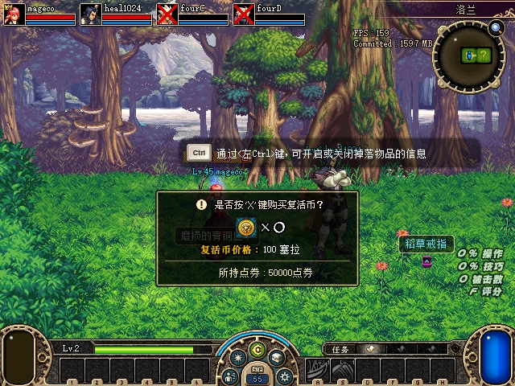
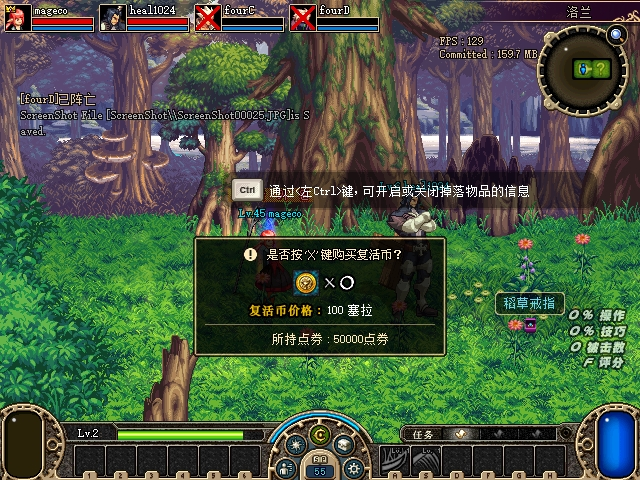
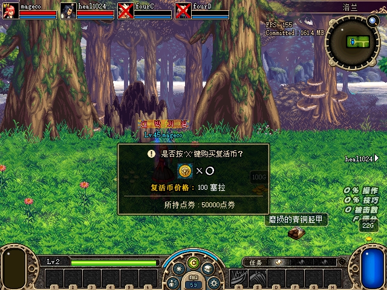
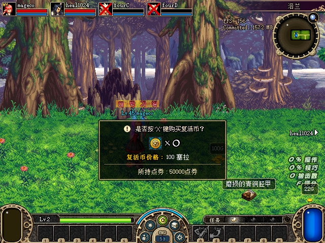
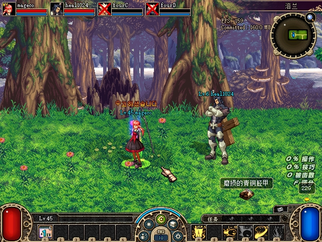

# U11 死亡队员地面残留修复与四端验收

2026-10-30，按队列最后一项处理。修复死亡角色脱离地图后，收到拾取移除通知却不能停用地面物的接收端错误；四端同房白装、两活两死真实换房返回后的蓝装、金币拾取均已核对。服务端业务和debug修改授权未放宽。

## 根因和实现

原ground_item_removal.cpp从dispatcher的context→stage→map找到地图后，还要求localActor+E4等于该地图。C／D原生死亡会让角色地图变为null，这一附加条件使接收器在查找物品前直接返回。ACT1原始NOTI39的421EF7→4042B0→4180B0→404380只取当前stage地图；4C5AA0按类型和GroundId查找，再以568540(false)停用，由原生帧清理对象和描述符。

现在接收端按只读保护值解析scene及死亡状态，校验dispatcher／UI的stage指针和地图一致，重复核对角色、地图、保护键、stage及死亡值。存活者仍要求角色地图一致；只有已验证死亡时才允许脱离／旧角色地图，并始终采用当前stage地图。保留对象所属地图、类型0121、精确GroundId、active和activation方法身份校验；不扫描死者旧地图，不手动析构或发放物品。安装时校验死亡getter652A00的原版字节。诊断记录具体上下文／对象拒绝原因，每进程最多前128条拾取通知。

## 先复现旧版，再验证新模块

第一轮计划放入修复版，但普通启动器会自动把其旁边旧IJL复制到客户端。实际四端文件哈希及旧格式接收日志确认运行的是0F2CB060…，因此保留为**旧版复现**，不计作新代码失败：A拾取白装后，A／B对象消失，C／D角色地图为null且对象仍active，服务端已唯一提交。原图如下。

随后隔离启动器副本的启动调用未返回，没有游戏进程或可见确认弹窗；结束本次自有等待进程并关闭服务端，单独保留失败阶段。最终沿已验证的普通启动器路径，临时提供有备份的测试IJL，启动后立即恢复原bundle；没有操作Windows安全设置。每个客户端启动后都校验了8B060DBB…文件哈希及新格式安装日志。正式验收为dead-remove-v3；它从相同的测试前封存存档复制新副本，而非使用前轮留地物品未归属的关闭档。

## 实机结果

四窗按田字形排列。全部定位和掉落分离在四人仍存活时完成；之后通过玩家击杀CLI让C／D死亡，A／B保持存活。普通操作不截图，关键过程才请求原生截图。

| 场景 | 权威结果 | 四端结果 |
|---|---|---|
| 同房白装13201 | event1 committed／persisted；A精确槽位13、实例与元数据一致 | 连续21次取样，A／B／C／D分别11／10／10／10个新序列；目标移除，同型号另一实例保留 |
| A／B右门出去再左门返回，C／D仍死 | room_generation 1→2→3；蓝装24002实例01a18860-caab-7803-a562-f84ce92c8471保持，event2提交给A槽15 | 返回后连续21次取样，每端10个新序列；C／D日志均death=1、actor-map=0、stage=ui-stage，明确deactivated |
| 换房后100金币 | committed／persisted，A／B各+50，C／D不增加；死亡成员换房后失去金币分配资格，符合既有规则 | 服务端、关闭保存和原生背包slot0/count一致；四端金币对象消失，重复输入无新提交／余额变化 |

关闭前再次独立核对：白装、蓝装和金币的原生actor在四端列表中均已**不存在**，不只是active=false；同型号对照白装仍active。关闭后JSON中，已拾取的两个装备实例在主背包／装备／仓库／装扮／宠物五个空间内各只有一个，槽位和元数据仍匹配。

复活币提示遮住部分地面，原图只辅助说明场景及死亡状态；清除结论以新鲜对象列表、接收日志和持久化为准。金币核对脚本曾误读不存在的inventory.gold属性，在实际提交后报错；随后按原生slot0/count只读续验，没有再次发送拾取。

## 测试、范围与收尾

实际接收上下文回归先保留旧门槛得到6项失败，修复后32项检查0失败，包含空／旧死亡角色地图、四接收者、重复包、未知保护值、不同stage但相同map、读取中切图／换人／换键及异图对象。一次中间夹具把UI stage槽和dispatcher stage槽放在相同模拟地址，已纠正为独立地址；这不是额外产品缺陷。原有七字节兼容、解析及对象校验回归保留。完整IJL兼容套件通过，debug测试控制模型／IO均0失败；独立源码审查无P1／P2。托管与Python本组未改，沿用U09最近完整结果：托管全通过，Python567 passed／2 skipped／413subtests及6项既有失败，不宣称全量全绿。

实测IJL SHA256 `8B060DBB004395770FF31B60C6A440AEB6032A29D8AD86307D809E7BE83FDE18`，debug仍1AFDF77A…，服务端仍AA11B5DB…。三阶段均已关闭，4份INI、4份原测试IJL及临时普通启动器bundle均恢复，16项保护文件、31个旧封存命名空间保持。正常存档E0E2FB4B…未变，本组尚未部署正常目录。

本轮没有重复实机复活后的残留、也未造出死亡角色保留旧非零地图的状态，后者由夹具覆盖。私有九字节移除包没有房间epoch，不能承诺任意延迟旧包／GroundId复用的全面隔离。见[有界验收数据](assets/2026-10-30-dead-ground-removal/acceptance.json)、[同房序列](assets/2026-10-30-dead-ground-removal/same-room-samples.json)、[返回后序列](assets/2026-10-30-dead-ground-removal/after-return-samples.json)及[附件哈希](assets/2026-10-30-dead-ground-removal/manifest.json)。

独立[证据复核](assets/2026-10-30-dead-ground-removal/independent-review.txt)重新计算168份地面样本及绑定、核对8份关闭哈希／13份运行包哈希／16项保护文件，结果一致。此前31组封存的全量复核由主执行者完成，审查者只检查其验证摘要，未重复全量哈希。
