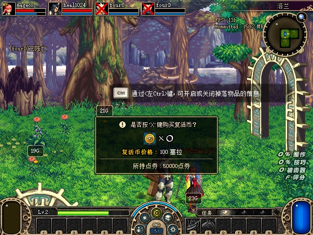
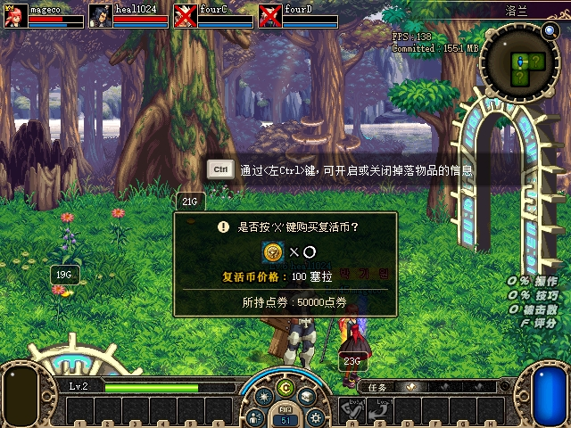

# U05 死亡后的测试地面与库存观测

2026-10-30，死亡角色不再停留在最后一份存活测试快照。原代码复用存活玩家的修改校验，死亡时只读观测也停止；现在独立校验观察者及当前stage地图，读取前后核对身份和新鲜租约，继续按约200ms发布。死亡角色可以脱离地图或保留旧地图指针，但观测只读取当前stage地图。定位、丢弃、击杀等修改接口仍要求角色存活，观测身份operation为0，不能复用成修改请求。

测试快照v1新增`observer`，记录actor／user／actor-map／stage及死亡标志。空actor-map与普通SDK一致导出null；消费者核对这些字段、sequence、进程和generation。旧存活快照兼容，缺少绑定的旧死亡快照保持未知。截断SDK只发布明确无效的地面结果，库存按独立有界读取结果报告。没有调用原生业务函数来取得这些状态，也未改变U11地面移除逻辑。

## 四端实机

使用原PVF和独立克隆存档，四端按田字形启动并进入普通洛兰；用既有指定怪物死亡接口准备安全房。debug DLL为 `8B344D54A7350316929E3D8E50073BC54F8AE3A716F055F9CCF404229DBD9EE8`，服务端DLL仍为 `E058182878E8176981C3D9649515F744035385E812525DBE14B4D2C8059193C0`，未改托管业务。

A正常丢弃23金币，服务端源扣减、新地面及四端同步确认后，分别调用C、D真实玩家死亡入口，服务端与四端均确认死亡。随后7秒记录144次成组观察：C／D分别有35／34个不同sequence，死亡后的actor-map均为null，地面和库存继续更新，23金币仍在实际地面列表。不能把重复轮询计为独立采样帧。

C／D原生库存分别含12／19行（含金币），主背包物品及金币逐项与服务端一致：C金币50029、11个主包物品；D金币50036、18个主包物品。分别尝试死者定位，均在发布前拒绝，原命令文件逐字不变。关键截图仅明确请求两次，其余按debug数据操作。详见[验收数据](assets/2026-10-30-dead-observation/acceptance.json)及[哈希清单](assets/2026-10-30-dead-observation/manifest.json)。

本组只验收死亡后的新鲜观测与修改拒绝，未做两死者换房返回、活人拾取后的残留移除；U11仍排最后。死亡保留旧非零地图指针的情况由离线夹具覆盖，不冒充实机覆盖。

## 测试与收尾

原生死亡／脱离／旧地图观测RED3→GREEN。独立审查发现零地图序列化和读取中撤销租约两项问题，以RED2复现后修复；真实`ExportState`文件再交由Python验证地面与库存，避免只用手写JSON掩盖序列化错误。身份／地图／死亡变化、租约关闭／过期／撤销、未知状态、截断及全部修改操作拒绝回归通过。原生状态、测试控制、导航、组队、跨区相关套件均0失败。

相关Python及真实原生导出往返为241 passed／342 subtests，最终完整检查547 passed／392 subtests；仍保留前组相同6项失败（3个ledger行数期望、3个WinError10013监听）。首版消费测试把夹具辅助函数放错测试类，纠正后才记录有效RED，不以夹具错误充当功能失败。托管未改，本组未重跑托管套件。

第一轮启动发现上组A主动结束游戏留下输入文件，控制器正确拒绝覆盖；先关闭本轮自有进程，归档旧文件，再以独立phase2启动验收，不重放旧退出操作。两阶段原记录均保留。最终全部测试进程关闭，7001连接退出清理完成，四份INI恢复，16项受保护文件及14个旧封存目录逐文件核验通过。正常存档仍为 `E0E2FB4BB53B9775463E9F54905CE9CB3426D72A9EB0BDADF845642ABB98A283`，没有部署正常运行目录。接续U07／U08／U10／U09，U11最后。
