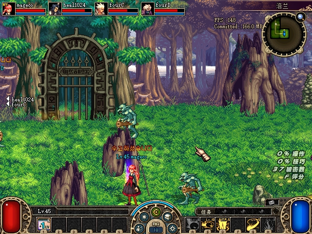
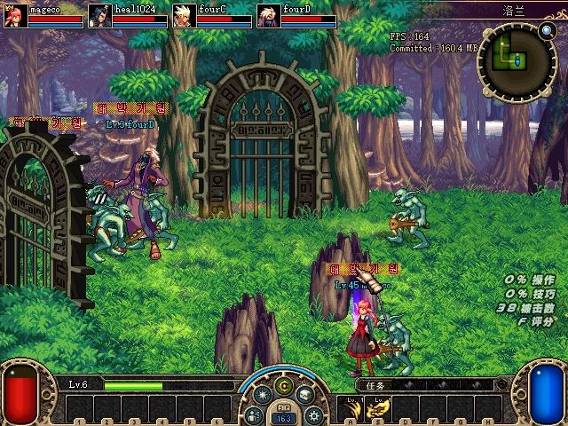
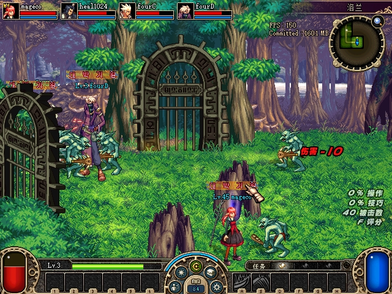
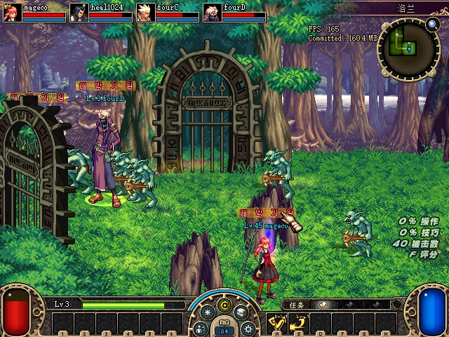

# 原生循环卡顿与首领房运动拒绝接续

2026-10-30，北京时间。**两个历史阻断仍保留，不能用本轮窗口未复现大差宣布修复。** 本轮捕获一次覆盖层之外的约0.6秒停顿，在该区间内取得资源装载路径的栈，并补齐同次运动候选、拒绝出口和GP42 provider实际返回的证据。改动留在`D:\codex_worktree\party-chat-gold\DFLegacy`；四端测试进程已关闭，正常存档及临时替换文件已恢复。

| 项目 | 本轮确定的事实 | 尚未关闭的部分 |
|---|---|---|
| U08 卡顿 | 四端同次长间隔在原生更新函数之外，线程CPU接近墙钟；区间内取栈落在`.ani`／`.img`缓存未命中后的装载、解析与构造路径。 | 尚无loader入口／出口计时，不能把整段间隔归给单个资源；也未证实重复解析或缓存误用。 |
| U07 位置差／GP42 | 新窗1237次同次X/Y拒绝均来自两次原生grid检查；803次GP42 provider成功，输出CRC全部有效，其中796份对应到原生CRC门后的接收。 | 新窗最大位置差43.475px，未重现历史277／421px级差；7份provider输出未配对，仍是未知。 |

## 覆盖层之外的停顿

新增默认关闭的原生七段计时，覆盖`433B00`至原tail返回，另记录连续调用之间的耗时。每段同时记录墙钟与量化的线程user+kernel时间。固定桶和事件环由worker导出；未完成、嵌套、漏序号和缺CPU数据不会当作零耗时。Host／Frame ABI v2不变。scene是最近一次debug绘制观察值，前台只检查端点，均不外推为连续状态。

WPR未再尝试，也未改系统采样策略。新26.485秒组队准备窗口内，严格要求worker已导出而主循环采样落后超过240ms才取线程上下文；再用随后完成的连续interval核对取栈时点。四条记录的`previous_sequence`都精确对应取栈所见的旧采样。

| 端 | 调用之间的耗时 | 对应线程CPU | 取栈暂停时间 | 区间内采样所见路径 |
|---|---:|---:|---:|---|
| A | 600.578ms | 609.375ms | 139µs | `.ani`解析／构造 |
| B | 558.359ms | 546.875ms | 90µs | `.img`文件／包访问及初始化 |
| C | 525.186ms | 531.250ms | 74µs | `.ani`解析／构造 |
| D | 596.670ms | 593.750ms | 71µs | `.ani`解析／构造 |

CPU计时有量化误差，略高于墙钟不表示CPU超过100%。取栈暂停纳入观察边界，不能当作零扰动。A所在窗口另有1次丢锁及1次序号缺口；目标interval自身连续有效，其余三端窗口没有这两项计数。

A／C／D的有效返回链进入`82F720`动画解析、`83009B`、`8B3E92`、`8B3CC5`及`904E1F`工厂返回点。原版在`904CF0`已有查找、命中、未命中构造和插入路径；这次经过工厂返回只能证明采样时是缓存未命中。资源键分别涉及`KallaAir.ani`、`SubWeaponFrontRapid2.ani`、`Attack3.ani`，不能把不同进程或同栈字符串副本当作同键重复解析。尚未取得loader入口／出口计时，整段600ms不等于某个资源或函数的耗时。

早期16次取栈有14次落在系统D3D8的`DrawPrimitiveUP`链（[接口定义](https://raw.githubusercontent.com/crosire/d3d8to9/v1.15.1/source/d3d8.hpp)），但触发仅凭旧JSON年龄，存在200ms发布滞后，**不能归到上述同次长间隔**。随后A／C临时使用仓库D3D8→9兼容层、B／D保留系统D3D8，仍观察到约0.49–0.57秒间隔，未据此启用兼容层。临时DLL已移除。

见[连续interval及裁剪后的有效返回链](assets/2026-10-30-native-loop-and-motion-followup/timing-window.json)。原始栈只保留在私有运行目录，报告附件不复制整段栈内存。

## 同次运动拒绝与网格勘误

默认关闭的固定内存环记录原`4C8EBC`的实际逐整数步X/Y候选及原v94返回，双向验证actor／controller绑定，只收集已入图的怪物529与原`4B3C30`。Z走v90，不能混用`result4`。按同一原生callee frame及actor关联bounds、state、第一／第二次grid路径；未命中marker保留`unknown_exit`。

此前只读重算把网格Y换行写成`y/6`是错误。原指令是signed `IMUL 0x2AAAAAAB`后再`SAR EDX,1`，实际为`trunc0(y/12)`；第二行先32位`INC`再换行。例如252对应第21行；359的第二行是30，仍可能因越界拒绝。已用原机器码覆盖负数、换行及INT_MAX回绕，旧重算先出现11组失败，修正后通过。旧`/6`候选格结果作废，原生游戏逻辑从未使用该重算。旧[独立复核附件](assets/2026-10-30-remaining-blockers-followup/independent-review.json)已勘误并更新manifest，保留了原hash。

本轮新增诊断也曾引入一次测试客户端退出：旧第二grid探针覆盖`4B3DFF..4B3E06`，原`4B3DDF→4B3E03`同一行快捷分支跳进覆盖区内部。A在`4B3E0A`异常，失败阶段已单独归档，不计作成功验收。

修正版改拦截完整`4B3DFA CALL 8A8FE0`，独立恢复原`ret16`及返回点DFF，保留DFF至E06原字节。安装器和测试共用实际导出的`DflMotionProbeSites`表；新控制流审计先精确复现内部落点失败，再执行原getter、原grid函数及完整同一行／跨行尾部，对照参数、寄存器、flags、输出指针和栈。最终四端实载核对原字节均保留，四端日志没有异常记录。

## 最终四端窗口与GP42

修正版使用统一系统D3D8，按历史首领房位置布置四名角色，再观察20.047秒。窗口内只发送普通方向键；不定位、攻击、强制死亡或截图。四名角色在窗口首尾均存活，截图目录没有变化。

| 端 | 第一次grid拒绝 | 第二次grid拒绝 | GP42 provider成功／观察数 | 对应原生CRC门后接收 |
|---|---:|---:|---:|---:|
| A | 265 | 18 | 196／196 | 195 |
| B | 301 | 18 | 210／210 | 208 |
| C | 299 | 19 | 206／206 | 204 |
| D | 298 | 19 | 191／191 | 189 |

合计1237次拒绝，均有实际X/Y候选及原函数false返回；没有state、独立bounds或unknown出口记录。这证明本窗的拒绝在grid查询路径，仍不能把出口名称当成某个具体cell谓词或历史大差的根因。

GP42在原`78EE73` provider调用返回后观察。source是返回时快照，尚不能视为未被provider修改的调用前输入；output在copy、二次变换及原生CRC／dispatch之前。803份输出均能校验CRC，内部协议分布为GP7=327、GP6=196、GP5=184、GP35=44、GP20=44、GP23=8。GP4普通位置消息不在这组provider输出里。

796份按同线程、context、原生帧、相同CRC有效内容及QPC先后，唯一对应到原生接收事件，最大间隔9µs。剩余7份保留为未配对，不写成通过。provider、拒绝和接收事件流均没有观察到序号缺口；另有一次A接收JSON读取错误，完整保留。

4252组合格位置比较要求同怪物UID、存活活动、同关联角色及捕获差不超过150ms，按双方sequence去重。最大差43.475px，发生在相差125ms的两次采样；这些不是同时刻坐标。没有超过100px的样本，**不能用随机窗口未复现来关闭历史大差**。

详见[原始字节配对示例、796组身份及QPC关联、位置比较和健康状态](assets/2026-10-30-native-loop-and-motion-followup/motion-provider-window.json)，以及[实载安装字节及四端异常日志核对](assets/2026-10-30-native-loop-and-motion-followup/installed-sites.json)。

以下四张原生截图均在窗口之后取得，不替代窗口内的健康／位置JSON。

## 回归、保护与接续

Python分两组执行以免重复：`tests + tools/debug + tools/acceptance/tests`为509 passed、1 skipped、516 subtests；独立`protocol/tests`为97 passed，合计606 passed。唯一跳过仍是未提供fixture的旧测试控制导出roundtrip，没有冒充执行。完整IJL兼容测试、debug真实fixture及循环／frame／gameplay模型测试均通过。pytest日志含Unicorn `mem_map`内的Windows访问异常诊断，但进程以0完成并报告上述通过数；该日志保留，没有把它写成“全程无诊断”。

原官服ELF仍用于核对既有队伍／转发业务合同，SHA256为`8859C99D8290DC5FB58151444138CF2697B2BFFF12D47D6159596A03F20B5261`；客户端网格与provider观察依据原ACT1机器码。没有改写不透明GP42载荷、跳过原CRC，或推测性重排GP6原生发布顺序。第四人重新邀请、掉落、金币等已完成手工矩阵没有重做。

最终IJL SHA256为`0598B7C21F9960DAE0DD7A6D8B4A726240C84D08C12F2E0C6F69A883052734CB`。测试服务端只用克隆状态；7001被Codex进程占用后，隔离实例改用47001，没有改系统策略或结束占用进程。所有任务进程已关闭，12个客户端INI／DLL恢复原hash，8个受保护文件校验通过。正常存档仍为`E0E2FB4BB53B9775463E9F54905CE9CB3426D72A9EB0BDADF845642ABB98A283`。见[恢复校验](assets/2026-10-30-native-loop-and-motion-followup/restoration.json)、[验证范围](assets/2026-10-30-native-loop-and-motion-followup/verification.json)及[原始私有证据位置和hash](assets/2026-10-30-native-loop-and-motion-followup/sources.json)。

接续应只补缺口：U08需要同manager、同规范化资源键的装载／命中／插入／驱逐时序，才能判定是否存在可修复的重复加载；U07需要在再次出现历史百像素差的同一时段关联新拒绝出口、GP4实际发布及GP5／GP6状态变化。本轮未找到足以支持新增游戏业务补丁的原因，两个阻断继续保留。
