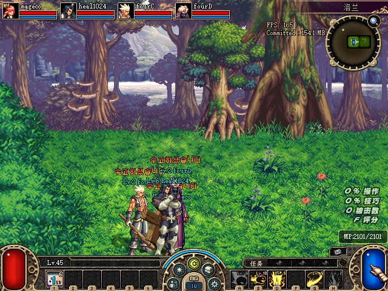
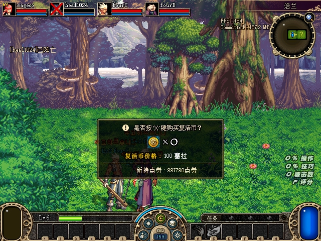
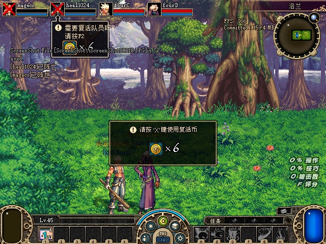
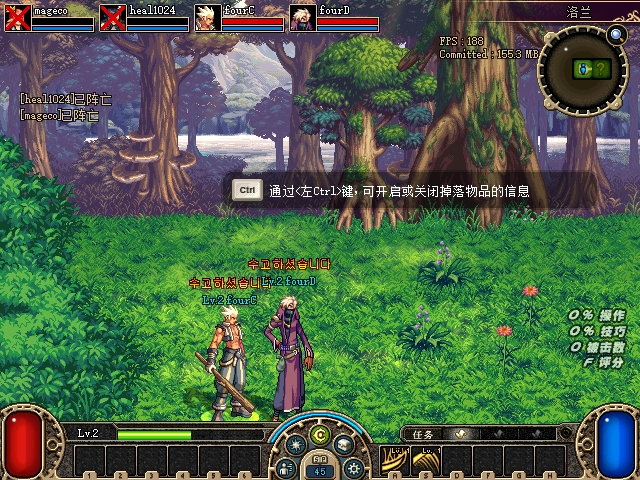
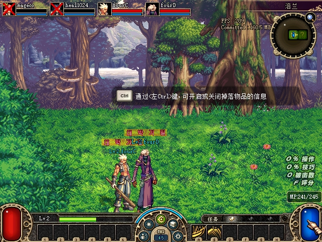

# 2026-10-30：测试玩家击杀与本地 MP 观测

按用户最新要求，U11死亡队员地面残留移到整个队列末尾，排在U09技能栏之后；先新增玩家击杀接口，随后推进U05本地MP观测。本组没有修改U11的地面移除处理，也没有把死亡后停止刷新的测试地面快照记为已修复。

## 使用与实现

```powershell
python -m tools.debug.test_control --directory G:\test\snapshots player kill --uid 2
```

初版高层CLI支持**当前2～4人组队副本内该客户端自己的角色**，要求相关客户端均能提供新鲜状态。UID为当前区用户ID。单人副本的生死计时保留在服务端会话内部，当前接口会在发送前拒绝单人场景；不是单人模式已通过。测试开关仍默认关闭，必须同时启用服务端TestControl/ClientOverlay及客户端EnableTestControl，使用同run的新鲜租约。

DLTC112新增op6，目标必须等于自身UID、x/y/reserved均为0。除现有进程创建时间、UID/user/actor、地图、时限和重放校验外，另核对玩家类型0x111、原玩家虚表、HP>0且尚未死亡。静态核对原HP函数`0x481000`的三个栈参数和`ret 0x0c`，调用`HP=0/force=true/source=null`，保留玩家专用`v32C→0x4A1E40`，不借用怪物死亡实现、不直接改存档或构造死亡网络包。

`native applied/partial`只代表入口执行或可能部分执行。CLI独立要求服务端实际成员alive=false、自身及各观察端看到该角色HP0/dead=true，且身份、房间和SDK代次一致、采样向前推进后，才返回`synchronized`。发布前重新核对队伍UID/角色ID/槽位、目标存活及全部客户端上下文；不自动重发。服务端诊断只投影真实组队死亡集合，单人会话私有生死以null表示，未改变正常死亡业务。

U05新增本地副本MP/max_mp：原`v340→652A70`读取secure1170；`v344→652A80`经`v2E0→652670`选择secureE48基础值和secure浮点E50倍率。基础值先转float32，再乘并截断；负值、损坏镜像、非有限和超出int32的结果保持unknown，当前MP与上限独立有效，不把MP强行压到上限。仅v2副本本地角色输出已验证值；队友、城镇及旧v1非空MP仍拒绝。静态依据与精度边界见[合同记录](assets/2026-10-30-player-kill-mp/mp-static-contract.txt)，未观测运行时x87精度/舍入模式，不能宣称所有接近整数边界的因子都逐位等价。

## 实机结果与原图

同一隔离构建四端按田字形启动，A=mageco、B=heal1024、C=fourC、D=fourD。原版PVF，克隆上组关闭存档；进房后仅用测试怪物死亡接口准备安全场景，不冒充正常战斗验收。托管DLL `E058182878E8176981C3D9649515F744035385E812525DBE14B4D2C8059193C0`，debug DLL `E1CB3D51C9E3524035AACB0A378B8DA03FD4ADAFF9C90CE7CA285A0D18D50AB9`，只部署隔离服务端及Loot4测试客户端。

| 操作 | 服务端和原生结果 | UI核对 |
|---|---|---|
| 击杀队员B/UID2 | 原生op6执行、服务端成员死亡，四端均看到B HP0/dead | B红叉及正常单币购买／复活窗口 |
| 再次击杀B | `authoritative_living_player_required`，已有命令文件逐字未变 | 未重复发送击杀 |
| 击杀队长A/UID1 | 原生op6执行、服务端成员死亡，四端均看到A HP0/dead | A已有复活币窗口，C端A/B红叉 |
| C正常Z技能 | MP245→最低239→241，之后恢复245/245；上限稳定245 | 原生提示241/245与采样相符 |

初始A/B/C/D本地MP分别为2101/200/245/270，各自上限相同。A先尝试普通热键A，三秒采样未看到MP下降，此尝试不计为耗蓝验证；实际耗蓝依据C的原生Z输入。最终服务端A/B死亡、C/D存活；没有测试全灭、购买复活币、复活及单人击杀。不把收到原生请求当作服务端确认，也不以角色消失替代HP0/死亡证明。

以下5张为显式请求的原生截图，未裁剪或重绘；普通操作仍默认不截图。数值、请求ID及观察结果见[验收数据](assets/2026-10-30-player-kill-mp/acceptance.json)，原图和日志哈希见[清单](assets/2026-10-30-player-kill-mp/manifest.json)。











## 测试、审查和关闭

- 原生玩家校验RED1→GREEN，玩家对象绑定缺失接口RED→GREEN，实际文件IO覆盖不支持布局、同ID最多消费一次。MP新断言RED3→GREEN；原生状态、测试控制、导航、组队、跨区相关套件最终全部0失败。
- 托管成员生死投影RED3→GREEN，单人未知状态RED1→GREEN；死亡／复活状态及只读发布校验通过，[完整Release协议冒烟通过](assets/2026-10-30-player-kill-mp/managed-full-green.txt)。第一版测试误用单人夹具及一次并行构建文件占用已纠正，保留私有记录，不用错误夹具失败充当有效RED。
- [相关Python](assets/2026-10-30-player-kill-mp/python-mp-related-green.txt)：229 tests／300 subtests通过；[完整Python](assets/2026-10-30-player-kill-mp/python-full-final.txt)：535 passed／348 subtests，仍有前组相同6项既有失败（3个ledger行数期望、3个监听WinError10013），不是全量全绿。
- [独立只读审查](assets/2026-10-30-player-kill-mp/review.txt)发现两项P2：跨代快照可能误判成功、队伍变化只在发送后检查。分别增加真实失败回归后修复，审查者独立内存验证确认跨代拒绝、成员／死亡／观察端变化零发布；MP无确定P1/P2，数值精度限制保留。
- 测试进程全部关闭，已确认7001连接退出清理完成，四份INI逐字恢复。16项受保护文件一致，正常存档SHA256仍为 `E0E2FB4BB53B9775463E9F54905CE9CB3426D72A9EB0BDADF845642ABB98A283`。旧封存目录保持只读；本组未部署正常运行目录。

U05还剩技能冷却／可用性、通用模态UI、scene2和死亡后的测试地面观测；U07／怪物位置、U08其他卡顿、U10单位继续排查，随后U09，最后U11。具体顺序以[当前列表](2026-10-28-restoration-backlog.md)为准。
