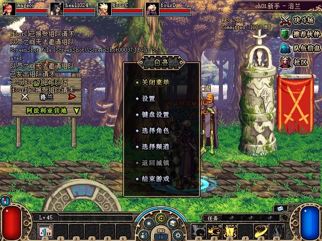
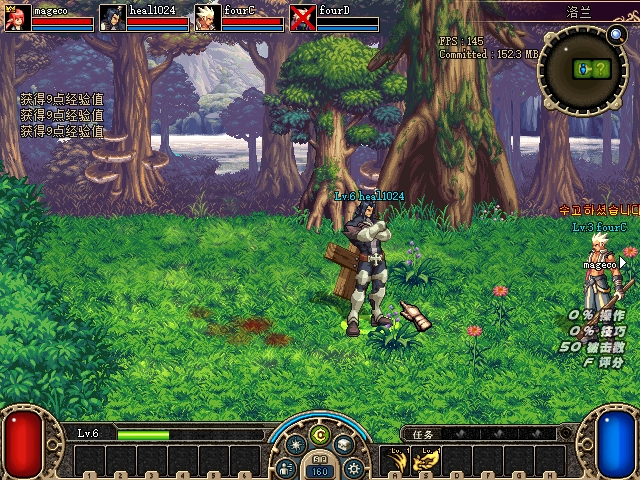

# 三个剩余阻断的修复与接续

2026-10-30，北京时间。按夜间报告的顺序处理：**回城后第四人邀请已闭环；卡顿仍未归因；位置同步修正了两个确证分支，但自然怪物大差仍然存在。** 改动和构建产物留在`D:\codex_worktree\party-chat-gold\DFLegacy`，没有覆盖日常发布包。正常存档及测试客户端文件已恢复。

| 项目 | 本轮结果 | 接续状态 |
|---|---|---|
| U05 第四人再次邀请 | 原生单人队保留规则已确认；显式解散后，同一批进程恢复四人队。CLI增加精确拒绝原因。 | 此阻断闭环；不是自动退队功能。 |
| U08 剩余卡顿 | 增加外层调用计时，80.172秒窗口没有超过50ms的已知前台间隔；准备阶段仍抓到2.544秒间隔，调用本身仅0.531ms。 | 保留阻断；当前WPR采样被系统策略拒绝。 |
| U07 历史位置差与GP42 | 测试瞬移改用原版完整发布；修复原生普通插值误用旧时限的算术分支。新鲜四端仍出现277px及首领421px级差异。 | 保留阻断；已收窄到原生运动测试拒绝等后续分支。 |

## 第四人邀请和官服规则

原官服ELF的`CParty::leave_user`、`CParty::giveup_game`与ACT1请求函数`4FE9B0`的门控相互吻合：依次退出副本时，最后一人保留旧的单人队。A／B／C已经另组新队后，双方`user+FC`均非零，客户端会在发送邀请前拒绝。重启清掉运行时队伍只是绕开这个条件。

官服ELF用于核对队伍业务规则；下文客户端算术修正依据原ACT1指令、实际向量和相同输入回放，不把服务端代码当作客户端碰撞规则。

四端只读用户绑定和实际队伍槽确认：新队为`[1,2,3,FFFF]`，D仍有旧单人队。D在原生“队伍信息”中点击“解散队伍”，随后A邀请、D接受；四端队伍槽和SDK名单均为`[1,2,3,4]`，PID及启动时间不变。新版CLI在同一原生拒绝条件下返回`both_already_in_parties`；未知失败仍保留`native_action_failed`，不会隐式解散队伍。

见[用户绑定、队伍槽及实际请求结果](assets/2026-10-30-remaining-blockers-followup/party-recovery.json)。探索阶段的`party+10`投影不是用户表，已排除，不用于结论。官服ELF SHA256仍为`8859C99D8290DC5FB58151444138CF2697B2BFFF12D47D6159596A03F20B5261`，原始反汇编保留在私有运行目录。

## 剩余卡顿

`ExportFrameProfile=1`现在同时记录外层性能绘制调用，覆盖输入及原监视绘制、文字准备、debug模块、FPS／内存格式化、文字绘制五段。沿用固定桶、事件环和工作线程导出，Host／Frame ABI v2不变；旧回调文件保持原格式。

明确的80.172秒窗口依次包含空闲12秒、单目标28秒、原生跨区28秒及短UI操作12秒。645次轮询，7次读取错误；四端截图目录在窗口内没有变化。以下来自落在时间范围内的80个秒桶：首个不完整秒排除，末个桶可能不完整。

| 客户端 | 外层记录帧数 | 外层最大耗时 | debug回调最大耗时 | 已知前台间隔最大值 |
|---|---:|---:|---:|---:|
| A | 12018 | 5.212ms | 0.275ms | 40.906ms |
| B | 12753 | 1.037ms | 0.263ms | 无合格前台区间 |
| C | 12972 | 1.064ms | 0.293ms | 无合格前台区间 |
| D | 12722 | 0.949ms | 0.217ms | 无合格前台区间 |

窗口前另有55.502ms间隔，同次外层调用0.433ms、debug回调0.041ms。后续准备阶段D又出现2.544472秒间隔，同次外层调用0.531ms；另一次输入及原监视段达到49.655ms。因而外层覆盖范围扩大了，整段原生循环、渲染呈现及调度耗时仍不能由这些数据归因。前台判定仅检查端点，不能证明区间内始终前台。

当前环境执行`wpr -start CPU -filemode`仍返回`0xc5585011`，不能启用系统性能采样策略；没有改系统策略，结束时WPR未在记录。见[受控窗口及同次事件](assets/2026-10-30-remaining-blockers-followup/pipeline-window.json)、[准备阶段原始计时投影](assets/2026-10-30-remaining-blockers-followup/setup-stutters.json)及[实际WPR输出](assets/2026-10-30-remaining-blockers-followup/etw-current-attempt.log)。没有据此删除原生校验或提交猜测性的性能优化。

## 测试瞬移的完整发布

旧测试定位只改本机原生位置，随后走普通压缩发布，实机可留下本人`(560,282)`、三名队友约`(559.9,228.3)`的稳定差。它是本轮测试工具的确证问题，不能直接解释历史自然怪物大差。

仅角色测试操作1在定位前验证本机身份、地图、控制器和原函数签名，定位后调用原版`4C8FE0(controller,true,1)`，采用原角色重定位调用者的完整`0x10`发布，并更新压缩基线。地面物定位不走这条角色发布路径；正常游戏移动不由测试命令改写。

五组目标覆盖UID1两次、UID2／3／4各一次，四端都观察到收敛。另一次UID1到`(560,282)`，B／C／D各保留了一条严格CRC有效的完整位置消息，以及相邻、身份一致的原生运动入口事件。原生回执仍只叫`native_position_publication_requested`，收到该回执不等于网络确认。

下图在定位矩阵和清场之后取得，D已死亡；五组定位的时点状态以逐次JSON为准。

见[五组四端位置及三名接收者的原始消息](assets/2026-10-30-remaining-blockers-followup/teleport-publication.json)。

## 自然位置差和原生插值

新增默认关闭的玩法观察：`78EF2B`记录原生CRC门后的内部应用消息；`78F22C`记录GP4通过对象、房间及关联角色检查后，将进入原版运动函数的事件。固定64条环、每条最多2048字节，游戏线程不写盘。独立消费者严格校验身份、时效、长度、序号和CRC。内部GP5／GP6已可观察，但`provider_buffer_match`只是缓冲区指针比较；GP42外层与内部消息的明确对应仍未观察到，没有扫描不透明数据或替换provider。

第一次普通房间观察已复现同一活怪、同一关联角色的大差：A／C共17组超过100px，持续约3.312秒，最大233.986px。另一MAP8窗口最大157.790px；焦点UID3／关联UID4在A／B／C各63条GP4，全部紧邻对应运动入口，三端payload顺序完全相同。它们证明接收及入口通过，不能证明原运动函数完成或坐标收敛。

进一步只读当前／目标向量找到一个独立算术分支。MAP5的B／怪物UID3在`437341343`：当前X为159.8747、目标244.0099，该轴加速度和速度均为零，却保留18836的正时限。原`4C99EF`用`lea edx,[edi+1C]`检查一个始终非零的数组地址，错误地沿用了这个已失活轴的旧时限。整数加速度算成零，修正速度也成为零；下一条“沿用接收者当前坐标”的压缩消息又把目标覆盖回159.8747，直到完整发布恢复位置。

修复将这三个字节改为`mov edx,[ebx-0C]`，判断当前轴的目标加速度。零加速度使用原有500ms默认分支；有效加速轴仍保留原时限。它影响共享`4C9270`普通修正的XYZ轴，包括使用该函数的玩家和怪物；所有零加速度正时限都改用500ms，小正值也包括在内。

原EXE及实际安装字节的离线回放中，旧现场输入产生速度0／加速度0，积分后仍不追赶；修复后产生速度336.50003、加速度−673，在500ms内与目标相差小于0.1px。混合XYZ、正负有效加速度、非正时限、短正时限、非零终端速度和完整`0x10`的向量复制分支均有回归。完整发布及其余算术保留。安装时检查23字节邻域，重复安装幂等；四端实机内存均核对到实际修复字节。

见[相邻接收及运动入口原始事件](assets/2026-10-30-remaining-blockers-followup/native-movement-admissions.json)、[算术现场原始向量](assets/2026-10-30-remaining-blockers-followup/arithmetic-repro.json)及[原机器码回归测试](../../tools/acceptance/tests/test_motion_horizon_native.py)。原客户端磁盘EXE未改，SHA256为`6B4850BEAF67EC61ADB04AE17F119F16278DD05E97B8FFCA871A9BDB547DE0D5`。

## 尚未关闭的自然大差

后续勘误：独立复核附件曾把原生网格Y换行写成`y/6`，实际是向零截断的`y/12`；第二行先执行32位`y+1`再换行。旧只读工具据`/6`派生的候选格不能用于拒绝归因，原生游戏指令没有使用这项重算。已更正附件并保留原hash及勘误说明；机器码回归和后续同次拒绝／GP42实载证据见[接续报告](2026-10-30-native-loop-and-motion-followup.md)。

下表比较相同怪物UID、存活活动状态、相同关联角色，捕获时间差不超过150ms，按双端sequence去重。各窗口的随机地图、种子和读取缺口不同，**不是算术补丁前后效果的量化A／B**。已修分支的因果回归使用上一节的同一现场输入。

| 窗口 | 秒数 | 合格怪物比较 | 最大差 | 超过100px | 读取错误／trace缺口 |
|---|---:|---:|---:|---:|---:|
| 修复前MAP8内部消息观察 | 30.016 | 3510 | 234.047px | 51 | 3／0 |
| 修复前MAP8运动入口观察 | 30.031 | 3530 | 157.790px | 141 | 1／0 |
| 修复前MAP14首领房 | 20.000 | 4086 | 61.464px | 0 | 0／0 |
| 修复前MAP4全怪物向量 | 35.047 | 6839 | 51.302px | 0 | 4／0 |
| 修复前MAP5算术现场 | 35.093 | 5156 | 84.135px | 0 | 1／0 |
| 修复后MAP9 | 35.016 | 4947 | 276.798px | 91 | 50／2 |
| 修复后MAP12动态全怪物 | 30.000 | 3790 | 66.190px | 0 | 85／2 |
| 修复后MAP6416首领房 | 9.266 | 1718 | 420.568px | 120 | 22／9 |

首轮MAP9有六只怪，原私有采样只读UID0–3，未涵盖最大差的UID4；不能拿其他怪物的向量解释它。后续已改为按实际敌人UID动态采集。MAP12有效原生向量比较1249组，最大66.309px。修改后两个普通窗口的玩家本人／观察者比较分别1674／1310组，最大47.691／79.457px；观察到的1560条玩家GP4均匹配入口事件。它们覆盖了玩家路径，不能证明每条都命中了本次时限分支。

首领房D／怪物UID0出现另一种明确机制：X停在127、目标393.572，速度和加速度非零；两个后续样本`pause=0`、原生更新时间前进，X轴结果均为4。这证明原版`v+94`运动测试拒绝并钳回，已经不是零修正固定点；尚不能区分地图网格、状态限制或其他子门。后续仍有完整`0x10`发布进入并恢复位置，不能说原生完整发布始终断链。GP7已核对为怪物计时同步，不是请求完整位置的协议；GP5动作和GP6归属切换路径才包含原版完整发布调用。

GP6中的调用本身也不能作为发送证明：静态代码在更新归属前调用发布，而发布预检仍可读旧归属并拒绝。它只是接续时需核对的候选，尚未据此重排原生调用；已有GP5完整发布的实载恢复证据仍成立。

首领观察因D血量低于70在9.266秒保护停止，终态全员仍存活；不记作完成20秒验收。没有为了通过而强制队长控制、忽略运动测试、改服务端出生坐标为实时权威位置，或持续重写坐标。见[完整数值与筛选条件](assets/2026-10-30-remaining-blockers-followup/natural-windows.json)及[首领原生拒绝现场](assets/2026-10-30-remaining-blockers-followup/remaining-native-motion.json)。

图片只用于核对场景和UI，均在测量窗口之外取得；位置数值来自debug数据。原始缺口、过期和读取错误保留，不填零、不计成功。

## 回归和环境恢复

完整Python：**586 passed、1 skipped、445 subtests passed、0 failed**。已给新原生trace、frame profile、实际IJL机器码及运动补丁提供显式夹具；剩余条件跳过为原有测试控制导出往返夹具。完整IJL兼容套件（含新时限测试）、debug组队／测试控制／状态／导航／地图反馈／trace／frame profile及实际DLL覆盖层测试均无失败。旧路线的真实PVF条件用例和交互式光标用例没有在本轮重做；未重复U01、U03、U04、U09、U11的人工矩阵。

新导出保留旧`DebugObserveGameplay@16`，新增独立`V2@20`；实际DLL同时验证两种stdcall栈宽。两个观察入口只有完整安装才启用，失败尝试回退两处call；原生环导出时钟竞态、末条invalid／drop和独立进程身份均有回归。实际x86探针用Unicorn验证原参数、返回、寄存器、flags及payload保持。各问题先观察失败，再验证修复。

本轮构建：IJL `CFE0EE46A66DFB1579349692051B7AE136ACBF429256C29F4C4DBA93D5E27C4E`；debug `E6D1AAA6015F074E6C9BE06D0AE05CB87A617C07EAB24F158E1B8EA06F73CEAE`。见[Python结果](assets/2026-10-30-remaining-blockers-followup/final-python.log)、[IJL结果](assets/2026-10-30-remaining-blockers-followup/final-native-ijl.log)及[debug结果](assets/2026-10-30-remaining-blockers-followup/final-native-debug.log)。

全部本轮进程已按PID／路径／启动时间关闭；7001连接均观察到退出清理，停止服务前活跃会话为0。A／B／C／D的INI、debug.dll、ijl15.dll共12个文件逐字节恢复，输入计划已封存防止重播。正常launcher配置与bundle均恢复原始哈希，8项保护输入逐项核对一致；正常存档SHA256仍为`E0E2FB4BB53B9775463E9F54905CE9CB3426D72A9EB0BDADF845642ABB98A283`。见[保护与恢复清单](assets/2026-10-30-remaining-blockers-followup/protection.json)、[原始证据索引](assets/2026-10-30-remaining-blockers-followup/sources.json)及[附件哈希清单](assets/2026-10-30-remaining-blockers-followup/manifest.json)。私有完整快照、原始输入和关闭后的netdump保留在`G:\Game\DNF_ACT1\DFLegacy\.tmp\blockers-20261030`。

## 接续顺序

1. **U08**：优先定位覆盖层调用之外的秒级间隔。保留当前策略拒绝的ETW输出，在具备系统采样能力的环境采调度／原生循环／呈现；若继续用客户端计时，新增分段必须保持原调用ABI，不能把端点前台当连续前台。
2. **U07**：从首领D／UID0的`4B3C30`运动测试子门继续，只读记录实际网格和状态检查输入、GP5／GP6应用与关联变化。先补清洁、连续且全UID覆盖的证据，再决定ACT1适配；不恢复已排除的GP7位置请求猜测。
3. **GP42**：现有内部CRC后观察可用，明确外层provider调用与内部结果的对应仍需独立分支证据。不得把指针相等升级成分支证明。

U05无需再次重启验证或重跑完整组队矩阵；直接沿用“显式解散旧单人队再邀请”的原生流程。
