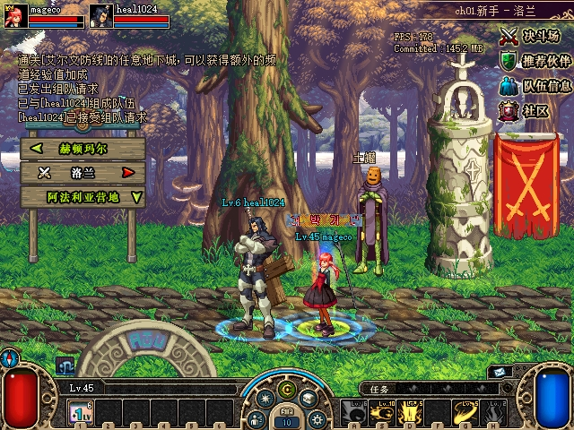
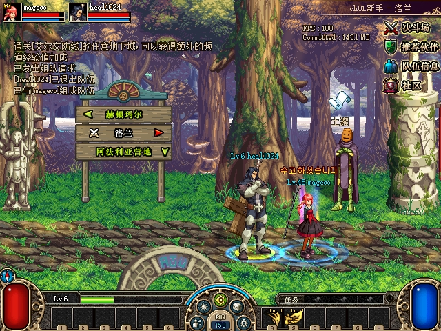
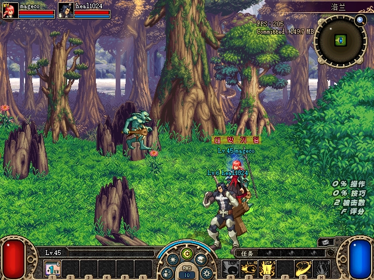
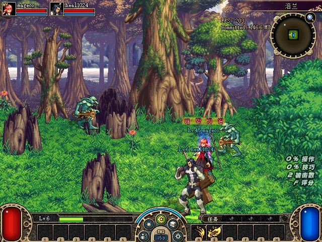

# U07 城镇与怪物位置同步新鲜复测

2026-10-30，使用当前debug数据补做自然移动观察，**本轮未复现历史持续大差，也未修改同步业务或宣布修复**。历史首领房异常仍缺具体原生接收／运动分支及GP42内部链证据，按用户夜间指示保留阻断项，继续后续队列。原版50像素逐轴停步容差保持。

四个隔离客户端按田字形启动，A／B组成两人队，C／D留城镇。原PVF、克隆存档，托管E0581828…／debug8B344D54…。测量期间不截图、不瞬移、不击杀或攻击；只用单目标原生寻路和原生方向键。截图在窗口结束后分别取得，不用于像素坐标测量。

## 城镇27秒

Town1／area0，4次输入为A／B各一次单目标寻路、各一次500ms方向键，共718次轮询。对关闭后的完整socket流保持rolling cipher，严格过滤CMD37／NOTI22：

| 发送者 | 实际位置上报／对端收到 | 最大滚动1000ms条数 | 末次游戏字段完整匹配 | 最后3秒本人／队友视角最大XY差 |
|---|---:|---:|---:|---:|
| A | 3／3 | 1 | 唯一1条 | 0.4375px |
| B | 4／4 | 1 | 唯一1条 | 0.3199px |

两端全部目标帧和其他CMD解码／CRC错误均0、TCP流尾残留0。原版常规上报经`89F496`约每秒触发、`479A40`抑制相同整数坐标；本轮没有达到本地10/s预算，不能把硬丢尾候选当作这次根因。原官服缓存和原值广播合同仍成立，未删除限流或强制坐标对齐。

## 普通房间30秒

实际洛兰MAP4、房间(1,0)，不是历史首领房或相同种子。A／B分时完成8次600ms方向键移动，共779次轮询，无读取错误，最终HP1516／466。246组不同sequence配对中，98组因捕获时间偏差超过75ms排除；余148组、每组4只存活活动怪物，共592行比较，合格配对最大时间差32ms，不称为原子双端快照。

| 怪物UID（monster ID均1） | 合格行数 | 最大XY差 | 大于100px的行数 |
|---|---:|---:|---:|
| 0 | 148 | 30.2697 | 0 |
| 1 | 148 | 3.1487 | 0 |
| 2 | 148 | 12.3910 | 0 |
| 3 | 148 | 28.3653 | 0 |

没有把进程内指针跨进程比较，也没有从未验证的原始关联指针推断控制权。观测结束后才截图，再通过原生菜单返回城镇；没有使用测试击杀来结束本轮。

## 边界与收尾

本轮只能关闭这两个新鲜窗口的“大差复现”尝试；[历史S02](2026-10-28-monster-sync-diagnosis.md)仍未闭环。当前SDK没有每条GP4实际门控／运动应用事件，GP42仍经TerSafe provider封装；socket收到不等于已应用。服务端怪物X/Y是出生记录，缺少据此改成实时权威坐标的合同。继续保留这些未知，不推出强制队长控制、重写坐标或插值时间的修复。

独立只读复核从原始SDK和原始关闭抓包重新分帧、解密及CRC校验，复算14条过滤位置消息、末次唯一匹配及全部592行，结果一致。过滤器复用既有源码，复制到新目录构建，6项分合包／截断／错误头／pending自测通过。没有业务源码变更，未重跑无关全量套件。

全部测试进程已关闭，7001退出清理完成，4份INI恢复，16项保护文件及16个旧封存命名空间一致。正常存档SHA仍为 `E0E2FB4BB53B9775463E9F54905CE9CB3426D72A9EB0BDADF845642ABB98A283`。见[数值与构建](assets/2026-10-30-sync-followup/acceptance.json)、[独立复核](assets/2026-10-30-sync-followup/independent-review.json)及[附件清单](assets/2026-10-30-sync-followup/manifest.json)。U07／历史怪物大差保留阻断，接续U08／U10／U09，U11最后。
