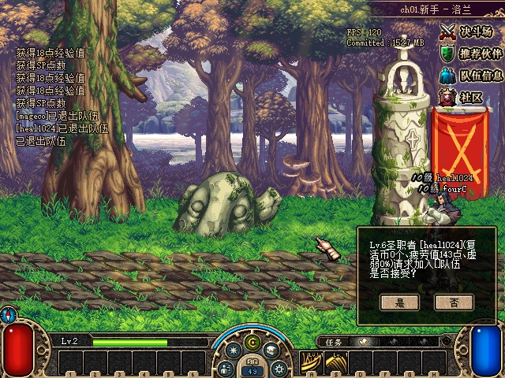
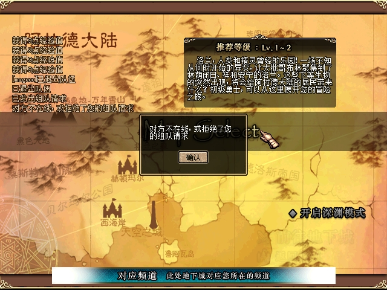
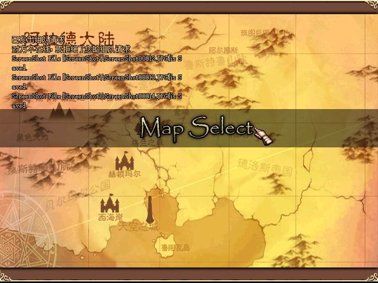

# U05 选择副本与常用弹窗数据验收

2026-10-30，debug v2 消费接口补齐 scene2，只允许读取界面状态，城镇、玩家、房间、敌人及技能载荷保持空；没有放开寻路、组队或副本测试操作的场景限制。新增副本选择索引对应的实际副本 ID／难度、原生过渡标记、阶段、附着 stage 和选择输入抑制值。原有 `active_raw` 是初始化标记，`visible` 仍未知。

常用原生弹窗按活动登记表读取，范围为 class23／25／30／59／6A（十六进制），校验专用虚表、管理器、根节点及双向归属，排除缓存池和待关闭队列。`shown_raw`／`input_enabled_raw` 仅代表原生根节点标志；不等同于屏幕可见或全局输入阻断，`input_blocked` 保持 null。异常／超限时列表明确无效，不能据空数组推断没有弹窗。旧 v2 缺失新增字段时仍兼容，查询保持未知。

## 四端实机及原图

隔离克隆上组关闭存档，未手工编辑存档。A／B／C／D 按田字形启动，原 PVF，四人正常进普通洛兰，使用既有怪物死亡测试接口准备安全房。debug DLL 为 `CC767308702EF2A881A2BE1432FEF1B2ACC141A29318DB2058369A230F2FFC64`；服务端 DLL `E058182878E8176981C3D9649515F744035385E812525DBE14B4D2C8059193C0` 未变。

- 四端分别捕获 25 个不同 sequence 的 scene2 数据，其中各有 12 个带过渡标记；此时可有附着 stage，但不伪造 room／me。共175次轮询、86次含过渡，不把重复轮询当独立帧。
- C 实际收到 B 的组队请求，class37、shown／enabled=true 与原生应答窗相符；通过已有接口拒绝后，活动列表移除该窗。
- B 随后收到拒绝通知 class35，恰在选择副本界面显示；关闭后从列表移除。没有据此声称任意 UI 或另外三类窗均已实机验收。
- B 再次打开选择界面，selected=0 对应实际副本 ID1、difficulty0，world 载荷为空；原生返回按钮回到 scene1，新增选择投影随即恢复未知。D 保持 scene3。
- 选择界面各端最大读取耗时 A／B／C／D 为7／10／9／12微秒；后续3秒 B／C／D 采样最大20／21／88微秒。这里只证明本轮采样，没有排除 U08 的其他卡顿。

以下3张为明确请求的原生截图，未裁剪或重绘。数值和构建身份见[验收数据](assets/2026-10-30-ui-state/acceptance.json)，文件哈希见[清单](assets/2026-10-30-ui-state/manifest.json)。

## 测试、误操作与关闭

原生新增缺口 RED9→GREEN；独立审查另发现索引和投影可能来自不同选择，第三次索引读取变更用例 RED1→GREEN。现重复校验原生选择状态及原有索引，一致才有效。五类窗的正向夹具、隐藏／禁用、待关闭、缓存池、重复登记、错类／根归属、超限及坏向量通过。原生状态、导航、组队、测试控制和跨区套件均0失败。

Python 消费54项通过；扩展 tools 检查357 passed／208 subtests、3项既有监听失败；完整 `tests protocol/tests tools` 为545 passed／376 subtests，仍有原先6项失败：3项ledger行数期望，3项WinError10013。第一次扩展测试缺少PYTHONPATH导致收集错误，纠正后重跑；不把收集错误当新增功能的有效RED。托管业务未改，本组未重跑托管套件。

实机准备中，A“返回城镇”和“结束游戏”都直接执行，没有确认窗，不能计为确认窗覆盖。返回时一次脚本断言早于淡出完成；Esc实际切换菜单，前几次取消尝试未通过，另一次选择界面已超时。均保留私有原记录，最终仅以原生返回按钮及新鲜scene1数据计算取消通过。A为测试自有进程正常退出，不报告为崩溃修复。

测试进程全部关闭，7001会话退出清理完成，4份INI逐字恢复，16项受保护文件一致，11个旧封存命名空间及文件集／哈希保持。正常存档仍为 `E0E2FB4BB53B9775463E9F54905CE9CB3426D72A9EB0BDADF845642ABB98A283`，未部署正常服务端目录。继续死亡后的测试地面／库存观测及后续列表，U11仍最后。
