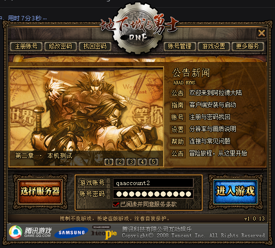
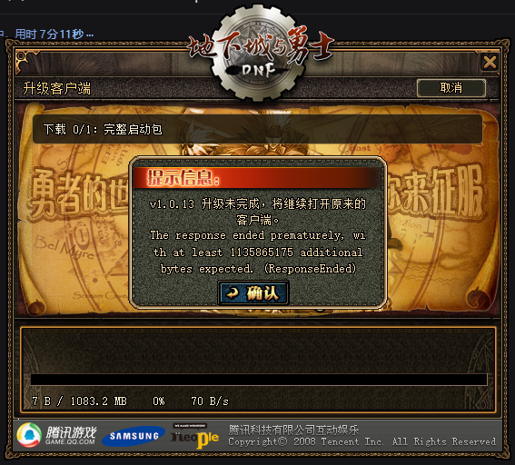

# 第二章 v1.0.13 过渡更新（v1.0.13-bridge）验收与发布

2026-11-17。本轮把第二章 Windows x64 普通版 v1.0.12 的固定入口接上「过渡更新 → 自动下载 v1.0.13 完整包」。**已发布公开过渡包并完成匿名回读；未部署线上服务、未切换玩家更新源、未做真实玩家流量验证。** 发行说明见 [v1.0.13-bridge](../../docs/releases/v1.0.13-bridge.md)。

## 结论

- 原版 v1.0.12 客户端能发现并应用过渡清单；过渡登录器随后按原更新源下载 v1.0.13 完整包，校验 SHA-256、解压到旧目录下的独立客户端、复制账号/登录器/游戏设置，新版登录器通过启动校验后才写激活记录。
- 下载中断、校验失败或新版启动失败时不写激活记录，原快捷方式继续打开 v1.0.12；GitCode 路径专门用截断响应验证了该回滚。
- GitHub、GitCode 两个镜像各用一份原版 v1.0.12 客户端在本地回环完成完整升级，两个镜像的完整包哈希与过渡登录器内置的固定摘要一致。
- 过渡清单与 4 个附件已作为 `v1.0.13-bridge` 预发布在两个镜像公开，并逐个匿名回读校验。

## 发布身份

| 项目 | 值 |
| --- | --- |
| 源码提交（两镜像 `main`） | `b0e7c292d0dcc34324ad9ef8f4d6c8a0b605ca07`，父提交 `2751e133c4c189bdf620f8cac352ee1e33654169` |
| Tag / Release | `v1.0.13-bridge`，GitHub prerelease、GitCode `release_status=pre`，目标提交为上述源码提交 |
| 过渡清单 | `DFLegacy-client-update-v4-chapter-two-startup-v2-normal-win-x64.json`，`sha256:c476cad17585970743475e3d3868df9dd70f42a7b543aa639cc0b3c91ccf6cce`，375,609 字节 |
| 清单身份 | `version=v1.0.13-bridge`，`sequence=19`，`minimumSequence=17`，`chapter-two` / `x64` / `normal`，787 个文件、3 条历史弃用、无迁移、`previous=null`（与 v1.0.12 清单结构一致） |
| 保留的固定入口 | `DFLegacy.Launcher.exe` = `ebe2fbc158df3a70db7ffdc67de49f204fadfcfa6a1100b9d19f14ee149d7804`，411,648 字节（v1.0.12 原版，不改写） |
| 过渡登录器 | `DFLegacy.Launcher.App.exe` = `c2a12ed98356aa6d068bc14423c6d99d204a4ecbec47fe21815f6659366d28df`，89,100,315 字节；附件分卷 `af3c77ee…`（50,331,648）+ `a56c1b1a…`（38,768,667） |
| Bootstrap 描述符 | `d37f6a5adb88c8729477624044f17866d3901280b024b3d9781db5b553c638ab`，204 字节 |
| 目标完整包（GitHub） | `DFLegacy-ChapterTwo-v1.0.13-win-x64.zip`，`7ad9d33a3c6ae224555b87b46a7a977decbf44e29bbc26b50b091cb97b751996`，1,135,865,180 字节 |
| 目标完整包（GitCode） | 同名，`54c047d72a686704f982c332ef8c9b851948efed40f43440d6829d0b86e0f024`，1,135,865,182 字节 |
| 目标清单 / 入口 | `a1574a2daf4ca896a5c48250008bdc8e4479828edd3bc915d5c1b86cfa334ccd` / `cf16fedc2b310214398caad1be8a5d60f3dce2a7be5f749b70a06e177bc345dc` |

实现位置：`src/DFLegacy.Launcher/Updates/FullStarterMigration*.cs`、`App.xaml.cs`、`ChapterTwoGameSettings.cs`，入口迁移常量只接受上述两套完整包摘要，GitHub 与 GitCode 各自固定自己的 ZIP。

## 过渡行为与回滚边界

1. v1.0.12 客户端按常规 V4 检查找到 `startup-v2` 名称的过渡清单；该清单只替换 `DFLegacy.Launcher.App.exe` 与 `DFLegacy.Bootstrap.ini`，固定入口字节不变，因此不触发固定入口热更限制。
2. 过渡登录器启动时把完整包写入旧目录 `.dflegacy/c2-upgrade/<随机>/{starter.zip,client}`，边写边算 SHA-256；长度或摘要不符、ZIP 成员非法/重复/超限都中止并删除暂存。
3. 校验通过后复制 `launcher.chapter2.json`、`Config.ini` 和 `.dflegacy/chapter-two/settings/DNF_CHINA.cfg`，启动候选登录器并等待其启动就绪回调，成功后才把候选 ID 写入 `.dflegacy/c2-upgrade/active.json`。
4. 任一失败路径都不写激活记录；已存在但无效的激活记录会被删除并回到旧登录器。之后的启动若已有有效激活记录，直接打开已激活的新版，不重复下载。

## 本地双镜像验收

两个隔离安装各用发布中的 v1.0.12 清单（787 个文件）还原原版安装，保留原版固定入口，更新源分别为本机回环的 `/github`、`/gitcode`；完整包使用两镜像发布的真实 ZIP 字节。

| 路径 | 过程 | 结果 |
| --- | --- | --- |
| GitHub | 08:54:48 原版入口自检通过；08:59 下载并校验过渡清单与分卷；09:12:03 应用过渡组件，09:12:41 确认 v1.0.13 登录器就绪并激活 | 通过 |
| GitCode | 08:54:48 原版入口自检通过；09:11:53 注入截断的完整包响应，`HttpIOException` 中止且未激活，旧登录器仍以 v1.0.12 打开；09:39:33 以正常响应重试，09:40:21 确认 v1.0.13 并激活 | 先失败回滚、重试通过 |

设置与入口核对（两镜像均通过，`fixture.py verify` + `release-acceptance.json`）：

- 旧入口哈希仍为 `ebe2fb…`，旧目录 `launcher.chapter2.json` 未被改写。
- 新目录保留两个测试账号、`AccountIndex=1`、800×600/sharp 显示设置、未知字段 `FutureSetting`、`ClientPath=DNF.exe`、`DisableGitHubUpdates=false`、`Theme=dark`；`Config.ini` 与 `DNF_CHINA.cfg` 字节一致。
- 新目录安装记录为 `v1.0.13`、来源指向回环的 `/installed`，`validated.json` 存在；新版入口哈希为 `cf16fedc…`。
- 过渡清单在两个安装中的 `manifestSha256` 都是 `c476cad1…`，即两个镜像装的是同一份过渡清单。

激活后再次启动原快捷方式（09:48:33）直接打开已激活的 v1.0.13 客户端，没有新建升级暂存目录，说明切换后的固定入口仍可用。

GitCode 截断响应的回滚现场与回滚后打开的原版 v1.0.12：

## 自动测试

- `--full-starter-migration-tests`：11 条断言 0 失败（错误摘要不留暂存、ZIP 成员不可越界、设置与未知字段保留、失败/未就绪不激活、激活记录不可指向目录外）。
- `--chapter-two-settings-tests`：16 条断言 0 失败（含 `DNF_CHINA.cfg` 的保存与复制）。
- 测试源码与发布源码的 `src/` 树逐字节一致（`git diff 1565581 b0e7c29 -- src/` 为空），过渡登录器构建于发布提交 `b0e7c29`。
- **未重跑**与本改动无关的全量 .NET/Python 套件；早前一次全量启动在 `BootstrapUpdateTests` 遇到本机设备/管道错误，未作为本轮证据。

## 发布与匿名回读

1. 两镜像 `main` 均由 `2751e13` 快进到 `b0e7c29`。
2. `v1.0.13-bridge` 以预发布创建，附件为过渡清单 + 3 个分卷；GitHub 用 `gh` 草稿上传后公开，GitCode 用发布令牌创建后上传。
3. 发布脚本对每个附件在两个镜像做匿名下载并核对长度与 SHA-256，全部通过；GitHub 路径还核对了清单引用的历史发行附件仍在、摘要未变。

## 发布后线上发现检查

用生产代码 `ChapterTwoReleaseProvider`（GitCode 优先、GitHub 兜底）以原版 v1.0.12 固定入口摘要 `ebe2fb…` 为过滤条件请求真实镜像：

- GitCode：找到 `v1.0.13-bridge`，清单 `c476cad1…`、`sequence=19`/`minimum=17`、提交 `b0e7c29`，清单仍包含原固定入口；用真实提供方下载 204 字节 Bootstrap 描述符并核对摘要通过；`DiscoveryProvider=gitcode`。
- GitHub：同样的过滤条件在镜像的发行列表中找到同一份过渡清单，`tag`、清单摘要与固定入口一致；此前一次查询遇到 GitHub 匿名 API 配额（60/60，403），等待配额恢复后复测通过。
- 结论：v1.0.12 客户端按生产发现逻辑在 GitCode 优先路径和 GitHub 兜底路径都能看到这份过渡清单，而不是只在发布脚本的元数据里存在。

## 未验证项与仍存限制

- 没有部署线上、没有修改任何玩家更新源；过渡包对玩家生效的时点由正式渠道决定。
- 完整包下载只在本地回环完成，未在真实宽带/代理/限速/断网条件下重复 1.1 GB 下载；中断路径由本地截断响应覆盖。
- GitHub 首次匿名发现查询遇到 60/60 的匿名 API 配额（403），约 25 分钟后配额恢复并复测通过；共享出口 IP 的真实客户端也可能遇到同类配额限制，这是 GitHub 匿名 API 的行为，不是发行包问题。
- 过渡包已按用户要求作为预发布公开，GitCode 优先发现路径会立即让检查更新的 v1.0.12 客户端看到它；没有单独的线上开关，若要暂缓只能撤回或改回草稿。
- 第二章暗精灵墓地深渊侧门的已知问题仍按 [v1.0.13 发行说明](../../docs/releases/v1.0.13.md) 保留。

## 证据

本地证据目录 `.tmp/full-starter-upgrade/`（不随 Git 提供）：`release-acceptance.json`（`77eb411b…`）、`test-migration-r3.log`（`f4e8add6…`）、`test-settings-r3.log`（`5ba03727…`）、`live-discovery.log`，以及上列截图。入库副本在 [assets/2026-11-17-chapter-two-v1.0.13-bridge](assets/2026-11-17-chapter-two-v1.0.13-bridge/release-acceptance.json)。
