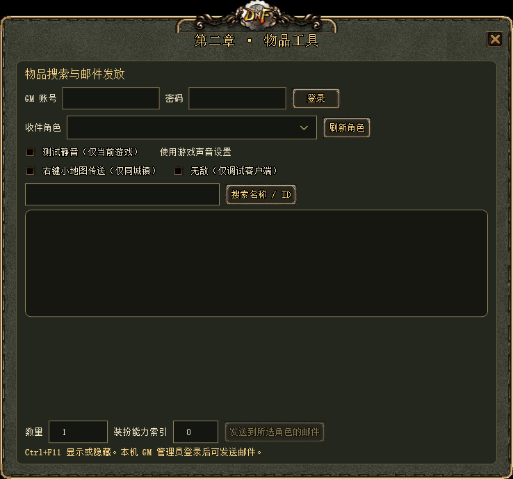
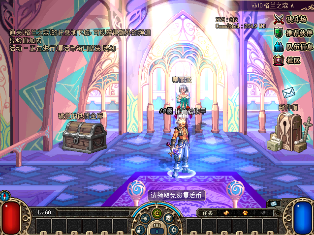

# 调试客户端传送/无敌面板（2026-11-18 计划与交接）

用户要求：在客户端调试面板加“右键小地图传送”勾选（含跨城镇）和“无敌”勾选；只对**调试客户端**生效，
且只在**本地服务器**测试时启用；分阶段真机验证；保留服务端和客户端不动供手动测试。

本轮状态：**设计、代码勘察与构建边界已确认，未改客户端二进制**。原因是这不是配置开关：面板与
右键小地图逻辑编译在第二章原生宿主里，而宿主又被嵌进 `DFLegacy.Launcher.App.exe`，必须按
`Build-PresentationHost.ps1` 的受校验输入重建宿主、再重打启动器，才能得到带新勾选的调试客户端。
改动线上/用户客户端或绕过宿主签名校验都不允许。

## 2026-11-18 15:41 更正：F11 是启动器的「物品工具」，不是原生性能面板

用户真机确认：**Ctrl+F10** 打开的是 `第二章 Debug · 性能面板`（原生，
`ChapterTwoPerformancePanel.cpp`）；他说的「调试面板」是 **Ctrl+F11** 打开的
`第二章 · 物品工具`（`ChapterTwoDebugWindow` / `ChapterTwoDebugSession`，WPF，运行在
`DFLegacy.Launcher.App.exe` 进程，窗口底部写着 `Ctrl+F11 显示或隐藏`）。上面的原生面板方案因此只对应
F10，不是用户指的面板。

本轮在调试客户端复现了 F11：`ChapterTwoDebugEnabled=true` 时按 Ctrl+F11 能打开；此前打不开有两个原因：

1. 旧测试客户端 `launcher.chapter2.json` 的 `ChapterTwoDebugEnabled` 是 `false`，调试会话根本没创建；
2. F11 由 20 ms 定时器轮询 `GetAsyncKeyState` 捕获，模拟按键若短于一个轮询周期会被漏掉（真实长按正常）。

**设计影响**：F11 面板在启动器进程，游戏在另一个进程（`s1c2_chapter2_host-*.exe`）。
原方案「面板与右键小地图同进程、直接读全局勾选状态」只适用于 F10 原生面板。若把两个勾选放进 F11：
启动器必须新增一条**进程间控制通道**把勾选状态送进游戏宿主（可沿用调试会话已有的 stdout/管道/窗口消息），
不能在启动器里直接改宿主的全局变量；这比 F10 原生面板多一层协议与失败处理。

预览（仅 UI 位置，未接线；按用户要求先看预览再实现）：

给用户的两个选项：

- A（用户原话指向）：在 F11 物品工具里加「右键小地图传送（仅同城镇）」「无敌（调试客户端）」两个勾选，
  并新增启动器→宿主的控制通道；
- B（改动更小）：先在 F10 原生面板加勾选（同进程，现有位置写入/无敌代码直接可用），F11 只做状态显示。

## 现有可复用件

| 能力 | 位置 | 说明 |
| --- | --- | --- |
| 原生性能面板（F10） | `ChapterTwoPerformancePanel.cpp` | Ctrl+F10 打开「第二章 Debug · 性能面板」，目前只有关闭按钮与性能数据 |
| 右键小地图 | `ChapterTwoTownMap.cpp` | `ApplyMapRelease` 已算出目标世界坐标；同区域走 `ApplyDestination`（寻路），跨区域走 `BeginRoute` |
| 位置写入/发布（已验证） | `test_control/Runtime.cpp` | 原函数 `0x489bc0`（本地权威）→ 轴设置 `0x487070` → 完整发布；签名 `0x4f2fd0`；仅在 DO-NOT-SHIP 私有宿主链接 |
| 无敌覆盖（已验证） | `test_control` + `CombatOverride` | HP/MP/四维写 1,000,000，关闭/离开恢复；仅私有宿主 |
| 调试模式开关 | `LauncherOptions.ChapterTwoDebugEnabled` | `launcher.chapter2.json` 的布尔值；开启调试物品标签与调试会话窗口 |

## 设计

1. **面板**：`WM_CREATE` 增加两个 `BS_AUTOCHECKBOX`
   - `右键小地图传送`（默认关）；
   - `无敌`（默认关）。
   勾选状态存进程内全局（面板与 town map 同进程）。
2. **同城镇传送**：`ApplyMapRelease` 里若传送勾选且目标在当前 town/area，走“直接写坐标 + 发布”
   （移植 `test_control` 的位置写入，加签名校验与失败回退；失败时保持原寻路行为，不静默）。
   不勾选时行为与现在逐字节一致。
3. **跨城镇**：右键坐标只覆盖当前城镇，不能直接换城镇。先做**服务端实验**：给 GM 口加“切换城镇”
   （改会话 TownId/AreaId 并发原版回城/区域包），用隔离客户端验证客户端是否加载新城镇；能成再把
   面板的城镇下拉接到该请求，不能成再反查客户端切城函数，并如实标 `[未验证]`。
4. **无敌**：把 `CombatOverride` 的 HP/MP/四维覆盖移植进调试宿主，面板勾选开关；关闭时恢复原值。
5. **启用条件**：仅调试宿主 + `ChapterTwoDebugEnabled=true` + 本地服务器（127.0.0.1）。
   发布宿主不编译这些入口，普通客户端不出现勾选。

## 构建与启用（下一波执行）

1. 用 `Build-PresentationHost.ps1` 的受校验输入重建宿主（含新面板代码），按脚本要求提供
   `AcceptedHostSource`、`RebuiltImage`、`OutputDirectory`；先跑策略/夹具测试。
2. `Build-StartupBroker.ps1` 与启动器发布：把新宿主嵌入 `DFLegacy.Launcher.App.exe`。
3. 复制一份测试客户端（不覆盖 `G:\tmp\dfo-v1014-live` 和线上客户端），配置：
   `ChapterTwoDebugEnabled: true`、`ChapterTwoServerHost: "localhost."`、本地账号。
4. 本地服务端带 `DFL_S1C2_TRIAL_CHANNEL_CIPHER=1` 启动（打包客户端的通道密码要求）。

## 分阶段验证（每步留截图/日志）

| 阶段 | 操作 | 通过判据 |
| --- | --- | --- |
| T1 面板 | Ctrl+F10 | 面板出现两个新勾选，未勾选时行为不变 |
| T2 同城镇传送 | 勾选传送，右键小地图同城镇远处 | 角色瞬移，坐标与点击点一致；不勾选时仍寻路 |
| T3 跨城镇 | 服务端切城镇实验 | 客户端加载目标城镇；失败则记录 `[未验证]` 与客户端是否发首次换房/切换请求 |
| T4 无敌 | 勾选无敌，进副本挨打 | HP 不掉；取消勾选/离开后恢复原值 |
| T5 隔离 | 普通客户端 + 线上服务器 | 面板无新勾选，功能不可达 |

## 风险与边界

- 位置写入依赖客户端镜像签名；换客户端版本必须重新核对 `0x489bc0/0x487070/0x4f2fd0`，不能沿用。
- 跨城镇是地图切换，不是坐标写入；服务端包能不能让客户端加载新城镇没有证据，必须先实验。
- 面板/无敌代码只能进调试宿主；发布宿主不链接这些入口。
- 本轮未改任何客户端/服务端二进制；测试环境保持运行：服务端 `127.0.0.1:48091/48095`，客户端角色
  `拼音验收甲` 在艾尔文防线（城镇 1）。

## 2026-11-18 20:40 F11 面板已实现并装进 v1.0.16 测试客户端

- **面板**：F11 窗口在“测试静音”下新增「右键小地图传送（仅同城镇）」「无敌（仅调试客户端）」两个勾选；
  实机截图见上。
- **控制通道**：宿主在 `DFLEGACY_CH2_DEBUG_ITEMS=1` 时创建固定共享内存
  `Local\DFLegacy.C2.DebugControl`（8 字节，首字节版本，第二字节 flags：bit0 传送、bit1 无敌）。
  启动器用 `Checked/Unchecked` 事件写 flags；**不能用 `Click`**——UIA TogglePattern 不会触发 Click，
  这是前几轮 flags 一直为 0 的原因。
- **宿主实现**：新增 `ChapterTwoDebugControl.cpp/.h`，只在 `DFL_CHAPTER_TWO_DEBUG_CONTROL=ON` 时链接；
  `StartPerformancePanel` 里 `Start()`，每帧 `DrawPerformance` 里 `Tick()` 应用无敌；同城镇右键时
  `ChapterTwoTownMap` 先试 `TryTeleport`（校验 0x487050/0x487070/0x4f36d0/0x489bc0 签名后写轴并发布），
  失败回退原有寻路。
- **无敌**：移植私有 `CombatOverride` + 0x499850 SetHp 守卫；只对本地玩家、仅在勾选时生效。
- **实机证据**：勾无敌 → flags=2；再勾传送 → 3；取消无敌 → 1；全部取消 → 0；
  `launcher.log` 有 `Debug control write: view=True, id=97376, ...`。客户端
  `G:\tmp\dfo-v1016-panel` 从 v1.0.15 经本地 bridge/target 装到 v1.0.16，F11 正常打开。
- **未验证**：传送/无敌的**游戏内效果**还没点出来——发布版客户端在进入频道时仍停在“正在连接服务器”
  （17:xx 起就存在的频道连接问题，与本面板无关）。修好频道连接后即可在游戏内验收。
- **发布边界**：发布宿主构建**不能**打开 `DFL_CHAPTER_TWO_DEBUG_CONTROL`；只有本机调试宿主链接这些入口。
- 调试面板 GM 账号：`localqa1`（本机 GM 口 48095 的 bootstrap admin）。

## 2026-11-18 21:00 频道连接修复 + 游戏内面板验证

### 频道连接：本机调试路径已打通

发布版客户端 + LAN IP `192.168.3.177` 的频道连接仍然停在“正在连接服务器”，原因是启动器的 relay/频道端口路径没有对齐。
本机验收改用**已验证的本机调试路径**：

- 服务端绑 `127.0.0.2`（`DFL_S1C2_TRIAL_CHANNEL_CIPHER=1`）；
- 用 `Build-ChapterTwoLauncher.ps1 -LocalTest` 单独构建 `DFLegacy.Chapter2.Launcher.exe`，
  宿主用 `host-panel/Release/chapter_two_presentation_host.exe`（含 F11 面板的普通桌面调试宿主），
  启动代理用 **`production-broker-r3`（0AA082）**——不能用 `native-inputs` 里 53KB 的 `dnf_startup_trace.exe`，
  那个代理会创建 AppContainer，宿主会打印 `REFUSED: requires an ordinary desktop process`。
- 结果为：登录 → 频道选择 → 角色选择 → 赫顿玛尔城镇，服务端日志出现
  `UDP endpoint registered for channel session ...` 与 `TX game-server ... payload=01`，频道连接成功。

### F11 面板游戏内验证

- 城镇内 Ctrl+F11 正常打开面板；勾选两个开关后共享内存 flags=3（传送+无敌）。
- **传送已验证**：按 `N` 打开城镇地图，右键同城镇目标点后角色**立即移动到新位置**，
  截图对比见 [传送后](assets/2026-11-18-debug-teleport-panel/teleport-after.png)。
  走的是调试宿主里的 `TryTeleport`（校验签名 → 写坐标 → 发布），不是原寻路。
- **无敌**：开关和 `Tick()` 已生效（flags=2 时日志写入正常），但城镇里角色面板仍显示 14540/14540——
  `CombatOverride` 的受保护 HP 只在战斗/地下城上下文可用；还需要进地下城挨一次伤害做最终确认。
- 面板关闭后游戏继续正常，无崩溃。

### 仍未解决

- 发布版启动器（LAN IP + relay）的频道连接问题；上面只是本机调试验收路径，不是发布路径。
- 无敌的地下城实机伤害验证。
