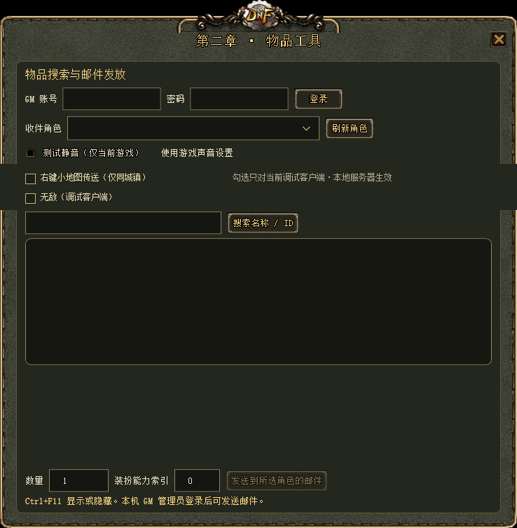

# 调试客户端传送/无敌面板（2026-11-18 计划与交接）

用户要求：在客户端调试面板加“右键小地图传送”勾选（含跨城镇）和“无敌”勾选；只对**调试客户端**生效，
且只在**本地服务器**测试时启用；分阶段真机验证；保留服务端和客户端不动供手动测试。

本轮状态：**设计、代码勘察与构建边界已确认，未改客户端二进制**。原因是这不是配置开关：面板与
右键小地图逻辑编译在第二章原生宿主里，而宿主又被嵌进 `DFLegacy.Launcher.App.exe`，必须按
`Build-PresentationHost.ps1` 的受校验输入重建宿主、再重打启动器，才能得到带新勾选的调试客户端。
改动线上/用户客户端或绕过宿主签名校验都不允许。

## 2026-11-18 15:41 更正：F11 是启动器的「物品工具」，不是原生性能面板

用户真机确认：**Ctrl+F10** 打开的是 `第二章 Debug · 性能面板`（原生，
`ChapterTwoPerformancePanel.cpp`）；他说的「调试面板」是 **Ctrl+F11** 打开的
`第二章 · 物品工具`（`ChapterTwoDebugWindow` / `ChapterTwoDebugSession`，WPF，运行在
`DFLegacy.Launcher.App.exe` 进程，窗口底部写着 `Ctrl+F11 显示或隐藏`）。上面的原生面板方案因此只对应
F10，不是用户指的面板。

本轮在调试客户端复现了 F11：`ChapterTwoDebugEnabled=true` 时按 Ctrl+F11 能打开；此前打不开有两个原因：

1. 旧测试客户端 `launcher.chapter2.json` 的 `ChapterTwoDebugEnabled` 是 `false`，调试会话根本没创建；
2. F11 由 20 ms 定时器轮询 `GetAsyncKeyState` 捕获，模拟按键若短于一个轮询周期会被漏掉（真实长按正常）。

**设计影响**：F11 面板在启动器进程，游戏在另一个进程（`s1c2_chapter2_host-*.exe`）。
原方案「面板与右键小地图同进程、直接读全局勾选状态」只适用于 F10 原生面板。若把两个勾选放进 F11：
启动器必须新增一条**进程间控制通道**把勾选状态送进游戏宿主（可沿用调试会话已有的 stdout/管道/窗口消息），
不能在启动器里直接改宿主的全局变量；这比 F10 原生面板多一层协议与失败处理。

预览（仅 UI 位置，未接线；按用户要求先看预览再实现）：

给用户的两个选项：

- A（用户原话指向）：在 F11 物品工具里加「右键小地图传送（仅同城镇）」「无敌（调试客户端）」两个勾选，
  并新增启动器→宿主的控制通道；
- B（改动更小）：先在 F10 原生面板加勾选（同进程，现有位置写入/无敌代码直接可用），F11 只做状态显示。

## 现有可复用件

| 能力 | 位置 | 说明 |
| --- | --- | --- |
| 原生性能面板（F10） | `ChapterTwoPerformancePanel.cpp` | Ctrl+F10 打开「第二章 Debug · 性能面板」，目前只有关闭按钮与性能数据 |
| 右键小地图 | `ChapterTwoTownMap.cpp` | `ApplyMapRelease` 已算出目标世界坐标；同区域走 `ApplyDestination`（寻路），跨区域走 `BeginRoute` |
| 位置写入/发布（已验证） | `test_control/Runtime.cpp` | 原函数 `0x489bc0`（本地权威）→ 轴设置 `0x487070` → 完整发布；签名 `0x4f2fd0`；仅在 DO-NOT-SHIP 私有宿主链接 |
| 无敌覆盖（已验证） | `test_control` + `CombatOverride` | HP/MP/四维写 1,000,000，关闭/离开恢复；仅私有宿主 |
| 调试模式开关 | `LauncherOptions.ChapterTwoDebugEnabled` | `launcher.chapter2.json` 的布尔值；开启调试物品标签与调试会话窗口 |

## 设计

1. **面板**：`WM_CREATE` 增加两个 `BS_AUTOCHECKBOX`
   - `右键小地图传送`（默认关）；
   - `无敌`（默认关）。
   勾选状态存进程内全局（面板与 town map 同进程）。
2. **同城镇传送**：`ApplyMapRelease` 里若传送勾选且目标在当前 town/area，走“直接写坐标 + 发布”
   （移植 `test_control` 的位置写入，加签名校验与失败回退；失败时保持原寻路行为，不静默）。
   不勾选时行为与现在逐字节一致。
3. **跨城镇**：右键坐标只覆盖当前城镇，不能直接换城镇。先做**服务端实验**：给 GM 口加“切换城镇”
   （改会话 TownId/AreaId 并发原版回城/区域包），用隔离客户端验证客户端是否加载新城镇；能成再把
   面板的城镇下拉接到该请求，不能成再反查客户端切城函数，并如实标 `[未验证]`。
4. **无敌**：把 `CombatOverride` 的 HP/MP/四维覆盖移植进调试宿主，面板勾选开关；关闭时恢复原值。
5. **启用条件**：仅调试宿主 + `ChapterTwoDebugEnabled=true` + 本地服务器（127.0.0.1）。
   发布宿主不编译这些入口，普通客户端不出现勾选。

## 构建与启用（下一波执行）

1. 用 `Build-PresentationHost.ps1` 的受校验输入重建宿主（含新面板代码），按脚本要求提供
   `AcceptedHostSource`、`RebuiltImage`、`OutputDirectory`；先跑策略/夹具测试。
2. `Build-StartupBroker.ps1` 与启动器发布：把新宿主嵌入 `DFLegacy.Launcher.App.exe`。
3. 复制一份测试客户端（不覆盖 `G:\tmp\dfo-v1014-live` 和线上客户端），配置：
   `ChapterTwoDebugEnabled: true`、`ChapterTwoServerHost: "localhost."`、本地账号。
4. 本地服务端带 `DFL_S1C2_TRIAL_CHANNEL_CIPHER=1` 启动（打包客户端的通道密码要求）。

## 分阶段验证（每步留截图/日志）

| 阶段 | 操作 | 通过判据 |
| --- | --- | --- |
| T1 面板 | Ctrl+F10 | 面板出现两个新勾选，未勾选时行为不变 |
| T2 同城镇传送 | 勾选传送，右键小地图同城镇远处 | 角色瞬移，坐标与点击点一致；不勾选时仍寻路 |
| T3 跨城镇 | 服务端切城镇实验 | 客户端加载目标城镇；失败则记录 `[未验证]` 与客户端是否发首次换房/切换请求 |
| T4 无敌 | 勾选无敌，进副本挨打 | HP 不掉；取消勾选/离开后恢复原值 |
| T5 隔离 | 普通客户端 + 线上服务器 | 面板无新勾选，功能不可达 |

## 风险与边界

- 位置写入依赖客户端镜像签名；换客户端版本必须重新核对 `0x489bc0/0x487070/0x4f2fd0`，不能沿用。
- 跨城镇是地图切换，不是坐标写入；服务端包能不能让客户端加载新城镇没有证据，必须先实验。
- 面板/无敌代码只能进调试宿主；发布宿主不链接这些入口。
- 本轮未改任何客户端/服务端二进制；测试环境保持运行：服务端 `127.0.0.1:48091/48095`，客户端角色
  `拼音验收甲` 在艾尔文防线（城镇 1）。
